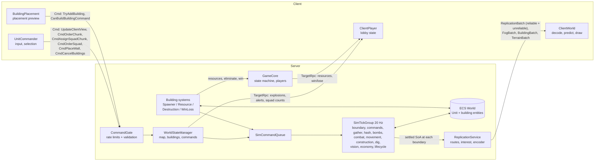
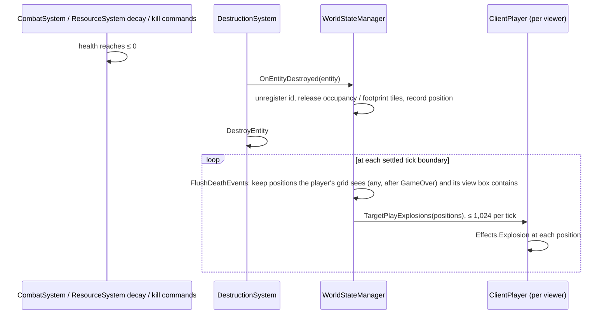
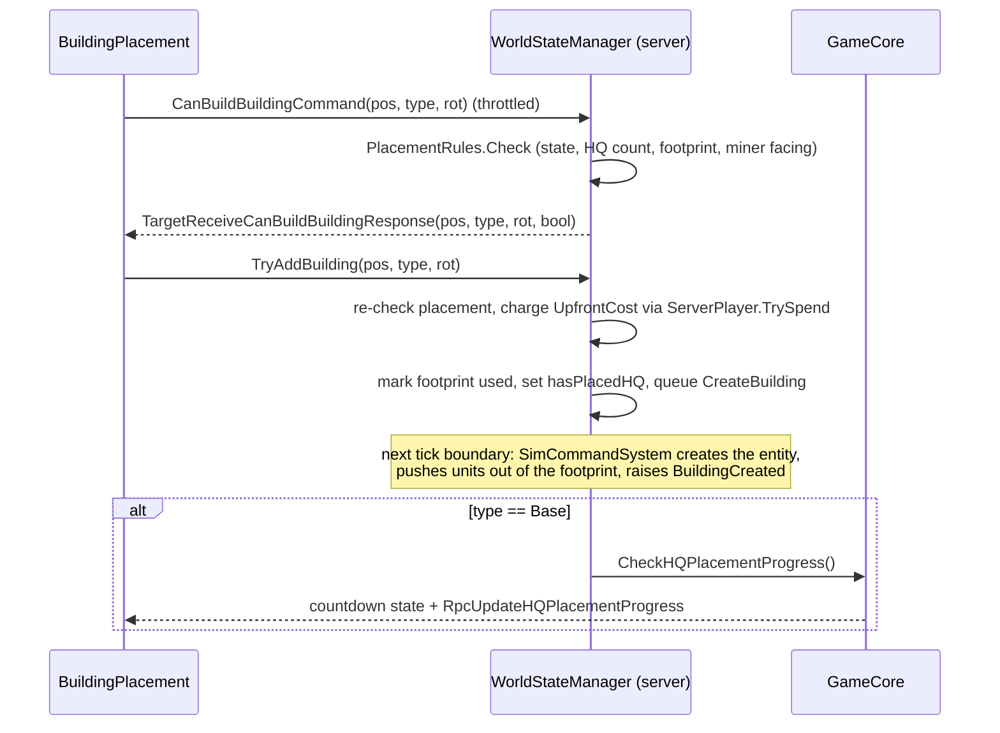

# Architecture

WAR-2D combines two models:

- **Mirror** handles connections, players, scene changes and all client↔server messaging.
- **Unity DOTS (Entities)** holds and simulates the game world. Units and buildings are ECS entities that exist **only on the server**.

Clients never see the ECS world. Units reach them through the **replication encoder**: each client gets its own units and the units its fog of war (its sight plus vision shared with it) sees, as routes plus corrections, and predicts and draws them with GPU instancing. Buildings (a few hundred at most) go through the same service as per-client building records (`BuildingBatch`) and are drawn instanced too (`InstancedBuildingRenderer`); terrain changes (walls, dug rock) reach each client as `TerrainBatch` deltas for tiles it sees; the fog itself reaches each client as its own team's grid (`FogBatch`).

The server simulates units in an **asynchronous 20 Hz tick**: a fixed-rate system group whose Burst jobs run on worker threads between ticks and are settled at the next tick boundary. Main-thread code never touches unit entities; it queues `SimCommand`s that the tick applies at its boundary.



## Assemblies

| Assembly               | Where                                                    | Contents                                                                                                                                                                                                                      |
| ---------------------- | -------------------------------------------------------- | ----------------------------------------------------------------------------------------------------------------------------------------------------------------------------------------------------------------------------- |
| `WAR2D`                | `Assets/Scripts/WAR2D.asmdef`                            | All game code. References Mirror, Entities, Burst, Collections, Mathematics, Transforms, TextMeshPro, UnityEngine.UI, Input System, 2D Tilemap Extras, NaughtyAttributes and TIM Console; DOTween as a precompiled reference. |
| `WAR2D.Tests.EditMode` | `Assets/Tests/EditMode/`                                 | Editor-only rule, parser, validation, simulation (`SimHarness`), flow-field and replication tests.                                                                                                                            |
| `WAR2D.Tests.PlayMode` | `Assets/Tests/PlayMode/`                                 | Hosted-match tests that run in play mode, plus the performance regression guard (Unity Performance Testing).                                                                                                                  |
| Vendored               | `Assets/Mirror/`, `Assets/3rd Party/`, `Assets/Plugins/` | Mirror, TIM Console, NaughtyAttributes, DOTween.                                                                                                                                                                              |

Game code moved into its own assembly in v0.2, which is what lets the test assemblies reference it.

## Scenes and lifetime

| Scene                                      | Contains                                                                                                                                                                                                                                           | Notes                                                                                                                                                                                                                                                                                                                                                                                                                                                   |
| ------------------------------------------ | -------------------------------------------------------------------------------------------------------------------------------------------------------------------------------------------------------------------------------------------------- | ------------------------------------------------------------------------------------------------------------------------------------------------------------------------------------------------------------------------------------------------------------------------------------------------------------------------------------------------------------------------------------------------------------------------------------------------------- |
| `Assets/Main_Menu.unity`                   | `GameManager` (Mirror `NetworkManager` + `MultiplexTransport`: KCP and SimpleWebTransport, both on port 7778), the `Menu` UI (`UIDocument`, `MenuController`, `MenuBattle`), `Custom_Commands`                                                     | Offline scene. `GameManager` is a `DontDestroyOnLoad` singleton. `GameCore` is **not** in the scene: the server spawns it from `Resources/Network/GameCore.prefab` when it starts (see `GameManager`).                                                                                                                                                                                                                                                  |
| `Assets/Maps/Map_2.unity`                  | `WorldStateManager`, `UnitCommander` (adds `ClientWorld` on clients), `BuildingPlacement`, the `HUD` (`UIDocument` + `HudController`), orthographic camera with `Character_Controler` and a `Physics2DRaycaster`, walkable and unwalkable tilemaps | Loaded by `GameCore.Cmd_StartGame` → `ServerChangeScene`, using the scene name from `GameConfig.xml` (`Match.Scene`, currently `Map_2`). With `Match/Map/Size > 0` (the default, 1024) the map is generated and the scene's tilemaps are hidden; with 0 the tilemaps are the map (the PlayMode tests use this).                                                                                                                                         |
| `Assets/Player.prefab`                     | `ClientPlayer`                                                                                                                                                                                                                                     | Mirror player prefab, auto-created for each connection and `DontDestroyOnLoad`.                                                                                                                                                                                                                                                                                                                                                                         |
| `Assets/Resources/Network/GameCore.prefab` | `GameCore`                                                                                                                                                                                                                                         | Spawned by the server in `GameManager.OnStartServer` and registered with clients in `GameManager.Awake` (`spawnPrefabs`); `DontDestroyOnLoad` once spawned, destroyed by Mirror when the server or client stops. A spawned prefab rather than a scene object: in the editor, the scene play mode starts in never gets Mirror's scene post-process, so a scene object that moves itself to `DontDestroyOnLoad` kept an id a build client couldn't match. |

`GameManager.LeaveLobby()` stops the host or client, destroys the `GameCore` and `WorldStateManager` objects, and reloads `Main_Menu`.

## Core classes

### `GameManager` (`Scripts/GameManager.cs`): `NetworkManager`

- Loads `GameConfig.xml` in `Awake` and adds the `GameCore` prefab to `spawnPrefabs`. `OnStartServer` stops the server on an invalid config (and quits, in batch mode), then spawns `GameCore`.
- **No headless auto-start.** `Awake` sets Mirror's `headlessStartMode` to `DoNothing`: there is no dedicated server, and a batch-mode player is a perf client (or a test) that starts its own networking. Mirror's default made every `-perfClient` process host on port 7778 instead of joining.
- **`OnServerConnect`** closes the connection unless the match is in the lobby and has room (`LobbyRules.MayJoin`: _Lobby_ only, at most `LobbyRules.MaxPlayers` = 8 connections). The joining client's Play screen then says the match has started or is full.
- **`OnServerAddPlayer`** creates a `ServerPlayer` with the configured starting resources and adds it to `GameCore.ServerPlayers`.
- **`OnServerDisconnect`** stops replication to the connection, drops any Steam sign-in still in progress for it (`SteamAuthenticator.OnServerDisconnect`) and forwards to `GameCore.OnPlayerLeave`.
- **`OnStartClient`** registers the `ReplicationBatch`, `FogBatch`, `BuildingBatch` and `TerrainBatch` handlers (`ReplicationClient`, `ClientFog`, `ClientBuildings`, `ClientTerrain`).
- The menus are UI Toolkit (`MenuController`, see "Menus" below).
- Public actions: `HostServer`, `Connect(route)` / `ConnectToServer(address)`, `LeaveLobby`, `QuitGame`.
- **Ports.** `DefaultPort` is the transport's scene port (7778). `HostServer` always listens on it. `ConnectToServer` takes `host`, `host:port` or `[ipv6]:port` (`Net.JoinAddress`) and sets the port on the transport (a `MultiplexTransport` sets its first available one, KCP), so a host behind a tunnel or a forward to another external port can be joined.
- **Internet hosting without Steam (Direct play).** Steam relay is the normal way online (see "Networking reference"); this path remains for Direct hosts. The menu's Host button (not `HostServer` itself, so tests, perf and QA never touch the router) calls `Net.HostReachability.Start(DefaultPort)`. Off the main thread it finds the router over SSDP (`Net.Upnp.UpnpGateway`; the text side is `UpnpProtocol`, covered by EditMode tests), reads its external address and maps UDP 7778 to this machine with a 2-hour lease, renewed every hour. `OnStopServer` removes the mapping and `OnApplicationQuit` waits up to 2 s for it. A router whose external address is private or carrier-grade NAT gets no mapping (`Reachability.SharedAddress`): only a tunnel works there. The lobby subtitle shows `HostReachability.Describe` to the host. `-noUpnp` turns it off. Player instructions: [playtesting.md](playtesting.md). The menu skips it when Steam is available (`SteamServices.Available`); then the Steam lobby is opened instead.

### `GameCore` (`Scripts/GameCore.cs`): `NetworkBehaviour`, server game state

- Spawned by the server from `Resources/Network/GameCore.prefab` (not a scene object); `Instance` is cleared when it is destroyed.
- `[SyncVar] CurrentState : GameState` (`Lobby`, `PlacingHQ`, `Countdown`, `Playing`, `GameOver`), `[SyncVar] CountdownEndTime`, and the public lobby and match data `Settings` (`MatchSettings`), `DiplomacyEnabled` and `MatchStartTime`.
- `ServerPlayers : Dictionary<NetworkIdentity, ServerPlayer>` is the authoritative player list. `MatchStartPlayerCount` records how many players were present when the match launched (so a departure before _Playing_ can't stop the survivor from winning).
- `Teams : SyncDictionary<int, int>` maps each owner id to its team, fixed by `Cmd_StartGame` from the lobby choices (`TeamRules.Assign`: players who picked the same team share one, the rest are solo; AIs choose like a player, Scripted seats get their own). `TeamOf` reads it. It is only the starting state of diplomacy (`SimContext.Diplomacy`, see the tick section): from Playing on, who attacks and shares vision with whom is per player and one-way. The host sets choices with `Cmd_SetTeam(playerNetId, team)` (server owner, _Lobby_ only, and only choices a player could make for themselves: `LobbyRules.IsTeamChoiceValid`, so Solo only in Free-for-all).
- `PlayerOrder : SyncList<int>` holds the owner ids in match order: join order (ascending net id), as the lobby lists the players and colours the HQ sites. An owner's index here is its bit in the diplomacy masks and picks the clearing the camera starts on; colours come from each player's lobby `colourIndex`.
- **AI players** (v0.14, `Net/AiPlayers.cs`): `AiPlayers : Dictionary<int, AiSeat>` holds connectionless players: a `ServerPlayer` with no connection plus an `AiSeat` (difficulty, the style picked and the one it resolved to, callsign, colour, lobby team, brain). `AllPlayers()` and `serverPlayers` list humans then AIs; an AI counts in the player order, the player and team counts, teams, diplomacy, income and upkeep (`RollSecond`), win/loss (`WinLossSystem`), start-option dealing, random HQ placement and statistics exactly like a human. Owner ids come from `AiOwnerIds` (`0x7FFF0000` up, below `int.MaxValue`), a range Mirror's `netId` counter (from 1) never reaches (`AiSeatTests`). Each AI gets a **server-owned `ClientPlayer`** (the player prefab spawned with no connection: `isAi`, `aiOwnerId`, `aiDifficulty`, the picked `aiStyle` — Random stays Random — and the callsign as `nickname`), so every HUD path that looks a player up by owner (`ClientPlayer.TryFind`: humans by `netId`, AIs by owner id) shows it as a player; it is one networked object per player, not per entity. TargetRpcs go through a player's connection, so none is sent for an AI. `AddAi` / `RemoveAi` (lobby only; the host-only lobby Commands come with plan Task 3) seat AIs within `LobbyRules.MaxPlayers` humans plus AIs (`GameManager.OnServerConnect` counts both), each with the first free colour and a callsign drawn from `<Ai><Callsigns>` with the lobby seed. At match start (`StartAiSeats`) a Random style is resolved with server randomness and the brain is made through `AiBrains.Factory`. `DevAddScriptedAi(ownerId, resources)` (refused unless `DevApi.Allowed`) adds a dev-only **Scripted** seat with no brain mid-match, for the perf harness, the control API's `bots` and tests; Scripted seats never hold up the countdown or get a random HQ (their driver places them). An AI's HQ going up (any path) sets its object's `hasPlacedHQ`.
- **`WAR2D.Ai` assembly** (`Scripts/Ai/`, v0.14): the AI's brain. It references only `WAR2D` and `Unity.Mathematics` (no Entities, Collections, Burst or Mirror), so the ECS world, the simulation's native arrays and the network are out of reach at compile time; `AiSeatTests.TheAiAssemblyReachesOnlyWhatAPlayerMay` (a source scan) and `AiAssemblyTests` (an IL scan of the compiled assembly: base types, fields, signatures, locals and every type, field and method its method bodies name) fail if it names `SimData`, `SimCommand(Queue)`, `SimContext`, `MapStore`, `EntityManager`, `ServerPlayer` (or `AiSeat.Player`), `WorldStateManager`, `GameCore`, `ClientPlayer`, `ReplicationService`, the view builder or anything in the Entities, Collections, Jobs, Burst or Mirror namespaces. `WAR2D` can't reference it back (a cycle), so the game reaches it through `IAiBrain` (`ThinkSeconds`, `Think(TeamView)`), `AiBrains.Factory` (a brain per seat at match start) and `AiBrains.Director` (the scheduler), which `AiRegistration` sets at load (`RuntimeInitializeOnLoadMethod`, plus `InitializeOnLoadMethod` in the editor).
- **Team view** (`Scripts/AiView/`, v0.14, in `WAR2D`, namespace `WAR2D.AiView`): `TeamView` is the plain data an AI reads (spec §4): its own units (type, position, health, stance, work, order goal, unpaid), other players' units its grid sees now, its buildings plus seen ones and last-seen ghosts, its grid's fog, the map as it knows it (the generated map plus wall and dig changes on cells it saw), its resources/income/upkeep, the alerts, attack events, blasts and death explosions since its last think, its own diplomacy row and who shares with it (owner lists, never a mask), its own and its teammates' start options, and the match state and public player list. `TeamViewBuilder` builds it on the settled world for the one AI whose think is due, into buffers reused between thinks (`ViewList<T>`; units and fog through Burst jobs), with the predicates replication uses for a client of the same owner: `InterestRules` (unit visible now, building may-know, attack-event attacker and target naming, v0.13 building attackers; the encoder and `BuildInterestJob` call the same functions), `BuildingInterest.Update<TSink>` (records applied straight to the AI's store; the network form writes them), `TerrainInterest.Select`, `BombRules.MayKnow`, `VisibilityRules.ShowsDeath` and `Diplomacy.RowFor`. Between thinks it collects each tracked owner's attack events, blasts and deaths every settled tick, and its alerts from `AlertService.Observer` (alerts for an AI owner go only there). An AI has no camera, so attack events use the whole map as its view box. `GameCoreFacts` supplies what a client learns outside replication (resources, start options through `StartPickRules.TeamView`, players). `AiLeakTests` (EditMode) and `AiViewTests` (PlayMode: a human and an AI teammate know the same units and buildings) guard it.
- **AI director** (v0.14): `AiRunner` (`AiView/`, owned by `WorldStateManager` on the server) steps `AiDirector` (`WAR2D.Ai`) once per settled tick in _Playing_ (from `SimContext.Settled`, after replication) and once per tick's worth of time in _PlacingHQ_ (from `WorldStateManager.Update`; the tick doesn't run then, so no jobs are in flight). The director does nothing outside _PlacingHQ_/_Playing_ or while `IAiHost.Paused` (`SimPause.Paused`, plus `AiRunner.MatchPaused` for plan Task 9's menu pause); otherwise at most one due seat thinks per step, round robin, each every `ThinkSeconds`. A think builds the seat's view and runs its `AiBrain`: the `Blackboard` learns the view (known enemy bases from buildings and ghosts, last-seen army size and mix per enemy, threats near its buildings, alerts and newly seen armies behind `ReactionSeconds`, plans), each manager (`Ai/Managers/`: Opening, Economy, Builder, Production, Scouting, Army, Diplomacy, Concede; stubs until plan Tasks 7 and 8) proposes `(priority, AiAction)`, and the `ActionBudget` (tokens at the difficulty's APM, up to `<Ai><Brain>BudgetBurstSeconds`) takes the highest first; unaffordable proposals wait up to `ProposalWaitSeconds`. `AiAction.Execute` only calls `PlayerActions`. The step's main-thread time (view build and think) is `SimTiming.LastAiMs`, the perf gate's `perf.part.ai`.
- **`PlayerActions`** (`Net/PlayerActions.cs`, v0.14): every player action as a server-side method taking an owner id and returning whether it was accepted (HQ and building placement, cancel/demolish, walls, production type, queues, rallies, orders of every `OrderKind` with the queue flag and goal, Detonate, dig areas, squads, attack and share-vision changes, gifts, surrender). A `[Command]` is gate (`CommandGate.Allow`) → owner (its sender's player object; chunked id lists still assembled in the Command) → action; an AI calls the same action with its own id. Each action checks the owner may act now (`MayAct`: Playing and still in the match, or the placement rules for the HQ), ownership and value ranges itself, so a client and the AI pass the same validation (`PlayerActionsTests`).
- Server ownership: `SetServerOwner`/`IsServerOwner`. The owner is the only player allowed to start a match, and ownership transfers when the owner leaves.
- `Cmd_StartGame` (owner only, _Lobby_ only, valid config only) resets each player's `hasPlacedHQ`, captures `MatchStartPlayerCount` and `MatchStartTeamCount`, fixes `Teams`, switches to _PlacingHQ_ and loads the configured map.
- `CheckHQPlacementProgress` starts the _Countdown_ once every player has placed an HQ. `Update` switches to _Playing_ at `CountdownEndTime`.
- `ApplyOutcome(MatchOutcome)` (from `WinLossSystem`) eliminates the newly HQ-less players and ends the match on a win or draw.
- `EliminatePlayer`, `DeclareWinner` and `DeclareDraw` send the Win/Lose/Draw TargetRpcs and wipe entities (through `WorldStateManager`).
- `OnPlayerLeave` removes the player, forgets their rate-limit buckets, drops their view and destroys their entities; it transfers ownership or, when the host leaves, shuts down with the server.
- Every `LateUpdate` it sends each player their resources via `TargetUpdateResources` **only when they changed**, at most every 0.1 s (`ResourcesDirty`).

### `ServerPlayer` (`Scripts/ServerPlayer.cs`)

- `ServerPlayer` is a plain C# object, server only: the connection, a `PlayerState` (`Playing`, `Eliminated`, `Spectating`), and `Resources` with a dirty flag. `Add` ignores non-positive amounts (including NaN); `TrySpend` goes through `UpkeepRules.TryCharge`.
- The client only learns a player's own resources, through the TargetRpc above — never a SyncVar.

### `ClientPlayer` (`Scripts/ClientPlayer.cs`): `NetworkBehaviour` on the player prefab

- `[SyncVar] nickname`, `hasPlacedHQ`, `isServerOwner` (drives the lobby Start button, including when ownership transfers).
- **Private start points** (v0.11, `Net/StartPoints.cs`): when the match scene's map and simulation exist, `WorldStateManager.OnStartServer` calls `GameCore.BeginPlacementPhase`, which deals every player `MatchSettings.StartOptions` distinct start sites (`StartPickRules.Deal`, unique across players, randomness from `RandomNumberGenerator`, never the map seed that every client can reproduce) into `ServerPlayer.StartOptions`. Only the owner learns them, through `ClientPlayer.TargetStartOptions` (plus each teammate's options and pick in Teams mode) and `TargetTeammatePick`; nothing is a SyncVar (`LeakTests.NoStartOptionOrPickIsEverASyncVar`). `WorldStateManager.CheckPlacement` refuses an HQ with any footprint tile outside the sender's options (`PlacementResult.OutsideStartOptions`), checked before the free-footprint test so probing another site never answers "occupied". Players without options (Scripted AI seats added mid-match, the scene's tilemap map) are unconstrained. The pick time is `MatchSettings.StartPickSeconds` (0 random, seconds, or `StartPickRules.Unlimited`): `GameCore.HqPlacementEndTime` (a SyncVar, 0 for random and unlimited) ends placement for stragglers with `PlaceRemainingRandomly`, which uses the same `WorldStateManager.PlaceBuilding` path as the command. `BuildingPlacement` rings every option until the HQ is placed, and the HUD starts the camera on the first.
- `[SyncVar] colourIndex` (0–7, unique in the lobby), `ready`, and `lobbyTeam`: the team the player was put on in the lobby (`TeamRules.NoTeam` = solo), shown in each lobby row and cycled by the host's team pill.
- It receives these TargetRpcs: `TargetUpdateResources` (resources plus last second's income and upkeep, kept by `ServerPlayer.AddIncome`/`AddUpkeep` and rolled once a second by `GameCore`), `TargetReceiveCanBuildBuildingResponse`, `TargetPlayExplosions`, `TargetSpawnerQueue`, `TargetSquadCounts`, `TargetAlerts`, `TargetDiplomacy`, `TargetGift`, `RpcOnPlayerWon`, `RpcOnPlayerLost` and `RpcOnMatchDraw`. The end screen is a HUD layer (`EndScreenController`, raised through `ClientPlayer.MatchEnded`).
- `CmdSetNickname` is the one authority-checked command here; it goes through `CommandGate` and `CommandValidator.TrySanitizeNickname`.

### `WorldStateManager` (`Scripts/Unit/WorldStateManager.cs`): `NetworkBehaviour`, the world gateway

- In `OnStartServer` it builds `Map` (a `MapStore`, see "Map" below), then creates the match's simulation (`Sim`, a `SimContext`) and unit replication (`Replication`, a `ReplicationService`), and registers every connected player with replication. `OnDestroy` disposes all three.
- `Ids => Sim.Ids` (the match's `NetIdAllocator`), a `Buildings` registry (`Dictionary<int id, Entity>`) and a `buildingFootprints` map so a destroyed building frees its tiles.
- It owns every world **Command** clients send (see the table below), fills `ReplicationService.CollectBuildings` with every live building, and on each settled boundary (`SimContext.Settled`) flushes death explosions (`FlushDeathEvents`). The order and squad commands live in `Net/OrderCommands.cs` (`WorldStateManager` is `partial`).
- `TryAddBuilding` validates, charges, reserves the footprint (`MapStore.QueueUsed`) and sets `hasPlacedHQ`, then queues `CreateBuilding`; the entity appears at the next tick boundary. Spawners queue `SpawnUnit`.
- `OnEntityDestroyed` (called by `DestructionSystem`) unregisters a building, frees its id and footprint, and records a death position; unit deaths arrive through `SimContext.UnitDied`. `KillAllEntitiesOwnedBy` zeros the player's buildings' health and queues `KillOwner` (and forgets their squads); `DestroyAllEntities` wipes buildings and queues `DestroyAll` at match end.
- Dev only (`DevApi.Allowed`): `DevPlaceBuilding` and `DevSpawnUnit` for the performance harness.

## Map (`Scripts/World/`)

- `MapGrid` is the tile grid: `Width`, `Height`, `Tiles` (`(byte)TileType` per tile: Ground 0, Wall 1, Gem 2, Border 3) and `Used` (1 under a building footprint), row-major with tile (x, y) covering [x, x+1). Off-map reads as `Border`. **Grid tiles are world tiles**, so the map starts at (0, 0) and `WorldStateManager.MapBounds` is `(0, size − 1)`.
- `MapStore` owns the grid's native memory. `Generate(size, seed, gemChance)` runs `MapGenerator`, which delegates to `RegionMapGenerator` (v0.11): regions by dart-throwing (start sites first; radii scaled per map size by `<RegionScale>`), a Gabriel graph (non-crossing, exact integer test) with its MST plus a third of the other edges and two ways out of every start site, lanes as jittered polylines (widths scaled by `<LaneScale>`) with optional chokepoints. Rasterising carves each region as a noisy core plus seeded noisy lobes (a start site's core stays a round radius-12 clearing), drops rock outcrops into central areas and expansions (`<OutcropShare>`), clears every start site's radius-12 core again, carves the lanes (which run centre to centre, so they cut through any outcrop in their way), grows cave edges into the rock within `<CaveDepth>` tiles of the floor (integer value noise thresholded by distance, then two cellular-automaton smoothing passes; it only adds floor and leaves every chokepoint's surroundings alone), roughens the edges in one pass that only widens, and turns any floor cut off from the first start site back into rock. Then gems (a vein per start site, rich fields at expansions, a few scattered), the border. A plan is checked against the fairness band (nearest start site and expansion by lane distance) and retried with derived sub-seeds up to 32 times; the best attempt is used if none passes, so generation never fails and clients agree. Layout numbers are in `GameConfig.xml` `<Map>`. `FromTilemaps` reads Map_2's tilemaps through `CellToWorld`; Map_2's Ground and Walls tilemaps are offset by (29, 45) so every tile is non-negative. The tick's movement job reads `Used`, so main-thread code between ticks never writes it: `QueueUsed` queues a footprint change, `IsUsed` / `IsWalkable` see queued changes at once (no footprint is booked twice), and `OrderBook.AtBoundary` applies the queue (`ApplyPendingUsed`, then `SetUsed`, which records `ChangedTiles`) once the jobs are complete. `Hash()` is FNV-1a over the tile kinds.
- Generated maps reach clients as three SyncVars on `WorldStateManager`: `MapSize`, `MapSeed`, `MapHash`. A client regenerates the map, disconnects on a hash mismatch (`[Map] hash mismatch`), hides the tilemap renderers and draws the map with `MapView`: one point-filtered texture, one texel per tile, on a quad at z = 1. A 1024² map generates in about 170 ms.

### `UnitCommander` (`Scripts/Client/UnitCommander.cs`): client presentation and input

- Owns the local `Selection` (`Client/Selection.cs`): left drag selects every own unit in the box (no limit; Shift adds), right click orders the selection, Ctrl+1–0 assigns a squad (an empty selection empties it) and 1–0 selects one; a click that hits none of your units but one of your buildings' footprint selects it (`SelectBuilding`; `BuildingPicker` resolves the tile, Shift-click combines spawners), and a box over your spawners selects them. Move and Attack-move can be armed (`ArmedOrder`) by the `A` key or the command card, and the next click sends them. Orders go out as chunked id lists, or as one `CmdOrderSquad` when the selection is exactly a squad.
- Sends its camera rectangle (padded by `visualAdditionalRange`, clamped to the map) through `UpdateClientView`, only when it changes and at most every 0.1 s.
- Adds `ClientWorld` on clients and calls `ClientWorld.Draw(selection)` from `LateUpdate`.
- Buildings: no GameObjects. `ClientWorld` draws every building `ClientBuildings` holds with `InstancedBuildingRenderer` (packed by `BuildingPacking`: footprint centre, facing and idle frame from the `Buildings` atlas, team colour, ghosts grey and dim, blueprints fading in under the construction overlay with a progress bar, health bars when damaged, a red flash when hit, farther buildings first). The commander keeps the selection brackets, rally flags and the Radar's range ring, and resolves clicks and boxes with `BuildingPicker`.

### `ClientWorld` (`Scripts/Client/ClientWorld.cs`): the client's units

- Wraps a `ClientUnitStore`, which decodes `ReplicationBatch` payloads (Enter, Leave, MoveOrder, Correction, Health, Attack) and predicts every known unit with `MovementPrediction`, the same code the server's encoder runs, so the server knows the client's position bit for bit. A malformed batch is logged and dropped.
- `ServerTime` advances with real time and is nudged (≤ 10 % a frame, never backward) toward the newest batch's tick plus the time since it arrived; a quiet server sends no batches, but its clock keeps running.
- Every frame a Burst job predicts all known units; `Draw` packs them into `UnitInstance`s (position, facing from motion, owner colour from `GameCore.PlayerOrder`, selection highlight) and draws them with `InstancedUnitRenderer`: one `Graphics.RenderPrimitives` call for units and one for the damaged units' health bars (`Resources/Shaders/InstancedUnit.shader`).
- **Drawn positions are smoothed.** A correction (or new route) moves a unit's prediction at once, which must stay bit-identical to the server's copy, so `Draw` uses `ClientUnitStore.Drawn` instead: the prediction plus the jump the correction made, faded out over `BlendSeconds` (0.1 s). Jumps over `MaxBlendTiles` (2) are drawn as they are. Gameplay (selection, the minimap, tracers) keeps reading `Predicted`.
- `Attack` events become tracers for attackers on screen (≤ 200 a frame).
- `TryGet`, `IsKnownId` and `QueryBox` serve selection.

### `BuildingPlacement` (`Scripts/Building/Building Spawning/BuildingPlacement.cs`)

- Started by the command card's build buttons (`BeginPlacement`), and on its own with the HQ during _PlacingHQ_ until `hasPlacedHQ`. While placing, it asks the server whether the spot is valid (change-gated and throttled `CanBuildBuildingCommand` → TargetRpc → preview colour), places with `TryAddBuilding` on left-click and cancels on right-click. `UnitCommander` leaves that frame's clicks to it.
- The HQ prompt, progress and the server-owned countdown (from `GameCore.CountdownEndTime`) are HUD overlays (`HudOverlayController`).

## ECS data model

All components are `IComponentData` structs.

| Component              | File                               | Fields                                                                                                                                                                                                                                                                        | On                                            |
| ---------------------- | ---------------------------------- | ----------------------------------------------------------------------------------------------------------------------------------------------------------------------------------------------------------------------------------------------------------------------------- | --------------------------------------------- |
| `Unit`                 | `Sim/SimComponents.cs`             | `Id`, `OwnerId`, `OwnerSlot`, `Type`, `SizeClass`, `TargetKind`, `Radius`, `Health`, `MaxHealth`, `Position`, `Velocity`, `TargetId` (unit or building id, or −1), `Cooldown`, `OrderSlot` (order handle or −1), `Unpaid`, `Stance`, `LastHitBy` (owner of the last attacker) | Units: the only unit component                |
| `SimData` (singleton)  | `Sim/SimData.cs`                   | The map arrays (not owned), per-type balance tables, the damage table, and the SoA scratch every stage runs over (positions, health, owners, ids, hash cells, targets…), building targets, attack events, death queue, pending orders/moves, order table, economy arrays      | The sim singleton                             |
| `SimClock` (singleton) | `Sim/SimComponents.cs`             | `Tick`, `Running`, `Dt`, `UnitCount`                                                                                                                                                                                                                                          | The sim singleton                             |
| `MapGrid`              | `World/MapGrid.cs`                 | `Width`, `Height`, `Tiles`, `Used`                                                                                                                                                                                                                                            | A plain struct the sim and pathing copy       |
| `BuildingData`         | `Components/BuildingComponents.cs` | `id`, `ownerId`, `position` (footprint anchor), `buildingType`, `rotation` (degrees)                                                                                                                                                                                          | Buildings. Also the struct synced to clients. |
| `HealthComponent`      | `Components/UnitComponents.cs`     | `entityId`, `currentHealth`, `maxHealth`                                                                                                                                                                                                                                      | Buildings                                     |
| `UpkeepComponent`      | `Components/UpkeepComponent.cs`    | `ownerId`, `runningCostPerSecond`, `timeSinceLastCharge`, `unpaid`                                                                                                                                                                                                            | Buildings                                     |
| `MiningComponent`      | `Building/MiningComponent.cs`      | `timeSinceLastMining`, `isActive`                                                                                                                                                                                                                                             | Miners                                        |
| `SpawnerData`          | `Components/BuildingComponents.cs` | `unitType` (the selected type), `count` (queued units of it, 0 to `MaxQueue`), `progress` (seconds put into the next unit), `ownerId`, `position`, `rally`                                                                                                                                                                                         | Producers (HQ, Barracks, Heavy Factory, Siege Workshop)                         |
| `HQComponent`          | `Components/HQComponent.cs`        | `ownerId`                                                                                                                                                                                                                                                                     | HQ (Base)                                     |
| `Construction`         | `Components/BuildingComponents.cs` | `Progress` (0..1); removed when it reaches 1. Per-slot `BuildingFlags` (`UnderConstruction`, `Hidden` for bombs, Radar) live in `SimData`                                                                                                                                      | Blueprints                                    |

Enums: `UnitType { None, Tank, Builder, Digger, Scout, Heavy, Artillery, Sniper, Flamethrower, SuicideBomber }`, `BuildingType { None, Miner, Barracks, Base, Bomb, Radar, HeavyFactory, SiegeWorkshop, GunTurret, Jammer }`, `TileType { Ground, Wall, Gem, Border, PlayerWall, WallBlueprint }`, `TargetClass { LightUnit, HeavyUnit, Building, Wall }`, `OrderKind { Move, AttackMove, Hold, Stop, Build, Repair, Dig, Detonate }`.

**IDs.** Units and buildings share one `NetIdAllocator` per match: an id is `(generation << 20) | index`. The index (below `MaxEntities`) addresses every per-unit array, and the generation (1..2047, wrapping) changes when an index is reused, so a stale id never matches a newer entity. `ownerId` is the owning player's `netId` cast to `int` (`BuildingData.UIntToInt`). Nothing is keyed by `Entity.Index`.

## The simulation tick (`Scripts/Sim/`)

`SimTickGroup` (in `SimulationSystemGroup`) runs at `Simulation/TickRate` (20 Hz) through a `FixedRateCatchUpManager`. The order is boundary, commands, gather, hash, bombs, combat, movement, construction, dig, vision, economy, lifecycle, end. `SimContext` (created by `WorldStateManager.OnStartServer`) owns the singletons, the id allocator, the `SimCommandQueue`, the `OrderBook`, the `WaypointBook`, the `DigAreaBook` and the owner slots; the systems do nothing until it exists. Stages in order:

| System                               | Does                                                                                                                                                                                                                                                                                                                                                                                                                                                                                                                                                                                                                                                                                                                                                                                                                                      |
| ------------------------------------ | ----------------------------------------------------------------------------------------------------------------------------------------------------------------------------------------------------------------------------------------------------------------------------------------------------------------------------------------------------------------------------------------------------------------------------------------------------------------------------------------------------------------------------------------------------------------------------------------------------------------------------------------------------------------------------------------------------------------------------------------------------------------------------------------------------------------------------------------- |
| `SimBoundarySystem` (first, managed) | `CompleteAllTrackedJobs` (the previous tick's jobs) → destroys the units the lifecycle queued (freeing ids, raising `UnitDied` for explosions) → takes last second's upkeep from the owners (`SimContext.Spend`) and refreshes budgets (`BudgetOf`) → `OrderBook.AtBoundary` (publish rebuilt flow fields, apply queued footprints and the terrain changes they make, retire orders with no followers, extend routes to sectors units wandered into) → raises `Settled` (replication runs here on the settled SoA) → sets `Running` (server, _Playing_ or _GameOver_: `RunsIn`; _GameOver_ so the match-end wipe is settled once more and reaches clients as explosions and Leaves). Later stages return at once while not running.                                                                                                       |
| `SimCommandSystem` (managed)         | Writes last tick's building damage to `HealthComponent`s, sends each unit in `SimData.Arrivals` (written by movement when a unit reaches its goal) on to its next `WaypointBook` waypoint (units popping the same goal, stance and size class share one order), then drains the queue: `CreateBuilding` (and pushes units out of the new footprint), `KillOwner`, `DestroyAll` and `KillUnits` (dev tools) in any state; `SpawnUnit` (refused over `MaxUnitsPerPlayer`) and `OrderUnits` only while running (deferred otherwise). `OrderUnits` carries an `OrderKind` (Move, AttackMove, Hold, Stop) that sets the unit's `Stance`; a Shift-queued Move or AttackMove is appended to the `WaypointBook` of each unit with a live order (up to `Orders/MaxQueued`), and any other order clears the unit's waypoints. `DigArea` (a Dig drag, from `CmdDigAreaChunk`) puts the listed Diggers in a `DigAreaBook` area: each takes the nearest unclaimed diggable tile in the box as a Dig job with a move to a floor tile beside it, and the next one when the job finishes (`WorkFinished`), until none is left; a queued area waits in the `WaypointBook` as a `WorkKinds.DigArea` waypoint whose `goal.x` is the area id. Any other order takes a Digger out of its area. Every structural change to units happens here. |
| `SimGatherSystem`                    | Counts units and gathers building targets on the main thread, then a parallel job copies each `Unit` into its SoA slot, applying pending orders and moves.                                                                                                                                                                                                                                                                                                                                                                                                                                                                                                                                                                                                                                                                                |
| `SimHashSystem`                      | Counting-sort spatial hashes of units and buildings (`HashCellSize` 5).                                                                                                                                                                                                                                                                                                                                                                                                                                                                                                                                                                                                                                                                                                                                                                   |
| `SimBombSystem`                      | Hidden bombs: a finished bomb goes off when a living unit of an owner it attacks stands on its tile. The blast hurts every unit, building and wall tile in `BlastRadius`, friends included, and destroys the bomb. Unit damage lands in the SoA for combat's write-back to store; building and wall damage wait for the boundary. |
| `SimCombatSystem`                    | Resolves last tick's targets (a unit on a live `Move` order has none), runs the sliced nearest-enemy search (a unit searches every `TargetSearchSliceTicks` ticks; enemy units first, then enemy buildings), attacks on cooldown for `Damage × DamageTable(type, target class)`, applies damage with one writer, records attack events, writes back. **v0.12:** the search (and the kept target between searches) only takes targets whose fog cell is visible on the attacker owner's grid (`SimData.Visible`) and not inside the type's `MinRange`; a Suicide bomber searches its sight radius instead of its range. Each unit scans only the hash cells its own type's range reaches (`SearchCells`, from the longest range, is the cap), so long-range types don't widen every Tank's search. Damage uses the target's class (`LightUnit` or `HeavyUnit` from `SimData.ArmourByType`, `Building`, `Wall`). The attack job queues a `SplashRequest` for units with `Splash`; `SplashJob` (parallel over the requests, after the attack job) spreads it over the spatial hash, the building hash and the wall tiles (enemies only, 100 % to 50 % by distance, the direct target skipped) into the same hit queue, and `BomberJob` blows up bombers in contact or in `SimData.ForcedBombers` (a `Detonate` order): friends included, the bomber itself spent, a `BombBlast` event (marked `Bomber`: it raises no "bomb triggered" alert, and clients draw it as `BomberBlast` from the second list of `TargetPlayBlasts`). `ApplyDamageJob` is still the only writer of health. **v0.13 (Gun turret):** the units' search body is shared as `TargetSearch.Nearest` (units, then buildings, then walls when asked; units pass walls only on Attack-move, turrets always). Over `SimData.AttackerBuildings` (the slots of complete attacker buildings, rebuilt by the gather), `ResolveBuildingTargetsJob` drops a stored target the same way `ResolveTargetsJob` does (`TargetSearch.Keep`: dead, out of range, no line of fire, in the fog of the turret owner's grid, off its attack mask), `BuildingTargetJob` searches sliced like units on the building's stable id index (`(IndexOf(id) + Tick) % Slice`, never the slot, which moves when an earlier slot is freed) and skips blueprints and `BuildingFlags.Unpaid`, and `BuildingAttackJob` fires on `BuildingIntervalByType` for `BuildingDamageByType × DamageTable[BuildingAttacker(type), class]` into the same hit queue, before `ApplyDamageJob`. Each shot adds `(building id, target id)` to `SimData.BuildingAttackEvents` (target 0 for a wall tile, which is no entity: clients still see the shot); `AlertService` raises Under-attack for the victims (not for walls), and the boundary writes the target back to `BuildingWeapon`. |
| `SimMovementSystem`                  | Follows the order's flow field from the `OrderFieldTable` (aiming at the next cell's centre), holds while it has a target (except on a `Move` order; a `Hold` unit never moves and gets no separation push), steers straight at the goal and reports a route miss when off the route, separates (every `SeparationIntervalTicks`), integrates without entering blocked tiles, counts each order's followers. A unit standing on floor inside a field cell that holds wall (fields run on 2×2-tile cells, so cave edges are full of them) has no direction there; it steers to the nearest neighbouring cell that has one instead of heading straight at the goal into the wall. A unit stops within `0.5 + 0.4·√followers` tiles of the goal.                                                                                             |
| `SimConstructionSystem`              | Builders with a Build or Repair target within `WorkReach` add `BuildPower × dt` to a blueprint (applied at the boundary) or repair a finished building (the repairer pays; repairs stop when the owner is broke). A Builder whose target is gone or finished is queued on `WorkFinished`. |
| `SimDigSystem`                       | Diggers with a Dig target dig the first solid tile on the 4-connected line to it: rock and gems take `DigTime` and queue a dig event for the boundary (gems pay out), player walls take attack damage. A finished or blocked line queues the Digger on `WorkFinished`. When the Digger's live order goes to a floor tile beside its target (a dig area's), the line runs from that tile, so it digs nothing else on the way. |
| `SimVisionSystem`                    | Every `VisionIntervalTicks` (5 Hz): each owner slot's fog grid (`FogCellSize` tiles per cell) is cleared and re-stamped from every living unit and building (each source goes on its owner's grid and on the grid of every slot its owner shares vision with, `SimData.ShareVisionMask`; sources merged per grid and cell; Bresenham line of sight over tiles between the two cells' tiles nearest each other, retried from or to a cell's nearest open tile when that is blocked and an end tile is rock (so the half-rock border rows see along themselves), skipped on open ground via a summed-area table). Changed cells are queued on `FogChanges` for replication and seen cells added to `Explored`. Grid g is owner slot g; a grid keeps its `Explored` memory when sharing stops. **v0.13 (Jammer):** `SimData.JamMask` (same layout as `Visible`, one byte per cell per grid) marks the cells within `JamRadius` of a complete, paid Jammer (`BuildingFlags.Jams`, not `Unpaid`) whose owner neither is that grid's owner nor shares vision with it; `RebuildJamJob` rebuilds it in this stage only when the Jammer set or the share-vision masks changed. `StampVisionJob` marks a jammed cell only when the closest tiles of the source's cell and that cell are within `JamSight` (each grid stamped with its own mask), `StampRadarJob` skips jammed cells, and `RadarService` neither lists nor pings a contact on one. Nothing about the jam is sent: fog, unit and building interest, terrain deltas, explosions and alerts all follow the grid. The spectator grid (`SimData.SeesAll`) is never jammed. |                                                                                                                                                                                                                                     |
| `SimEconomySystem`                   | Once a second charges each owner's units their running cost in slot order until the owner's budget runs out (the rest are unpaid); unpaid units decay; counts units per owner.                                                                                                                                                                                                                                                                                                                                                                                                                                                                                                                                                                                                                                                            |
| `SimLifecycleSystem`                 | Queues every unit at 0 health for the next boundary.                                                                                                                                                                                                                                                                                                                                                                                                                                                                                                                                                                                                                                                                                                                                                                                      |
| `SimEndSystem` (last)                | Schedules up to `MaxFieldRebuildsPerTick` flow-field rebuilds (completed at the next boundary) and closes the main-thread timing (`SimTiming`).                                                                                                                                                                                                                                                                                                                                                                                                                                                                                                                                                                                                                                                                                           |

Every stage declares write access to `Unit`, which chains their jobs without a sync point; no stage completes its own jobs.

## Siege

- **Terrain is mutable.** Walls and dug rock are tiles: `MapStore.SetTile` (queued as a `SimCommand`, applied at the boundary) changes the grid, refuses the border, pushes units off a newly solid tile, refreshes the tile-LOS tables and flags the tile in `ChangedTiles` so the flow fields rebuild. `TileType` gains `WallBlueprint` and `PlayerWall`; `TileRules` decides floor/solid/opaque for each, and a new `TileType` needs its `TileRules` cases. Per-tile wall owner and health live beside the grid.
- **Terrain reaches clients as deltas.** `TerrainInterest` sends each client a `TerrainBatch` (`Net/Replication/TerrainMessages.cs`) only for tiles in cells its team sees (or saw), into `ClientTerrain`, which `MapView` redraws (index texture: R type, G frame and damage, B owner colour). Join path is unchanged. Known cost: it walks every tile changed since the start ([known-issues.md](known-issues.md)).
- **Line of sight is per tile** (`Sim/LineOfSight.cs`, `OpaqueTile`); the fog-cell table stays as the fast path and `SetTile` refreshes it.
- **Work fields and stages.** Three stages were added to the tick: `SimConstructionSystem` (Builders add build power to blueprints and repair for a cost; repairs stop when the owner is broke, raising `RepairsStopped`) and `SimDigSystem` (Diggers dig rock/walls tile by tile, gems pay out), both after movement, and `SimBombSystem` (bombs trigger on a unit of an attack-mask owner and blast everything in radius, friendlies included), before `SimCombatSystem`. Builders and Diggers share the `OrderKind.Build`/`Repair`/`Dig` work orders.
- **Buildings as blueprints.** New buildings start as `Construction` entities with health = max x progress; the refund is full for a blueprint and `DemolishRefund` for a finished building. Builders build everything except the HQ.
- **Bombs are private.** `BuildingInterest` sends a bomb only to its owner and the share-vision set, never as a ghost; the explosion goes to everyone who sees the tile. `LeakTests` cover bombs, terrain, walls and radar pings.
- **Radar.** `RadarRules` + the Radar building give LOS-free vision over radius `Sight` (it never reveals bombs); one `EnemySpotted` alert per contact, with `RadarClearSeconds` and `RadarAlertCooldownSeconds`; the ping carries only the Radar's tile.
- **Instanced buildings.** See "Buildings on clients": walls are tiles drawn by `MapView`, everything else by `InstancedBuildingRenderer`.

## Building systems (`Scripts/Systems/`)

`ISystem` structs in the default world, server only, on building components (no tick job touches them):

| System              | Runs                        | Does                                                                                                                                                            |
| ------------------- | --------------------------- | --------------------------------------------------------------------------------------------------------------------------------------------------------------- |
| `SpawnerSystem`     | Every frame, _Playing_ only | Production: a producer with a queue adds `dt` to `SpawnerData.progress` (capped at the selected type's `BuildSeconds`), then charges the cost and queues `SpawnUnit` on the nearest free walkable tile outside the footprint (a tile with 2 tiles of clearance for the large units). A refused spawn (unit cap) is refunded and put back on the queue. `CmdSetProduction` changes the type and clears queue and progress; `CmdChangeQueues` steps the count. |
| `ResourceSystem`    | Every frame, _Playing_ only | Passive income, mining (every 1 s, only when the miner faces a gem), and building upkeep and decay.                                                             |
| `DestructionSystem` | Every frame                 | Destroys buildings at ≤ 0 health, calling `WorldStateManager.OnEntityDestroyed` first.                                                                          |
| `WinLossSystem`     | Every 1 s, _Playing_ only   | Applies `WinLossRules.Evaluate` to the players (humans and AIs) that own a living HQ.                                                                                 |

## Rule and net helpers

- **`Scripts/Rules/`** — `PlacementRules`, `MinerRules`, `Footprint`, `DamageTable` (Burst-friendly multipliers), `SpawnerRules`, `UpkeepRules`, `WinLossRules`, `TileSearch`, `VisibilityRules`.
- **`Scripts/Net/`** — `CommandGate`, `RateLimiter`, `CommandValidator` (box span, nickname, squad index, bounds), `NetIdAllocator`, `OrderIdCodec` (chunked delta-varint id lists), `OrderCommands.cs`, and `Replication/` (below).

## Networking reference

**Steam.** `GameManager` hosts on a `MultiplexTransport` (KCP plus FizzySteamworks); a client picks one child from a `ConnectionRoute` (`steam:<id>` or `host:port`) in `GameManager.Connect`. Direct routes need `-direct`, `-perf` or the editor. `SteamAuthenticator` verifies Steam auth tickets (`SteamAuthSessions`, 10 s timeout) and records the verified id in `SteamIdentity` / `ServerPlayer.SteamId` (server only). The host's Steam lobby (`SteamLobbyService`, metadata keys in `LobbyInfo`) is opened from the menu's Host, kept current from `MenuController.Update`, and left in `GameManager.OnStopServer`. Everything Steam-specific is behind `ISteamBackend`; the real one is `WAR2D.Steam` (define `WAR2D_STEAM`).

### Client → server (Mirror `[Command]`)

| Command                                                                 | On                  | Purpose                                                                                           | Budget (burst, /s) | Validation                                                                                                                                                                                                                                                                                                             |
| ----------------------------------------------------------------------- | ------------------- | ------------------------------------------------------------------------------------------------- | ------------------ | ---------------------------------------------------------------------------------------------------------------------------------------------------------------------------------------------------------------------------------------------------------------------------------------------------------------------- |
| `CmdSetNickname(name)`                                                  | `ClientPlayer`      | Rename in the lobby                                                                               | 5, 1               | nickname sanitised; _Lobby_ only                                                                                                                                                                                                                                                                                       |
| `Cmd_StartGame()`                                                       | `GameCore`          | Server owner starts the match                                                                     | 3, 0.5             | ownership, _Lobby_, valid config, `LobbyRules.CanStart` (all ready, ≥ 2 teams; skipped under `DevApi.Allowed`)                                                                                                                                                                                                         |
| `Cmd_SetMatchSettings(settings)`                                        | `GameCore`          | Host changes mode, diplomacy, map size, seed, starting resources                                  | 10, 4              | ownership, _Lobby_, `MatchSettingsRules.IsValid` (values from `<Lobby>`); clears every ready flag                                                                                                                                                                                                                      |
| `Cmd_RerollMap()`                                                       | `GameCore`          | Host picks a new random seed                                                                      | 5, 2               | ownership, _Lobby_; clears every ready flag                                                                                                                                                                                                                                                                            |
| `Cmd_SetTeam(playerNetId, team)`                                        | `GameCore`          | Host sets a player's lobby team                                                                   | 10, 5              | ownership, _Lobby_, `LobbyRules.IsTeamChoiceValid`                                                                                                                                                                                                                                                                     |
| `Cmd_SetColour(colour)`                                                 | `GameCore`          | Pick a palette colour                                                                             | 10, 4              | _Lobby_, sender in the lobby, `LobbyRules.IsColourFree` (0–7, unused)                                                                                                                                                                                                                                                  |
| `Cmd_SetReady(ready)`                                                   | `GameCore`          | Ready up or cancel                                                                                | 10, 4              | _Lobby_, sender in the lobby                                                                                                                                                                                                                                                                                           |
| `CmdReplayWanted(id, wanted)` | `ClientPlayer` | Accept or decline the finished match's replay (GameOver only, the current offer only) | 3, 1 | offer id, GameOver |
| `Cmd_SetOwnTeam(team)`                                                  | `GameCore`          | Pick one's own team                                                                               | 10, 4              | _Lobby_, `LobbyRules.IsTeamChoiceValid`                                                                                                                                                                                                                                                                                |
| `Cmd_Surrender()`                                                       | `GameCore`          | Leave the match as if the HQ fell                                                                 | 3, 0.5             | _Playing_, sender still playing                                                                                                                                                                                                                                                                                        |
| `Cmd_GiftResources(targetNetId, amount)`                                | `GameCore`          | Give resources to another live player                                                             | 5, 1               | `GiftRules.CanGift` (_Playing_, both playing, not self, cooldown) and `GiftRules.IsValid` (finite, ≥ 1, ≤ balance)                                                                                                                                                                                                     |
| `Cmd_SetAttack(targetNetId, on)`, `Cmd_SetShareVision(targetNetId, on)` | `GameCore`          | Diplomacy                                                                                         | 10, 2 each         | `DiplomacyRules.CanChange` (diplomacy on, _Playing_, both playing, not self, per-command cooldown)                                                                                                                                                                                                                     |
| `UpdateClientView(start, end)`                                          | `WorldStateManager` | Camera rectangle (correction fidelity and explosions only; never widens what the client may know) | 20, 15             | box span; clamped to the map                                                                                                                                                                                                                                                                                           |
| `CmdOrderChunk(token, ids, final, kind, queue, goal)`                   | `WorldStateManager` | One chunk of an order (`OrderKind`: Move, AttackMove, Hold, Stop; `queue` = Shift)                | 40, 20             | _Playing_, player still playing; known kind, goal inside the map for Move/AttackMove; `OrderIdCodec.TryDecode` (≤ 2,048 ids, ≤ 8 KB, strictly ascending; an empty chunk is no ids); ≤ `MaxUnitsPerPlayer` ids per token; ≤ 4 open tokens, dropped after 2 s; the sim skips ids that aren't the sender's or aren't live |
| `CmdAssignSquadChunk(token, squad, ids, final)`                         | `WorldStateManager` | One chunk of a squad assignment (empty = empty the squad)                                         | 40, 10             | as above, plus squad 0..9                                                                                                                                                                                                                                                                                              |
| `CmdOrderSquad(squad, kind, queue, goal)`                               | `WorldStateManager` | Order a squad's living members                                                                    | 10, 5              | squad 0..9; as `CmdOrderChunk`; dead members pruned                                                                                                                                                                                                                                                                    |
| `TryAddBuilding(pos, type, rot)`                                        | `WorldStateManager` | Validate, charge and queue a building                                                             | 10, 5              | `PlacementRules`; cost charged                                                                                                                                                                                                                                                                                         |
| `CanBuildBuildingCommand(pos, type, rot)`                               | `WorldStateManager` | Placement preview validity                                                                        | 20, 15             | throttled client-side                                                                                                                                                                                                                                                                                                  |
| `BuildingClicked(id)`                                                   | `WorldStateManager` | Queue a unit at an owned spawner (production +)                                                   | 20, 10             | _Playing_ only; ownership; queue below 100                                                                                                                                                                                                                                                                             |
| `CmdChangeQueues(buildingIds, unitType, delta)`                         | `WorldStateManager` | Add or remove units of one type on several own spawners (the queue's −, +, +10, +50)              | 20, 10             | _Playing_; ownership; `SpawnerRules.MayProduce`; step in `SpawnerRules.QueueSteps`; ≤ `MaxSpawnersPerCommand` (64) buildings                                                                                                                                                                                              |
| `CmdSetRally(buildingIds, tile, clear)`                                 | `WorldStateManager` | Set or clear the rally point of several own spawners                                              | 10, 5              | _Playing_; ownership; tile on the map (snapped like any order goal); ≤ 64 buildings                                                                                                                                                                                                                                        |
| `CmdCancelBuildings(buildingIds)`                                       | `WorldStateManager` | Cancel blueprints (full refund) or demolish finished buildings (`DemolishRefund`)                 | 10, 5              | _Playing_; ownership; never the HQ; ≤ 64 buildings                                                                                                                                                                                                                                                                         |
| `CmdPlaceWall(from, to)`                                                | `WorldStateManager` | Lay a wall line of blueprints                                                                     | 10, 5              | _Playing_; at most `MaxWallLine` segments; the sim pays and checks each tile at the boundary (seen, free, affordable), so the answer never reveals unseen tiles                                                                                                                                                           |
| `CmdDequeueUnit(id)`                                                    | `WorldStateManager` | Remove a queued unit (production −; no refund, cost is charged at spawn)                          | 20, 10             | _Playing_ only; ownership; queue above 0                                                                                                                                                                                                                                                                               |

All are `requiresAuthority = false` and take `NetworkConnectionToClient sender = null`, except `CmdSetNickname`, which runs on the sender's own player object. Commands not listed in `CommandGate` get its default budget (10, 5).

### Server → client

| Mechanism      | Member                                                                                                                                                                                                                                       | Purpose                                                                                                                                                                                     |
| -------------- | -------------------------------------------------------------------------------------------------------------------------------------------------------------------------------------------------------------------------------------------- | ------------------------------------------------------------------------------------------------------------------------------------------------------------------------------------------- |
| Message        | `ReplicationBatch { Tick, Flags, Payload }`                                                                                                                                                                                                  | Unit replication: whole encoded messages; reliable batches carry Enter/Leave/MoveOrder/Health, unreliable ones one Correction or Attack message each                                        |
| Message        | `FogBatch`                                                                                                                                                                                                                                   | The client's own fog grid: a snapshot, then deltas                                                                                                                                          |
| Message        | `BuildingBatch`                                                                                                                                                                                                                              | Building Enter / Health / Progress / Unpaid (owner only) / Hide (ghost) / Gone records                                                                                                                                       |
| Message        | `TerrainBatch`                                                                                                                                                                                                                               | Changed tiles (walls, dug rock) inside cells the client's grid sees or saw                                                                                                                  |
| Message        | `ReplayOffer { Id, Bytes, Sha256, DurationSeconds }`, `ReplayChunk { Id, Offset, Bytes }`: the match recording, only in GameOver, only to players who accept |
| TargetRpc      | `TargetPlayBlasts`, `ClientPlayer.TargetSpawnerRally`                                                                                                                                                                                        | Bomb and Suicide bomber blasts (two position lists) on tiles the receiver sees (`VisibilityRules.SeenBlasts`); one of the receiver's spawners set or cleared its rally point (owner only)                                                                          |
| SyncVar        | `GameCore.CurrentState`, `CountdownEndTime`, `Settings`, `DiplomacyEnabled`, `MatchStartTime`; `ClientPlayer.nickname`, `colourIndex`, `ready`, `lobbyTeam`, `hasPlacedHQ`, `isServerOwner`; `WorldStateManager.MapSize / MapSeed / MapHash` | Public lobby and match state                                                                                                                                                                |
| SyncList       | `GameCore.PlayerOrder`                                                                                                                                                                                                                       | Owner order (diplomacy bits, starting clearing)                                                                                                                                             |
| SyncDictionary | `GameCore.Teams`                                                                                                                                                                                                                             | Team per owner                                                                                                                                                                              |
| TargetRpc      | `TargetUpdateResources`                                                                                                                                                                                                                      | Private resources, sent only when changed (≤ 10 Hz)                                                                                                                                         |
| TargetRpc      | `TargetReceiveCanBuildBuildingResponse`                                                                                                                                                                                                      | Placement preview replies                                                                                                                                                                   |
| TargetRpc      | `ClientPlayer.TargetDiplomacy`                                                                                                                                                                                                               | The receiver's own diplomacy row (whom it attacks, whom it shares with, who shares with it), bits by `PlayerOrder` index                                                                    |
| TargetRpc      | `ClientPlayer.TargetAlerts`                                                                                                                                                                                                                  | The receiver's own alerts (`AlertService`, once per tick): damage to its own entities at their own tile (never the attacker), first unpaid upkeep, vision shared or unshared with it, gifts |
| TargetRpc      | `ClientPlayer.TargetSpawnerQueue`                                                                                                                                                                                                            | One of the receiver's spawners changed its queue count                                                                                                                                      |
| TargetRpc      | `ClientPlayer.TargetSquadCounts`                                                                                                                                                                                                             | The receiver's own live units per squad (after an assignment, and every 2 s)                                                                                                                |
| TargetRpc      | `ClientPlayer.TargetGift`                                                                                                                                                                                                                    | A gift between the receiver and another player (sender and recipient only)                                                                                                                  |
| TargetRpc      | `TargetPlayExplosions`                                                                                                                                                                                                                       | Death explosions inside that player's view that its fog sees (any after _GameOver_), ≤ 256 per message and ≤ 1,024 per tick                                                                 |
| TargetRpc      | `RpcOnPlayerWon`, `RpcOnPlayerLost`, `RpcOnMatchDraw`                                                                                                                                                                                        | End-of-game screens                                                                                                                                                                         |
| ClientRpc      | `GameCore.RpcMatchStats`                                                                                                                                                                                                                     | Every player's statistics, sent only at _GameOver_ (`StatsRules.MaySend`)                                                                                                                   |
| ClientRpc      | `RpcUpdateHQPlacementProgress`                                                                                                                                                                                                               | Placement progress (clients count `hasPlacedHQ` themselves)                                                                                                                                 |

### Command security

Every client `[Command]` calls `CommandGate.Allow(sender, nameof(...))` first and returns if it fails. The gate is a per-connection, per-command token bucket (`Net/RateLimiter.cs`); a connection that exceeds a command's budget 200 times inside 10 s is disconnected. Buckets are forgotten when the player leaves. Anything else the command depends on — ownership, game state, argument shape — is validated server-side inside the handler with `CommandValidator` and the `Rules/` classes; the client is never trusted.

## Unit replication (`Scripts/Net/Replication/`)

```mermaid
sequenceDiagram
    participant T as SimBoundarySystem
    participant R as ReplicationService
    participant C as ClientWorld
    T->>R: Settled(SimData, tick, count)
    R->>R: RouteMaintenance: trace new/changed orders' routes from the flow cells (in parallel), simplify, commit the changed ones
    R->>R: BuildInterestJob per client: own units + units on cells its grid sees, diffed by id index
    R->>C: FogBatch (own grid snapshot, then flipped cells) and BuildingBatch (records)
    R->>R: EncodeClientJob per client: Leave, Enter, Health, MoveOrder, Correction, Attack
    R->>C: ReplicationBatch (reliable: whole messages ≤ Mirror's limit; unreliable: one message each)
    C->>C: decode, apply, predict every frame (same MovementPrediction), draw instanced
```

- **Interest.** A client may know its own units and any unit standing on a fog cell its grid sees now (its sight plus vision shared with it); nothing else, whatever camera box it reports. Enemy fog and resources never leave the server (`LeakTests`). A unit outside the allowed set is never looked up by that client's encode. The diff is by id index: an index whose id changed (the unit died and the index was reused) is a Leave followed by an Enter.
- **Messages** (`Messages.cs`): units are addressed by id index, ascending and delta coded; only Enter carries the full id (index + generation), owner, type, quantised position, health and route. Corrections are deltas from the client's own prediction in 1/`DeltaScale` tile, with the unit's measured speed (1/64 of full speed) and the projected resume waypoint.
- **Cadence.** In-view units are checked every `CorrectionIntervalTicks` against `CorrectionThreshold`; units outside the view every `OffscreenIntervalTicks` against `OffscreenThreshold`. Attack events go to clients whose view holds the attacker; the target is named only when that client may know it (a unit in its interest set, or a building it owns or, unless hidden, sees), else it is sent as 0 and no tracer is drawn.
- **Building attack events (v0.13).** `AttackEvent` carries an attacker kind (`AttackerKinds.Building`: the event names the building's full id, not a unit index). The encoder sends a building's attack only to a client that may know the building (`BuildingInterest`'s rule: it owns it, or its grid sees it now and it isn't hidden), and, except for the owner, only while the building is in that client's view (the owner's turret status must not depend on the camera); the target follows the rule above (always 0 for a wall shot). `ClientWorld` turns the turret head toward a named target (8 facings, `ClientBuildings.Heads`), draws the `TurretMuzzle` flash and tracer, plays `shot_turret` and feeds the panel's "Firing" status. A visible turret firing at an unnamed target does reveal a contact within its range, as a visible unit attacker does (accepted).
- **Wire version.** `GameVersion.Protocol` (13 since v0.13) is the wire-protocol number; bump it with any change to a message, the replication format or a recording. `SteamAuthenticator` checks it on every remote connection: a Steam client sends it in `SteamAuthRequest` (with the build version, which must match exactly), a Direct (KCP) client sends a `VersionHello` before it is let in (the host's own client skips both). A mismatch is refused through the usual `SteamAuthResponse` with "Different game version: the host runs …", shown on the Play screen (`SteamAuthenticator.LastRefusal`); a client that sends no hello (an older build) is refused after 10 s. The build version is `PlayerSettings.bundleVersion` (0.13.0), set through the editor.
- **Snapshot pacing.** A joining client learns at most `SnapshotBytesPerSecond / TickRate` worth of new units per tick; until a unit is admitted the client is sent nothing about it.
- **Routes** are traced from the order's flow cells: the unit's rounded position, the next cell's centre, then a waypoint wherever the direction changes. Working back from the goal, turns the route can cut within `<RouteTolerance>` tiles are dropped (a staircase of eight-way steps becomes one segment; the kept waypoints are a subset of the traced ones, so they stay whole numbers). A unit is re-traced when it is new or its order changes, and on a rotation (every 40 ticks, budgeted) while it follows one; a rotation's route is only sent when the way ahead changed, not when the unit has just walked further along it. The traces run in parallel (`RouteTraceJob`, one stream entry per unit) and one job commits the changed routes (`RouteCommitJob`).
- `AddVirtualClient` (the perf harness) sends a client's bytes to a callback instead of a connection.
- **One set of predicates (v0.14).** The interest rules live in `InterestRules` (unit visible now, building may-know, attack attacker and target naming), `BuildingInterest.MayKnow`/`MayLearnGone` and `TerrainInterest.Select`; the encoder, `BuildInterestJob` and the AI's `TeamViewBuilder` all call them, so an AI's view can't drift from what a client of its owner is sent (`AiLeakTests.TheViewEqualsWhatAClientOfTheSameOwnerIsSent`). `TryGetBuildingViews` lets the view reuse the boundary's building list.

## Buildings on clients

`ReplicationService.SendBuildings` runs at each settled boundary over the list `WorldStateManager.FillBuildingViews` gathers. Per client, `BuildingInterest` remembers what the client knows and writes records: **Enter** when a building becomes visible (or the client's own), **Health** when a seen building's health changes, **Hide** when it leaves sight (the client keeps a dimmed ghost as it was last seen), and **Gone** only once the client's grid sees the spot (or it was the client's own). **Progress** carries a blueprint's construction percent, and **Unpaid** (v0.13) tells the owner, and only the owner, that one of its buildings went unpaid or paid again (the panel's "Unpaid" status, a defence's 40 % ring and the own Jammer's pulse read it; an enemy never learns it, `LeakTests.OnlyTheOwnerLearnsABuildingIsUnpaid`). The replay recorder is not an owner, so recordings carry no Unpaid records. A building destroyed out of sight therefore stays a ghost until it is scouted again. Clients apply records to `ClientBuildings`, which `InstancedBuildingRenderer` draws and `BuildingPicker` indexes by tile. Walls are tiles, drawn by `MapView`.

## Destruction and death events



Every path to death records a position: units through the tick (the lifecycle queues them, the boundary destroys them and raises `UnitDied`), buildings through `DestructionSystem`, and kills/the match-end wipe through the command system. So every death reaches clients as an explosion, and only if that client can see the tile; once the match is over (_GameOver_) nothing is secret, so the match-end wipe shows wherever the client is looking (`VisibilityRules.ShowsDeath`). The tick keeps running in _GameOver_ so that wipe is settled at all. Clients also drop a dead unit when its Leave (reason `Died`) arrives.

## Building placement



Anchors: `Footprint` treats the anchor as the tile at `size/2` from the footprint's bottom-left, so the sprite pivot is the footprint centre. A Miner must face a gem tile. Units standing on a new footprint are moved to the nearest free tile when the building is created.

## Pathfinding: hierarchical flow fields (`Scripts/Pathing/`)

- The map is split into 32×32-tile sectors; fields run on a half-resolution grid of 2×2-tile cells (a cell is blocked if any of its tiles is). `SectorGraph` finds portals (maximal runs of open edge cells) and in-sector portal costs, and searches a route of sectors from the order's start sectors to the goal; `SectorFieldCache` builds one local field per covered sector as Burst jobs. Building footprints (`MapGrid.Used`) count as blocked; the cache keeps its own blocked grid and refreshes a tile on `Invalidate`.
- **Portal costs are centre to centre.** A portal's in-sector cost is the field distance between portal centre cells, and the route search seeds a portal from its centre only. Taking the minimum over a portal's cells (as before v0.11) let two portals that share a corner cell cost 1 to cross, so the route search looped round a corner of four sectors and units oscillated at sector edges. The route walk follows the exit that is cheapest *from the portal it entered by* (`BestExitFrom`), and a sector's field seeds each exit at its true onward cost (`CrossingCostOf`), so a field never pulls units towards a nearer but worse exit (`SectorGraphTests.CrossingAnOpenSectorCostsItsWidth`).
- **One field per order.** `OrderBook` (in `SimContext`) issues one order (one cache handle) per size class per move command, spreading the goal over about one cell per four units. Units carry the handle as `OrderSlot`; orders with no followers left are released.
- **Job-readable table.** `OrderFieldTable` maps (handle, sector) to a block of cell directions. Rebuilds are scheduled at the end of a tick and completed and published at the next boundary, so jobs never see a half-built field; only blocks whose directions changed are rewritten.
- **Off the route.** A unit in a sector its route doesn't cover steers straight for the goal and reports the sector; the boundary adds it as a start sector and the route is rebuilt.
- **Terrain changes** (`MapStore.ChangedTiles`, e.g. a new footprint) invalidate the touched sector and its neighbours; only orders whose route runs within one sector of the change are rebuilt.

## Art and audio

- **Art pipeline:** `ArtManifest` lists every sprite. `Editor/ArtBuild.cs` (`WAR-2D/Art/Build all`) renders units, buildings and tiles with `RenderGen` (lit SDF shapes, then `PixelFinish` onto the palette with the team colour split into a mask) and effects with `EffectGen`, and packs them (`AtlasPacker`) into `Resources/Art/{Units,Buildings,Tiles,Effects}.png`, `_mask.png` and `.json`. At runtime `ArtAtlas` loads an atlas. Units draw through `InstancedUnitRenderer` (8 facings, `UnitFrames`) and buildings through `TeamSpriteMaterial` (the Miner has 4 facings, picked by its rotation). The map draws through `Shaders/Terrain` from an index texture (`MapView`, `TileAutotile`) and fog through `Shaders/Fog`. Sorting bands are in `SortingOrders`. The camera zooms in whole-number art scales with the URP Pixel Perfect Camera (`CameraZoom`).
- **UI skin:** `Theme.uss` (approved v0.8 Figma: Jersey 10, square corners, a 2 px bevel). Icons and cursors are `PixelIcons` bitmaps turned into point-filtered textures (`CommandIcon`, `GameCursor`).
- **Audio:** `Audio/Sfxr` renders sound effects and `Audio/Chiptune` (`SongWriter`, `ChiptuneRenderer`) renders music. `Editor/AudioBuild.cs` writes the WAVs under `Resources/Audio`. At runtime `AudioService` is a client-only `DontDestroyOnLoad` object: effects go through `SfxVoicePool` (16 voices, a per-sound cooldown, on-screen only), and music through `MusicPlayer`, chosen from `GameCore.CurrentState`, the end screen and visible deaths per second (`GameConfig.xml` `<Audio>`). Everything is routed through `Main.mixer`'s groups.

## Configuration

`Assets/Resources/GameConfig.xml` is the **single** source of gameplay balance values. `Config.ConfigParser` parses it strictly and culture-invariantly; every problem (missing section, missing enum type, non-number, out-of-range value) is collected into `ConfigLoader.Errors` and logged with a `[GameConfig]` prefix. `ConfigLoader.LoadConfig()` caches the result and `ConfigLoader.IsValid` tells callers whether it is safe to host; `GameManager` refuses to start a server with an invalid config, and `Cmd_StartGame` checks it again.

Schema:

```xml
<GameConfig>
  <Resources>
    <PassiveGenerationRate/> <StartingResources/> <MiningRate/>
    <DecayPercentPerSecond/> <!-- % of max health lost per second while upkeep is unpaid -->
  </Resources>
  <Match>
    <Scene/>            <!-- scene loaded when the match starts -->
    <CountdownSeconds/> <!-- one server-owned countdown, synced to all clients -->
    <Map>
      <Size/>      <!-- 0 = the scene's tilemaps, else 128..4096 tiles per side, generated -->
      <Seed/>      <!-- 0 = random per match -->
      <GemChance/> <!-- share of floor-facing rock that becomes gem -->
    </Map>
  </Match>
  <Simulation>  <!-- server tick: TickRate, TargetSearchSliceTicks, SeparationIntervalTicks,
                     SeparationStrength, HashCellSize, MaxFieldRebuildsPerTick,
                     MaxUnitsPerPlayer, MaxEntities, FogCellSize, VisionIntervalTicks -->
  </Simulation>
  <Replication> <!-- encoder: CorrectionIntervalTicks, CorrectionThreshold, DeltaScale,
                     OffscreenThreshold, OffscreenIntervalTicks, SnapshotBytesPerSecond -->
  </Replication>
  <Orders> <MaxQueued/> </Orders>                         <!-- Shift-queued waypoints per unit -->
  <Diplomacy> <ChangeCooldownSeconds/> </Diplomacy>       <!-- per player, per command -->
  <Lobby>
    <MapSizes/>          <!-- space-separated, ascending: the sizes the host may pick -->
    <StartingResources/> <!-- likewise, the starting resources the host may pick -->
  </Lobby>
  <MenuBattle> <UnitsPerArmy/> <MapSize/> <Seed/> </MenuBattle> <!-- the battle behind the main menu -->
  <Gifting> <CooldownSeconds/> </Gifting>                 <!-- per sender -->
  <Alerts> <ThrottleSeconds/> <AreaTiles/> <ShowSeconds/> </Alerts>
  <DamageTable>
    <Entry attacker="Tank" target="Wall">0.5</Entry> <!-- target: Unit | Building | Wall; 1.0 when missing -->
  </DamageTable>
  <Units>
    <Unit type="Tank"> <!-- must match a UnitType enum name; every non-None type is required -->
      <Health/> <Damage/> <Range/> <AttackInterval/> <MoveSpeed/>
      <UpfrontCost/> <RunningCost/>
      <Radius/> <SizeClass/> <!-- collision radius in tiles; pathing class 0 small, 1 large -->
      <Sight/>              <!-- sight radius in tiles (fog of war) -->
    </Unit>
  </Units>
  <Buildings>
    <Building type="Base"> <!-- must match a BuildingType enum name; every non-None type is required -->
      <Health/> <Width/> <Height/> <UpfrontCost/> <RunningCost/> <SpawnRate/> <Sight/>
    </Building>
  </Buildings>
</GameConfig>
```

`Width`/`Height` set a building's footprint (and the client uses the same `Footprint` maths to place its sprite). `SpawnRate` is units per second and must be > 0 for the Small Unit Spawner.

## Client UI (`Assets/UI/`, `Scripts/UI/`)

The HUD and menus are **UI Toolkit**, built from the approved Figma designs ([v0.6](ux/v0.6-figma.md), then the [v0.7](ux/v0.7-figma.md), [v0.8](ux/v0.8-figma.md), [v0.9](ux/v0.9-figma.md), [v0.10](ux/v0.10-figma.md) and [v0.11](ux/v0.11-figma.md) passes). A change to an approved frame goes back through Figma first.

- **Tokens.** `UI/Theme.uss` holds the Figma variables as USS custom properties (`--color-*`, `--color-player-1..8`, `--space-*`, `--font-size-*`, `--radius-*`) for the standard palette on `:root`, overridden by `.palette-colourblind` and `.palette-high-contrast`, plus the shared classes (`.panel`, `.button*`, `.swatch`, `.player-N`). Change colours in Figma first, then mirror them here.
- **Panel.** `UI/PanelSettings.asset` uses `UI/RuntimeTheme.tss` (default theme + `Theme.uss`) and scales with screen size from a 1920×1080 reference (no player UI-scale setting).
- **Layout.** UXML per screen part (`UI/Hud/Hud.uxml` instances `UI/Hud/TopBar.uxml`). Elements are found by `name`.
- **Sections.** `TopBarController` (resources, players), `SelectionPanelController` (count, squad, per-type buttons that narrow the selection, combined health), `CommandCardController` (order buttons, build buttons, and a selected spawner's production queue), `SquadBarController` (squad counts), `HudOverlayController` (HQ prompt with the pick timer and Option buttons, countdown), `StartMarkersController` (badges on the start option rings, and edge badges for options off screen). `MinimapController` shows a `MinimapTexture` (`Client/`): one texel per fog cell, redrawn at 5 Hz (terrain fill in a Burst job) from the client's own fog, `ClientWorld` units (only on cells seen now) and building records (ghosts dimmed), with the camera's box; left-click/drag moves the camera (`Character_Controler.CentreOn`), right-click calls `UnitCommander.OrderAt`. `AlertFeedController` shows the `AlertFeedModel` (newest four, dismissable, minimap pings for attacks); `DiplomacyPanelController` shows the local player's own diplomacy row from `HudModel` and sends `Cmd_SetAttack` / `Cmd_SetShareVision`. Player colours come from `PlayerPalette` (the Figma `color/player/N` tokens), shared with the unit renderer. Command icons are `CommandIcon`, a `Painter2D` element drawn from the Figma vectors. Order buttons call `UnitCommander.Order`, the same path as the keys.
- **Private HUD data.** A spawner's queue count reaches only its owner (`ClientPlayer.TargetSpawnerQueue`, sent on every change) and so do squad counts (`TargetSquadCounts`, after an assignment and every 2 s, counted on the settled world from the owner's own live units, so a client can't learn about ids it put in a squad that aren't its own).
- **Models and controllers.** A model (`Scripts/UI/Models/`, e.g. `HudModel`) pulls only data the client legitimately has (its own `ClientPlayer`, public SyncVars) and raises change events only when values change. A controller (`Scripts/UI/Controllers/`, e.g. `TopBarController`) binds a model to its elements and exposes button events. `HudController` (on the `HUD` object in `Map_2`) owns both and pulls resources each frame and players four times a second.

### Menus (`Assets/UI/Menus/`, `Main_Menu`)

The `Menu` object in `Main_Menu` has a `UIDocument` (`Menu.uxml`: `MainMenu`, `HostJoin`, `Lobby`), `MenuController` (shows the screen the network state calls for and sends the lobby commands) and `MenuBattle`. The lobby's model is `LobbyModel` (public SyncVars only: `ClientPlayer.nickname`, `colourIndex`, `lobbyTeam`, `ready`, `isServerOwner`, and `GameCore.Settings`). `MapPreview` generates the host's map in a job and downsamples it to 256² (1024² takes ~170 ms); clients regenerate the full map at match start anyway, so the preview reveals nothing new.

**Joining.** The server takes new players only in the lobby and up to `LobbyRules.MaxPlayers` (8, one per colour and HQ clearing); `GameManager.OnServerConnect` closes any other connection, and `MenuController` tells the joining player the match has started or is full (`HostJoinController.ShowRefused`).

**Lobby rules** (`Net/MatchSettings.cs`, `Net/LobbyCommands.cs`): `GameCore.Settings` (`MatchSettings`: mode, diplomacy, map size, seed, starting resources) is the only source of the map size, seed and starting resources at start; the config gives the defaults (`Match/Map`, `Resources/StartingResources`) and the lists the host may choose from (`<Lobby>`). `Cmd_SetMatchSettings` and `Cmd_RerollMap` (server owner, Lobby) clear every ready flag; Free-for-all forces every lobby team to Solo. `Cmd_SetColour` (unique, 0–7), `Cmd_SetReady`, `Cmd_SetOwnTeam` (Teams mode, or Solo). `Cmd_StartGame` also requires `LobbyRules.CanStart` (all ready, ≥ 2 teams), except under `DevApi.Allowed` (the perf harness and hosted tests start alone); it sets `DiplomacyEnabled` from the settings and resets every player's resources to the starting resources.

**Menu battle** (`Client/MenuBattle.cs`): while offline (not hosting or joined, not batch mode, not `-perf`), a `SimContext` in a World of its own ("MenuBattle", the `SimTickGroup` stages added as in `SimHarness`) runs two bot armies (`<MenuBattle>`) on attack-move on a generated map, ticked at 20 Hz from `Update` with `SimContext.RunningOverride`, replicated through a virtual client into a `ClientWorld` whose colours map the two bots to player colours 1 and 2. The attack-move goes out on the tick after a spawn (a box order only reaches units already in the settled world). Armies that lost a tenth of their units are topped up and re-ordered, checked every 4 s. With no server to send `TargetPlayExplosions`, it plays its own deaths' explosions (`SimContext.UnitDied`, on screen only, at most 64 a tick), and its `ClientWorld.ViewCamera` is the menu camera (which isn't tagged MainCamera) so tracers are culled against it. It is torn down (view, map backdrop, replication, `SimContext`, World, `RunningOverride`) before Host or Join, and whenever the client becomes active.

- **Replays** (`Replays.uxml`, `ReplaysController`, `ReplaysModel`) and the **replay viewer** HUD (`ReplayViewer.uxml`, `ReplayViewerController`, driving `ReplayPlayer`) are menu screens; `MenuController` shows the viewer while a `ReplayPlayer` exists. The end screen's replay line comes from `EndScreenController.ReplayState`.

### Match end (`Net/MatchCommands.cs`)

`Cmd_Surrender` eliminates the sender like losing the HQ. `Cmd_GiftResources` (any other live player, `GiftRules`: 1 ≤ amount ≤ balance, cooldown) moves resources at once and tells only the two players (`ClientPlayer.TargetGift`, plus a GiftReceived alert). `GameCore.Stats` (`MatchStats`) counts units built (`SimContext.UnitSpawned`), lost and killed (`SimContext.UnitKilled`: the dead unit's owner and `Unit.LastHitBy`, the owner of the last attacker, written only by `ApplyDamageJob`), buildings built and lost, mined, spent (`ServerPlayer.SpentThisMatch`, gifts excluded), gifts and peak army (counted once a second at the boundary). `RpcMatchStats` sends them to everyone only from `DeclareWinner` / `DeclareDraw`, after `CurrentState` is `GameOver` (`StatsRules.MaySend`). The HUD's end screen (`EndScreenController`) shows the result from `RpcOnPlayerWon/Lost/MatchDraw` (via `ClientPlayer.MatchEnded`) and the table from `GameCore.MatchStatsReceived`; the in-match menu (`InMatchMenuController`, Esc) and the gift dialog (`GiftDialogController`) are HUD layers too.

### Settings (`Client/Settings/`, `Assets/UI/Menus/Settings.uxml`)

`SettingsStore` loads `GameSettings` (JSON in `persistentDataPath`; a corrupt file gives the defaults and a warning; values are clamped) and `Apply`s it: resolution, fullscreen, VSync, FPS cap, the volumes on `Resources/Main.mixer` (exposed `MasterVolume`, `MusicVolume`, `SFXVolume`; route future audio sources to its Music and SFX groups), the palette and the key bindings. Players apply the saved settings at start; the editor, tests and batch mode keep the defaults. `Palettes` holds the three approved palettes (player colours as in `Theme.uss`); `Palettes.Changed` recolours units (`ClientWorld` drops its colour cache), buildings (`UnitCommander` re-tints), the minimap and each UI root (`Palettes.ApplyTo` swaps the `.palette-<name>` class, which redefines the USS tokens). `Rebinding` saves `GameInput.Map`'s overrides with the settings and finds conflicts; `SettingsController` (one in the menu document, one in the HUD) drives `PerformInteractiveRebinding` and the swap. `PlayerPalette` gives a player's colour from their lobby `colourIndex` in the current palette.

## Rendering and input

- **URP 2D.** `Assets/Settings/Rendering/URP-2D.asset` is the default render pipeline in `ProjectSettings/GraphicsSettings.asset`, with `Renderer2D.asset` and a Global Light 2D in both scenes.
- **Units** are drawn by `ClientWorld` with GPU instancing (see above); **the map** by `MapView` (one texture, a texel per tile); **buildings** by `InstancedBuildingRenderer` (instanced, like units).
- **Input System only** (`activeInputHandler: 1`). Gameplay input is a code-defined action map in `Scripts/Client/GameInput.cs` (`Pan`, `Zoom`, `FastPan`, `Select`, `Command`, `Rotate`, `Point`, `AssignModifier` (Ctrl), `AppendModifier` (Shift), `QueueModifier` (Shift), `AttackMove`, `Stop`, `Hold`, `DragPan`, `Menu`, `Squad1`–`Squad0`); UI uses `InputSystemUIInputModule`. `GameInput.PointerOverUI` is true only over UI: the camera's `Physics2DRaycaster` also hits building and tilemap colliders, and those clicks belong to the world.
- **Orthographic camera.** `Character_Controler` pans at a speed scaled by `orthographicSize / 5`, zooms between the configured limits in `CameraZoom` steps, and is clamped to the map. It adds a URP `PixelPerfectCamera` at runtime (not in the scene) and enables it only at whole-number art scales, with a reference resolution of `screen / scale` so the camera's own zoom equals that scale; off it, the size is used as is and the mipmapped atlases downscale smoothly.
- Client-side effects (explosions, bomb blasts, muzzle flashes, tracers, dig debris, repair sparks: `Effects`) draw frames from the `Effects` atlas that `EffectGen` renders (see "Art and audio"). `NoPlaceholderArtTests` fails if a hand-made asset sneaks into `Resources`.

## Asset naming conventions

Sprites are looked up in the generated atlases by enum name: a unit or building `ArtManifest` entry is named after its `UnitType` or `BuildingType` (`Tank`, `Builder`, `Digger`, `Miner`, `SmallUnitSpawner`, `Base`, `Bomb`, `Radar`). So a new type needs a manifest entry and a generator in `RenderGen`, then `WAR-2D/Art/Build all`; until then it draws as a placeholder. A building's footprint comes from `Width`/`Height` in config (the client positions it with `Footprint.VisualCenter`), not from sprite size.

## Tests

- `WAR2D.Tests.EditMode` covers the pure rules, config parser, validators, rate limiter, ids, the map generator, the tick (`SimHarness` drives a private world tick by tick: commands, combat, movement, construction, digging, bombs, walls, economy, lifecycle), flow fields and the order table, the replication encoder against the client store (prediction bit-identical, interest boundary, fuzzed decode), `LeakTests` (nothing a team may not know reaches its client: fog, bombs, terrain, walls, Radar pings), the art and audio generators, UI models, and the Steam path against `FakeSteamBackend`.
- `WAR2D.Tests.PlayMode` hosts real matches in play mode (HQ placement, spawner output, draws, generated maps, replication to the host client, squads, a full siege match) through the shared `PlayModeMatch` helper, drives the HUD, lobby, settings and friends list, and has `PerformanceTests` (2 × 2,000 units, tick p95 ≤ 25 ms in the editor).
- Run them through the open Unity editor: `tools/unity-test.sh EditMode` and `tools/unity-test.sh PlayMode`. `tools/unity-compile.sh` checks compilation first. There is no CI.

## Developer tools

- **Control API and CLI (v0.10).** `Dev/DebugApi/`: a loopback TCP JSON-lines server (`DebugServer`) queues requests; `DebugDispatcher` runs them on the main thread with a per-run token and a role per command (`DebugRegistry`). Reads come from `SettledSnapshot` (captured in `SimContext.Settled`) or client stores, writes go through `SimCommand`s (`KillUnits` is new) or existing server paths; `SimPause` pauses/steps the tick. `tools/war2d` is the client; see [debugging.md](debugging.md).
- **Overlays** (`Dev/Overlays/`): nine layers drawn as point-filtered sprites plus a line mesh, host-only where they read server data.
- **`WarLog`** (`Dev/Logging/`): categories, levels, a ring, a session file, Unity log capture. Game code logs through it (`GameCodeLogsThroughWarLog` test).
- **Recordings** (`Net/Replay/`): `MatchRecorder` is a virtual replication client with `SeesAll` (the only client that may receive bombs it doesn't own), written by a background thread to `.war2drec`; `ReplaySender`/`ReplayReceiver` transfer it after GameOver (`ReplayOffer`, `ReplayChunk`, `ClientPlayer.CmdReplayWanted`); `ReplayPlayer` (`Client/Replay/`) plays it offline. The file format is `ReplayFile.Format` 2 since v0.13 (attack events carry the attacker kind); the player refuses another format ("replay format N is not supported") or a recording from another game version (`GameVersion.IsCompatible` on the header: "recorded with version …").

- **TIM Console** (`` ` `` to toggle; editor and development builds only, `DevUi` removes it from release builds). Custom commands live in `Assets/3rd Party/Console/Custom Commands/Custom_Commands.cs`: help, server player count, server/client active, GameCore null check, players' resources, WorldStateManager.
- **NaughtyAttributes** is vendored and used by `Character_Settings` only.
- **Steam delivery.** `tools/steam-upload.sh` and [steam/README.md](../steam/README.md).
- **Two-process smoke test.** `tools/qa-smoke.sh` builds a Linux player into `Builds/QA` through the live editor, then runs one instance with `-qaHost` and another with `-qaJoin 127.0.0.1` (`Dev/QaSmoke.cs`): the host starts the match once the client joins, and both write their state (game state, HQ placement, HUD overlays, every `NetworkIdentity` and whether it was spawned to that side), warnings, errors and screenshots to the output directory. PlayMode tests run as host only, so anything a remote client depends on (scene objects, SyncVars, TargetRpcs) needs this check.
- **Performance gate.** A player build started with `-perf` (`Dev/PerfMatch.cs`) hosts 8 owners × 10,000 units on a generated 1024² map (seed 1), runs the v0.3 fronts battle with reinforcements around each HQ, samples 1,200 ticks and writes `perf.csv` (`-perfOut <dir>`). `tools/perf-run.sh` runs it three times against `Builds/Linux/WAR-2D.x86_64` and prints the median of each gated statistic against its budget; the v0.7 run also carries the siege load (walls, Radars, bombs, Builders, Diggers). Headless clients join over Direct (KCP), so the Steam relay is not part of the gate (`Dev/RelayMeter.cs` can meter it). Results are kept under `docs/perf/v0.N/` (v0.4 to v0.7 are in `docs/archive/perf/`). `perf.csv` also splits the main-thread tick (`perf.part.*` from `SimTiming`, `perf.split.*` from `PerfSplits`: the boundary, `Settled` handlers, replication's steps, commands, Burst stages). `-perfBreakdown` adds bytes per message type for one bot; `-perfCorrectionThreshold`, `-perfCorrectionInterval`, `-perfDeltaScale` and `-perfSeparationStrength` try tunings without a rebuild. Dev-only server APIs (`DevApi`) refuse to run without `-perf`.
