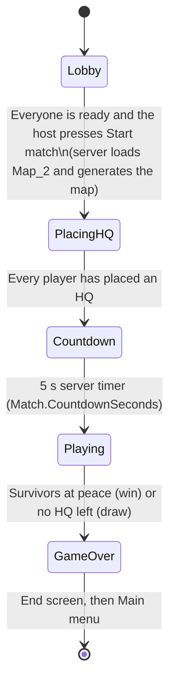

# Gameplay Guide

This document describes how WAR-2D plays **as currently implemented**. Every number comes from `Assets/Resources/GameConfig.xml`, which since v0.2 is the single source of gameplay balance values. The file is parsed strictly (typed, invariant culture); if it is missing or invalid, no server starts.

## The goal

WAR-2D is an RTS for any number of players, free-for-all or in teams. Every player has one **Headquarters (HQ)**. If your HQ is destroyed, you're eliminated. The match is won when the players who still have an HQ no longer attack each other (see "Win, loss and leaving"; in free-for-all that means one player is left). If every remaining HQ is destroyed in the same check, the match is a draw.

## Match flow

1. **Main menu → Play → Lobby** (`Main_Menu` scene). The main menu (Play, Settings, Quit) has a live battle running behind it (`<MenuBattle>`; off in Settings → Graphics). **Play** asks for a nickname (remembered) and either **Host** or join a game. Online play runs through **Steam**: Host opens a Steam lobby (friends see it in the *Friends' games* list, with a Refresh button, or you send an **Invite friends** from the lobby) and everyone connects over Steam's relay, so nobody opens a port. A **Direct (IP)** block (an address, `host:port` or `[ipv6]:port`, UDP 7778) is shown only in the editor or with `-direct`; invalid addresses are flagged, while connecting there is a Cancel, and a failed join says so. Without Steam running, the Play screen says so. A lobby holds up to **8 players**, and nobody can join once the match has started (the server refuses the connection and the Play screen says why). In the **lobby** every player (the host included) picks an unused colour (8, from the palette), and readies up; in Teams mode they pick Team 1–4 or Solo (the host can also cycle anyone's team). The host (the server owner: the host, or the next player if the host leaves) sets the **match settings**: mode (Free-for-all or Teams), Diplomacy on/off, map size (`Lobby/MapSizes`: 256, 512, 1024) and starting resources (`Lobby/StartingResources`: 500–5000), the map seed (typed, or **Reroll**). Two more host settings are about start points: **options per player** (`Lobby/StartOptions`, 1–4, default 3) and the **HQ pick time** (`Lobby/StartPickSeconds`: Random, 15–90 s, or Unlimited). Everyone sees the settings and a **map preview** of the terrain only: start points are private. The match needs `players × options + 2` start sites on the chosen map size; options that don't fit are greyed out with a hint naming the site count, and Start match waits until they fit. Any settings change or reroll clears everyone's ready. **Start match** needs every player ready and at least two teams (so someone attacks someone). Teams are fixed when the match starts.
2. **PlacingHQ** (`Map_2`). The map is generated from a seed (see "Map and tiles"). An HQ placement prompt is shown. The server deals every player their own **start options** (distinct start sites nobody else shares), tells only that player and their teammates, and the player places a single 5×5 HQ on free ground **inside one of their options** (ringed and numbered in their colour; the camera starts on the first, and the prompt's Option buttons or the edge badges move it to the others; teammates' options are ringed in their colour, a teammate's pick solid). The pick time is the host's setting: *Random* places every HQ at once at a random option, a timed pick places the rest at a random option when it ends, *Unlimited* waits for every player (a player who leaves is dropped). The screen shows how many players are still placing.
3. **Countdown.** When the last HQ is placed, the server starts a **5-second** countdown (`Match.CountdownSeconds`) and every client displays the same remaining time from the synced end time.
4. **Playing.** Economy, building, spawning and combat run, and win/loss is checked every second.
5. **GameOver.** Each player sees the **end screen**: Victory, Defeat or Draw, who won and how long it took, and every player's statistics (units built, lost and killed, buildings built and lost, mined, spent, gifted out and in, peak army). Statistics are sent only once the match is over. A player eliminated earlier **spectates** the rest of the match: a Spectating panel (with Leave match) replaces the HUD's controls, and the server shows them the whole map (every unit and building, no fog); the end screen with Defeat and the table comes when the match ends. Buttons: Main menu, Quit.

Before *Playing*, the economy, spawning, combat and win/loss checks are paused, and units can't be ordered. Passive income only starts in *Playing*.

## Controls

| Input | Action |
|---|---|
| Arrow keys | Pan the camera (`A`, `S` and `H` are order keys since v0.6) |
| Pointer at a screen edge | Pan that way (Settings → Controls → Edge scrolling) |
| Middle mouse + drag | Drag the map |
| Mouse wheel | Zoom towards the cursor (orthographic size 3–30; pan speed scales with zoom). The match starts at 1:1 art pixels (size 8.4 at 1080p). Zooming in snaps to whole-number scales (2:1, 3:1, …, pixel perfect); zooming out past 1:1 moves in smooth steps (×1.25 per notch). |
| Double-click a unit | Select every own unit of that type on screen |
| `1`–`0` twice quickly | Select that squad and centre the camera on it |
| `Esc` | In-match menu (closes the settings, gift or diplomacy panel first) |
| Hold `Shift` | Pan 2.5× faster |
| Left-click + drag | Select **every** one of your units inside the box (no limit). A plain click selects what is under the cursor. |
| `Shift` + left-click while placing | Place the building and keep placing the same type (not the HQ) |
| `Shift` + drag | Add the units in the box to the selection |
| Right-click | Order the selected units to **Move** to the cursor (they ignore enemies until they arrive) |
| `A`, then left- or right-click | **Attack-move** to the cursor: move, but stop to fight enemies in range |
| `Shift` + right-click (or attack-move click) | **Queue** the order after the current one: up to 4 waypoints per unit (`Orders/MaxQueued`). Units without an order start it at once. Stop, Hold or an unqueued order clears the queue. While Shift is held, the first selected unit's goals show as numbered rings; at the limit the cursor says "Queue full (5 orders)" and a Shift-click sends nothing. |
| `S` | **Stop**: drop the order and stand (still fighting enemies in range) |
| `H` | **Hold**: stand still, never pushed aside, fighting enemies in range |
| `Ctrl` + `1`–`0` | Assign the selection to squad 1–10 (squads are kept by the server); with nothing selected, empty that squad |
| `1`–`0`, or a squad on the squad bar | Select that squad (a right-click then orders the whole squad at once). The squad bar shows each squad's live unit count. |
| Command card: Move, Attack-move | Arm the order: the next left- or right-click sends it (the armed button is highlighted) |
| Command card: Stop, Hold | Same as `S` and `H` |
| Selection panel: a unit type | Keep only that type selected |
| Command card: Miner, Spawner, Wall, Bomb, Radar, Gun turret, Jammer | With Builders selected, pick a building (greyed out until you can afford it); a preview follows the cursor. Right-click cancels. Each placement is a blueprint the Builders then build. |
| Left-click and drag (Wall armed) | Lay a straight wall line (horizontal, vertical or diagonal); each tile is its own blueprint |
| `F`, then click (Builders) | **Repair** the damaged own or allied building or wall you click (the command card has the same button) |
| `G`, then click (Diggers) | **Dig** toward the rock, gem or wall you click |
| `G`, then drag a box (Diggers) | **Dig an area**: the selected Diggers share out the rock, gems and enemy walls in the box (lit up while you drag, with a count), each taking the nearest tile no other has, until it is clear. Your own and allies' walls are left alone. At most `Orders/MaxDigArea` (24) tiles a side. Shift queues it and keeps Dig armed; right-click or Esc cancels the drag. |
| `Delete` (own buildings selected) | Cancel a blueprint (full refund) or demolish a finished building (half back, after a confirm). The HQ can't be removed. |
| Minimap: left-click or drag | Move the camera there |
| Minimap: right-click | Send the selection there (Move, or the armed Attack-move; `Shift` queues) |
| `R` (while placing a Miner) | Turn the Miner 90° (it draws its auger facing that way); other buildings have one facing |
| Left-click (while placing) | Place the building. The preview is grey if valid and red if not. During HQ placement the HQ preview appears on its own. |
| Left-click on one of your producers (HQ, Barracks, Heavy Factory, Siege Workshop; where none of your units are) | Select it: the command card shows a type selector (one button per unit it makes, the chosen one highlighted) above one queue row, where `+`, `+10` and `+50` queue units of the chosen type and `−` removes one (max 100 queued per producer; nothing is refunded, as the cost is charged at spawn). Picking another type **clears the queue** and the progress on the next unit |
| `Shift` + left-click on your spawners, or drag a box over them (where none of your units are) | Select several spawners: the queue buttons add to (or take from) each of them |
| Right-click with only spawners selected | Set their **rally point**: each new unit drives there. The flag shows while the spawner is selected; only you see it |
| `` ` `` (backquote) | Toggle the developer console |

In **Settings → Controls** you can rebind Select, Move, Attack-move, Stop, Hold, Repair, Dig, Cancel, Queue order (Shift), the squad-assign modifier (Ctrl), Rotate and Menu: click a binding, press the new key (Esc cancels). A key already in use offers to swap the two bindings. Bindings are saved with the settings. Panning (arrows), the squad number keys, zoom, middle-drag and Shift for fast panning and adding to a box selection are fixed.

## Settings

Settings (main menu, or the in-match menu) apply at once and are saved on this machine (`settings.json` in the player's data folder):

- **Graphics:** resolution (1280×720, 1920×1080, 2560×1440), fullscreen, VSync, FPS cap (60, 120, 144, none), the battle behind the main menu, and the **colour palette**: Standard, Colourblind (Okabe–Ito; every pair at least ΔE2000 20 apart) or High contrast (every player colour at least 4.5:1 against the map floor). The palette recolours units, buildings, the minimap and the whole UI at once.
- **Audio:** master, music and sound-effect volumes (the `Main` mixer's groups).
- **Controls:** rebinding and edge scrolling.
- **Reset to defaults** restores everything, bindings included.

Camera settings (speed, zoom range, shift multiplier) are in `Assets/Character_Settings.asset`; the zoom steps are in `CameraZoom`.

## Map and tiles

The map is a grid of 1×1 tiles. By default it is **generated from a seed** at the start of each match (`Match/Map`): a 1024×1024 **region-graph** map: start sites (40 at 1024), rich expansions (14), and large central areas (12) joined by a looped graph of lanes, some with narrow chokepoints (3–6 tiles wide, so Heavies pass single file and walls can close them). Regions are irregular, lobed caves with wandering edges, and central areas and expansions have rock outcrops to fight around; the rock beside regions and lanes is eaten back into ragged cave edges and side pockets (`CaveDepth` tiles deep), but never at a chokepoint. Regions, lanes and cave edges grow with the map size (`RegionScale`, `LaneScale`, `CaveDepth`), so about 40 % of a 512 or 1024 map is floor. The map has a guaranteed gem vein at every start site, rich gem fields at expansions and few scattered gems. Every start site passes the same fairness tests (open area, vein, distance to the nearest other site and to an expansion). `Seed` 0 picks a new seed every match; every client regenerates the same map and checks it against the server. With `Size` 0 the game uses the small hand-built tilemaps in `Map_2` instead.

| Tile | Walkable | Buildable | Notes |
|---|---|---|---|
| Ground (floor) | Yes | Yes | |
| Wall | No | No | |
| Gem | No | No | Miners must face a gem tile to produce resources. A Digger can dig it for a payout. |
| Border | No | No | The map's outer ring. Never dug. |
| Wall blueprint | Yes | No | A planned wall segment. Units walk through and see through it until a Builder starts it. |
| Player wall | No | No | A built wall: blocks movement and sight, has an owner and health. A destroyed wall becomes ground. |

Digging turns rock and gems into ground for good. A building occupies tiles based on its configured size (5×5 for the HQ, 2×2 for a Small Unit Spawner or Radar, 1×1 for a Miner or Bomb). An order or rally point on rock goes to the nearest open ground within 12 tiles; the game shows an X where you clicked, a dashed line and a ring at the open ground, and "Moved to open ground". A building can only be placed when every tile of its footprint is free ground; units standing there are moved to the nearest free tile. Occupied tiles can't be built on again, and units path around buildings.

## Economy

There is one resource (shown as **Resources** in the HUD).

| Source / sink | Rate | Notes |
|---|---|---|
| Starting resources | **1000** | Per player |
| Passive income | **5 / second** | Players still in the match, during *Playing* only |
| Miner income | **10 / second** per active miner | Only while the miner faces a gem tile |
| Building upkeep | Per building, per second | See table below |
| Unit upkeep | Per unit, per second | See table below |

Upkeep is charged once per second. Units are charged one by one (oldest slot first) until the owner's resources run out; the rest go unpaid. **If a player can't afford an entity's upkeep, that entity decays**: it loses `DecayPercentPerSecond` of its **max** health every second (5% by default) until its owner can pay. Decay can destroy the entity. Resources never go negative.

## Buildings

Buildings are placed from the HUD and must sit entirely on free ground your side has explored (the HQ excepted: nobody has seen anything when it is placed). Except for the HQ, they can only be placed during *Playing*; the HQ can only be placed during *PlacingHQ*, one per player. Every building except the HQ starts as a **blueprint** that Builders finish (see "Siege").

| Building | Size | Health | Upfront cost | Upkeep / s | Function |
|---|---|---|---|---|---|
| **Base (HQ)** | 5×5 | 500 | 0 | 0 | Your life. Placed during *PlacingHQ*. Click it to queue Builders (one per `BuildSeconds`, 2 s). It can't be demolished. |
| **Miner** | 1×1 | 50 | 50 | 0 | Produces 10 resources/s while the tile it faces is a gem. Placement is only allowed when it faces a gem. |
| **Barracks** | 2×2 | 300 | 200 | 20 | (v0.12: the old Small Unit Spawner.) Makes **Scouts, Tanks and Flamethrowers**, one type at a time. |
| **Heavy Factory** | 3×3 | 500 | 400 | 30 | (v0.12, proposed numbers.) Makes **Heavies, Artillery and Snipers**; its large units leave on a tile with 2 tiles of clearance. |
| **Siege Workshop** | 2×2 | 300 | 250 | 20 | (v0.12, proposed numbers.) Makes **Diggers and Suicide bombers**. |
Every producer makes **one selected type at a time**, one unit per `BuildSeconds` of that type (in the unit table), charging the unit's cost as it spawns. A new producer starts on the first type it makes.
| **Bomb** | 1×1 | 40 | 75 | 1 | A hidden trap, walkable. See "Siege". |
| **Radar** | 2×2 | 200 | 250 | 5 | Sees 20 tiles ignoring walls and rock, and pings you when an enemy comes in range. See "Siege". |
| **Gun turret** | 1×1 | 350 | 150 | 4 | (v0.13.) Shoots enemy units in range 7, else buildings, else walls: 8 damage every 0.4 s. Sight 8. See "Siege". |
| **Jammer** | 2×2 | 200 | 200 | 6 | (v0.13.) Hides the area within 12 tiles from enemies: they see in it only from 3 tiles, and their Radars not at all. Sight 6. See "Siege". |

### Miner facing

A Miner checks the single tile next to it in the direction it faces:

| Rotation | Checks the tile to the… |
|---|---|
| 0° | right (+x) |
| 90° | up (+y) |
| 180° | left (−x) |
| 270° | down (−y) |

## Units

| Unit | Health | Damage | Range | Interval | Speed | Cost | Upkeep / s | Sight | Radius | Armour | Build s | Special |
|---|---|---|---|---|---|---|---|---|---|---|---|---|
| **Tank** | 100 | 10 | 5 | 1 s | 5 | 50 | 2 | 8 | 0.35 | Light | 1 | |
| **Builder** | 60 | 0 | 1 | 1 s | 5 | 60 | 2 | 6 | 0.35 | Light | 2 | Never attacks |
| **Digger** | 120 | 4 | 1.5 | 1 s | 4 | 120 | 4 | 6 | 0.4 | Light | 1 | |
| **Scout** | 40 | 4 | 4 | 0.5 s | 9 | 30 | 1 | 12 | 0.3 | Light | 0.7 | Widest sight, fastest |
| **Flamethrower** | 90 | 6 | 2.5 | 0.5 s | 4.5 | 70 | 2 | 6 | 0.35 | Light | 1.5 | Splash 1.5 |
| **Heavy** | 400 | 30 | 5 | 1.5 s | 2.5 | 200 | 6 | 7 | 0.7 | Heavy | 5 | Large pathing class |
| **Artillery** | 120 | 40 | 14 | 4 s | 2.5 | 220 | 6 | 7 | 0.7 | Heavy | 6 | Splash 2, can't fire inside 4; large pathing class |
| **Sniper** | 50 | 60 | 16 | 3 s | 4 | 150 | 4 | 10 | 0.35 | Light | 4 | Can't fire inside 3 |
| **Suicide bomber** | 30 | (blast 150) | 0.8 | n/a | 8 | 60 | 1 | 6 | 0.3 | Light | 1 | Blast radius 2 |

The v0.12 numbers are starting values to tune in play. Speeds are in tiles per second.

**Armour and damage classes.** Every unit is *Light* or *Heavy* armoured (`<Armour>`); with buildings and walls that gives four target classes (`LightUnit`, `HeavyUnit`, `Building`, `Wall`). The damage table holds one multiplier per attacker and class (`target="Unit"` in the XML means both unit classes). Scouts and Snipers do a quarter or half damage to Heavies; Artillery does double to buildings.

**Fire only at what you see.** A unit only fires at an enemy whose fog cell its owner's side sees now (own units, allies who share vision, Radars). Artillery (range 14) and Snipers (16) outrange their own sight, so Scouts and Radars are what let them fire.

**Splash.** Flamethrower and Artillery hits also damage every *enemy* unit, building and wall within the splash radius of the target (the target itself takes only the direct hit): 100 % at the centre falling to 50 % at the edge, times the multiplier for each target's class. Allies are not hit.

**Minimum range.** Artillery and Snipers ignore targets closer than their minimum range and look for another.

**Suicide bomber.** On an attack-move, or when idle with an enemy in sight, it runs straight at the nearest enemy unit or building and explodes on contact (within 0.8 tiles of the target's edge). The **Detonate** order (key `B`, rebindable) explodes every selected bomber where it stands. The blast hurts every unit, building and wall in its radius, **friends included**, with the damage-table multipliers (buildings ×2, walls ×3). A bomber shot down before contact does not explode.

Units reach full speed at once (the unused `Acceleration` setting was dropped). Builders never attack (their damage multiplier is 0). The Digger's Radius is 0.4 tiles; the others' is 0.35.
- A player can own at most **10,000 units** (`Simulation/MaxUnitsPerPlayer`). A spawner at the cap keeps its queue and refunds the unit.
- A spawner creates a unit on the nearest free walkable tile outside its footprint, then sends it to the spawner's rally point if it has one (a Move order, so a rally on rock snaps to the nearest floor). Units are round bodies (`Radius` 0.35 tiles for the Tank) that push apart when they overlap, so a crowd spreads out on its own.
- A move order gives the whole group one shared flow field to the goal, so any number of units path around walls and buildings together. The group gathers around the goal and stops within a radius that grows with its size.
- Every unit has a stance. On a **Move** order it ignores enemies until it arrives. On an **Attack-move** order, an enemy in range makes it stop to fight, and it resumes the order when the target is gone. **Idle** (no order, or arrived) and **Hold** units fight whatever comes in range; a Hold unit never moves, not even when its neighbours push. Arriving at the goal makes a Move or Attack-move unit Idle. A goal on rock or a building is moved to the nearest open floor within 12 tiles (on the units' side when two are as near); with none, the order is ignored.

## Fog of war, teams and diplomacy

- Each player sees through the eyes of all their units and buildings, plus those of every player sharing vision with them. Teammates share vision with each other from the start. Sight radius (`Sight`) is per unit and building type in `GameConfig.xml`: Tank 8 tiles, Builder 6, Digger 6, HQ 10, Spawner 6, Miner 4, Radar 20 (Radar sight ignores walls), Bomb 0, Gun turret 8, Jammer 6. A blueprint sees nothing until it is finished.
- Walls block sight; you can see a wall's face but not what's behind it. Fog is tracked on a grid of 2×2-tile cells and updated 5 times a second.
- **Jams (v0.13).** Inside a finished, paid enemy Jammer's radius (`Siege/JamRadius`, 12 tiles), your side sees a fog cell only when one of your sources is within `Siege/JamSight` (3 tiles) of it, measured between the closest tiles of the source's cell and that cell (line of sight still applies), and your Radars see nothing there and never ping for a contact in it. Units, buildings, wall and terrain changes, explosions and alerts in the jam follow what you see, so a building there stays a ghost until you come close. A Jammer never jams its owner or anyone its owner shares vision with. Its dark disc does show roughly where it is.
- The map shows three states: **unexplored** (black), **explored** (dimmed: you've seen it before), and **visible** (clear).
- You only receive other players' units standing where you can see now (your own sight plus vision shared with you). Enemy buildings you've seen stay on your map as dimmed **last-seen ghosts** when they go out of sight; you only find out a ghost was destroyed when you see its spot again.
- Diplomacy is per player and one-way. At the start, teammates don't attack each other and share vision; everyone else attacks and doesn't share. When the match has diplomacy on, each player chooses whom they attack and with whom they share vision (at most one change per command every 2 s, `Diplomacy/ChangeCooldownSeconds`). Stopping sharing keeps what the other player already explored. Nobody learns another player's choices, except that you're told who shares vision with you. Units of players who don't attack each other never damage each other (bomb blasts are the exception: they hit everything in range, friends included). The **Diplomacy** button on the top bar (shown only when the match has diplomacy on) opens a panel with an Attack and a Share-vision switch per player; it also marks who shares vision with you.

### Alerts

The alert feed (top left) shows the newest four alerts for 8 s each (`Alerts/ShowSeconds`); × dismisses one. You're told only about your own things and choices made towards you:

- **Under attack near your HQ/Spawner/Miner** (or "Your units are under attack"): one of your units or buildings took damage. The minimap pings the spot. At most one per 32-tile area every 10 s (`Alerts/AreaTiles`, `Alerts/ThrottleSeconds`). It never says who attacked.
- **Upkeep unpaid**: some of your upkeep first went unpaid (repeats only after a fully paid second).
- **A player shares vision with you / stopped sharing vision with you**.
- **A player gifted you N**.
- **Construction finished** (a blueprint of yours is done), **Bomb triggered** (one of yours went off), **Enemy spotted by Radar** (at the Radar's tile, never the enemy's) and **Out of resources: repairs stopped**.

## Siege

All numbers are starting values in `GameConfig.xml` (`Siege`, `Units`, `Buildings`), meant to be tuned in play.

- **Builders** (60 cost, 60 health) come from the HQ queue. They build everything except the HQ and never attack. Every building starts as a **blueprint** that charges its full cost and has health in proportion to progress (minimum 1). Each Builder adds `BuildPower` 25 health/s, so a 300-health Spawner takes 12 s with one. Builders work from `WorkReach` 1.6 tiles; Shift queues orders (up to `Orders/MaxQueued`). Placing a blueprint with Builders selected sends them to build it.
- **Demolish** (Delete, then confirm): a blueprint refunds in full, a finished building refunds `DemolishRefund` 50%.
- **Repair** (F): Builders restore own or allied buildings and walls for `RepairCostPerHealth` 0.2 per health; they stop, with an alert, when the owner can't pay.
- **Walls** (drag): 5 resources and 150 health per segment, 4-connected, up to 64 per drag, no upkeep. Each tile is charged and checked on its own; the wall is built once the tile is empty. Units attack walls by attack-move; a destroyed wall becomes ground.
- **Diggers** (120 cost, 120 health) come from the Spawner queue. Dig (G) removes a rock tile in `DigTime` 1.5 s; walls take damage instead (x6). A gem tile pays `GemPayout` 150 and stops Miners on it. The map border is never dug. Diggers fight back if attacked (x0.5 on units, x3 on buildings).
- **Bombs** (75 cost, 1x1, walkable): only the owner and anyone they share vision with ever see one. A unit of any player you attack triggers it; the blast (radius 2.5, 200 damage) hits everything, friendlies too. Everyone who sees the tile sees the explosion, and the owner gets an alert.
- **Radar** (250 cost, 2x2, 5 upkeep): sees 20 tiles ignoring walls and rock, never bombs. It pings its owner once when an enemy enters its range, again only after the area has been clear `RadarClearSeconds` 5 s and `RadarAlertCooldownSeconds` 30 s have passed.
- **Gun turret** (v0.13; 150 cost, 1x1, 350 health, 4 upkeep, sight 8): the only building that attacks. It fights like a unit that can't move: the nearest enemy unit in `Range` 7 it sees and has a clear line to, else the nearest enemy building, else an enemy wall tile, for `Damage` 8 every `AttackInterval` 0.4 s times the damage table (`GunTurret` row: light units 1.5, heavy units 0.4, buildings 0.5, walls 0.5). Strong against Scouts, weak against Heavies. It doesn't fire as a blueprint or while its upkeep is unpaid (the owner's panel says "Unpaid: not firing"). Enemies who see a turret see it fire; its victims' owners get the usual Under-attack alert, and a turret being shot raises its owner's.
- **Jammer** (v0.13; 200 cost, 2x2, 200 health, 6 upkeep, sight 6): while finished and paid, jams `JamRadius` 12 tiles for every player its owner doesn't share vision with (see "Fog of war"). It stops jamming while unpaid or destroyed. Its owner sees the jam radius as a ring while it is selected.

## Combat

- Combat is fully automatic. Every unit picks the **nearest enemy unit** (a unit of any player its owner attacks) within range that it has a clear line to (rock blocks shots as it blocks sight; buildings and units don't), and only when there is none, the nearest enemy **building**. Idle units look for targets every few ticks, so a new enemy is picked up within about 0.4 s.
- Damage is the attacker's `Damage` times a multiplier from the damage table (`DamageTable`) for what it hits: units, buildings or walls. The Tank's multipliers are 1.0 except against walls (0.5). The Digger does 0.5 to units, 3 to buildings and 6 to walls; the Builder 0 to everything.
- It keeps attacking that target every attack interval while the target is alive and in range. When the target dies or leaves range, it picks a new one.
- Buildings don't attack, except the **Gun turret** (v0.13, see "Siege").
- Anything at 0 health is destroyed, and **every death plays an explosion**. The server sends each player only the deaths inside their camera view that they can see (their sight plus vision shared with them), at most 1,024 a tick; once the match is over, the end-of-match wipe shows wherever they look.
- Clients see a short yellow tracer for each attack whose attacker is on screen, and a health bar over every damaged unit or building.

## Win, loss and leaving

- During *Playing* the server checks every second which players still own an HQ.
- A player with no HQ is **eliminated**: all their remaining units and buildings are destroyed (each with an explosion) and, while the match goes on, they spectate it with the whole map shown (see GameOver above). Eliminated players stop earning passive income.
- If no player with an HQ left attacks another (they are all at peace with each other, or only one is left), and the match started with more than one team, they **win** together: every HQ holder, and every eliminated player whose starting team includes one, sees the Win screen. Peace must be mutual: if one survivor still attacks another, the match goes on. Everyone else sees the Lose screen, and the winner's world is wiped with explosions as the match ends.
- If nobody has an HQ, it's a **draw**, and everyone sees a Draw screen.
- **Esc** (or Menu on the top bar) opens the **in-match menu**: Resume, Settings, Surrender and Leave match. Nothing pauses. **Surrender** asks to confirm, then eliminates you exactly as losing your HQ.
- **Gifting.** Gift (top bar) sends resources to any other live player, ally or enemy (marked from whom you attack): an amount from 1 up to what you have, one gift every 5 s (`Gifting/CooldownSeconds`). It is taken from you and given at once; only you and the recipient are told (the recipient gets an alert).
- When a player disconnects mid-match, they're removed from the player list, their units and buildings are destroyed, and the lobby UI updates. If the **server owner** leaves, ownership passes to another player; if the host itself leaves, the server shuts down and everyone returns to the main menu.

## AI players (v0.14, in progress)

AI players run on the host and play by a player's rules: they see only what their side sees (their units' and buildings' sight, shared vision, last-seen ghosts) and act only through the same checked actions a player's clicks use, at a limited number of actions per minute (Easy 30, Normal 80, Hard 200). No difficulty gets more resources, vision or speed. An AI places its HQ in its best-scored start option at once (more gems and open ground, rich fields nearby, near its teammates), runs its style's build order (`<Ai><Style><BuildOrder>`), keeps Builders and Miners, expands to the map's rich fields, builds producers, a Radar and defences (Hard: at the chokepoints on the lanes out of its base towards enemies it knows), and gathers its army in front of its HQ. It attacks only buildings it has seen (ghosts count) or armies it last saw, when its army looks stronger than what it has seen of the enemy; it defends its base when attacked. Normal and Hard never take on upkeep their income can't carry (they build Miners instead, and cancel or demolish buildings if income falls away); Easy may go unpaid. Normal and Hard pull back from lost fights and shift their army towards counters of the enemy units they've seen (Hard also of the enemy producers it has seen); Hard focuses fire, keeps Artillery and Snipers behind its front and digs through walls with Diggers. Every number is in `GameConfig.xml` `<Ai>`.

## Replays (v0.10)

The host records every match. When it ends, each player whose **Save replays** setting is on (Settings › Graphics, on by default) receives the recording in the background; it is kept in the local Replays folder (the newest 50). A replay shows the whole match without fog: every player, every unit and building, bombs included. The end screen shows "Saving replay… n %" while it arrives, then "Replay saved". **Replays** on the main menu lists them newest first (date, map, mode, players, length, size) with **Watch** and **Delete** (asks first). The viewer has play/pause, speeds 0.5× to 8×, a seek bar (seeking back replays from the start, quietly) and each player's resources and units.
