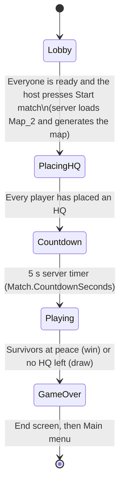

# Gameplay Guide

This document describes how WAR-2D plays **as currently implemented**. Every number comes from `Assets/Resources/GameConfig.xml`, which since v0.2 is the single source of gameplay balance values. The file is parsed strictly (typed, invariant culture); if it is missing or invalid, no server starts.

## The goal

WAR-2D is an RTS for any number of players, free-for-all or in teams. Every player has one **Headquarters (HQ)**. If your HQ is destroyed, you're eliminated. The match is won when the players who still have an HQ no longer attack each other (see "Win, loss and leaving"; in free-for-all that means one player is left). If every remaining HQ is destroyed in the same check, the match is a draw.

## Match flow

1. **Main menu → Play → Lobby** (`Main_Menu` scene). The main menu (Play, Settings, Quit) has a live battle running behind it (`<MenuBattle>`; off in Settings → Graphics). **Play** asks for a nickname (remembered) and either **Host** or join a game. Online play runs through **Steam**: Host opens a Steam lobby (friends see it in the *Friends' games* list, with a Refresh button, or you send an **Invite friends** from the lobby) and everyone connects over Steam's relay, so nobody opens a port. A **Direct (IP)** block (an address, `host:port` or `[ipv6]:port`, UDP 7778) is shown only in the editor or with `-direct`; invalid addresses are flagged, while connecting there is a Cancel, and a failed join says so. Without Steam running, the Play screen says so. A lobby holds up to **8 players** (AI seats included), and nobody can join once the match has started (the server refuses the connection and the Play screen says why), except a player who dropped out rejoining their own seat (see "Reconnecting"). In the **lobby** every player (the host included) picks an unused colour (8, from the palette; a colour an AI holds can be taken, and the AI moves to a free one), and readies up. **Team board (playtest 2026-11-05, Figma L1–L3):** in Teams mode the players are shown as one row per team (Team 1–4, then Solo, "everyone is an enemy"), each with its cards side by side. A player changes team by dragging their card by its ⠿ handle onto another row or by picking the team in the card's **Team ▾** dropdown (both always work). A joined player can move only themselves; the host can move anyone, AIs included, and has **Quick setup** buttons: *Me vs the AIs* (the host on Team 1, everyone else on Team 2), *Humans vs AIs*, *Split evenly* (one team per human, 2 to 4 teams, AIs dealt to the smallest team), *Shuffle* (same team sizes, players dealt at random) and *Everyone solo*. Mode and Diplomacy sit beside the Players title. In Free-for-all the cards are two per row with no team, and the map preview is larger. Your own colour is the **colour ▾** on your card. The host (the server owner: the host, or the next player if the host leaves) sets the **match settings**: mode (Free-for-all or Teams), Diplomacy on/off, map size (`Lobby/MapSizes`: 256, 512, 1024) and starting resources (`Lobby/StartingResources`: 500–5000), the map seed (typed, or **Reroll**). Two more host settings are about start points: **options per player** (`Lobby/StartOptions`, 1–4, default 3) and the **HQ pick time** (`Lobby/StartPickSeconds`: Random, 15–90 s, or Unlimited). Everyone sees the settings and a **map preview** of the terrain only, with the map's size and seed under it: start points are private. (2026-11-02) The host names the server beside the lobby's title (shown in friends' join lists; empty means "<host>'s server"), and each other human's card has a ⋯ menu for the host: **Force ready**, **Kick** (they may rejoin) and **Ban** (asks first; they can't rejoin while the server is open). A removed player's Play screen says why. Every match setting has a hover card explaining it. (v0.16, Figma M2: the local player's card is outlined; the host's settings sit in Map, Start and Rules blocks.) The match needs `players × options + 2` start sites on the chosen map size; options that don't fit are greyed out with a hint naming the site count, and Start match waits until they fit. Any settings change or reroll clears everyone's ready. **Start match** needs every player ready and at least two teams (so someone attacks someone). Teams are fixed when the match starts.
2. **PlacingHQ** (`Map_2`). The map is generated from a seed (see "Map and tiles"). An HQ placement prompt is shown. The server deals every player their own **start options** (distinct start sites nobody else shares), tells only that player and their teammates, and the player places a single 5×5 HQ on free ground **inside one of their options** (ringed and numbered in their colour; the camera starts on the first, and the prompt's Option buttons or the edge badges move it to the others; teammates' options are ringed in their colour, a teammate's pick solid). While placing, the **minimap** shows the whole map at full brightness (the map is public) with the player's options as rings numbered like the Option buttons and teammates' options as small rings in their colour; a minimap click inside an option's ring centres the camera on that option (v0.16). The pick time is the host's setting: *Random* places every HQ at once at a random option, a timed pick places the rest at a random option when it ends, *Unlimited* waits for every player (a player who leaves is dropped). The camera moves to your HQ if it was placed out of view. The screen shows how many players are still placing.
3. **Countdown.** When the last HQ is placed, the server starts a **5-second** countdown (`Match.CountdownSeconds`) and every client displays the same remaining time from the synced end time.
4. **Playing.** Economy, building, spawning and combat run, and win/loss is checked every second.
5. **GameOver.** Each player sees the **end screen**: Victory, Defeat or Draw, who won and how long it took, and every player's statistics (units built, lost and killed, buildings built and lost, mined, spent, gifted out and in, peak army). Statistics are sent only once the match is over. A player eliminated earlier **spectates** the rest of the match with the replay viewer's bars (v0.18 R1): every player's balance and units on top, and the match time, a **View** selector (Everything, or one player's sight, their fog and last-seen ghosts) and Leave below. It replaces the HUD's controls, and the server shows them the whole map (every unit and building, no fog); the end screen with Defeat and the table comes when the match ends. Buttons: Main menu, Quit.

Before *Playing*, the economy, spawning, combat and win/loss checks are paused, and units can't be ordered. Passive income only starts in *Playing*.

## Controls

| Input | Action |
|---|---|
| Arrow keys | Pan the camera (`A`, `S` and `H` are order keys since v0.6) |
| Pointer at a screen edge | Pan that way (Settings → Controls → Edge scrolling) |
| Middle mouse + drag | Drag the map |
| Mouse wheel | Zoom towards the cursor (orthographic size 3–30; pan speed scales with zoom). The match starts at 1:1 art pixels (size 8.4 at 1080p). Zooming in snaps to whole-number scales (2:1, 3:1, …, pixel perfect); zooming out past 1:1 moves in smooth steps (×1.25 per notch). |
| Double-click a unit | Select every own unit of that type on screen |
| `1`–`0` twice quickly | Select that squad and centre the camera on it |
| `Esc` | In-match menu (closes the settings, gift or diplomacy panel first) |
| Hold `Shift` | Pan 2.5× faster |
| Left-click + drag | Select **every** one of your units inside the box (no limit), except that a box catching Builders and anything else keeps only the others (v0.18; Diggers and bombers count as army). A plain click selects what is under the cursor. |
| Hold `Alt` (v0.18, rebindable) | **Range and sight rings** of the selection and of whatever is under the pointer: attack range solid, minimum range dashed, sight dotted, in the owner's colour. Close units of a type share a ring (`RangeRings/MergeOverlap`), at most `RangeRings/Max` (64) sets. A Gun turret, Radar or Jammer always shows its reach while you place it. |
| `Shift` + left-click while placing | Place the building and keep placing the same type (not the HQ) |
| `Shift` + drag | Add the units in the box to the selection |
| Right-click | Order the selected units to **Move** to the cursor (they ignore enemies until they arrive) |
| `A`, then left- or right-click | **Attack-move** to the cursor: move, but stop to fight enemies in range |
| Move or Attack-move with two or more units (v0.16) | The group **forms up** (Settings → Gameplay → Formations, on by default): it travels at its slowest member's speed and stops in a block at the goal, Heavies, Tanks, Flamethrowers and bombers in front, Scouts, Builders and Diggers in the middle, Snipers and Artillery at the back. See "Formations" below |
| `Shift` + right-click (or attack-move click) | **Queue** the order after the current one: up to 30 waypoints per unit (`Orders/MaxQueued`). Units without an order start it at once. Stop, Hold or an unqueued order clears the queue. While Shift is held, the first selected unit's goals show as numbered rings; at the limit the cursor says "Queue full (31 orders)" and a Shift-click sends nothing. |
| Right-click an enemy, or `A` then click one (v0.18) | **Attack**: the units go after that target, fire at it in range and ignore everything else until it dies, then stand. Builders and Diggers keep their own right-click. If it leaves your side's sight they walk to the last tile it was seen on, and the order ends there if it still isn't seen. `Shift` queues it. A ghost, or anything your side can't see now, gets an attack-move to the tile. |
| Middle click (playtest 2026-11-04) | **Ping** the tile: rings in your colour with your name, a minimap ring, and an alert row with a sound for everyone you share vision with. One ping per `Pings/CooldownSeconds` (0.5). A press held over 0.4 s or moved over 6 px drags the camera instead. |
| `S` | **Stop**: drop the order and stand (still fighting enemies in range) |
| `H` | **Hold**: stand still, never pushed aside, fighting enemies in range |
| `Ctrl` + `1`–`0` | Assign the selection to squad 1–10 (squads are kept by the server); with nothing selected, empty that squad |
| `1`–`0`, or a squad on the squad bar | Select that squad (a right-click then orders the whole squad at once). The squad bar shows each squad's live unit count. |
| Command card: Move, Attack-move | Arm the order: the next left- or right-click sends it (the armed button is highlighted) |
| Command card: Stop, Hold | Same as `S` and `H` |
| Selection panel: a unit type | Keep only that type selected |
| Command card: Miner, Spawner, Wall, Bomb, Radar, Gun turret, Jammer | With Builders selected, pick a building (greyed out until you can afford it); a preview follows the cursor. Right-click cancels. Each placement is a blueprint the Builders then build. |
| `Q` `W` `E` `T` / `Z` `X` `C` `V` `N` (Builders selected) | **Build hotkeys (v0.15.1):** the command card's top row (Miner, Barracks, Heavy Factory, Siege Workshop) and bottom row (Wall, Bomb, Radar, Gun turret, Jammer), skipping `R` (Rotate) and `B` (Detonate). A key does what its button does; while placing, another key switches building. Each button shows its key top-left. A greyed-out button's key places nothing and the cursor says why ("Radar: need 250 (you have 90)") |
| `Q` `W` `E` (own producers of one kind selected) | **Production hotkeys (v0.15.1):** the type buttons in order. A key on the type being made queues one more at every selected producer (`Shift`: ten); a key on another type switches to it, as a click does. "Queue full" at the cursor when no producer has room |
| Left-click and drag (Wall armed) | Lay a straight wall line (horizontal, vertical or diagonal); each tile is its own blueprint |
| `F`, then click (Builders) | **Repair** the damaged own or allied building or wall you click (the command card has the same button) |
| `G`, then click (Diggers) | **Dig** toward the rock, gem or wall you click |
| `G`, then drag a box (Diggers) | **Dig an area**: the selected Diggers share out the rock, gems and enemy walls in the box (lit up while you drag, with a count), each taking the nearest tile no other has, until it is clear. Diggers past the rock face (a big group has more Diggers than exposed tiles) stand by at the face and take the next tile that opens up, for up to 30 s with nothing free (playtest 2026-11-05; they used to drop out of the area and idle). Your own and allies' walls are left alone. At most `Orders/MaxDigArea` (24) tiles a side. Shift queues it and keeps Dig armed; right-click or Esc cancels the drag. |
| `.` | Select your **idle Builders** (not moving, with no own blueprint or own building under 90 % health, the line `AutoWork/RepairBelow` where an idle Builder takes the repair, within 5 tiles; the client cannot see Builder work, so this is a guess). Pressed again it centres the camera on the next one. `Ctrl` + `.` selects every Builder |
| `,` | Select your **army**: every own unit that can attack. Pressed again it adds Diggers and Suicide bombers |
| `Backspace` | Centre the camera on your HQ; twice quickly it also selects it |
| `Space` | Centre the camera on the newest alert you have not visited yet |
| `J` | Roam (also the Roam command button): the selected units (Builders aside) scout on their own, each driving to random ground not seen lately (roamers that need a goal are grouped by 16-tile area and each group of up to 48 shares one goal and one order, four orders per half second, so even 3,000 roamers all have goals within a few seconds; playtest 2026-11-05), until you give them another order. Roaming units wear a dashed gold ring; the selection title counts them ("· 4 roaming") |
| `Ctrl` + double-click a unit | Select every own unit of that type **anywhere on the map** |
| `Ctrl` + `1`–`0` (buildings selected) | Save a **building group** in that slot (kept on this client only; assigning units to the slot replaces it). `1`–`0` selects it, twice centres the camera |
| `Ctrl` + right-click (producers selected) | **Rally all** your producers to the cursor. A rally onto an own blueprint makes new Builders build it |
| `Delete` (own buildings selected) | Cancel a blueprint (full refund) or demolish a finished building (half back, after a confirm). The HQ can't be removed. |
| Minimap: left-click or drag | Move the camera there |
| Minimap: right-click | Send the selection there (Move, or the armed Attack-move; `Shift` queues) |
| `R` (while placing a Miner) | Turn the Miner 90° (it draws its auger facing that way); other buildings have one facing |
| Left-click (while placing) | Place the building. The preview is grey if valid and red if not. During HQ placement the HQ preview appears on its own. |
| Left-click on one of your producers (HQ, Barracks, Heavy Factory, Siege Workshop; where none of your units are) | Select it: the command card shows a type selector (one button per unit it makes, the chosen one highlighted) above one queue row, where `+`, `+10` and `+50` queue units of the chosen type and `−` removes one (Shift-click: ten, Ctrl-click: the whole queue; max 100 queued per producer; nothing is refunded, as the cost is charged at spawn). Picking another type **clears the queue** and the progress on the next unit |
| `Shift` + left-click on your spawners, or drag a box over them (where none of your units are) | Select several spawners: the queue buttons add to (or take from) each of them |
| Right-click with only spawners selected | Set their **rally point**: each new unit drives there. The flag shows while the spawner is selected; only you see it |
| `` ` `` (backquote) | Toggle the developer console |

In **Settings → Controls** you can rebind Select, Move, Attack-move, Stop, Hold, Roam, Repair, Dig, Cancel, Queue order (Shift), the squad-assign modifier (Ctrl), Rotate, Menu, Select idle Builders, Select army, Jump to HQ, Next alert and the nine card slots (v0.15.1: "Card top 1–4", "Card bottom 1–5"): click a binding, press the new key (Esc cancels). A key already in use offers to swap the two bindings. Bindings are saved with the settings. Panning (arrows), the squad number keys, zoom, middle-drag and Shift for fast panning and adding to a box selection are fixed.

### Formations (v0.16)

A Move or Attack-move given to two or more units with **Formations** on lays a block of slots at the goal, facing from the group towards the goal: rows about √(2n) wide (`Formation/Spacing` 1.2 tiles apart), roles never sharing a row, and within a role the units already furthest ahead taking the front. Slots on rock, on a footprint or behind one (seen from the goal) are pulled in towards the goal. On the way each unit holds to the group's speed (the slowest member's) until it is within `Formation/LooseTiles` (4) of its slot; one that falls `Formation/LostTiles` (20) behind the group's leader runs at its own speed to catch up. Within `Formation/SlotTiles` (12) of the goal a unit walks straight to its slot while the line to it is clear floor (else it keeps following the route). A unit's formation ends when it reaches its slot or gets another order; an Attack-move unit that meets an enemy fights as before, then walks on to its slot. A single unit, Build, Repair, Dig, Hold and Stop never form up, and neither do Shift-queued orders or the AI.

### Reading the battle (v0.16)

- **Target lines** (Settings → Gameplay → Target lines: Selected or Off): each selected own unit or Gun turret that is shooting draws a thin line to its target, red to units and buildings, orange to walls, for `TargetLines/HoldSeconds` (1.5 s) after its last shot; a selected unit on an Attack-move with no target draws a faint dashed line to its goal. At most `TargetLines/Max` (200), those nearest the middle of the view first.
- **Fights on the minimap:** a unit or building you know of losing health makes its `MinimapCombat/CellTiles` (16-tile) cell pulse on the minimap for `MinimapCombat/PulseSeconds` (1.5 s), red when your own things were hit and white otherwise; the cell then stays quiet for `MinimapCombat/QuietSeconds` (3 s). At most `MinimapCombat/Max` (32) at once.

## Settings

Settings (main menu, or the in-match menu) apply at once and are saved on this machine (`settings.json` in the player's data folder):

- **Graphics:** resolution (1280×720, 1366×768, 1600×900, 1920×1080, 2560×1080, 2560×1440, 3440×1440, 3840×2160, plus your monitor's own size and the current one if they are not listed), fullscreen, VSync, FPS cap (60, 120, 144, none), the battle behind the main menu, **Reduce motion** (v0.16: menu screens, overlays and dialogs swap at once instead of sliding and fading in), and the **colour palette**: Standard, Colourblind (Okabe–Ito; every pair at least ΔE2000 20 apart) or High contrast (every player colour at least 4.5:1 against the map floor). The palette recolours units, buildings, the minimap and the whole UI at once.
- **Audio:** master, music and sound-effect volumes (the `Main` mixer's groups).
- **Controls:** rebinding and edge scrolling.
- **Gameplay (v0.15):** UI scale (0.75–1.5, applies at once), health bars (always, damaged only, selected only), attack tracers (full, reduced, off), target lines (selected, off; v0.16), formations (on, off; v0.16), hover-card delay, camera pan / edge-scroll / zoom speed and the Shift pan multiplier, confirm before demolishing or surrendering (surrender always asks in a match with other humans), the minimap's size and layers (gems, ghosts, army, buildings, HQ flags), and which alerts show and sound. Under Attack and Upkeep unpaid can never be switched off completely.
- **Reset to defaults** restores everything, bindings included.

Base camera values (speed, zoom range) are in `Assets/Resources/Character_Settings.asset` and the zoom steps in `CameraZoom`; the Gameplay tab scales them.

## Map and tiles

The map is a grid of 1×1 tiles. By default it is **generated from a seed** at the start of each match (`Match/Map`): a 1024×1024 **region-graph** map: start sites (40 at 1024), rich expansions (14), and large central areas (12) joined by a looped graph of lanes, some with narrow chokepoints (3–6 tiles wide, so Heavies pass single file and walls can close them). Regions are irregular, lobed caves with wandering edges, and central areas and expansions have rock outcrops to fight around; the rock beside regions and lanes is eaten back into ragged cave edges and side pockets (`CaveDepth` tiles deep), but never at a chokepoint. Regions, lanes and cave edges grow with the map size (`RegionScale`, `LaneScale`, `CaveDepth`), so about 40 % of a 512 or 1024 map is floor. The map has a guaranteed gem vein at every start site, rich gem fields at expansions and, elsewhere, gems only in **patches** of 6 to 12 tiles on the rock faces, seeded at least 14 tiles apart, `GemChance` (0.04) of the floor-facing rock in all (playtest 2026-11-05: no more lone gems here and there), and (v0.17 Heartland) **rich gems** in the central areas far from every start site: `<Map><CentralRichGemTiles>` (8, 16, 24, 32 by map size) per chosen area, in 2 to 4 clusters, in every central area at least `<RichMinStartDistance>` (0.15 of the map size, by lanes) from every start site, or in the farthest one if none is that far, so every map has some. Every start site passes the same fairness tests (open area, vein, distance to the nearest other site and to an expansion); no start site is beside a rich field (and no rich gem lies within `<RichStartClearance>` 48 tiles of a start site's centre in a straight line: an area far by lanes can still border a start, playtest 2026-11-05), and every one can reach one. `Seed` 0 picks a new seed every match; every client regenerates the same map and checks it against the server. With `Size` 0 the game uses the small hand-built tilemaps in `Map_2` instead.

| Tile | Walkable | Buildable | Notes |
|---|---|---|---|
| Ground (floor) | Yes | Yes | |
| Wall | No | No | |
| Gem | No | No | Miners must face a gem tile to produce resources. A Digger can dig it for a payout. |
| Rich gem (v0.17) | No | No | A gem worth `<Resources><RichGemMultiplier>` (2.5) times as much: a Miner facing one earns 25/s, for good. A Digger can dig it for `<Siege><RichGemPayout>` (375), and it is gone. Gold crystals; gold on the minimap. |
| Border | No | No | The map's outer ring. Never dug. |
| Wall blueprint | Yes | No | A planned wall segment. Units walk through and see through it until a Builder starts it. |
| Player wall | No | No | A built wall: blocks movement and sight, has an owner and health. A destroyed wall becomes ground. |

Digging turns rock and gems into ground for good. A building occupies tiles based on its configured size (5×5 for the HQ, 3×3 for a Heavy Factory, Large Radar or Large Jammer, 2×2 for a Barracks, Siege Workshop, Radar or Jammer, 1×1 for a Miner, Bomb or Gun turret). An order or rally point on rock goes to the nearest open ground within 12 tiles; the game shows an X where you clicked, a dashed line and a ring at the open ground, and "Moved to open ground". A building can only be placed when every tile of its footprint is free ground; units standing there are moved to the nearest free tile. Occupied tiles can't be built on again, and units path around buildings.

## Economy

There is one resource (shown as **Resources** in the HUD).

| Source / sink | Rate | Notes |
|---|---|---|
| Starting resources | **1000** | Per player. The lobby's **Infinite** option (playtest 2026-11-04) means no balance runs out: nothing is charged, nothing decays, and spending still counts on the end screen. |
| Passive income | **5 / second** | Players still in the match, during *Playing* only |
| Miner income | **10 / second** per active miner (**25** facing a rich gem, v0.17) | Only while the miner faces a gem tile |
| Building upkeep | Per building, per second | See table below |
| Unit upkeep | Per unit, per second | See table below |

Upkeep is charged once per second. Units are paid first, one by one (oldest slot first), and a building's upkeep is only paid from what the units' last charge leaves in the bank. **Buildings give way first:** an unpaid building stops working until it is paid, but takes no damage: a producer holds its progress, a Gun turret doesn't fire, a Jammer doesn't jam, a Radar doesn't scan or ping, and a bomb is a dud that only its owner can set off. **Then units decay, one whole unit at a time:** each unpaid unit costs its owner `DecayPercentPerSecond` (5%) of a unit every second, and all of that comes off the weakest unpaid unit until it dies. **With no units left, unpaid buildings decay too**, each losing that share of its max health per second. Miners and the HQ have no upkeep and keep working. Resources never go negative. The top bar shows the upkeep owed, paid or not, and reads "Decaying" while any of it goes unpaid.

## Buildings

Buildings are placed from the HUD and must sit entirely on free ground your side has explored (the HQ excepted: nobody has seen anything when it is placed). Except for the HQ, they can only be placed during *Playing*; the HQ can only be placed during *PlacingHQ*, one per player. Every building except the HQ starts as a **blueprint** that Builders finish (see "Siege").

| Building | Size | Health | Upfront cost | Upkeep / s | Function |
|---|---|---|---|---|---|
| **Base (HQ)** | 5×5 | 500 | 0 | 0 | Your life. Placed during *PlacingHQ*. Click it to queue Builders (one per `BuildSeconds`, 2 s). It can't be demolished. |
| **Miner** | 1×1 | 50 | 50 | 0 | Produces 10 resources/s while the tile it faces is a gem (25/s for a rich gem, v0.17). Placement is only allowed when it faces a gem. |
| **Barracks** | 2×2 | 300 | 200 | 20 | (v0.12: the old Small Unit Spawner.) Makes **Scouts, Tanks and Flamethrowers**, one type at a time. |
| **Heavy Factory** | 3×3 | 500 | 400 | 30 | (v0.12, proposed numbers.) Makes **Heavies, Artillery and Snipers**; its large units leave on a tile with 2 tiles of clearance. |
| **Siege Workshop** | 2×2 | 300 | 250 | 20 | (v0.12, proposed numbers.) Makes **Diggers and Suicide bombers**. |
| **Bomb** | 1×1 | 40 | 75 | 1 | A hidden trap, walkable. See "Siege". |
| **Radar** | 2×2 | 200 | 250 | 5 | Sees 20 tiles ignoring walls and rock, and pings you when an enemy comes in range. See "Siege". |
| **Gun turret** | 1×1 | 500 | 150 | 4 | (v0.13.) Shoots enemy units in range 9, else buildings, else walls: 12 damage every 0.4 s. Sight 10. See "Siege". |
| **Jammer** | 2×2 | 200 | 200 | 6 | (v0.13.) Hides the area within 12 tiles from enemies: they see in it only from 3 tiles, and their Radars not at all. Sight 6. See "Siege". |
| **Large Radar** | 3×3 | 450 | 625 | 12.5 | A Radar that sees 30 tiles. See "Siege". |
| **Large Jammer** | 3×3 | 450 | 500 | 15 | A Jammer that hides the area within 18 tiles. Sight 6. See "Siege". |

Every producer makes **one selected type at a time**, one unit per `BuildSeconds` of that type (in the unit table), charging the unit's cost as it spawns. A new producer starts on the first type it makes.

### Miner facing

A Miner checks the single tile next to it in the direction it faces:

| Rotation | Checks the tile to the… |
|---|---|
| 0° | right (+x) |
| 90° | up (+y) |
| 180° | left (−x) |
| 270° | down (−y) |

## Units

| Unit | Health | Damage | Range | Interval | Speed | Cost | Upkeep / s | Sight | Radius | Armour | Build s | Special |
|---|---|---|---|---|---|---|---|---|---|---|---|---|
| **Tank** | 100 | 10 | 5 | 1 s | 5 | 50 | 2 | 8 | 0.35 | Light | 1 | |
| **Builder** | 60 | 0 | 1 | 1 s | 5 | 60 | 2 | 6 | 0.35 | Light | 2 | Never attacks |
| **Digger** | 120 | 4 | 1.5 | 1 s | 4 | 120 | 4 | 6 | 0.4 | Light | 1 | |
| **Scout** | 40 | 4 | 4 | 0.5 s | 9 | 30 | 1 | 12 | 0.3 | Light | 0.7 | Widest sight, fastest |
| **Flamethrower** | 90 | 6 | 2.5 | 0.5 s | 4.5 | 70 | 2 | 6 | 0.35 | Light | 1.5 | Splash 1.5 |
| **Heavy** | 400 | 30 | 5 | 1.5 s | 2.5 | 200 | 6 | 7 | 0.7 | Heavy | 5 | Large pathing class |
| **Artillery** | 120 | 70 | 18 | 5 s | 2 | 220 | 6 | 18 | 0.7 | Heavy | 6 | Splash 2, can't fire inside 4; large pathing class |
| **Sniper** | 70 | 60 | 20 | 3 s | 4 | 150 | 4 | 20 | 0.35 | Light | 4 | Can't fire inside 3 |
| **Suicide bomber** | 30 | (blast 150) | 0.8 | n/a | 8 | 60 | 1 | 6 | 0.3 | Light | 1 | Blast radius 2 |

The v0.12 numbers are starting values to tune in play ([tuning.md](tuning.md) says how). Speeds are in tiles per second.

**Armour and damage classes.** Every unit is *Light* or *Heavy* armoured (`<Armour>`); with buildings and walls that gives four target classes (`LightUnit`, `HeavyUnit`, `Building`, `Wall`). The damage table holds one multiplier per attacker and class (`target="Unit"` in the XML means both unit classes). Scouts do a quarter of their damage to Heavies and Snipers 70 %; Artillery does double to buildings.

**Fire only at what you see.** A unit only fires at an enemy whose fog cell its owner's side sees now (own units, allies who share vision, Radars). Artillery and Snipers see as far as they shoot (playtest 2026-11-04), though rock still blocks both; Jammers still blind them, so Scouts and Radars are what let them fire.

**Splash.** Flamethrower and Artillery hits also damage every *enemy* unit, building and wall within the splash radius of the target (the target itself takes only the direct hit): 100 % at the centre falling to 50 % at the edge, times the multiplier for each target's class. Allies are not hit.

**Minimum range.** Artillery and Snipers ignore targets closer than their minimum range and look for another.

**Suicide bomber.** On an attack-move, or when idle with an enemy in sight, it runs at a blast point chosen on its target search (v0.18): of the enemy units its side sees within `Bomber/AimTiles` (6) of its target, the position where its blast is worth most (enemy cost, less `Bomber/FriendlyWeight` times its own side's and allies' cost). Against a building it runs to the middle of a side. It goes off within `Bomber/AimReachTiles` (0.5) of the point, or touching an enemy where the blast is already worth `Bomber/GoodEnough` (0.8) of the point's, or touching one and blocked for a second. Against a wall it explodes on contact. The **Detonate** order (key `B`, rebindable) explodes every selected bomber where it stands. The blast hurts every unit, building and wall in its radius, with the damage-table multipliers (buildings ×2, walls ×2); **its own side and allies take only `Bomber/FriendlyDamage` (10 %) of it**, units, buildings and walls alike. **A bomber at 10 % of its health or less explodes where it stands (v0.18, `Bomber/LastGaspHealth`), so one shot down explodes where it falls:** a killing hit counts, and so does decay. A blast can set off more bombers, up to `Bomber/ChainPasses` (4) rounds a tick. Whoever shot a bomber down gets that kill; what its blast kills is credited to its owner.

Units reach full speed at once (the unused `Acceleration` setting was dropped). Builders never attack (their damage multiplier is 0). Radius (in the table) is a unit's collision radius in tiles.
- A player can own at most **10,000 units** (`Simulation/MaxUnitsPerPlayer`). A spawner at the cap keeps its queue and refunds the unit. The owner gets one alert, "Unit cap reached (10,000): producers wait", and a selected producer with a queue says "Waiting: unit cap (10,000 units)" (playtest 2026-11-05); both clear once a unit spawns again, and the alert comes again only after that.
- A spawner creates a unit on the nearest free walkable tile outside its footprint, then sends it to the spawner's rally point if it has one (a Move order, so a rally on rock snaps to the nearest floor). Units are round bodies (`Radius` 0.35 tiles for the Tank) that push apart when they overlap, so a crowd spreads out on its own.
- A move order gives the whole group one shared flow field to the goal, so any number of units path around walls and buildings together. The group gathers around the goal and stops within a radius that grows with its size.
- Every unit has a stance. On a **Move** order it ignores enemies until it arrives. On an **Attack-move** order, an enemy in range makes it stop to fight, and it resumes the order when the target is gone. **Idle** (no order, or arrived) and **Hold** units fight whatever comes in range; a Hold unit never moves, not even when its neighbours push. **Idle units answer fire (playtest 2026-11-04):** armed idle units within `Defend/RespondTiles` (12) of a shot unit or building of theirs attack-move at the shooter, or `Defend/StepTiles` (8) towards it if their side can't see it. Hold, work and any order keep their units. Arriving at the goal makes a Move or Attack-move unit Idle. A goal on rock or a building is moved to the nearest open floor within 12 tiles (on the units' side when two are as near); with none, the order is ignored.

## Fog of war, teams and diplomacy

- Each player sees through the eyes of all their units and buildings, plus those of every player sharing vision with them. Teammates share vision with each other from the start. Sight radius (`Sight`) is per unit and building type in `GameConfig.xml`: Tank 8 tiles, Builder 6, Digger 6, HQ 10, Spawner 6, Miner 4, Radar 20 (Radar sight ignores walls), Bomb 0, Gun turret 8, Jammer 6. A blueprint sees nothing until it is finished.
- Walls block sight; you can see a wall's face but not what's behind it. Fog is tracked on a grid of 2×2-tile cells and updated 5 times a second.
- **Jams (v0.13).** Inside a finished, paid enemy Jammer's radius (`Siege/JamRadius`, 12 tiles; a Large Jammer's `Siege/LargeJamRadius`, 18 tiles), your side sees a fog cell only when one of your sources is within `Siege/JamSight` (3 tiles) of it, measured between the closest tiles of the source's cell and that cell (line of sight still applies), and your Radars see nothing there and never ping for a contact in it. Units, buildings, wall and terrain changes, explosions and alerts in the jam follow what you see, so a building there stays a ghost until you come close. A Jammer never jams its owner or anyone its owner shares vision with. Its dark disc does show roughly where it is.
- The map shows three states: **unexplored** (black), **explored** (dimmed: you've seen it before), and **visible** (clear).
- You only receive other players' units standing where you can see now (your own sight plus vision shared with you). Enemy buildings you've seen stay on your map as dimmed **last-seen ghosts** when they go out of sight; you only find out a ghost was destroyed when you see its spot again.
- Diplomacy is per player and one-way. At the start, teammates don't attack each other and share vision; everyone else attacks and doesn't share. When the match has diplomacy on, each player chooses whom they attack and with whom they share vision (at most one change per command every 2 s, `Diplomacy/ChangeCooldownSeconds`). Stopping sharing keeps what the other player already explored. Nobody learns another player's choices, except that you're told who shares vision with you. Units of players who don't attack each other never damage each other (bomb blasts are the exception: they hit everything in range, friends included). The **Diplomacy** button on the top bar (shown only when the match has diplomacy on) opens a panel with an Attack and a Share-vision switch per player; it also marks who shares vision with you.

### Alerts

The alert feed shows the newest five alerts. Each leaves after `Alerts/ShowSeconds` (12 s), shown by a bar draining along its bottom edge, though not while the pointer is over the feed, or when you dismiss it with × or a right click on it. An alert repeating one already shown (same kind and text) joins that row, with a count ("×3"), instead of adding a row. Clicking an alert that happened somewhere (Under attack, Bomb triggered, Enemy spotted, Construction finished, Repairs stopped) moves the camera there. You're told only about your own things and choices made towards you:

- **Under attack near your HQ/Spawner/Miner** (or "Your units are under attack"): one of your units or buildings took damage, from a shot or from another player's bomb or Suicide bomber. The minimap pings the spot. At most one per 32-tile area every 10 s (`Alerts/AreaTiles`, `Alerts/ThrottleSeconds`). It never says who attacked.
- **Upkeep unpaid**: some of your upkeep first went unpaid (repeats only after a fully paid second).
- **A player shares vision with you / stopped sharing vision with you**.
- **A player gifted you N**.
- **Construction finished** (a blueprint of yours is done), **Bomb triggered** (one of yours went off), **Enemy spotted by Radar** (at the Radar's tile, never the enemy's) and **Out of resources: repairs stopped**.

## Siege

All numbers are starting values in `GameConfig.xml` (`Siege`, `Units`, `Buildings`), meant to be tuned in play.

- **Builders** (60 cost, 60 health) come from the HQ queue. They build everything except the HQ and never attack. Every building starts as a **blueprint** that charges its full cost and has health in proportion to progress (minimum 1). Each Builder adds `BuildPower` 25 health/s, so a 300-health Spawner takes 12 s with one. Builders work from `WorkReach` 1.6 tiles; Shift queues orders (up to `Orders/MaxQueued`). Placing a blueprint with Builders selected sends them to build it.
- **Demolish** (Delete, then confirm): a blueprint refunds in full, a finished building refunds `DemolishRefund` 50%.
- **Repair** (F): Builders restore own or allied buildings and walls for `RepairCostPerHealth` 0.2 per health; they stop, with an alert, when the owner can't pay.
- **Builders work on their own (v0.16):** a Builder with nothing to do (no order, no work, nothing queued) looks every `AutoWork/SliceTicks` (10) ticks for its owner's nearest blueprint or unfinished wall within `AutoWork/Radius` (8) tiles, then for the nearest own building or wall under `AutoWork/RepairBelow` (0.9) of its health (not while the owner has no money), and takes it as if ordered. It never leaves an order for it, never goes further than the radius, and never works on a teammate's things. This also finishes long wall drags: the drag sends Build orders for its first `Orders/MaxQueued` + 1 tiles, and the Builders then carry on along the rest of the line.
- **Selecting walls (v0.14):** click or box-select your own walls and wall blueprints (with no units or buildings under the pointer); the command card offers Cancel (blueprints, full refund at once) or Demolish (built walls, `Siege/DemolishRefund` back, after a confirm). `Esc`/the Cancel key work as for buildings.
- **The map's rim:** rock within `<Map><EdgeTiles>` (4) tiles of the edge is undiggable border (2026-11-02; gems there stay), so nobody can tunnel around the map's edge.
- **Walls** (drag): 5 resources and 150 health per segment (the damage table's Wall column was cut on 2026-11-04, so most attackers take over twice as long; Diggers are unchanged and remain the counter), 4-connected, up to 64 per drag, no upkeep. Each tile is charged and checked on its own; the wall is built once the tile is empty. Units attack walls by attack-move (only walls their side can see, since v0.16); a destroyed wall becomes ground.
- **Diggers** (120 cost, 120 health) come from the Spawner queue. Dig (G) removes a rock tile in `DigTime` 1.5 s; walls take damage instead (x6). A gem tile pays `GemPayout` 150 (a rich gem `RichGemPayout` 375) and stops Miners on it. Gems in the rim (`EdgeTiles`) can be mined but not dug. The map border is never dug. Diggers fight back if attacked (x0.5 on units, x3 on buildings).
- **Bombs** (75 cost, 1x1, walkable): only the owner and anyone they share vision with ever see one. A unit of any player you attack triggers it by coming within `Siege/BombTriggerRadius` (1.5 tiles); the blast (radius 3, 250 damage) hits everything, your own side at `Siege/BombFriendlyDamage` (10 %). Everyone who sees the tile sees the explosion, and the owner gets an alert.
- **Radar** (250 cost, 2x2, 5 upkeep): sees 20 tiles ignoring walls and rock, never bombs. It pings its owner once when an enemy enters its range, again only after the area has been clear `RadarClearSeconds` 5 s and `RadarAlertCooldownSeconds` 30 s have passed.
- **Gun turret** (v0.13; 150 cost, 1x1, 500 health, 4 upkeep, sight 10): the only building that attacks. It fights like a unit that can't move: the nearest enemy unit in `Range` 9 it sees and has a clear line to, else the nearest enemy building, else an enemy wall tile, for `Damage` 12 every `AttackInterval` 0.4 s times the damage table (`GunTurret` row: light units 1.5, heavy units 0.5, buildings 0.5, walls 0.25). Strong against Scouts, weak against Heavies. It doesn't fire as a blueprint or while its upkeep is unpaid (the owner's panel says "Unpaid: not firing"). Enemies who see a turret see it fire; its victims' owners get the usual Under-attack alert, and a turret being shot raises its owner's.
- **Jammer** (v0.13; 200 cost, 2x2, 200 health, 6 upkeep, sight 6): while finished and paid, jams `JamRadius` 12 tiles for every player its owner doesn't share vision with (see "Fog of war"). It stops jamming while unpaid or destroyed. Its owner sees the jam radius as a ring while it is selected.
- **Large Radar** (625 cost, 3x3, 450 health, 12.5 upkeep) and **Large Jammer** (500 cost, 3x3, 450 health, 15 upkeep, sight 6): do exactly what the Radar and Jammer do, the Large Radar over `Sight` 30 tiles and the Large Jammer over `LargeJamRadius` 18 tiles. They need what the small ones need (nothing but a Builder), go on the command card's bottom row after the Jammer, and have no hotkey (the five bottom-row keys are taken). AI players don't build them.

## Combat

- Combat is fully automatic. Every unit picks the **nearest enemy unit** (a unit of any player its owner attacks) within range that it has a clear line to (rock blocks shots as it blocks sight; buildings and units don't), and only when there is none, the nearest enemy **building**. Range to a building counts to its footprint's edge. Idle units look for targets every few ticks, so a new enemy is picked up within about 0.4 s.
- Damage is the attacker's `Damage` times a multiplier from the damage table (`DamageTable`) for what it hits: units, buildings or walls. The Tank's multipliers are 1.0 except against walls (0.5). The Digger does 0.5 to units, 3 to buildings and 6 to walls; the Builder 0 to everything.
- It keeps attacking that target every attack interval while the target is alive and in range. When the target dies or leaves range, it picks a new one.
- Buildings don't attack, except the **Gun turret** (v0.13, see "Siege").
- Anything at 0 health is destroyed, and **every death plays an explosion**. The server sends each player only the deaths inside their camera view that they can see (their sight plus vision shared with them), at most 1,024 a tick; once the match is over, the end-of-match wipe shows wherever they look.
- Clients see a short yellow tracer for each attack whose attacker is on screen, and a health bar over every damaged unit or building.

## Win, loss and leaving

- During *Playing* the server checks every second which players still own an HQ.
- A player with no HQ is **eliminated**: all their remaining units and buildings are destroyed (each with an explosion) and, while the match goes on, they spectate it with the whole map shown (see GameOver above). Eliminated players stop earning passive income.
- If no player with an HQ left attacks another (they are all at peace with each other, or only one is left), and the match started with more than one team, they **win** together: every HQ holder, and every eliminated player whose starting team includes one, sees the Win screen. Peace must be mutual: if one survivor still attacks another, the match goes on. Everyone else sees the Lose screen, and the winner's world is wiped with explosions as the match ends.
- If nobody has an HQ, it's a **draw**, and everyone sees a Draw screen.
- **Esc** (or Menu on the top bar) opens the **in-match menu**: Resume, Settings, Surrender and Leave match. **Pause (v0.14):** when you're the only human connected (AIs don't count), the menu pauses the match while it, or Settings opened from it, is open: it reads "Menu · Paused" with a "Paused · You're the only player" banner, and the tick, income, upkeep, production, the AI, win/loss checks, the countdown, the HQ pick timer and every cooldown stop. Resume (or Esc) continues. With two or more humans nothing pauses and the menu says so. There is no speed control. A replay of a paused match plays straight through. **Surrender** asks to confirm, then eliminates you exactly as losing your HQ.
- **Gifting.** Gift (top bar) sends resources to any other live player, ally or enemy (marked from whom you attack): an amount from 1 up to what you have, one gift every 5 s (`Gifting/CooldownSeconds`). It is taken from you and given at once; only you and the recipient are told (the recipient gets an alert).
- **Reconnecting (v0.15).** If your connection drops mid-match, your seat is kept for `Match/ReconnectSeconds` (60 s). You get a rejoin ticket when the match starts; the Play screen offers **Rejoin** while it is valid. While you are away your economy is frozen (no income, no upkeep, nothing charged), your units hold position, your producers pause, gifts to or from you are refused, and the others see you marked away with a countdown. Rejoining resends the world you can see. If the time runs out you are out, as if you had left. Leaving on purpose never keeps a seat: Leave match tells the server first (the menu reads "Leaving…" for up to a second) and the others see "left the match" at once. Being removed for flooding commands is not a drop either. If your HQ falls while you are away you are out at once. A refused Rejoin says why on the Play screen ("you were eliminated while away", "your time ran out", "the match is over" and so on) and stops offering Rejoin; Dismiss clears it. If you come back before the host noticed you dropped (a short blip), your ticket takes the seat over from the old connection and your orders stand. Rejoining resends your producers' queues and rally points, and your squad keys and building groups come back as you left them (the game keeps them while it waits to rejoin; closing the game forgets them).
- When a player disconnects mid-match, they're removed from the player list, their units and buildings are destroyed, and the lobby UI updates. If the **server owner** leaves, ownership passes to another player; if the host itself leaves, the server shuts down and everyone returns to the main menu. A host leaving through the menu tells the others first, so they see "The host left the match" and no Rejoin; a host whose game crashed looks like a dropped connection, and Rejoin is offered until it fails.

## AI players (v0.14)

**In the lobby:** the host adds AIs with **+ Add AI**: at the end of each team row in Teams mode (the AI joins that team), under the cards in Free-for-all (shown while a seat is free: humans and AIs together are at most 8). A new AI gets a callsign drawn from `<Ai><Callsigns>` with the lobby seed (unique; a reroll or a new seed draws them again), Normal difficulty, the Random style, the first unused colour and, from the Free-for-all button, no team. The host's AI card has a colour swatch (click: the next free colour), the callsign with the AI tag, **Difficulty** (Easy, Normal, Hard) and **Style** (Random, Rusher, Turtle, Expander, Balanced) dropdowns, the team dropdown (in Teams mode), "Ready" (an AI is always ready) and × to remove. Every change clears everyone's ready. Other players see the row read-only ("IronFox [AI icon] AI · Hard", the style as text: a Random style shows "Random"). Only the server owner edits AIs; if ownership passes to another human the AIs stay and the new owner edits them. A Random style is resolved on the server at match start and nobody, the host included, learns it until the end screen ("AI · Hard · Turtle (random)").

**Visibility** (the first match setting, Friends by default, `<Lobby><Visibility>`): **Public** (a public Steam lobby anyone can find), **Friends** (a friends-only Steam lobby, the old behaviour) or **Private** (single-player: no Steam lobby, the host's address line and Invite friends are hidden, and the server refuses every connection but the host's own with "Private match"; works without Steam running). Changing it opens, retypes or closes the Steam lobby; going Private while another human is in the lobby is refused ("Remove the other players first"); AIs never block it. A Private lobby with one human and AIs is a single-player match ("Single-player: start when you like"); start rules are unchanged (everyone ready, two teams).

**Everywhere a name appears** (top bar, diplomacy panel, gift dialog, alerts, end screen, replay viewer) an AI's callsign is followed by the AI tag: the robot icon and "AI · <difficulty>". AIs are gift targets like anyone.

AI players run on the host and play by a player's rules: they see only what their side sees (their units' and buildings' sight, shared vision, last-seen ghosts) and act only through the same checked actions a player's clicks use, at a limited number of actions per minute (Easy 30, Normal 80, Hard 200). No difficulty gets more resources, vision or speed. An AI places its HQ in its best-scored start option at once (more gems and open ground, rich fields nearby, near its teammates), runs its style's build order (`<Ai><Style><BuildOrder>`), keeps Builders and Miners, expands to the map's rich fields (v0.17: the best by gem worth over distance, rich central areas included, `<Ai><Play><ExpansionDistanceScale>`), values a Miner facing a rich gem 2.5 times as a target, builds producers, a Radar and defences (Hard: at the chokepoints on the lanes out of its base towards enemies it knows), and gathers its army in front of its HQ. It attacks only buildings it has seen (ghosts count) or armies it last saw, when its army looks stronger than what it has seen of the enemy; it defends its base when attacked. Normal and Hard never take on upkeep their income can't carry (they build Miners instead, and cancel or demolish buildings if income falls away); Easy may go unpaid. Normal and Hard pull back from lost fights and shift their army towards counters of the enemy units they've seen (Hard also of the enemy producers it has seen); Hard keeps Artillery and Snipers behind its front and digs through walls with Diggers (focus fire exists, `FocusFire`, but is off at every difficulty since the v0.14 tuning). Every number is in `GameConfig.xml` `<Ai>` ([tuning.md](tuning.md)).

- **Diplomacy** (when the match has it on): an AI never attacks or stops sharing vision with a teammate. A non-teammate who shares vision with it and hasn't hit anything of its for 60 s (`<Ai><Diplomacy>PeaceSeconds`) is offered peace: it stops attacking them and shares vision back. Easy always accepts; Normal unless it is clearly winning against them (its army over theirs, as it has seen them, above 1.5); Hard only when it is losing to them (below 0.8) or both are fighting a third player, so a Hard AI that is winning won't take peace. A hit from someone it is at peace with means war at once (attack, stop sharing) and no peace from them for 180 s (`GrudgeSeconds`). A gift from a non-teammate halves their wait, once. Normal and Hard gift a quarter of their balance to the teammate they last saw fighting after sitting on more than 3000 for 60 s. If every survivor ends up at peace, they win together.
- **Conceding:** after 10 minutes of play, an AI surrenders (like a player's Surrender) when for 60 s it couldn't rebuild an army (no producer of fighting units, nor a Builder to put one up, it can afford with its resources plus a minute of income) and its army and buildings are worth less than a tenth of the strongest enemy force it saw in the last two minutes. It never concedes while a teammate is still in the match.
- **What to expect from each difficulty** (AI overhaul, 2026-10-30): every difficulty plays the same policy (`<Ai><Policy>`), which **Hard** plays as is; **Normal** and **Easy** play it through handicaps (`<Ai><Difficulty>`), so a harder level never plays worse. **Easy** thinks once a second at 30 actions a minute, reacts after 6 s, makes little of what it sees (Insight 0.2: it scouts once, barely counters, misjudges fights), runs its army micro on about a third of its thinks (it retreats late, rarely focuses fire), keeps a small economy (Ambition 0.4: 3 Builders, one late expansion) and lets a key decision slip a quarter of the time (a production refill, an upkeep check, an attack without the odds it wants, a retreat, its target). **Normal** (80 actions, 2 s reactions, Insight 0.6, Attention 0.7, Ambition 0.75, Mistakes 0.1) is the same, less so. **Hard** (200 actions, 0.5 s reactions) keeps 7 Builders, expands from a minute in, puts up three Gun turrets in front of its HQ against early rushes, counters what it has seen including your producers, keeps Artillery and Snipers behind its front, focuses fire with its units in range, digs through walls, defends chokepoints and sends three scouts on big maps. Every difficulty plans its upkeep (its upkeep-costing buildings stay under 60% of its income, so producers leave room for an army) and, when money piles up (over 1,500 for 30 s), fills its queues, adds producers beyond its style's and expands. Each AI also varies from match to match: one of its style's two or three openings, its attack timing and size and its army mix within ±20%, and where it gathers.
- **How an AI attacks:** it judges fights from the damage table (armour, range, splash; Lanchester's square law), not by cost. It attacks when its army beats what it has seen of yours (your army as it remembers it, plus the turrets it knows at the target) by its margin, and it picks the target worth most for the distance among those it can take: an undefended Miner or expansion before a turret-guarded HQ. Turrets it out-ranges are sieged: its Artillery and Snipers shell them while the rest wait out of reach. It first gathers short of the target and goes in together, so an attack can be seen coming. It defends its base and its expansions; a small raid on its base doesn't call its attack back, but a real counter-attack does, and after one it leaves a fifth of its army home. Rushers and Balanced AIs also raid your Miners with Scouts and Suicide bombers. When it has no upkeep room left and money piling up, it attacks with what it has and doesn't retreat.
- **How an AI defends** (playtest 2026-10-30): besides its difficulty's early turrets in front of its HQ and its style's turrets, bombs and Jammers at its chokepoints, each style rings its HQ with `HomeTurrets` Gun turrets spaced evenly round it, the first towards the enemy (Turtle 4, Expander and Balanced 1, Rusher none), from 1:30 once it has a producer. `DefenceStart` scales when its chokepoint defences begin (Turtle 0.4: from about 1:36 instead of 4:00). A style that holds its chokes (Turtle) may stand one more defence blueprint at once and always recalls its attack to a serious threat at its base, even when the attack has reached its target.
- **How an AI adapts:** it keeps a picture of each enemy (the most of each unit it has seen, decaying over minutes, and your buildings) and guesses your style. Expecting a rush, it adds a turret, holds its first attack and builds Flamethrowers and Tanks; against a greedy expander it attacks sooner; against a Turtle it builds Artillery and Diggers and raids more. After each attack it weighs what it killed against what it lost: a bad trade makes it more cautious and avoid that target for 4 minutes (and counter turrets harder if they beat it), a good one less. It can change style once every 3 minutes: a maxed-out or late Turtle that is ahead becomes Balanced, a Rusher after two bad attacks an Expander, an Expander that sees a rush coming Balanced. The end screen shows the style it started with.

## Field manual (v0.18)

**Manual** on the main menu, the lobby and the in-match menu, or `F1` in a match (rebindable, straight to the page of what is selected; `F1` or `Esc` closes it), opens a reference of five sections: **Units**, **Buildings**, **Damage table**, **Rules** and **Controls**, with a search box. Every number is read from the config when it opens and every key is as bound now, so it can't go stale. Strong and Weak against come from fights on open ground between armies of equal cost, each run both ways round, so a matchup only reads one way. A bomber is ranked by what one blast takes from a packed group. Opening it in a match counts as the in-match menu: it pauses only when you are the only human. It remembers the last page on this machine.

## End screen and Rematch (v0.18)

The end screen has three tabs: **Summary** (the statistics), **Graphs** (Army value, Income per minute, Units killed, Units lost; one line per player, yours thicker; click a legend entry to hide a player; hover for every value at that time; a skull on the axis marks an elimination) and **Timeline** (eliminations and big fights in order, with who lost what and where on the map). A sample is taken every `Summary/SampleSeconds` (10 s) of match time, at most `Summary/MaxPoints` (360) per player, with neighbouring pairs merging past that. A big fight opens when `Summary/FightMinWorth` (600) of units die within `Summary/FightWindowSeconds` (20 s) in a `Summary/FightCellTiles` (32) cell and its neighbours, and closes after a quiet window. All of it is sent only at game over.

**Rematch** (the server owner, once the replay is saved): everyone still connected returns to the same lobby with their seat, colour and team, ready cleared; AI seats stay; the seed is new; the Steam lobby stays open and joining is allowed again. Everyone else sees "Waiting for the host…" until then, and can leave.

**Remembered lobby (v0.18):** when the host starts a match, its settings and AI seats are saved on their machine (`lobby.json`). Hosting again starts from them, each value checked against the config's lists. **Reset** among the host's settings restores the defaults and removes the AIs.

## Replays (v0.10)

The host records every match. When it ends, it is kept in the host's local Replays folder (the newest 50); joined players get no copy and there is no setting for it. A replay shows the whole match without fog: every player, every unit and building, bombs included. The end screen shows "Saving replay… n %" while it arrives, then "Replay saved". **Replays** on the main menu lists them newest first (date, map, mode, players, length, size) with **Watch** and **Delete** (asks first). The viewer has play/pause, speeds 0.5× to 8×, a seek bar (seeking back replays from the start, quietly) and each player's resources and units.

**Since v0.18** (format 3; older files are refused) the viewer also has **Graphs** (the end screen's chart with a line at the playback time), **markers** on the seek bar (a skull for an elimination, crossed swords and a gold bar as long as the fight; hover says what it was, a click seeks `Replays/MarkerLeadSeconds` (5 s) before it and centres the camera there) and **View**: Everything, or any player, which draws that player's recorded fog, hides other teams' units outside what their team sees, shows other buildings as last seen, and never shows another player's bombs. Fog is recorded every `Replays/FogSeconds` (1 s); a file nearing `Replays/MaxMegabytes` drops its fog first, and then says the per-player view is unavailable.
