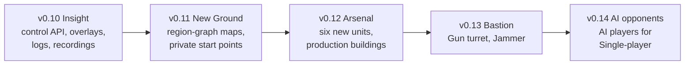

# WAR-2D Roadmap: v0.10 to v0.14

The second roadmap. The first one (v0.2 to v0.9: foundations, scale, fog, UI, art, Steam, siege) is complete and archived in [archive/roadmap-v0.2-v0.9.md](archive/roadmap-v0.2-v0.9.md), with its specs, plans, spike and performance results under [archive/](archive/).

- **Designs:** one spec per update in [`superpowers/specs/`](superpowers/specs/). If this file and a spec disagree, the spec wins and this file gets fixed.
- **Step-by-step plans:** each update's implementation plan lives in [`superpowers/plans/`](superpowers/plans/). The v0.10, v0.12, v0.13 and v0.14 plans are written (v0.13's is done). The v0.14 plan was written before v0.13 was built (owner, 2026-10-23), so it is re-checked against the merged v0.13 code when v0.14 starts.
- **Current state of the game:** [gameplay.md](gameplay.md), [architecture.md](architecture.md), [known-issues.md](known-issues.md), [bug-review.md](bug-review.md).

| Update | Name       | Delivers                                                                                                                       | Status                         | Design                                                                 | Plan                                                         |
| ------ | ---------- | ------------------------------------------------------------------------------------------------------------------------------ | ------------------------------ | ---------------------------------------------------------------------- | ------------------------------------------------------------ |
| v0.10  | Insight    | A control API and CLI for Claude and the owner, debug overlays, structured logs, and match recordings players watch afterwards | Built; perf gate passes with the recorder on (23.9 ms p95); owner playtest pending | [design](superpowers/specs/2026-10-16-v0.10-insight-design.md)        | [plan](superpowers/plans/2026-10-16-v0.10-insight.md)         |
| v0.11  | New Ground | A region-graph map generator (lanes, chokepoints, contested expansions) and private start points                               | Built, gated and UI done (Figma approved 2026-10-17) | [design](superpowers/specs/2026-10-16-v0.11-new-ground-design.md)     | Written when v0.11 starts                                    |
| v0.12  | Arsenal    | Scout, Heavy, Artillery, Sniper, Flamethrower and Suicide bomber; role-based production buildings, one unit type at a time      | Done: perf gate passes (23.8 ms p95, see perf/v0.12); security review, code review and a full Linux match done (owner, 2026-10-23) | [design](superpowers/specs/2026-10-16-v0.12-arsenal-design.md), [Figma](ux/v0.12-figma.md) | [plan](superpowers/plans/2026-10-17-v0.12-arsenal.md): all tasks done                                    |
| v0.13  | Bastion    | Static defences: the Gun turret and the Jammer                                                                                 | Built, tested and reviewed (2026-10-23): perf gate passes with a headless host (21.3 ms p95, see perf/v0.13), windowed re-run pending; two-process Linux match done headless | [design](superpowers/specs/2026-10-16-v0.13-bastion-design.md), [Figma](ux/v0.13-figma.md) | [plan](superpowers/plans/2026-10-23-v0.13-bastion.md): all tasks done |
| v0.14  | AI opponents | AI players in the lobby, so the game has Single-player and co-op against the AI before the Steam Early Access launch | Spec and plan written (2026-10-23), owner review pending | [design](superpowers/specs/2026-10-23-v0.14-ai-opponents-design.md); [store page plan](superpowers/specs/2026-10-19-store-page-design.md) §6 | [plan](superpowers/plans/2026-10-23-v0.14-ai-opponents.md) |

The owner set the scope, order and numbering on 2026-10-16 and will review the specs before each update starts. Decisions still open are listed at the end of each spec.

---

## 1. Why this order

- **v0.10 first:** every later update is easier to build, test and debug once Claude can drive a running game, the overlays show what the pathing, fog and replication are doing, and a recording can show a bug again. Recordings are also a player feature.
- **v0.11 before the units:** a new generator changes every seed's map and hash, the start sites and the perf gate's layout. Unit balance (Scout speed, Artillery range, which lanes Heavies fit through) depends on the maps it is tuned on, so the maps come first.
- **v0.14 last:** the AI has to play the finished roster, the new maps and the defences, so it comes after them. It is the last update before the Steam Early Access launch ([store page plan](superpowers/specs/2026-10-19-store-page-design.md)).
- **v0.12 before v0.13:** the defences are balanced against the new roster (the Gun turret against light units, the Jammer against Scouts and Radar), and the turret reuses the combat changes v0.12 makes (armour classes, buildings in the damage table).

Every update ships a playable, tested build.

---

## 2. The updates

### v0.10: Insight

> Tools that let Claude and the owner see, drive and replay the game.

- **Control API and `tools/war2d` CLI.** Localhost only, in the editor and in development builds started with `-debugApi`; release builds refuse it. Read the game (state, players, units, buildings, tiles, a player's fog, logs), drive it (host, join, start, add bots, order, spawn, set resources, pause and step the tick, move the camera, screenshot). The same scenario commands are in the TIM console.
- **Debug overlays** (dev builds, host process): flow fields and routes, unit stances and targets, fog grids per owner, sectors and portals, the spatial hash, footprints, replication interest.
- **Structured logs** (`WarLog`): categories and levels, an in-memory ring, a per-session file, filterable from the console and the API.
- **Match recordings.** The host records a fog-free spectator stream. After *GameOver* each player is offered the file in the background, and a **Replays** screen plays it back (play, pause, speed, seek, free camera, no fog). Nothing is sent before the match is over.

**Exit criteria:** Claude can host a match in the editor and in two dev-build processes, set up a scenario, observe it and take screenshots through the CLI without the owner's help; every overlay draws; a recorded 2-player match is offered to the joining player and plays back to the end; the perf gate passes with the recorder on.

### v0.11: New Ground

> Designed, strategic maps from a seed, and start points nobody else knows.

- **Region-graph generator:** start sites, rich expansions and central areas joined by a looped graph of lanes, some with narrow chokepoints; fewer scattered gems, rich fields at expansions. Every start site passes the same fairness tests (area, vein, distance to its neighbours).
- **Private start points:** the host sets how many options each player gets. The server deals them with its own randomness; only the player (and their teammates) learn them. Players pick one by placing their HQ in it during *PlacingHQ*. The host sets the pick time: 0 (everyone gets a random option), a time limit (the server places the rest at the deadline), or unlimited (the match waits for everyone). The lobby's clearing claim goes.

**Exit criteria:** leak tests prove no player learns another's options or pick (teammates excepted); the generator meets its fairness tests on 1,000 seeds at every map size; the perf gate passes on the new layout.

### v0.12: Arsenal

> More units, and buildings that each make one family of them.

- **Units:** Scout, Heavy, Artillery (direct fire, long range, splash), Sniper, Flamethrower (splash), Suicide bomber (detonates on contact or on a Detonate order).
- **Production:** HQ (Builder), Barracks (Scout, Tank, Flamethrower), Heavy Factory (Heavy, Artillery, Sniper), Siege Workshop (Digger, Suicide bomber). A producer makes one selected type at a time; switching clears its queue.
- **Combat:** splash damage, `LightUnit`/`HeavyUnit` armour classes in the damage table, the large pathing class used for real.

**Exit criteria:** rules tests for every unit and the production change; the perf gate passes with the mixed roster.

### v0.13: Bastion

> Defences worth building at a chokepoint.

- **Gun turret:** a building that attacks units, buildings and walls like a unit that can't move; strong against light units.
- **Jammer:** inside its radius, enemies see only at short range and enemy Radars see nothing.

**Exit criteria:** rules and leak tests for both (a jammed unit never reaches an enemy client beyond the short range); the perf gate passes with defences in the siege load.

### v0.14: AI opponents

> Someone to play against when nobody else is online.

- **AI players:** the host adds AI slots in the lobby, each with a difficulty (Easy, Normal, Hard), a play style (Rusher, Turtle, Expander, Balanced, or Random), a generated callsign, a colour and a team, like a human player. The AI places its HQ, builds an economy, expands, makes an army from the whole roster, builds defences, scouts, attacks, reacts to diplomacy, and surrenders when hopeless.
- **Server-side only, no cheating:** the AI runs on the server, acts through the same validated actions as a player's commands, and sees only a team view built from the replication interest rules. No difficulty gets extra resources or vision.
- **Single-player through the lobby:** a new lobby Visibility setting (Public, Friends, Private); a Private lobby with AIs is Single-player and works without Steam. A match with one human can be paused from the in-match menu.
- **Dev bots** become AI seats (a Scripted seat for the perf harness).
- **Store page:** Single-player and co-op against the AI go on the Steam page once this ships.

**Exit criteria:** AI-vs-AI matches finish on every map size, with Hard beating Normal and Normal beating Easy in at least 80% of games; leak tests prove the AI's view holds only its team's knowledge; the perf gate passes with AI players in the match (AI thinking ≤ 2 ms p95).

---

## 3. Performance budget

Unchanged from the first roadmap, on the same reference machine (Ryzen 5 5600GT, 32 GB, Radeon RX 6600, Linux, hosting and playing):

| Metric               | Target                                                      |
| -------------------- | ----------------------------------------------------------- |
| Server simulation    | 20 ticks/s, **≤ 25 ms main-thread tick p95** at 80,000 units |
| Client frame rate    | **≥ 60 fps** with 10,000 own units on screen                |
| Bandwidth per client | **≤ 256 KB/s average**, ≤ 768 KB/s peak 1 s                 |

The last gate (v0.7) measured 20.9 ms p95, so the margin is small: v0.10's recorder, v0.12's splash damage and v0.13's turret targeting each must be measured with `tools/perf-run.sh` before their update lands. New results go in `docs/perf/v0.N/`.

---

## 4. How every update is built

These rules carry over from the first roadmap unchanged.

- **Bugs before features:** a bug found during an update is fixed in it or logged in [known-issues.md](known-issues.md).
- **Security:** the server is authoritative; every `[Command]` goes through `CommandGate` and validates its arguments; hidden information never leaves the server and `LeakTests` prove it; validators get fuzz tests.
- **Config:** every balance number is in `GameConfig.xml`.
- **UI:** any HUD or menu change goes through Figma and the owner's approval first.
- **Art and sound:** generated (`RenderGen`, `EffectGen`, the SFX and music builders); nothing hand-made in `Resources`.
- **Testing:** EditMode and PlayMode suites through the live editor, both passing before a merge; compile checks while working.
- **Workflow:** one branch per update (`release/v0.N`), never commit from `main`, no co-author or AI attribution in commits; a security review and a code review before each merge; docs updated in the same branch.

**Definition of done:** all tests pass, the performance budget is met, no open known issue targets the update, and a full match is played on Linux.

---

## 5. Not in this roadmap

The Steam store page and content survey have their own plan: [store page plan](superpowers/specs/2026-10-19-store-page-design.md).

Carried over as candidates for later: the tutorial, the headless dedicated server and host migration, ranked matchmaking, new terrain types (water, forest), other defences (gates, tank traps, shields, decoys), healer and stealth units, and mobile or console platforms.

---

## 6. Decisions log

| Topic (2026-10-16) | Decision |
| --- | --- |
| Order and numbering | v0.10 Insight, v0.11 New Ground, v0.12 Arsenal, v0.13 Bastion |
| Debug tools | Control API plus CLI, overlays, structured logs, recordings. Scenario commands in the API and console only, no in-game debug panel |
| Control API reach | Editor and development builds, localhost, behind `-debugApi` in builds |
| Recordings | Host records; after *GameOver* each player is sent the file in the background; watched from a Replays screen; fog-free |
| Maps | Procedural region graph from the seed; chokepoints, lanes and expansions; no symmetry and no new terrain types |
| Start points | Dealt privately by the server; options per player and pick time (0 = random to unlimited) set by the host; teammates see each other's |
| Units | Scout, Heavy, Artillery (direct fire), Sniper, Flamethrower, Suicide bomber (contact and Detonate order) |
| Production | By role: Barracks, Heavy Factory, Siege Workshop; one type per building; switching clears the queue |
| v0.12 open decisions (2026-10-17) | Tank and Digger Light armour; the §3 numbers go in as written and are tuned in play; Detonate on B; a full Barracks rename |
| Defences | One Gun turret (shoots units, buildings and walls) and the Jammer; v0.13 spec approved |
| Archive | The first roadmap, its specs, plans, spike and perf results moved to `docs/archive/` |
| AI opponents and store (2026-10-19) | AI opponents become v0.14, before the Steam Early Access launch; the store page plan is in `superpowers/specs/2026-10-19-store-page-design.md` (free to play, Early Access, no release date yet) |
| v0.13 plan and v0.14 design (2026-10-23) | v0.12's reviews and Linux match are done; v0.13 starts with Figma and art up front. v0.14: Easy/Normal/Hard, never cheating, Single-player through a Private lobby, team-view snapshot, independent AI allies, AI reacts to diplomacy, host-picked styles, pause only with one human, dev bots become AI seats, lobby Visibility, Hard ≥ 80% vs Normal, surrenders when hopeless, military callsigns |
