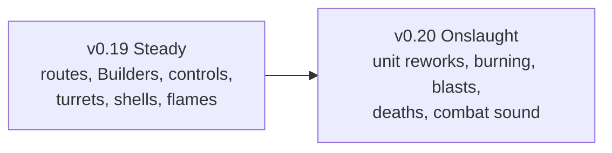

# WAR-2D Roadmap: v0.19 and v0.20

The fourth roadmap, planned 2026-11-06. v0.19 ships the routing, Builder, control and combat-visual work built on the unstable branch since v0.18, and v0.20 is a combat overhaul: clearer fights and units that each do one job their own way. The third roadmap (v0.16 to v0.18) is merged and archived in [archive/roadmap-v0.16-v0.18.md](archive/roadmap-v0.16-v0.18.md); the second (v0.10 to v0.14, then v0.15 and v0.15.1) is in [archive/roadmap-v0.10-v0.14.md](archive/roadmap-v0.10-v0.14.md), and the first (v0.2 to v0.9) is in [archive/roadmap-v0.2-v0.9.md](archive/roadmap-v0.2-v0.9.md).

- **Designs:** one spec per update in [`superpowers/specs/`](superpowers/specs/). If this file and a spec disagree, the spec wins and this file gets fixed.
- **Step-by-step plans:** each update's implementation plan goes in [`superpowers/plans/`](superpowers/plans/), written when the update starts.
- **Current state of the game:** [gameplay.md](gameplay.md), [architecture.md](architecture.md), [known-issues.md](known-issues.md), [bug-review.md](bug-review.md).

| Update | Name      | Delivers | Status | Design | Plan |
| ------ | --------- | -------- | ------ | ------ | ---- |
| v0.19  | Steady    | The unstable branch, finished and shipped: routes and jams fixed, idle Builders take the closest job, build keys with nothing selected, Ctrl + drag for buildings, Attack-move fires at the closest thing, orders drawn at once and smoothed, blue and red rally flags, cheaper ticks and a 100-order queue, Builders finish walls, turning turrets, real-looking shells, craters and flames, blueprints on ground you last saw, and the review fixes | Built on `unstable/pr30-routes-testing` plus the 2026-11-06 playtest fixes (uncommitted on `fix/pr30-review-round3`); EditMode 1482/1482, PlayMode 97/98 (a timing test), perf gate 26.3 ms against the new 28 ms budget; `ai-bench`, three live checks and a Linux match to do | [design](superpowers/specs/2026-11-06-v0.19-steady-design.md) | Not needed: the work is built; the spec's §4 checklist is the plan |
| v0.20  | Onslaught | A combat overhaul. **Bombers** (renamed from Suicide bombers) leap into the middle of an army and can't be shot down in the air; **Flamethrowers** reach further, hit softer and set units and buildings on fire; **Artillery** fires much further than it sees, with a huge blast and a very long reload, from shells that fly and land; **Snipers** become 2×2 heavy-killers that stop and aim; **Scouts** spot, **Heavies** carry armour, **Gun turrets** shred swarms, **Tanks** stay the baseline. A blast-resistance stat, flat armour and burning; the Bomb is renamed the Mine. New deaths and wrecks, new attack effects and a combat sound pass | Designed 2026-11-06; nothing built | [design](superpowers/specs/2026-11-06-v0.20-onslaught-design.md), [Figma brief](ux/v0.20-figma.md) | Written when the update starts |

The owner set both updates on 2026-11-06: v0.19 is "the completed content from the PRs currently in development under the unstable branch", and v0.20 is "a major combat overhaul, both improving the visual of combat and making each unit more unique". Decisions still open are listed at the end of each spec.

---

## 1. Why this order

- **Ship what is built first.** Eight PRs and three rounds of review fixes sit on the unstable branch, together with the owner's 2026-11-06 playtest fixes. They change how units move, find work and look in a fight, but only one balance number (`Orders/MaxQueued`), so they are finished and shipped as they are, with nothing new added. v0.20 then starts from a `main` that has them.
- **The combat overhaul second, and as one update.** Every v0.20 rework changes what the others are worth: a Bomber that leaps past the screen, a Flamethrower that burns, Artillery that out-ranges its own sight and a Sniper that hunts Heavies all move the same counters. Building them together means one `balance-sheet`, `ai-bench` and Field-manual pass at the end, against the finished set, rather than one per unit.
- **The visuals with the rules.** v0.19's turning turrets, shells, craters and flames are the base. v0.20's leap arc, burning units, aim laser, big blast and new deaths each show a rule v0.20 adds, so they are built with that rule and tested against it.
- **Closed PRs stay out.** PR 42 (real shells), PR 43 (Large Radar and Large Jammer) and PR 38 (the bomber chain rework) are in neither update. v0.20 designs shells and bombers again from the owner's 2026-11-06 answers.

Every update ships a playable, tested build.

---

## 2. The updates

### v0.19: Steady

> Units get where they are sent, Builders keep busy, orders feel instant, and fights look the part.

- **Movement and routes:** routes per pocket of floor, jams at narrow gaps end, big formations arrive, attackers in a crowd close to range, units on an Attack-move go at their own speed, and route waypoints keep their half tile on the wire.
- **Builders:** an idle Builder takes the closest job it can walk to, anywhere; Builders finish walls by moving own and allied units off the tile; build keys and the build row work with nothing selected; a blueprint can go on ground you last saw, and is placed or refunded once your side sees the spot.
- **Controls:** Ctrl + drag selects only buildings; an Attack-move fires at the closest thing in range; blue (Move) and red (Attack-move) rally flags; a 100-order queue; own orders drawn at once and corrections smoothed.
- **Combat visuals:** turrets that turn, a raised Artillery barrel, shells on an arc with a shadow, craters, muzzle flashes, tracers and flame streams.
- **Under the hood:** cheaper ticks and formation orders, messages kept under the transport cap, rematches that forget the last match, and the lobby team board without Quick setup.

**Exit criteria:** both suites pass; the perf gate is at or under the new **28 ms** tick budget with client frame time measured with the turret layer on; an `ai-bench` check that the difficulty ladder still holds; the three "not reproduced" playtest reports checked in a live match; a full match on Linux. Details in the [spec](superpowers/specs/2026-11-06-v0.19-steady-design.md).

### v0.20: Onslaught

> Every unit fights its own way, and every fight shows you what happened.

- **Bomber** (renamed from Suicide bomber): runs at the nearest army and, in leap range, leaps over units to its centre and explodes. In the air it can't be hit. Gunfire, decay, fire or a blast that kills it, or one that leaves it at 10 % or less, sets it off where it is. It resists blasts, so one blast doesn't chain a pack.
- **Flamethrower:** longer range, much less damage per hit, and every hit sets the target on fire (one burn, refreshed by the next hit). Units and buildings burn, Heavies at half rate; walls don't.
- **Artillery:** fires much further than it sees, so it needs spotters; a shell flies, lands where it aimed and can miss; a big blast that hurts its own side a little; a very long reload.
- **Sniper:** a 2×2 unit with long range and middling sight; it stops and aims before each shot, with a laser that shows its target; it does great damage to one unit, most of all to Heavies; weak against buildings, and it still can't fire up close.
- **Scout** spots for the gun line with the longest sight; **Heavy** gets flat armour that shrugs off small arms, and blast resistance; **Gun turret** fires fast, light shots against swarms; **Tank** stays the all-rounder.
- **Shared rules:** a per-unit blast resistance, flat armour, burning, and the Bomb building renamed the Mine.
- **Visuals and sound:** deaths by size and cause, wrecks and collapsing buildings; the leap arc, burning units and scorch, the aim laser and shot trail, the big shell and its blast; generated sounds for each.
- **HUD and manual:** a small Figma round (burning and aiming shown on the selection and hover cards, the new stats, the renamed icons), and the Field manual's words for the new rules approved through its mock website again.

**Exit criteria:** every rule's tests; `LeakTests` with the new burning, leap, aim and shell cases; the Field manual's every-type and every-number tests on the new stats; `balance-sheet` with no new flags and an `ai-bench` check that the difficulty ladder holds with the AI using spotters, leaps and burning; the perf gate passes at 28 ms with fire, shells, leaps and aims in the load; the owner approves the Figma frames and the manual's words before they are built; a full match on Linux.

---

## 3. Performance budget

On the same reference machine (Ryzen 5 5600GT, 32 GB, Radeon RX 6600, Linux, hosting and playing). **The tick budget is raised from 25 to 28 ms from v0.19 on** (owner, 2026-11-06), after the review rounds left the main tick at 26.3 ms:

| Metric               | Target                                                       |
| -------------------- | ------------------------------------------------------------ |
| Server simulation    | 20 ticks/s, **≤ 28 ms main-thread tick p95** at 80,000 units |
| Client frame rate    | **≥ 60 fps** with 10,000 own units on screen                 |
| Bandwidth per client | **≤ 256 KB/s average**, ≤ 768 KB/s peak 1 s                  |

v0.19 has never had its client frame measured with the turret layer (PR 41 adds a second instanced layer for units on screen) or its 4096×2048 atlases, so v0.19 measures it. v0.20 adds tick work (burning, shells in flight, leaps, Sniper aim) and client work (fire on units, lasers, death effects), and runs `tools/perf-run.sh` with all of it in the load. New results go in `docs/perf/v0.N/`.

---

## 4. How every update is built

Unchanged from the earlier roadmaps.

- **Bugs before features:** a bug found during an update is fixed in it or logged in [known-issues.md](known-issues.md).
- **Security:** the server is authoritative; every `[Command]` goes through `CommandGate` and validates its arguments; hidden information never leaves the server and `LeakTests` prove it.
- **Config:** every balance number is in `GameConfig.xml`.
- **UI:** any HUD or menu change goes through Figma and the owner's approval first.
- **Art and sound:** generated; nothing hand-made in `Resources`.
- **Testing:** EditMode and PlayMode suites through the live editor, both passing before a merge; compile checks while working.
- **Workflow:** one branch per update (`release/v0.N`), never commit from `main`, no co-author or AI attribution in commits; a security review and a code review before each merge; docs updated in the same branch; `GameVersion.Protocol` and `bundleVersion` bumped when the wire format changes.

**Definition of done:** all tests pass, the performance budget is met, no open known issue targets the update, and a full match is played on Linux.

---

## 5. Not in this roadmap

- **Closed PRs (owner, 2026-11-06):** real artillery shells as PR 42 built them, the Large Radar and Large Jammer (PR 43) and the bomber chain rework (PR 38). v0.20 designs shells and bombers fresh.
- **Combat ideas left out of v0.20:** damage states on hurt units and buildings (smoke and flames by health; the owner left them out of the visual pass), fire that spreads from unit to unit, a fire-at-ground order for Artillery, healer and stealth units, new unit types.
- **Carried from the last roadmap:** a tutorial, a guided first match, explanatory tooltips, a hotkey overlay; richer hover cards beyond v0.20's stat lines, an economy breakdown, a production overview, a live stats screen, an always-on waypoint view; status markers over units and buildings, strategic zoom; a Patrol order, repeat production, mixed production queues, camera bookmarks, selection-panel clicks, squad add/steal, select damaged or idle; unit idle animation; dynamic (combat-layer) music, ambient sound beds; new terrain (water, forest), more defences (gates, tank traps, shields, decoys), new modes; a headless dedicated server, host migration, ranked matchmaking; mobile or console platforms.

The owner turned down on 2026-10-30 (see [polish.md](polish.md)): screen shake, order-acknowledgement chirps, chat, floating resource numbers, an idle-producer alert, a Quick skirmish button, first-match hints, colourblind team colours.

---

## 6. Decisions log

| Topic (2026-11-06) | Decision |
| ------------------ | -------- |
| v0.19 scope | Exactly the unstable branch (PRs 30, 31, 33, 34, 37, 39, 40, 41, review rounds 2 and 3) plus the owner's 2026-11-06 playtest fixes; nothing added |
| Closed PRs | 42 (real shells), 43 (Large Radar and Jammer) and 38 (bomber chain rework) go in neither update |
| v0.19 exit | The full bar (both suites, perf gate, `ai-bench`, the live checks, a Linux match) with the tick budget relaxed |
| Tick budget | 28 ms p95 from v0.19 on (was 25) |
| v0.20 shape | One update: every unit rework and the combat visuals, one balance and AI pass at the end |
| Names | v0.19 Steady, v0.20 Onslaught |
| Bomber | Renamed from Suicide bomber; leaps into the centre of the nearest army, over units but not walls or rock; can't be hit while leaping; explodes on any death and at 10 % health; blast resistant |
| Blast resistance | A per-unit stat: Bombers high, Heavies some, light units none |
| Flamethrower | Longer range, much less damage, sets targets on fire; one burn per target, refreshed by each hit; light units, heavy units (half rate) and buildings burn; fire doesn't spread |
| Artillery | Much longer range, similar sight, a much bigger blast and damage, a very long reload; shells fly and land; its own side and allies take a reduced share |
| Sniper | 2×2, long range, medium sight, big single-target damage, best against Heavies; stops and aims before each shot; weak against buildings; keeps its minimum range |
| Other units | Scout as spotter, Heavy armoured, Gun turret anti-swarm, Tank as the baseline |
| Bomb building | Renamed the Mine |
| Visuals | Deaths and wrecks, new attack effects and a combat sound pass; not damage states |
| HUD | A small Figma round |
