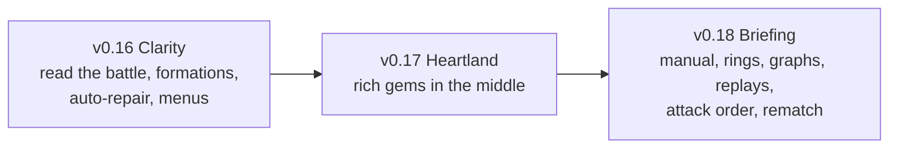

# WAR-2D Roadmap: v0.16 to v0.18

The third roadmap: polish and usability, with one piece of new content, then an update about showing players what they need to know (added 2026-11-03). The second roadmap (v0.10 to v0.14, then v0.15 and v0.15.1) is complete and archived in [archive/roadmap-v0.10-v0.14.md](archive/roadmap-v0.10-v0.14.md); the first (v0.2 to v0.9) is in [archive/roadmap-v0.2-v0.9.md](archive/roadmap-v0.2-v0.9.md).

- **Designs:** one spec per update in [`superpowers/specs/`](superpowers/specs/). If this file and a spec disagree, the spec wins and this file gets fixed.
- **Step-by-step plans:** each update's implementation plan goes in [`superpowers/plans/`](superpowers/plans/), written when the update starts.
- **Current state of the game:** [gameplay.md](gameplay.md), [architecture.md](architecture.md), [known-issues.md](known-issues.md), [bug-review.md](bug-review.md).

| Update | Name      | Delivers                                                                                                                                                         | Status                         | Design                                                                                          | Plan                      |
| ------ | --------- | ---------------------------------------------------------------------------------------------------------------------------------------------------------------- | ------------------------------ | ----------------------------------------------------------------------------------------------- | ------------------------- |
| v0.16  | Clarity   | Reading the battle (target lines, minimap combat, a clear HQ-placement minimap), controls (formations, Builder auto-repair) and menu presentation | Built on `release/v0.16` (2026-11-02), tests pass; perf gate passes on a quiet machine (19.7 ms, 2026-11-03, [perf/v0.16](perf/v0.16/README.md)); code review and a Linux match to do | [design](superpowers/specs/2026-11-01-v0.16-clarity-design.md), [Figma brief](ux/v0.16-figma.md) | [plan](superpowers/plans/2026-11-01-v0.16-clarity.md) |
| v0.17  | Heartland | Rich gems: a new gem tile in the middle of every map that pays 2.5 times as much, and an AI that values it                                                      | In progress on `release/v0.17` (2026-11-03): built (Figma H1 approved), tests pass, perf gate passes (22.6 ms, [perf/v0.17](perf/v0.17/README.md)), AI bench accepted (longer 1024 games); a Linux match to do | [design](superpowers/specs/2026-11-01-v0.17-heartland-design.md), [Figma brief](ux/v0.17-figma.md) | [plan](superpowers/plans/2026-11-03-v0.17-heartland.md) |
| v0.18  | Briefing  | Showing information and ease of use: a Field manual generated from the config, range rings on a held key, end-screen graphs and a timeline, replay graphs, markers and a per-player fog view, an Attack order, a drag box that prefers the army, Rematch and remembered lobby settings | Designed 2026-11-03, waiting for the owner's approval; Figma not drawn | [design](superpowers/specs/2026-11-03-v0.18-briefing-design.md), [Figma brief](ux/v0.18-figma.md) | Written when the update starts |

The owner set the direction, the split and the order on 2026-11-01 ("polish and usability, with some new content sprinkled in"; two bigger updates), and added v0.18 on 2026-11-03 ("displaying information to users and ease of use"). Decisions still open are listed at the end of each spec.

---

## 1. Why this order

- **Polish first:** the game's balance and AI were signed off on 2026-11-01. v0.16 changes how the game reads and handles, not what anything is worth, so the sign-off still holds when it ships.
- **The economy change last:** rich gems change every seed's map, the value of the middle and the AI's scoring. Doing it last means one balance and AI re-check at the end, against the finished controls (formations change how armies arrive at a contested middle).
- **One Figma round for v0.16:** target lines, minimap combat, the HQ-placement minimap and the menus are all HUD or menu work, so one brief ([ux/v0.16-figma.md](ux/v0.16-figma.md)) covers them before any is built.

- **Briefing after Heartland:** v0.18 changes no balance number (the Attack order's repath numbers are pathing, not worth), so the v0.17 balance and AI check still holds; its manual reads the finished v0.17 config, rich gems included. It starts once v0.16 and v0.17 have had their Linux matches.

Every update ships a playable, tested build.

---

## 2. The updates

### v0.16: Clarity

> See what's happening at a glance, move armies with less babysitting, and a front end that looks finished.

- **Reading the battle (client only):** target lines for selected units, fights flashing on the minimap, and a minimap that shows the whole map and your start options clearly while you place your HQ.
- **Controls (server):** formations (a group arrives together, at its slowest member's pace, heavy units in front) and Builders that repair nearby damage on their own when idle. The wall drag that stops after `Orders/MaxQueued + 1` tiles is fixed along the way.
- **Menu presentation:** transitions and motion through the main menu, Play, lobby and Settings, and a better-looking lobby.

**Exit criteria:** every feature's rules tests; `LeakTests` unchanged (nothing new is sent to clients); the perf gate passes with formations in the load; the owner approves the Figma frames before any HUD or menu item is built.

### v0.17: Heartland

> Something in the middle worth fighting for.

- **Rich gems:** a new tile, generated only in central areas, that a Miner mines for 2.5 times the ordinary rate, for good.
- **The AI** scores start options, expansions and targets with rich gems in mind.

**Exit criteria:** tile and generator tests (fairness on 1,000 seeds at every map size), Miner payout tests, `LeakTests`; an `ai-bench` check that the difficulty ladder still holds; the perf gate passes on the new maps.

### v0.18: Briefing

> Know what everything does, see what your units can reach, and understand how the match went.

- **Knowing the game (client only):** a Field manual from the main menu, the lobby, the in-match menu and F1 (opens at the selected type): every unit and building with its stats, counters worked out from the damage table, the damage grid, the rules and the current bindings, all generated from `GameConfig.xml`.
- **Reading the battle (client only):** hold Alt for range, minimum-range and sight rings on the selection and on whatever is under the pointer; a turret, Radar or Jammer shows its reach while being placed.
- **Looking back:** end-screen graphs (army value, income, kills, losses) and a timeline of eliminations and big fights, sent only at _GameOver_; the replay viewer gets the same graphs, markers on its seek bar and a per-player view through that player's recorded fog (replay format 3).
- **Ease of use (server and client):** an Attack order (right-click or A-click on an enemy; never follows a target into the fog), a drag box that drops Builders when it catches army, Rematch back to the same lobby with the AIs, and the host's lobby settings remembered.

**Exit criteria:** every feature's rules tests; `LeakTests` with the new Attack-order and summary tests; the manual's every-type and every-number tests; a two-match Rematch PlayMode test; the perf gate passes with Attack orders and the team-fog recording in the load; the owner approves the Figma frames before any HUD or menu item is built.

---

## 3. Performance budget

Unchanged, on the same reference machine (Ryzen 5 5600GT, 32 GB, Radeon RX 6600, Linux, hosting and playing):

| Metric               | Target                                                       |
| -------------------- | ------------------------------------------------------------ |
| Server simulation    | 20 ticks/s, **≤ 25 ms main-thread tick p95** at 80,000 units |
| Client frame rate    | **≥ 60 fps** with 10,000 own units on screen                 |
| Bandwidth per client | **≤ 256 KB/s average**, ≤ 768 KB/s peak 1 s                  |

v0.16's formations and auto-repair add tick work, and the 2026-11-01 terrain-replication change hasn't been measured yet, so v0.16 runs `tools/perf-run.sh` before it lands. v0.18's Attack-order repaths and the recorder's team-fog channel add tick work too, and the range rings are measured on the client frame. Target lines and the minimap flashes are measured on the client frame. New results go in `docs/perf/v0.N/`.

---

## 4. How every update is built

Unchanged from the earlier roadmaps.

- **Bugs before features:** a bug found during an update is fixed in it or logged in [known-issues.md](known-issues.md).
- **Security:** the server is authoritative; every `[Command]` goes through `CommandGate` and validates its arguments; hidden information never leaves the server and `LeakTests` prove it.
- **Config:** every balance number is in `GameConfig.xml`.
- **UI:** any HUD or menu change goes through Figma and the owner's approval first.
- **Art and sound:** generated; nothing hand-made in `Resources`.
- **Testing:** EditMode and PlayMode suites through the live editor, both passing before a merge; compile checks while working.
- **Workflow:** one branch per update (`release/v0.N`), never commit from `main`, no co-author or AI attribution in commits; a security review and a code review before each merge; docs updated in the same branch; `GameVersion.Protocol` and `bundleVersion` bumped when the wire format changes.

**Definition of done:** all tests pass, the performance budget is met, no open known issue targets the update, and a full match is played on Linux.

---

## 5. Not in this roadmap

Considered on 2026-11-01 and left for later:

- **Learning the game:** a tutorial, a guided first match, explanatory tooltips (the v0.18 manual covers the reference side), a hotkey overlay.
- **Information (considered 2026-11-03):** richer hover cards, an economy breakdown, a production overview, a live stats screen, an always-on waypoint view.
- **Battle view:** status markers over units and buildings (idle, unpaid, under attack, producing); strategic zoom (units and buildings as icons when zoomed far out; drawn for v0.16 and dropped at the owner's Figma review, 2026-11-01).
- **Controls:** a Patrol order, repeat production, mixed production queues, camera bookmarks, selection-panel clicks, squad add/steal, select damaged or idle (the last five considered 2026-11-03).
- **Feel:** unit turn, idle, recoil and death animation; dynamic (combat-layer) music; ambient sound beds.
- **Content:** new terrain (water, forest), more defences (gates, tank traps, shields, decoys), healer and stealth units, new modes.
- **Online:** a headless dedicated server and host migration (the match still ends when the host leaves), ranked matchmaking.
- Mobile or console platforms.

The owner turned down on 2026-10-30 (see [polish.md](polish.md)): screen shake, order-acknowledgement chirps, map pings, chat, floating resource numbers, an idle-producer alert, end-screen graphs (brought back for v0.18 on 2026-11-03), a Quick skirmish button, first-match hints, colourblind team colours.

---

## 6. Decisions log

| Topic (2026-11-01) | Decision |
| ------------------ | -------- |
| Direction | Polish and usability, with some new content sprinkled in |
| Polish themes | Reading the battle; controls and flow; look, sound and feel. Not a tutorial |
| Content | Dense resources at the middle of maps, as a richer gem type, paying 2.5× and never running out |
| Split | Two bigger updates: v0.16 Clarity (all three polish themes), v0.17 Heartland (rich gems) |
| v0.16 picks | Target lines, minimap combat, the HQ-placement minimap (owner addition), formations, Builder auto-repair, menu presentation |
| v0.16 Figma review | Every frame approved except strategic zoom, which leaves v0.16 and the roadmap |
| v0.18 (2026-11-03) | Added as one update the size of v0.16, one Figma round: "displaying information to users and ease of use" |
| v0.18 picks | Field manual (main menu, lobby, in-match menu, F1), range rings on a held key, end-screen graphs and timeline, replay graphs, markers and per-player fog view, Attack order, drag box prefers the army (no override), Rematch to the same lobby, remembered lobby settings |
| v0.18 not | Hover-card changes (the manual carries the detail), status markers, economy breakdown, production overview, live stats, Patrol, repeat production, tutorial, camera bookmarks |
| v0.18 name | Briefing |
