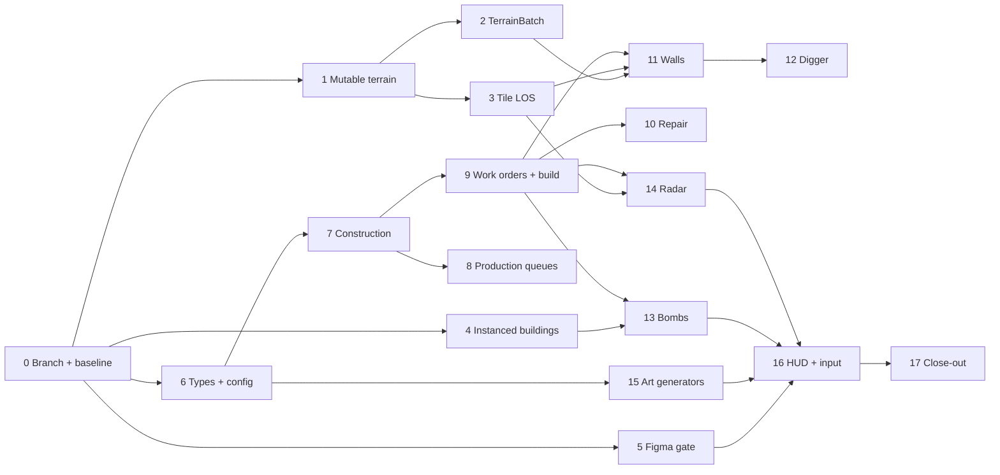

# v0.7 Siege Implementation Plan

> **For agentic workers:** REQUIRED SUB-SKILL: Use superpowers:subagent-driven-development (recommended) or superpowers:executing-plans to implement this plan task-by-task. Steps use checkbox (`- [ ]`) syntax for tracking.
> Project rules that apply to every task: compile with `tools/unity-compile.sh` while working; run **both** suites (`tools/unity-test.sh EditMode`, `tools/unity-test.sh PlayMode`) **once per task, before its commit**, not after every edit. Commit only when the owner has asked for it, never from `main`, and **never add a co-author or AI attribution line** (`CLAUDE.md`). Don't hand-edit `.csproj`/`.slnx`, scene, prefab or `.asset` files. Don't edit vendored code (`Assets/Mirror/`, anything under `Assets/3rd Party/` except `Console/Custom Commands/`).

**Goal:** Builders that construct from blueprints and repair, player walls that block movement and sight, Diggers that tunnel through rock and walls and mine gems, hidden bombs only their owner's side can see, and Radars that see over walls and ping their owner when an enemy comes into range. Everything stays server-authoritative and fog-respecting.

**Architecture:** Terrain becomes mutable at the tick boundary only (`SimCommandKind.SetTile`), and reaches clients as per-client last-seen deltas (`TerrainBatch`) like building ghosts. Line of sight moves to tile resolution so 1×1 walls block it. Walls are terrain tiles with per-tile owner, state and health arrays in `SimData`. Buildings gain a `Construction` component; Builders and Diggers carry a work target (`WorkTile`, `WorkKind`) through the SoA, and new tick stages (`SimConstructionSystem`, `SimDigSystem`, `SimBombSystem`) queue their effects for the boundary to apply. Client buildings move from one GameObject each to an instanced renderer with a tile picker. Bombs are filtered out of every message to players outside the owner's share-vision set. Radars are LOS-free sight sources plus a server-side contact watcher that raises one alert per contact.

**Tech Stack:** Unity `6000.4.1f1`, Unity Entities + Burst jobs, Mirror (KCP and FizzySteamworks), UI Toolkit, NUnit EditMode/PlayMode suites through the live editor.

**Spec:** [2026-10-10-v0.7-siege-design.md](../specs/2026-10-10-v0.7-siege-design.md) (Radar and demolish added 2026-10-15). Parent: [roadmap](../../roadmap.md) §3 v0.7.

## Global Constraints

- **The server owns the world.** Units and buildings are created only by `SimCommandSystem` at a tick boundary. Terrain changes the same way (`SimCommandKind.SetTile`). Main-thread code never touches `Unit` entities, the `SimData` arrays or `MapGrid.Tiles` between ticks; it queues a `SimCommand`.
- **New tick stages** are `[UpdateInGroup(typeof(SimTickGroup))]`, return when `SimClock.Running` is false, schedule Burst jobs over `SimData` on `state.Dependency`, declare write access to `Unit`, and never complete their own jobs.
- **Every new `[Command]`** has `requiresAuthority = false`, a `NetworkConnectionToClient sender = null` parameter, calls `CommandGate.Allow(sender, nameof(...))` first (with a rate-limit entry in `CommandGate`), and validates ownership, `GameState.Playing` (`TryActingOwner`) and value ranges (`CommandValidator`). Never trust a client argument.
- **Clients only see what their side sees.** Bombs (blueprint or built) reach only the owner and players the owner shares vision with, in every message (records, ghosts, placement answers, tracers). Terrain deltas and wall owner/health reach a client only for tiles its grid sees now. `LeakTests` must keep passing and gain v0.7 cases.
- **All balance numbers live in `Assets/Resources/GameConfig.xml`**, parsed strictly by `ConfigParser`. Adding a `UnitType` or `BuildingType` value without its config entry makes the config invalid, so enum and config change together.
- **Wire values are append-only:** new `TileType`, `AlertKind`, `OrderKind`, `BuildingRecord` values go at the end. `TileType.PlayerWall = 4` and `TileType.WallBlueprint = 5` match the slots `MapView` already reserves (`MapView.cs:135` lists `PlayerWall` then `WallBlueprint` after `Border`).
- **UI goes through Figma first** (memory: owner-approved Figma gate). No UI production code (UXML, USS, controllers) before Task 5's approval is recorded.
- **Art** comes only from generators (`RenderGen`, `EffectGen`) registered in `Editor/ArtBuild.cs`, rebuilt with `WAR-2D/Art/Build all`; nothing under `Assets/Resources` is hand-made (`NoPlaceholderArtTests`).
- **Performance budget (roadmap §4):** host main-thread tick ≤ 25 ms p95 at 8 × 10,000 units, ≥ 60 fps, ≤ 256 KB/s average and ≤ 768 KB/s peak per client. Re-run `tools/perf-run.sh` after Tasks 3 and 17.
- Style: XML `/// <summary>` on public members, PascalCase methods, Mirror attributes on networked methods, `Debug.Log` for logs. Keep `docs/` current in the same task that changes behaviour (`known-issues.md` especially).

## Decisions this plan makes (all approved by the owner, 2026-10-15)

These were not in the spec; each is the smallest choice that keeps the spec's rules intact. The owner approved all seven on 2026-10-15 (P1 as revised: blueprints refund in full, finished buildings half). They are recorded in the spec's decisions table.

| # | Decision | Why |
|---|---|---|
| P1 | **Demolish (owner-approved 2026-10-15).** `CmdCancelBuildings` removes any own building except the HQ: a blueprint (still under construction, whatever its progress) is refunded in full; a completed building is refunded `Siege.DemolishRefund` of its cost (0.5, half). It replaces the spec's "full refund before the first progress tick, none after". | Owner report "cannot destroy stuff I placed wrong" (`known-issues.md`, 12-10). |
| P2 | **Upkeep starts on completion.** A blueprint pays no running cost; `UpkeepComponent` is added when construction completes. | A blueprint that decays while waiting for Builders would be lost for no play reason. |
| P3 | **Walls have no upkeep in v0.7** (`WallUpkeep` is not added; the spec's 0.1 is dropped). | Thousands of wall tiles each decaying when unpaid costs a per-tile scan every second; the owner can ask for it later. |
| P4 | **Wall hits are not attack events.** Hitting a wall sends no tracer; clients see the wall's damage state change in the terrain delta. | `AttackEvents` carry entity ids the encoder writes as unsigned; a wall is a tile. Avoids changing the replication encoder. |
| P5 | **An enemy placement on a hidden bomb's tile detonates the bomb** (as if stepped on). Owner and share-vision players see the tile as blocked. | Refusing the placement would tell an enemy the bomb is there (the placement preview answer is a leak). |
| P6 | **Radar pings carry the Radar's own tile.** | The owner already knows it; nothing about the enemy leaks beyond "something hostile is in range". |
| P7 | **Production queues hold unit types.** `SpawnerData` keeps a `FixedList128Bytes<byte>` of queued `UnitType`s (max `SpawnerRules.MaxQueue` = 100 in total); the HQ gets one too. | The spec's "second item in the queue" (Digger) and the HQ's Builder queue. |

## File Structure

| File | Responsibility |
|---|---|
| `Assets/Scripts/World/MapGrid.cs` (modify) | `TileType.PlayerWall`, `TileType.WallBlueprint`; walkability through `TileRules` |
| `Assets/Scripts/Rules/TileRules.cs` (new) | What each tile kind does: floor, blocks sight, diggable, mutable |
| `Assets/Scripts/World/MapStore.cs` (modify) | `SetTile` (boundary only), `InitialTiles`, `ChangedSinceStart` |
| `Assets/Scripts/Sim/SimCommandQueue.cs`, `SimCommandSystem.cs` (modify) | `SetTile`, `PlaceWall`, `CancelBuilding` commands; terrain refresh; work, wall damage, dig and blast write-back at the boundary |
| `Assets/Scripts/Sim/SimData.cs` (modify) | `OpaqueTile`, wall arrays, work and dig SoA, building flags, new event queues, `RefreshTerrain` |
| `Assets/Scripts/Sim/LineOfSight.cs`, `SimVisionSystem.cs`, `SimCombatSystem.cs`, `TargetSearch.cs` (modify) | Tile-resolution LOS; Radar sources; wall targets; bombs untargetable |
| `Assets/Scripts/Net/Replication/TerrainMessages.cs` (new) | `TerrainBatch`, `TerrainCell`, `TerrainCodec`, `TerrainInterest`, `ClientTerrain` |
| `Assets/Scripts/Net/Replication/ReplicationService.cs`, `BuildingReplication.cs` (modify) | Send terrain; bombs and construction progress in building records |
| `Assets/Scripts/Client/BuildingPicker.cs` (new), `Client/Render/InstancedBuildingRenderer.cs` (new), `Client/UnitCommander.cs` (modify) | Instanced client buildings and tile picking |
| `Assets/Scripts/Components/UnitComponents.cs`, `BuildingComponents.cs` (modify) | `UnitType.Builder`/`Digger`, `BuildingType.Bomb`/`Radar`, `Construction`, production queue |
| `Assets/Scripts/Config/GameConfig.cs`, `ConfigParser.cs`, `Assets/Resources/GameConfig.xml` (modify) | `<Siege>` section, new unit and building entries, damage rows |
| `Assets/Scripts/Rules/ConstructionRules.cs`, `WallRules.cs`, `DigRules.cs`, `BombRules.cs`, `RadarRules.cs` (new) | Pure rules, unit-tested |
| `Assets/Scripts/Sim/SimConstructionSystem.cs`, `SimDigSystem.cs`, `SimBombSystem.cs` (new) | Tick stages |
| `Assets/Scripts/Net/SiegeCommands.cs` (new, `partial class WorldStateManager`) | Cancel/demolish, wall drag, production change commands |
| `Assets/Scripts/Net/RadarService.cs` (new) | Server-side Radar contact watch and pings |
| `Assets/Scripts/Net/AlertMessages.cs`, `ClientPlayer.cs` (modify) | New alert kinds, `TargetPlayBlasts`, per-type queue counts |
| `Assets/Scripts/Art/ArtManifest.cs`, `Art/Render/RenderGen.cs`, `Editor/ArtBuild.cs`, `Art/PixelIcons.cs` (modify) | Builder, Digger, Bomb, Radar, wall and blueprint generators; Radar, Dig, Cancel icons |
| `Assets/UI/Hud/*.uxml`, `Assets/Scripts/UI/**` (modify, after Figma) | Command card, production rows, alert texts |
| `Assets/Tests/EditMode/*Tests.cs` (new and modify), `Assets/Tests/PlayMode/SiegeMatchTests.cs` (new) | Tests |
| `docs/architecture.md`, `gameplay.md`, `known-issues.md`, `CLAUDE.md`, `docs/ux/v0.7-figma.md` (modify/new) | Docs |

## Task order



---

### Task 0: Branch and baseline

v0.7 starts from the merged v0.9 (roadmap order, 2026-10-12). Nothing here is code.

**Files:** none.

- [ ] **Step 1: Check that v0.9 is merged.** `git fetch && git log origin/main --oneline | head`. If the `release/v0.9` PR is not merged yet, stop and ask the owner whether to wait or branch from `release/v0.9`.
- [ ] **Step 2: Branch.** `git switch main && git pull && git switch -c release/v0.7`.
- [ ] **Step 3: Baseline.** Run `tools/unity-compile.sh`, `tools/unity-test.sh EditMode`, `tools/unity-test.sh PlayMode`. All must pass. Record the counts in the PR description draft.
- [ ] **Step 4: Open issues.** Read `docs/known-issues.md` and `docs/bug-review.md`. Any item targeted at v0.7 joins the task it belongs to (note which in the PR description). The owner report "cannot destroy stuff I placed wrong" is covered by Task 7 (P1).
- [ ] **Step 5: Perf baseline.** Build `Builds/Linux/WAR-2D.x86_64` and run `tools/perf-run.sh`; save the summary under `docs/perf/v0.7/baseline/`. Later tasks compare against it.

---

### Task 1: Mutable terrain on the server

Tiles change only at a tick boundary, through a command. Walkability goes through one rule so the new floor-like tile (`WallBlueprint`) is handled everywhere.

**Files:**
- Create: `Assets/Scripts/Rules/TileRules.cs`
- Modify: `Assets/Scripts/World/MapGrid.cs`, `Assets/Scripts/World/MapStore.cs`, `Assets/Scripts/Pathing/PathMap.cs:55`, `Assets/Scripts/Sim/SimData.cs` (`BuildLargeGrid`, new `RefreshTerrain`), `Assets/Scripts/Sim/SimCommandQueue.cs`, `Assets/Scripts/Sim/SimCommandSystem.cs`, `Assets/Scripts/Sim/SimContext.cs`, `Assets/Scripts/Unit/WorldStateManager.cs:453`, `Assets/Scripts/Sim/SimCommandSystem.cs:195`
- Test: `Assets/Tests/EditMode/TileRulesTests.cs` (new), `Assets/Tests/EditMode/TerrainChangeTests.cs` (new)

**Interfaces:**
- Produces: `TileType.PlayerWall = 4`, `TileType.WallBlueprint = 5`; `TileRules.IsFloor(TileType)`, `TileRules.IsFloor(byte)`, `TileRules.BlocksSight(TileType)`, `TileRules.IsDiggable(TileType)`, `TileRules.MayChange(TileType from)`; `MapStore.SetTile(int2, TileType) : bool`, `MapStore.InitialTiles : byte[]`, `MapStore.ChangedSinceStart : IReadOnlyCollection<int>`; `SimCommandKind.SetTile` with `SimCommand.Tile` and new field `SimCommand.TileType`; `SimData.RefreshTerrain(int2 tile)`; `SimContext.TerrainChanged : event Action<int2>`.

- [ ] **Step 1: Write the failing rules test** (`Assets/Tests/EditMode/TileRulesTests.cs`)

```csharp
using NUnit.Framework;

/// <summary>What each tile kind does.</summary>
public class TileRulesTests
{
    [Test]
    public void FloorIsGroundAndWallBlueprint()
    {
        Assert.IsTrue(TileRules.IsFloor(TileType.Ground));
        Assert.IsTrue(TileRules.IsFloor(TileType.WallBlueprint), "a blueprint is walkable until construction starts");
        Assert.IsFalse(TileRules.IsFloor(TileType.Wall));
        Assert.IsFalse(TileRules.IsFloor(TileType.Gem));
        Assert.IsFalse(TileRules.IsFloor(TileType.Border));
        Assert.IsFalse(TileRules.IsFloor(TileType.PlayerWall));
    }

    [Test]
    public void RockPlayerWallAndBorderBlockSight()
    {
        Assert.IsTrue(TileRules.BlocksSight(TileType.Wall));
        Assert.IsTrue(TileRules.BlocksSight(TileType.PlayerWall));
        Assert.IsTrue(TileRules.BlocksSight(TileType.Border));
        Assert.IsFalse(TileRules.BlocksSight(TileType.Gem), "gems face floor; they never blocked sight on their own");
        Assert.IsFalse(TileRules.BlocksSight(TileType.WallBlueprint));
        Assert.IsFalse(TileRules.BlocksSight(TileType.Ground));
    }

    [Test]
    public void OnlyRockGemsAndPlayerWallsAreDiggable()
    {
        Assert.IsTrue(TileRules.IsDiggable(TileType.Wall));
        Assert.IsTrue(TileRules.IsDiggable(TileType.Gem));
        Assert.IsTrue(TileRules.IsDiggable(TileType.PlayerWall));
        Assert.IsFalse(TileRules.IsDiggable(TileType.Border), "the map border can never be dug");
        Assert.IsFalse(TileRules.IsDiggable(TileType.Ground));
    }

    [Test]
    public void BorderNeverChangesAndNothingBecomesBorder()
    {
        Assert.IsFalse(TileRules.MayChange(TileType.Border, TileType.Ground));
        Assert.IsFalse(TileRules.MayChange(TileType.Ground, TileType.Border));
        Assert.IsTrue(TileRules.MayChange(TileType.Wall, TileType.Ground));
        Assert.IsFalse(TileRules.MayChange((TileType)99, TileType.Ground), "unknown kinds are refused");
    }
}
```

The existing gem rule: `SimData.BuildOpaque` counts only `Wall` and `Border` as walls, so gems don't block sight today. Keep that.

- [ ] **Step 2: Run it to see it fail.** `tools/unity-compile.sh` → fails: `TileRules` and `TileType.WallBlueprint` don't exist.

- [ ] **Step 3: Add the tile kinds and the rules.** In `MapGrid.cs` append to `TileType`:

```csharp
    /// <summary>A player's wall: blocks movement and sight, has an owner and health (see <c>SimData.WallHealth</c>).</summary>
    PlayerWall = 4,
    /// <summary>A planned wall segment: walkable and see-through until a Builder starts it.</summary>
    WallBlueprint = 5,
```

and change `MapGrid.IsWalkable` to `Contains(t) && TileRules.IsFloor(Tiles[Index(t)]) && Used[Index(t)] == 0`. Create `Assets/Scripts/Rules/TileRules.cs`:

```csharp
/// <summary>What each <see cref="TileType"/> does. Pure and Burst-safe.</summary>
public static class TileRules
{
    /// <summary>True for tiles units may stand on (ignoring building footprints).</summary>
    public static bool IsFloor(TileType type) => type == TileType.Ground || type == TileType.WallBlueprint;

    /// <summary>True for tiles units may stand on, from the grid's byte.</summary>
    public static bool IsFloor(byte type) => IsFloor((TileType)type);

    /// <summary>True for tiles line of sight stops at (the tile itself is still seen).</summary>
    public static bool BlocksSight(TileType type) => type == TileType.Wall || type == TileType.PlayerWall || type == TileType.Border;

    /// <summary>True for tiles a Digger can remove.</summary>
    public static bool IsDiggable(TileType type) => type == TileType.Wall || type == TileType.Gem || type == TileType.PlayerWall;

    /// <summary>True when a tile of kind <paramref name="from"/> may become <paramref name="to"/>: never to or from the border, never an unknown kind.</summary>
    public static bool MayChange(TileType from, TileType to) =>
        from != to && from <= TileType.WallBlueprint && to <= TileType.WallBlueprint && from != TileType.Border && to != TileType.Border;
}
```

- [ ] **Step 4: Route every "is it floor" check through `TileRules`.** Replace each comparison with `TileType.Ground` that means "units may stand here":
  - `MapStore.IsWalkable` (`MapStore.cs:155`): `TileRules.IsFloor(_grid.Tiles[_grid.Index(tile)])`.
  - `PathMap.cs:55`: `!TileRules.IsFloor(grid.Tiles[i]) || grid.Used[i] != 0 ? Rock : Floor`.
  - `SimData.BuildLargeGrid` (`SimData.cs:438`): `!TileRules.IsFloor(map.TileAt(...))`.
  - `WorldStateManager.TryFindSpawnTile` (`WorldStateManager.cs:453`) and `SimCommandSystem.PushUnitsOutOf` (`SimCommandSystem.cs:195`): the search's "may pass through" predicate becomes `t => TileRules.IsFloor(grid.TileAt(t))`.
  - Leave `PlacementRules` (`tileAt(tile) != TileType.Ground`) as it is: buildings may not go on a wall blueprint.
  - Leave `MapPreview.cs:121` (lobby preview only sees generated maps).

- [ ] **Step 5: Run the rules test.** `tools/unity-compile.sh` then `tools/unity-test.sh EditMode` filtered by eye to `TileRulesTests`: PASS. The rest of the suite must still pass (walkability is unchanged for existing tiles).

- [ ] **Step 6: Write the failing terrain test** (`Assets/Tests/EditMode/TerrainChangeTests.cs`)

```csharp
using NUnit.Framework;
using Unity.Mathematics;
using WAR2D.Sim;
using WAR2D.World;

/// <summary>Terrain changes at the tick boundary: SetTile, refusals, paths and units on newly blocked tiles.</summary>
public class TerrainChangeTests
{
    private static void SetTile(SimHarness sim, int2 tile, TileType type) =>
        sim.Context.Commands.Enqueue(new SimCommand { Kind = SimCommandKind.SetTile, Tile = tile, TileType = type });

    [Test]
    public void SetTileAppliesAtTheNextBoundary()
    {
        using var sim = new SimHarness(SimHarness.OpenMap(32));
        int2 tile = new int2(10, 10);
        int changes = 0;
        sim.Context.TerrainChanged += t => { if (t.Equals(tile)) changes++; };
        SetTile(sim, tile, TileType.Wall);
        Assert.AreEqual(TileType.Ground, sim.Map.Grid.TileAt(tile), "nothing changes before the boundary");
        sim.Tick();
        Assert.AreEqual(TileType.Wall, sim.Map.Grid.TileAt(tile));
        Assert.AreEqual(1, changes);
        CollectionAssert.Contains(sim.Map.ChangedSinceStart, sim.Map.Grid.Index(tile));
    }

    [Test]
    public void BorderTilesNeverChange()
    {
        using var sim = new SimHarness(SimHarness.OpenMap(32));
        SetTile(sim, new int2(0, 5), TileType.Ground);
        SetTile(sim, new int2(5, 5), TileType.Border);
        sim.Tick();
        Assert.AreEqual(TileType.Border, sim.Map.Grid.TileAt(new int2(0, 5)));
        Assert.AreEqual(TileType.Ground, sim.Map.Grid.TileAt(new int2(5, 5)));
        Assert.IsEmpty(sim.Map.ChangedSinceStart);
    }

    [Test]
    public void AUnitOnANewlyBlockedTileIsPushedToFloor()
    {
        using var sim = new SimHarness(SimHarness.OpenMap(32));
        int[] id = sim.Spawn(SimHarness.OwnerA, new float2(10.5f, 10.5f));
        sim.Tick();
        SetTile(sim, new int2(10, 10), TileType.Wall);
        sim.Tick();
        sim.Tick(); // the push lands in the next gather
        float2 p = sim.UnitById(id[0]).Position;
        Assert.AreNotEqual(new int2(10, 10), (int2)math.floor(p), "moved off the new rock");
        Assert.IsTrue(sim.Map.Grid.IsWalkable((int2)math.floor(p)));
    }

    [Test]
    public void OpeningRockLetsAMoveOrderThrough()
    {
        // A wall splits the map except for one rock tile at (16, 16); a unit ordered across waits until it opens.
        var rows = new string[32];
        for (int r = 0; r < 32; r++)
            rows[r] = r == 0 || r == 31 ? new string('B', 32) : "B" + new string('.', 14) + "#" + new string('.', 15) + "B";
        using var sim = new SimHarness(MapStore.FromAscii(rows));
        int[] id = sim.Spawn(SimHarness.OwnerA, new float2(5.5f, 16.5f));
        sim.Tick();
        SetTile(sim, new int2(15, 16), TileType.Ground);
        sim.Tick();
        sim.Move(SimHarness.OwnerA, new int2(25, 16), id[0]);
        sim.TickSeconds(8f);
        Assert.Greater(sim.UnitById(id[0]).Position.x, 20f, "the opened tile is a route");
    }
}
```

`ascii` row index 0 is the top row: the wall column is at x = 15 on every interior row, so (15, 16) is rock until opened.

- [ ] **Step 7: Run it to see it fail.** Compile error: `SimCommandKind.SetTile`, `SimCommand.TileType`, `TerrainChanged`, `ChangedSinceStart` missing.

- [ ] **Step 8: Implement `MapStore.SetTile`.** In `MapStore`:

```csharp
        /// <summary>The tiles as generated (or loaded), before any change: every client's starting copy.</summary>
        public byte[] InitialTiles { get; }

        private readonly HashSet<int> changedSinceStart = new HashSet<int>();

        /// <summary>Indices of every tile whose kind changed since the map was made (terrain replication walks these).</summary>
        public IReadOnlyCollection<int> ChangedSinceStart => changedSinceStart;

        /// <summary>
        /// Changes a tile's kind now and records it for the flow-field cache (<see cref="ChangedTiles"/>) and
        /// replication (<see cref="ChangedSinceStart"/>). Refuses border tiles, off-map tiles and unknown kinds
        /// (<see cref="TileRules.MayChange"/>). Tick boundary only: a live match queues
        /// <c>SimCommandKind.SetTile</c> instead.
        /// </summary>
        public bool SetTile(int2 tile, TileType type)
        {
            if (!_grid.Contains(tile)) return false;
            int i = _grid.Index(tile);
            if (!TileRules.MayChange((TileType)_grid.Tiles[i], type)) return false;
            NativeArray<byte> tiles = _grid.Tiles;
            tiles[i] = (byte)type;
            ChangedTiles.Add(tile);
            changedSinceStart.Add(i);
            return true;
        }
```

Set `InitialTiles = tiles.ToArray();` in the private constructor. `ChangedTiles` already feeds `SectorFieldCache.Invalidate` through `OrderBook.AtBoundary` (`OrderBook.cs:143`), so flow fields pick the change up with no more work.

- [ ] **Step 9: The command.** In `SimCommandQueue.cs` append `SetTile` to `SimCommandKind` with the summary "Change the tile at <see cref="SimCommand.Tile"/> to <see cref="SimCommand.TileType"/>." and add the field `public TileType TileType;` to `SimCommand`. In `SimContext` add:

```csharp
        /// <summary>Raised at the boundary for each tile whose kind changed: (tile).</summary>
        public event Action<int2> TerrainChanged;

        internal void RaiseTerrainChanged(int2 tile) => TerrainChanged?.Invoke(tile);
```

- [ ] **Step 10: Refresh derived grids.** In `SimData` add:

```csharp
        /// <summary>
        /// Recomputes what depends on one tile's kind after it changed: the large-unit grid around it and
        /// (from Task 3) the opaque tile and its fog cell. Boundary only.
        /// </summary>
        public void RefreshTerrain(int2 tile)
        {
            for (int dy = -1; dy <= 1; dy++)
            for (int dx = -1; dx <= 1; dx++)
            {
                int2 t = tile + new int2(dx, dy);
                if ((uint)t.x >= (uint)Width || (uint)t.y >= (uint)Height) continue;
                byte value = 0;
                for (int ny = -1; ny <= 1 && value == 0; ny++)
                for (int nx = -1; nx <= 1; nx++)
                {
                    int2 n = t + new int2(nx, ny);
                    bool inside = (uint)n.x < (uint)Width && (uint)n.y < (uint)Height;
                    if (!inside || !TileRules.IsFloor(Tiles[n.y * Width + n.x])) { value = 1; break; }
                }
                LargeGrid[t.y * Width + t.x] = value;
            }
        }
```

- [ ] **Step 11: Apply it in `SimCommandSystem`.** Add the case:

```csharp
                    case SimCommandKind.SetTile:
                        ApplySetTile(data, context, command.Tile, command.TileType, clock.UnitCount);
                        break;
```

and the method:

```csharp
        /// <summary>Changes a tile (refusing the border), refreshes what depends on it and moves units off it when it now blocks. True when it changed.</summary>
        private static bool ApplySetTile(SimData data, SimContext context, int2 tile, TileType type, int unitCount)
        {
            if (!context.Map.SetTile(tile, type)) return false;
            data.RefreshTerrain(tile);
            if (!TileRules.IsFloor(type)) PushUnitsOffTiles(data, context, tile, tile, unitCount);
            context.RaiseTerrainChanged(tile);
            return true;
        }
```

Refactor `PushUnitsOutOf` so its body after computing `lo`/`hi` becomes `PushUnitsOffTiles(SimData data, SimContext context, int2 lo, int2 hi, int unitCount)`, and call that from both places. `SetTile` runs in any game state (like `CreateBuilding`), because the map must stay consistent when commands arrive during the countdown.

- [ ] **Step 12: Run the tests.** `tools/unity-compile.sh`, then both suites. `TerrainChangeTests` PASS; everything else still passes.

- [ ] **Step 13: Commit.**

```bash
git add Assets/Scripts/Rules/TileRules.cs* Assets/Scripts/World Assets/Scripts/Pathing/PathMap.cs Assets/Scripts/Sim Assets/Scripts/Unit/WorldStateManager.cs Assets/Tests/EditMode/TileRulesTests.cs* Assets/Tests/EditMode/TerrainChangeTests.cs*
git commit -m "Make terrain mutable at the tick boundary"
```

---

### Task 2: Terrain deltas to clients (`TerrainBatch`)

A client learns a tile changed only when its grid sees that tile, like a building ghost. Wall owner and health ride along (used from Task 11).

**Files:**
- Create: `Assets/Scripts/Net/Replication/TerrainMessages.cs`
- Modify: `Assets/Scripts/Net/Replication/ReplicationService.cs`, `Assets/Scripts/GameManager.cs:216-218`, `Assets/Scripts/Unit/WorldStateManager.cs` (client: `OnStartClient` initialises `ClientTerrain`), `Assets/Scripts/Client/MinimapTexture.cs` (tile colours read `ClientTerrain`)
- Test: `Assets/Tests/EditMode/TerrainCodecTests.cs` (new), `Assets/Tests/EditMode/LeakTests.cs` (add cases), `Assets/Tests/EditMode/FuzzTests.cs` (add case)

**Interfaces:**
- Consumes: `MapStore.InitialTiles`, `MapStore.ChangedSinceStart`, `SimData.Sees(grid, position)`.
- Produces: `TerrainBatch : NetworkMessage { ArraySegment<byte> Payload }`; `struct TerrainCell { int Index; byte Type; int OwnerId; byte Health; }`; `TerrainCodec.Write(NetworkWriter, List<TerrainCell>)`, `TerrainCodec.Apply(ClientTerrain, ArraySegment<byte>) : bool`; `TerrainInterest.Update(IReadOnlyCollection<int> changed, Func<int, TerrainCell> current, Func<int2, bool> sees, int width, byte[] initial, NetworkWriter writer, int maxBytes) : int`; `ClientTerrain.Current`, `ClientTerrain.Init(MapGrid)`, `ClientTerrain.Changed : event Action<IReadOnlyList<int2>>`, `ClientTerrain.WallOwner(int index)`, `ClientTerrain.WallHealth(int index)`; `ReplicationService.TerrainSinkChannel = -3`; `ReplicationService.TerrainCellOf : Func<int, TerrainCell>` (set by the world; Task 11 fills owner/health).

- [ ] **Step 1: Write the failing codec test** (`Assets/Tests/EditMode/TerrainCodecTests.cs`)

```csharp
using System;
using System.Collections.Generic;
using Mirror;
using NUnit.Framework;
using Unity.Collections;
using Unity.Mathematics;
using WAR2D.Net.Replication;
using WAR2D.World;

/// <summary>Terrain delta encoding and per-client last-seen tracking.</summary>
public class TerrainCodecTests
{
    private static ClientTerrain Terrain(out MapStore map)
    {
        map = MapStore.FromAscii(new[] { "....", "....", "....", "...." });
        var terrain = new ClientTerrain();
        terrain.Init(map.Grid);
        return terrain;
    }

    [Test]
    public void RoundTripsCellsAndReportsChangedTiles()
    {
        var terrain = Terrain(out MapStore map);
        using (map)
        {
            var writer = new NetworkWriter();
            TerrainCodec.Write(writer, new List<TerrainCell>
            {
                new TerrainCell { Index = 5, Type = (byte)TileType.Wall },
                new TerrainCell { Index = 6, Type = (byte)TileType.PlayerWall, OwnerId = 77, Health = 40 },
            });
            IReadOnlyList<int2> changed = null;
            terrain.Changed += c => changed = c;
            Assert.IsTrue(TerrainCodec.Apply(terrain, writer.ToArraySegment()));
            Assert.AreEqual((byte)TileType.Wall, terrain.Tiles[5]);
            Assert.AreEqual((byte)TileType.PlayerWall, terrain.Tiles[6]);
            Assert.AreEqual(77, terrain.WallOwner(6));
            Assert.AreEqual(40, terrain.WallHealth(6));
            CollectionAssert.AreEquivalent(new[] { new int2(1, 1), new int2(2, 1) }, changed);
        }
    }

    [Test]
    public void RejectsOutOfRangeIndicesAndUnknownKinds()
    {
        var terrain = Terrain(out MapStore map);
        using (map)
        {
            var writer = new NetworkWriter();
            TerrainCodec.Write(writer, new List<TerrainCell> { new TerrainCell { Index = 999, Type = 0 } });
            Assert.IsFalse(TerrainCodec.Apply(terrain, writer.ToArraySegment()));
            writer.Position = 0;
            TerrainCodec.Write(writer, new List<TerrainCell> { new TerrainCell { Index = 1, Type = 42 } });
            Assert.IsFalse(TerrainCodec.Apply(terrain, writer.ToArraySegment()));
            Assert.IsFalse(TerrainCodec.Apply(terrain, new ArraySegment<byte>(new byte[] { 3, 1 })), "truncated");
        }
    }

    [Test]
    public void InterestSendsAChangeOnlyOnceAndOnlyWhenSeen()
    {
        byte[] initial = new byte[16];
        var current = new TerrainCell[16];
        for (int i = 0; i < 16; i++) current[i] = new TerrainCell { Index = i };
        current[5].Type = (byte)TileType.Wall;
        var changed = new HashSet<int> { 5 };
        var interest = new TerrainInterest();
        var writer = new NetworkWriter();
        bool seen = false;

        Assert.AreEqual(0, interest.Update(changed, i => current[i], _ => seen, 4, initial, writer, int.MaxValue), "unseen: nothing");
        seen = true;
        Assert.AreEqual(1, interest.Update(changed, i => current[i], _ => seen, 4, initial, writer, int.MaxValue));
        writer.Position = 0;
        Assert.AreEqual(0, interest.Update(changed, i => current[i], _ => seen, 4, initial, writer, int.MaxValue), "already sent");
        current[5].Type = (byte)TileType.Ground; // dug back to its initial kind
        Assert.AreEqual(1, interest.Update(changed, i => current[i], _ => seen, 4, initial, writer, int.MaxValue), "a change back is a change too");
    }
}
```

- [ ] **Step 2: Run it to see it fail.** Compile error: types missing.

- [ ] **Step 3: Implement `TerrainMessages.cs`.**

```csharp
using System;
using System.Collections.Generic;
using Mirror;
using Unity.Collections;
using Unity.Mathematics;
using WAR2D.World;

namespace WAR2D.Net.Replication
{
    /// <summary>Terrain changes for one client (see <see cref="TerrainCodec"/>). Sent reliably.</summary>
    public struct TerrainBatch : NetworkMessage
    {
        public ArraySegment<byte> Payload;
    }

    /// <summary>One tile as a client may know it: kind, and for player walls their owner and health percent.</summary>
    public struct TerrainCell : IEquatable<TerrainCell>
    {
        public int Index;
        public byte Type;
        /// <summary>The wall's owner (PlayerWall and WallBlueprint only), else 0.</summary>
        public int OwnerId;
        /// <summary>The wall's health in percent, 1..100 (PlayerWall only), else 0.</summary>
        public byte Health;

        public bool Equals(TerrainCell o) => Type == o.Type && OwnerId == o.OwnerId && Health == o.Health;
    }

    /// <summary>Encodes and decodes terrain cells: count, then (index delta, kind[, owner, health]) per cell, indices ascending. Pure.</summary>
    public static class TerrainCodec
    {
        /// <summary>Most cells one batch may carry, so a decoder never allocates on a hostile count.</summary>
        public const int MaxCells = 4096;

        public static void Write(NetworkWriter writer, List<TerrainCell> cells)
        {
            cells.Sort((a, b) => a.Index.CompareTo(b.Index));
            VarInt.Write(writer, (uint)cells.Count);
            int last = 0;
            foreach (TerrainCell c in cells)
            {
                VarInt.Write(writer, (uint)(c.Index - last));
                last = c.Index;
                writer.WriteByte(c.Type);
                if (HasWallData(c.Type))
                {
                    VarInt.WriteInt(writer, c.OwnerId);
                    writer.WriteByte(c.Health);
                }
            }
        }

        /// <summary>Applies every cell to <paramref name="into"/> and raises its Changed event once. False when malformed.</summary>
        public static bool Apply(ClientTerrain into, ArraySegment<byte> payload)
        {
            try
            {
                var reader = new NetworkReader(payload);
                uint count = VarInt.Read(reader);
                if (count > MaxCells) return false;
                var changed = new List<int2>((int)count);
                long index = 0;
                for (int i = 0; i < count; i++)
                {
                    index += VarInt.Read(reader);
                    byte type = reader.ReadByte();
                    if (index >= into.Tiles.Length || type > (byte)TileType.WallBlueprint) return false;
                    int owner = 0;
                    byte health = 0;
                    if (HasWallData(type))
                    {
                        owner = VarInt.ReadInt(reader);
                        health = reader.ReadByte();
                        if (health > 100) return false;
                    }
                    into.Set((int)index, type, owner, health);
                    changed.Add(new int2((int)index % into.Width, (int)index / into.Width));
                }
                if (reader.Remaining != 0) return false;
                into.RaiseChanged(changed);
                return true;
            }
            catch (Exception e) when (e is System.IO.EndOfStreamException || e is OverflowException || e is InvalidOperationException)
            {
                return false;
            }
        }

        private static bool HasWallData(byte type) => type == (byte)TileType.PlayerWall || type == (byte)TileType.WallBlueprint;
    }

    /// <summary>
    /// Per client, the terrain it was last sent, and the records that bring it up to date. A tile is sent
    /// only while the client's grid sees it; what the client knows is its initial (seeded) copy plus every
    /// cell it was sent. Memory grows with the tiles that changed, not with the map.
    /// </summary>
    public sealed class TerrainInterest
    {
        private readonly Dictionary<int, TerrainCell> sent = new Dictionary<int, TerrainCell>();
        private readonly List<TerrainCell> scratch = new List<TerrainCell>();

        /// <summary>Forgets everything (the client left or rejoined).</summary>
        public void Reset() => sent.Clear();

        /// <summary>Writes one batch of seen, changed tiles; returns how many cells it holds (0 writes nothing).</summary>
        public int Update(IReadOnlyCollection<int> changed, Func<int, TerrainCell> current, Func<int2, bool> sees, int width, byte[] initial, NetworkWriter writer, int maxBytes)
        {
            scratch.Clear();
            foreach (int index in changed)
            {
                TerrainCell now = current(index);
                TerrainCell known = sent.TryGetValue(index, out TerrainCell k) ? k : new TerrainCell { Index = index, Type = initial[index] };
                if (now.Equals(known)) continue;
                if (!sees(new int2(index % width, index / width) + 0.5f)) continue;
                scratch.Add(now);
                if (scratch.Count >= TerrainCodec.MaxCells || scratch.Count * 8 >= maxBytes) break;
            }
            if (scratch.Count == 0) return 0;
            foreach (TerrainCell c in scratch) sent[c.Index] = c;
            TerrainCodec.Write(writer, scratch);
            return scratch.Count;
        }
    }

    /// <summary>The terrain the local client knows: the seeded map plus every change it was sent.</summary>
    public sealed class ClientTerrain
    {
        /// <summary>The local client's terrain.</summary>
        public static ClientTerrain Current { get; private set; } = new ClientTerrain();

        /// <summary>Tile kinds, row-major (a copy; the client's MapGrid is patched to match by its owner).</summary>
        public byte[] Tiles { get; private set; } = Array.Empty<byte>();
        public int Width { get; private set; }

        private readonly Dictionary<int, (int owner, byte health)> walls = new Dictionary<int, (int, byte)>();

        /// <summary>Raised after a batch with the tiles it changed.</summary>
        public event Action<IReadOnlyList<int2>> Changed;

        /// <summary>Starts from the seeded map.</summary>
        public void Init(MapGrid grid)
        {
            Width = grid.Width;
            Tiles = grid.Tiles.ToArray();
            walls.Clear();
        }

        /// <summary>The owner of the wall at a tile index, or 0.</summary>
        public int WallOwner(int index) => walls.TryGetValue(index, out var w) ? w.owner : 0;

        /// <summary>The health percent of the wall at a tile index, or 0.</summary>
        public int WallHealth(int index) => walls.TryGetValue(index, out var w) ? w.health : 0;

        internal void Set(int index, byte type, int owner, byte health)
        {
            Tiles[index] = type;
            if (owner != 0) walls[index] = (owner, health);
            else walls.Remove(index);
        }

        internal void RaiseChanged(IReadOnlyList<int2> tiles) => Changed?.Invoke(tiles);

        /// <summary>Applies a received batch to <see cref="Current"/>.</summary>
        public static void Receive(TerrainBatch batch)
        {
            if (!TerrainCodec.Apply(Current, batch.Payload)) UnityEngine.Debug.LogWarning("[Terrain] dropped a malformed terrain batch");
        }

        /// <summary>Forgets the terrain (the match ended).</summary>
        public static void Clear() => Current = new ClientTerrain();
    }
}
```

`TerrainInterest.Update` is called only on vision ticks (fog changes then), so the walk over `ChangedSinceStart` runs at 5 Hz.

- [ ] **Step 4: Run the codec test.** PASS.

- [ ] **Step 5: Send it.** In `ReplicationService`:
  - add `public const int TerrainSinkChannel = -3;`, a `TerrainInterest Terrain` field on `Client` (reset in `Add`), and `public Func<int, TerrainCell> TerrainCellOf;` (default `i => new TerrainCell { Index = i, Type = data.Tiles[i] }` when null);
  - add `SendTerrain(SimData data, int tick)` called from `AfterBoundary` right after `SendFog(data)`, which returns unless `(tick - 1) % data.VisionInterval == 0` (the tick vision ran on) or a client's fog grid was just (re)sent, and for each active client runs `client.Terrain.Update(sim.Map.ChangedSinceStart, cellOf, p => data.Sees(grid, p), data.Width, sim.Map.InitialTiles, writer, limit)` and, when it wrote cells, sends `new TerrainBatch { Payload = writer.ToArraySegment() }` on `Channels.Reliable` (or the virtual sink with `TerrainSinkChannel`), adding to `BytesSent`;
  - loop the update while it returns `TerrainCodec.MaxCells` (a big reveal needs several batches).
- [ ] **Step 6: Receive it.** `GameManager.cs:218`: register `NetworkClient.RegisterHandler<WAR2D.Net.Replication.TerrainBatch>(WAR2D.Net.Replication.ClientTerrain.Receive, false);`. In `WorldStateManager.OnStartClient`, after the client regenerates and verifies its map, call `ClientTerrain.Current.Init(Map.Grid)` and subscribe `ClientTerrain.Current.Changed += OnTerrainChanged`, where `OnTerrainChanged` copies each changed tile's kind from `ClientTerrain.Current.Tiles` into the client's own `Map.Grid.Tiles` (no simulation runs on a client, so it may write directly) and calls `MapView.Refresh(tiles)`. Unsubscribe in `OnDestroy`. `ClientTerrain.Clear()` wherever `ClientBuildings.Clear()` is called.
- [ ] **Step 7: Leak cases.** In `LeakTests.Spy` add `public readonly ClientTerrain Terrain = new ClientTerrain();`, initialise it in the constructor with `Terrain.Init(sim.Map.Grid)` **before** any tick (the map is still as generated then), count `TerrainPayloads`, and add a branch for `ReplicationService.TerrainSinkChannel` that applies the payload and fails for any cell its grid doesn't see:

```csharp
            if (channel == ReplicationService.TerrainSinkChannel)
            {
                TerrainPayloads++;
                var cells = new List<int2>();
                Terrain.Changed += Collect;
                bool ok = TerrainCodec.Apply(Terrain, payload);
                Terrain.Changed -= Collect;
                if (!ok) { Failures.Add("malformed terrain"); return; }
                foreach (int2 tile in cells)
                    if (!data.Sees(grid, (float2)tile + 0.5f)) Failures.Add($"terrain {tile} sent while unseen");
                return;
                void Collect(IReadOnlyList<int2> changed) => cells.AddRange(changed);
            }
```

Then add the tests (the file's `Map()` is 96×96 with a rock spine at x = 46..47):

```csharp
    private static void SetTile(SimHarness sim, int2 tile, TileType type) =>
        sim.Context.Commands.Enqueue(new SimCommand { Kind = SimCommandKind.SetTile, Tile = tile, TileType = type });

    [Test]
    public void TerrainChangedUnderFogIsNotSentUntilSeen()
    {
        using var sim = new SimHarness(Map());
        using var replication = new ReplicationService(sim.Context, sim.Config);
        var spy = new Spy(sim.Context, replication, SimHarness.OwnerA);
        int[] scout = sim.Spawn(SimHarness.OwnerA, new float2(10, 10));
        sim.Tick();
        int2 tile = new int2(80, 80);
        int index = sim.Map.Grid.Index(tile);
        SetTile(sim, tile, TileType.Wall);
        for (int i = 0; i < 10; i++) sim.Tick();
        Assert.AreEqual((byte)TileType.Ground, spy.Terrain.Tiles[index], "changed far out of sight: still floor to A");

        sim.Teleport(scout[0], new float2(78, 80));
        for (int i = 0; i < 10; i++) sim.Tick();
        Assert.AreEqual((byte)TileType.Wall, spy.Terrain.Tiles[index], "seen now: sent");
        int payloads = spy.TerrainPayloads;
        for (int i = 0; i < 10; i++) sim.Tick();
        Assert.AreEqual(payloads, spy.TerrainPayloads, "sent once, not every tick");
        CollectionAssert.IsEmpty(spy.Failures);
        spy.Dispose();
    }

    [Test]
    public void TerrainChangesReachOnlyThePlayersWhoSeeThem()
    {
        using var sim = new SimHarness(Map());
        using var replication = new ReplicationService(sim.Context, sim.Config);
        var a = new Spy(sim.Context, replication, SimHarness.OwnerA);
        var b = new Spy(sim.Context, replication, SimHarness.OwnerB);
        sim.Spawn(SimHarness.OwnerA, new float2(10, 10));
        sim.Spawn(SimHarness.OwnerB, new float2(80, 80));
        sim.Tick();
        SetTile(sim, new int2(82, 80), TileType.Wall);
        for (int i = 0; i < 10; i++) sim.Tick();
        Assert.Greater(b.TerrainPayloads, 0, "B sees the tile");
        Assert.AreEqual(0, a.TerrainPayloads, "A doesn't");
        CollectionAssert.IsEmpty(a.Failures);
        CollectionAssert.IsEmpty(b.Failures);
        a.Dispose();
        b.Dispose();
    }
```

- [ ] **Step 8: Fuzz.** In `FuzzTests` add `TerrainDecode_NeverThrows`: 2,000 random byte arrays (length 0..64, seeded `System.Random(7)`) into `TerrainCodec.Apply` on a 16×16 `ClientTerrain`; it must return true or false, never throw, and never leave a tile kind above `WallBlueprint`.
- [ ] **Step 9: Minimap.** `MinimapTexture` colours terrain from the map it was given. Make the HUD's minimap redraw changed tiles on `ClientTerrain.Current.Changed` (same colour function, `MapView.TileColor`; add cases for `PlayerWall` and `WallBlueprint` using `StylePalette.Rock1` and `StylePalette.Floor1` until Task 15 fixes the final palette roles).
- [ ] **Step 10: Run both suites.** All pass, the new leak tests included.
- [ ] **Step 11: Commit.** `git add` the new and changed files; `git commit -m "Send terrain changes to clients only for tiles they see"`.

---

### Task 3: Tile-resolution line of sight

Fog cells are 2×2 tiles, so a 1×1 wall could be seen through with the per-cell rule. Vision and combat trace tiles instead; the per-cell table stays as the open-ground fast path.

**Files:**
- Modify: `Assets/Scripts/Sim/SimData.cs` (`OpaqueTile`, `BuildOpaque`, `RefreshTerrain`, `RebuildOpaqueSum`), `Assets/Scripts/Sim/LineOfSight.cs`, `Assets/Scripts/Sim/SimVisionSystem.cs` (`StampVisionJob`), `Assets/Scripts/Sim/SimCombatSystem.cs` and `Assets/Scripts/Sim/TargetSearch.cs` (LOS calls), `Assets/Scripts/Sim/SimCommandSystem.cs` (rebuild the sum once per drain)
- Test: `Assets/Tests/EditMode/SimVisionTests.cs`, `Assets/Tests/EditMode/SimCombatTests.cs`

**Interfaces:**
- Consumes: `TileRules.BlocksSight`, `SimData.RefreshTerrain` (Task 1).
- Produces: `SimData.OpaqueTile : NativeArray<byte>` (1 where `TileRules.BlocksSight`); `LineOfSight.Tiles(NativeArray<byte> opaqueTile, int width, int2 a, int2 b) : bool`; `LineOfSight.ClearTiles(NativeArray<byte> opaqueTile, int width, int height, float2 a, float2 b) : bool`; `SimData.RebuildOpaqueSum()`.

- [ ] **Step 1: Write the failing vision test** (add to `SimVisionTests`)

```csharp
    [Test]
    public void ASingleWallTileBlocksSightBehindIt()
    {
        // A one-tile-thick wall column at x = 20; the per-cell rule (half a 2x2 cell) would see through it.
        var rows = new string[64];
        for (int r = 0; r < 64; r++)
            rows[r] = r == 0 || r == 63 ? new string('B', 64) : "B" + new string('.', 19) + "#" + new string('.', 42) + "B";
        using var sim = new SimHarness(MapStore.FromAscii(rows));
        sim.Spawn(SimHarness.OwnerA, new float2(15.5f, 32.5f));
        Pass(sim);
        int grid = sim.Context.VisionOf(SimHarness.OwnerA);
        SimData data = sim.Context.Data;
        Assert.IsTrue(data.Sees(grid, new float2(20.5f, 32.5f)), "the wall itself is seen");
        Assert.IsFalse(data.Sees(grid, new float2(23.5f, 32.5f)), "behind a 1-tile wall");
    }

    [Test]
    public void AWallRaisedAtTheBoundaryBlocksTheNextVisionPass()
    {
        using var sim = new SimHarness(SimHarness.OpenMap(64));
        sim.Spawn(SimHarness.OwnerA, new float2(15.5f, 32.5f));
        Pass(sim);
        int grid = sim.Context.VisionOf(SimHarness.OwnerA);
        Assert.IsTrue(sim.Context.Data.Sees(grid, new float2(21.5f, 32.5f)));
        for (int y = 1; y < 63; y++)
            sim.Context.Commands.Enqueue(new SimCommand { Kind = SimCommandKind.SetTile, Tile = new int2(19, y), TileType = TileType.Wall });
        Pass(sim, 8);
        Assert.IsFalse(sim.Context.Data.Sees(grid, new float2(21.5f, 32.5f)));
    }
```

And in `SimCombatTests`, a unit doesn't shoot through a single wall tile: two enemy Tanks 4 tiles apart (in range 5) with a 1-tile wall column between them; after 3 seconds both are at full health. Copy the setup of the existing "no shots through rock" test in that file and change the wall to one tile thick.

- [ ] **Step 2: Run them to see them fail.** The first fails at "behind a 1-tile wall" (per-cell rule sees through).

- [ ] **Step 3: Tile LOS.** Add to `LineOfSight`:

```csharp
        /// <summary>True when no sight-blocking tile lies strictly between tiles a and b (Bresenham over tiles).</summary>
        public static bool Tiles(NativeArray<byte> opaqueTile, int width, int2 a, int2 b)
        {
            int2 d = math.abs(b - a);
            int2 step = new int2(a.x < b.x ? 1 : -1, a.y < b.y ? 1 : -1);
            int err = d.x - d.y;
            int2 p = a;
            while (p.x != b.x || p.y != b.y)
            {
                int e2 = 2 * err;
                if (e2 > -d.y) { err -= d.y; p.x += step.x; }
                if (e2 < d.x) { err += d.x; p.y += step.y; }
                if (p.x == b.x && p.y == b.y) return true;
                if (opaqueTile[p.y * width + p.x] != 0) return false;
            }
            return true;
        }

        /// <summary>True when no sight-blocking tile lies strictly between world positions a and b.</summary>
        public static bool ClearTiles(NativeArray<byte> opaqueTile, int width, int height, float2 a, float2 b)
        {
            int2 max = new int2(width - 1, height - 1);
            return Tiles(opaqueTile, width, math.clamp((int2)math.floor(a), 0, max), math.clamp((int2)math.floor(b), 0, max));
        }
```

- [ ] **Step 4: `OpaqueTile` and a conservative cell table.** In `SimData`: add `public NativeArray<byte> OpaqueTile;` built in `Create` (`TileRules.BlocksSight(map.TileAt(t)) ? 1 : 0` per tile), disposed in `Dispose`. Change `BuildOpaque` so a fog cell is opaque when **any** of its tiles blocks sight: the per-cell table is now only the fast path's "no LOS test needed in this window" flag, so it must never miss a blocking tile. Extend `RefreshTerrain(int2 tile)` to set `OpaqueTile` for the tile and recompute that tile's fog cell in `Opaque` (any tile of the cell blocks → 1). Add `public void RebuildOpaqueSum()` that refills `OpaqueSum` in place (the loop of `BuildSum`, writing into the existing array). The arrays are shared memory, so neither needs the singleton written back. In `SimCommandSystem.OnUpdate`, make `ApplySetTile` return whether the tile changed, keep a local `bool terrainChanged`, and after the command loop call `if (terrainChanged) data.RebuildOpaqueSum();` once per drain (a 1024² map's table is 512² entries: well under a millisecond, and only on ticks with changes).
- [ ] **Step 5: Use tile LOS in vision.** `StampVisionJob` gets `[ReadOnly] public NativeArray<byte> OpaqueTile; public int Width, Height, FogCellSize;`. Replace the line test with:

```csharp
                if (opaque > 0)
                {
                    int2 from = NearestTile(c, new int2(x, y)), to = NearestTile(new int2(x, y), c);
                    if (!LineOfSight.Tiles(OpaqueTile, Width, from, to)) continue;
                }
```

where `NearestTile(int2 cell, int2 towards)` returns the tile of `cell` closest to the cell `towards` (`math.clamp(towards * FogCellSize + (FogCellSize - 1) / 2, cell * FogCellSize, cell * FogCellSize + FogCellSize - 1)`, clamped to the map). The source and the target both use their tile nearest the other, so a source in a corridor still sees the wall face. Pass the new fields from `SimVisionSystem.OnUpdate`.
- [ ] **Step 6: Use tile LOS in combat.** In `SimCombatSystem` and `TargetSearch` (`ResolveTargetsJob`, `NearestEnemyJob`) replace every `LineOfSight.Clear(Opaque, FogW, FogH, InvFogCellSize, a, b)` with `LineOfSight.ClearTiles(OpaqueTile, Width, Height, a, b)`; swap the `Opaque`, `FogW`, `FogH`, `InvFogCellSize` job fields for `OpaqueTile`, `Width`, `Height`. Keep `LineOfSight.Cells`/`Clear` only if something else still calls them; otherwise delete them.
- [ ] **Step 7: Run both suites.** New tests pass. `UnitSeesAroundItButNotThroughWalls` (2-tile wall) still passes.
- [ ] **Step 8: Perf check.** Cave maps have rock everywhere, so the "any tile" cell table sends more windows to the LOS test. Build and run `tools/perf-run.sh`; compare tick p95 with Task 0's baseline. If p95 rises by more than 3 ms, cache per source: precompute, per vision pass, a 64-bit "shadow" mask per source window row (left for later), or raise `VisionIntervalTicks` to 5 with the owner's approval. Record the numbers in `docs/perf/v0.7/los/`.
- [ ] **Step 9: Commit.** `git commit -m "Trace line of sight over tiles so single walls block it"`.

---

### Task 4: Instanced client buildings and tile picking

Fixes the known issue "buildings are one GameObject each on clients" and gives ghosts, blueprints and bombs one draw path. Clicks resolve by tile, not by collider.

**Files:**
- Create: `Assets/Scripts/Client/BuildingPicker.cs`, `Assets/Scripts/Client/Render/InstancedBuildingRenderer.cs`
- Modify: `Assets/Scripts/Client/UnitCommander.cs` (remove `buildingGameObjects`, `BuildingListInsert/Remove/Clear/Set`, the `SpawnerClientManager` reflection mapping, `ShowBuildingSprite`; selection and clicks go through the picker), `Assets/Scripts/Client/ClientWorld.cs` (owns and draws the renderer), `Assets/Scripts/Client/Render/BuildingSelectionMarker.cs` (reads positions from `ClientBuildings`), `Assets/Scripts/Client/SmallUnitSpawnerClient.cs` and `Assets/Scripts/Client/BuildingDataClient.cs` (delete if nothing else uses them)
- Test: `Assets/Tests/EditMode/BuildingPickerTests.cs` (new); PlayMode `HudTests` must keep passing

**Interfaces:**
- Consumes: `ClientBuildings` (`Entered`, `Hidden`, `Removed`, `Entries`), `Footprint.Tiles(anchor, size)`, `WorldStateManager.GetBuildingSize(type)`.
- Produces: `BuildingPicker(Func<BuildingType, int2> sizeOf)`, `BuildingPicker.Attach(ClientBuildings)`, `BuildingPicker.Detach()`, `BuildingPicker.TryPick(int2 tile, out int id) : bool`, `BuildingPicker.InBox(int2 min, int2 max, List<int> into)`; `InstancedBuildingRenderer(ArtAtlas atlas)`, `InstancedBuildingRenderer.Draw(ClientBuildings buildings, float time)`.

- [ ] **Step 1: Write the failing picker test** (`Assets/Tests/EditMode/BuildingPickerTests.cs`)

```csharp
using System.Collections.Generic;
using NUnit.Framework;
using Unity.Mathematics;
using WAR2D.Client;
using WAR2D.Net.Replication;

/// <summary>Tile → building lookup for clicks and box selection.</summary>
public class BuildingPickerTests
{
    private static int2 Size(BuildingType t) => t == BuildingType.SmallUnitSpawner ? new int2(2, 2) : new int2(1, 1);

    private static void Enter(ClientBuildings b, int id, BuildingType type, int2 anchor) =>
        b.Enter(new BuildingData { id = id, buildingType = type, position = anchor, ownerId = 1 },
            new HealthComponent { entityId = id, currentHealth = 10, maxHealth = 10 });

    [Test]
    public void EveryFootprintTilePicksItsBuilding()
    {
        var buildings = new ClientBuildings();
        var picker = new BuildingPicker(Size);
        picker.Attach(buildings);
        Enter(buildings, 7, BuildingType.SmallUnitSpawner, new int2(10, 10));
        foreach (int2 tile in Footprint.Tiles(new int2(10, 10), new int2(2, 2)))
        {
            Assert.IsTrue(picker.TryPick(tile, out int id), $"tile {tile}");
            Assert.AreEqual(7, id);
        }
        Assert.IsFalse(picker.TryPick(new int2(30, 30), out _));
    }

    [Test]
    public void RemovedBuildingsStopPickingAndAttachSeesExistingOnes()
    {
        var buildings = new ClientBuildings();
        Enter(buildings, 3, BuildingType.Miner, new int2(5, 5));
        var picker = new BuildingPicker(Size);
        picker.Attach(buildings);
        Assert.IsTrue(picker.TryPick(new int2(5, 5), out _), "known before Attach");
        buildings.Remove(3);
        Assert.IsFalse(picker.TryPick(new int2(5, 5), out _));
    }

    [Test]
    public void BoxFindsEachBuildingOnce()
    {
        var buildings = new ClientBuildings();
        var picker = new BuildingPicker(Size);
        picker.Attach(buildings);
        Enter(buildings, 1, BuildingType.SmallUnitSpawner, new int2(0, 0));
        Enter(buildings, 2, BuildingType.Miner, new int2(8, 8));
        var found = new List<int>();
        picker.InBox(new int2(0, 0), new int2(4, 4), found);
        CollectionAssert.AreEquivalent(new[] { 1 }, found);
    }
}
```

`ClientBuildings.Enter`/`Remove` are `internal`; `Assets/Scripts/AssemblyInfo.cs` already grants `InternalsVisibleTo("WAR2D.Tests.EditMode")`, so the test calls them directly.

- [ ] **Step 2: Run it to see it fail.**
- [ ] **Step 3: Implement the picker.**

```csharp
using System;
using System.Collections.Generic;
using Unity.Mathematics;
using WAR2D.Net.Replication;

namespace WAR2D.Client
{
    /// <summary>
    /// Which known building (seen or ghost) covers a tile, kept in step with <see cref="ClientBuildings"/>.
    /// Replaces per-building colliders: clicks and box selection ask it by tile.
    /// </summary>
    public sealed class BuildingPicker
    {
        private readonly Func<BuildingType, int2> sizeOf;
        private readonly Dictionary<int2, int> byTile = new Dictionary<int2, int>();
        private readonly Dictionary<int, List<int2>> tilesOf = new Dictionary<int, List<int2>>();
        private ClientBuildings source;

        public BuildingPicker(Func<BuildingType, int2> sizeOf) => this.sizeOf = sizeOf;

        /// <summary>Starts following a building set, including the buildings it already holds.</summary>
        public void Attach(ClientBuildings buildings)
        {
            Detach();
            source = buildings;
            foreach (ClientBuildings.Entry e in buildings.Entries.Values) Add(e.Data, e.Health);
            buildings.Entered += Add;
            buildings.Removed += Remove;
        }

        /// <summary>Stops following and forgets every building.</summary>
        public void Detach()
        {
            if (source != null)
            {
                source.Entered -= Add;
                source.Removed -= Remove;
            }
            source = null;
            byTile.Clear();
            tilesOf.Clear();
        }

        /// <summary>The building covering a tile.</summary>
        public bool TryPick(int2 tile, out int id) => byTile.TryGetValue(tile, out id);

        /// <summary>Adds each building with a footprint tile inside the inclusive box, once.</summary>
        public void InBox(int2 min, int2 max, List<int> into)
        {
            foreach (KeyValuePair<int, List<int2>> pair in tilesOf)
                foreach (int2 t in pair.Value)
                    if (t.x >= min.x && t.y >= min.y && t.x <= max.x && t.y <= max.y) { into.Add(pair.Key); break; }
        }

        private void Add(BuildingData data, HealthComponent _)
        {
            Remove(data.id);
            List<int2> tiles = Footprint.Tiles((int2)math.round(data.position), sizeOf(data.buildingType));
            tilesOf[data.id] = tiles;
            foreach (int2 t in tiles) byTile[t] = data.id;
        }

        private void Remove(int id)
        {
            if (!tilesOf.Remove(id, out List<int2> tiles)) return;
            foreach (int2 t in tiles)
                if (byTile.TryGetValue(t, out int at) && at == id) byTile.Remove(t);
        }
    }
}
```

- [ ] **Step 4: Run the picker test.** PASS.
- [ ] **Step 5: The renderer.** `InstancedBuildingRenderer` follows `InstancedUnitRenderer`: a `GraphicsBuffer` of `UnitInstance` (reuse the struct: `position` = footprint visual centre from `Footprint.VisualCenter`, `frame` = atlas frame index for the type and facing from `ArtManifest`/`ArtAtlas`, `color` = team colour from `PlayerPalette` (dimmed to 50 % for ghosts, as `UnitCommander.Retint` does today), `health` = health fraction for the bar, `scale` = 1), one `Graphics.RenderPrimitives` per atlas with the `InstancedUnit` shader (buildings are upright sprites, so the unit shader fits; set `rotation` to 0 and use the Miner's rendered facing as the frame offset, as `TeamSpriteMaterial.Facing` does). Draw health bars only for buildings below full health (same as units). `Draw(ClientBuildings buildings, float time)` rebuilds the instance array from `buildings.Entries` each frame (a few hundred buildings: no need for dirty tracking). Sorting: `SortingOrders.Buildings` (add the constant between terrain and units if it isn't there).
- [ ] **Step 6: Swap the client path.** In `UnitCommander`: delete `buildingGameObjects` and every method that creates, tints or destroys building GameObjects (`BuildingListInsert/Remove/Clear/Set`, `ShowBuildingSprite`, `Retint`'s GameObject part, the `HealthList*` callbacks that only fed them); keep `SelectBuilding`. Build a `BuildingPicker` in `Awake` (`new BuildingPicker(WorldStateManager.GetBuildingSize)`) and attach it where `SubscribeBuildings` runs today. `TryOwnSpawnerAt` (`UnitCommander.cs:442`, a scan over every entry) becomes `picker.TryPick` plus an owner/ghost check, and generalises to `TryOwnBuildingAt` (any own, non-ghost building, so Task 16 can select a Miner or blueprint to cancel it); `AllSpawners` reads types from `ClientBuildings.Current.Entries` instead of `BuildingDataClient`; `OwnSpawnersIn` uses `picker.InBox`. The reflection mapping to `SpawnerClientManager` and the `BuildingDataClient` component go away. `BuildingSelectionMarker` (`ShowBuildingSelection`) reads positions from `ClientBuildings.Current.Entries`. `ClientWorld.LateUpdate` calls `buildingRenderer.Draw(ClientBuildings.Current, Time.time)`.
- [ ] **Step 7: Known issue.** Move "buildings are one GameObject each on clients" to the fixed section of `docs/known-issues.md` with "Fixed in v0.7: instanced (`InstancedBuildingRenderer`), picked by tile (`BuildingPicker`)."
- [ ] **Step 8: Run both suites.** PlayMode `HudTests` (spawner selection, production queue) must pass unchanged. Start a hosted match from the editor and check by eye: buildings draw, ghosts dim, clicking a spawner selects it, box-selecting spawners works.
- [ ] **Step 9: Commit.** `git commit -m "Draw client buildings instanced and pick them by tile"`.

---

### Task 5: Figma design gate (owner approval)

No UI production code for v0.7 before this is approved. Claude drafts in Figma (Figma connector; it must be authorised); the owner reviews.

**Files:**
- Create: `docs/ux/v0.7-figma.md` (file link, frame links, approved version, date, the owner's notes)

- [ ] **Step 1: Draft in the existing HUD file** (the v0.6/v0.8 Figma, linked from `docs/ux/v0.8-figma.md`), reusing its components and tokens (`Theme.uss` mapping):
  - Command card with **Builders selected**: build buttons Miner, Spawner, Wall, Bomb, Radar (costs, disabled when unaffordable), plus Repair (R) and Stop; a hint line for "drag to lay walls".
  - **Digger selected:** Dig (G) next to the standard orders.
  - **Own building selected:** Cancel (blueprint, "full refund") or Demolish (built, "refunds half": the amount from `Siege.DemolishRefund`), with a confirm affordance for Demolish.
  - **Production rows:** HQ → Builder; Spawner → Tank and Digger (one row per type, each with −, +, +10, +50 as approved in v0.8).
  - **World look:** blueprint (ghosted team colour + `ConstructionOverlay`), under-construction progress bar, wall blueprint vs rising vs built vs damaged, wall-drag preview with per-tile cost and red invalid tiles, Radar range ring when a Radar is selected.
  - **Alert feed rows and minimap pings:** "Enemy spotted by Radar", "Bomb triggered", "Construction finished".
- [ ] **Step 2: Ask the owner to review.** Record their decision, the approved frame links and date in `docs/ux/v0.7-figma.md`. Changes go back into Figma first.
- [ ] **Step 3: Commit** the doc: `git commit -m "Record the v0.7 Figma pass"` (once with "pending approval", again with the approval).

---
### Task 6: New unit and building types, and the siege numbers

Enum and config change together (the strict parser requires an entry for every type). The new units and buildings draw as placeholders until Task 15.

**Files:**
- Modify: `Assets/Scripts/Components/UnitComponents.cs`, `Assets/Scripts/Components/BuildingComponents.cs`, `Assets/Scripts/Config/GameConfig.cs`, `Assets/Scripts/Config/ConfigParser.cs`, `Assets/Resources/GameConfig.xml`, `Assets/Tests/EditMode/ConfigParserTests.cs` (its `ValidXml` fixture)
- Test: `Assets/Tests/EditMode/ConfigParserTests.cs`

**Interfaces:**
- Produces: `UnitType.Builder`, `UnitType.Digger` (appended); `BuildingType.Bomb`, `BuildingType.Radar` (appended); `GameConfigData.Siege : SiegeConfig` with `BuildPower`, `DemolishRefund`, `RepairCostPerHealth`, `DigTime`, `GemPayout`, `WallCost`, `WallHealth`, `MaxWallLine`, `BlastRadius`, `BlastDamage`, `RadarClearSeconds`, `RadarAlertCooldownSeconds`.

- [ ] **Step 1: Write the failing tests** (add to `ConfigParserTests`)

```csharp
    [Test]
    public void ShippedConfig_HasEverySiegeValueAndType()
    {
        ConfigLoader.ResetForTests();
        GameConfigData c = ConfigLoader.LoadConfig();
        Assert.IsTrue(ConfigLoader.IsValid);
        Assert.Greater(c.Siege.BuildPower, 0f);
        Assert.AreEqual(0.5f, c.Siege.DemolishRefund, "a completed building refunds half its cost (owner, 2026-10-15)");
        Assert.Greater(c.Siege.DigTime, 0f);
        Assert.Greater(c.Siege.WallHealth, 0);
        Assert.Greater(c.Siege.MaxWallLine, 0);
        Assert.Greater(c.Siege.BlastRadius, 0f);
        Assert.Greater(c.Siege.RadarAlertCooldownSeconds, 0f);
        Assert.AreEqual(0, c.GetUnit(UnitType.Builder).Damage, "Builders don't attack");
        Assert.AreEqual(1, c.GetBuilding(BuildingType.Bomb).Width);
        Assert.AreEqual(0f, c.GetBuilding(BuildingType.Bomb).Sight, "a bomb is never a sight source");
        Assert.Greater(c.GetBuilding(BuildingType.Radar).Sight, c.GetBuilding(BuildingType.Base).Sight);
        Assert.Greater(c.Damage.Multiplier(UnitType.Digger, TargetClass.Wall), c.Damage.Multiplier(UnitType.Digger, TargetClass.Unit));
    }

    [Test]
    public void MissingSiegeSection_IsAnError()
    {
        var errors = new List<string>();
        ConfigParser.Parse(Regex.Replace(ValidXml, "<Siege>.*?</Siege>", "", RegexOptions.Singleline), errors);
        Assert.That(errors, Has.Some.Contains("Siege"));
    }
```

- [ ] **Step 2: Run them to see them fail.** Compile error (`Siege`, `UnitType.Builder`).

- [ ] **Step 3: Enums.** Append `Builder` and `Digger` to `UnitType`; append `Bomb` and `Radar` to `BuildingType` (each with a one-line `/// <summary>`).

- [ ] **Step 4: Config class and parser.** In `GameConfig.cs` add `public SiegeConfig Siege = new SiegeConfig();` to `GameConfigData` and:

```csharp
    /// <summary>Construction, walls, digging, bombs and Radars (v0.7).</summary>
    public class SiegeConfig
    {
        /// <summary>Health per second one Builder adds to a blueprint, a rising wall or (for a price) a damaged building.</summary>
        public float BuildPower;
        /// <summary>Share of its cost (0..1) a completed building refunds when its owner demolishes it; blueprints refund in full.</summary>
        public float DemolishRefund;
        /// <summary>Resources per point of health a repair restores.</summary>
        public float RepairCostPerHealth;
        /// <summary>Seconds a Digger takes to turn one rock or gem tile into floor.</summary>
        public float DigTime;
        /// <summary>Resources a dug gem tile pays the Digger's owner.</summary>
        public float GemPayout;
        /// <summary>Resources per wall segment, taken when it is placed.</summary>
        public float WallCost;
        /// <summary>A finished wall segment's health.</summary>
        public int WallHealth;
        /// <summary>Most segments one wall drag may lay.</summary>
        public int MaxWallLine;
        /// <summary>Radius in tiles a bomb blast reaches.</summary>
        public float BlastRadius;
        /// <summary>Damage a bomb blast deals to every unit, building and wall it reaches.</summary>
        public float BlastDamage;
        /// <summary>Seconds a Radar's radius must stay clear of enemies before it may ping again.</summary>
        public float RadarClearSeconds;
        /// <summary>Least seconds between two pings from one Radar.</summary>
        public float RadarAlertCooldownSeconds;
    }
```

In `ConfigParser.Parse`, next to the `<Alerts>` block:

```csharp
            XmlNode siege = Require(root, "Siege", errors);
            if (siege != null)
            {
                const string s = "Siege";
                config.Siege.BuildPower = Float(siege, "BuildPower", s, errors, min: 0.1f, max: 1000);
                config.Siege.DemolishRefund = Float(siege, "DemolishRefund", s, errors, min: 0, max: 1);
                config.Siege.RepairCostPerHealth = Float(siege, "RepairCostPerHealth", s, errors, min: 0, max: 100);
                config.Siege.DigTime = Float(siege, "DigTime", s, errors, min: 0.05f, max: 60);
                config.Siege.GemPayout = Float(siege, "GemPayout", s, errors, min: 0, max: 100000);
                config.Siege.WallCost = Float(siege, "WallCost", s, errors, min: 0, max: 10000);
                config.Siege.WallHealth = Int(siege, "WallHealth", s, errors, min: 1, max: 100000);
                config.Siege.MaxWallLine = Int(siege, "MaxWallLine", s, errors, min: 1, max: 256);
                config.Siege.BlastRadius = Float(siege, "BlastRadius", s, errors, min: 0.5f, max: 16);
                config.Siege.BlastDamage = Float(siege, "BlastDamage", s, errors, min: 0, max: 100000);
                config.Siege.RadarClearSeconds = Float(siege, "RadarClearSeconds", s, errors, min: 0, max: 600);
                config.Siege.RadarAlertCooldownSeconds = Float(siege, "RadarAlertCooldownSeconds", s, errors, min: 0, max: 600);
            }
```

`MaxWallLine` max 256 matches `CommandValidator.MaxBoxSpan`.

- [ ] **Step 5: `GameConfig.xml`.** Add (spec §3 Phase 8 numbers; comments say "v0.7, owner tunes"):

```xml
  <Siege>
    <BuildPower>25.0</BuildPower>                       <!-- v0.7: health/s per Builder (a 300-health Spawner takes 12 s with one) -->
    <DemolishRefund>0.5</DemolishRefund>                <!-- v0.7: share of cost a demolished finished building refunds; blueprints refund in full (owner, 2026-10-15) -->
    <RepairCostPerHealth>0.2</RepairCostPerHealth>      <!-- v0.7 -->
    <DigTime>1.5</DigTime>                              <!-- v0.7: seconds per rock tile -->
    <GemPayout>150.0</GemPayout>                        <!-- v0.7 -->
    <WallCost>5.0</WallCost>                            <!-- v0.7: per segment; no upkeep in v0.7 (plan P3) -->
    <WallHealth>150</WallHealth>                        <!-- v0.7 -->
    <MaxWallLine>64</MaxWallLine>                       <!-- v0.7: segments per drag -->
    <BlastRadius>2.5</BlastRadius>                      <!-- v0.7: tiles -->
    <BlastDamage>200.0</BlastDamage>                    <!-- v0.7 -->
    <RadarClearSeconds>5.0</RadarClearSeconds>          <!-- v0.7: radius clear this long before it may ping again -->
    <RadarAlertCooldownSeconds>30.0</RadarAlertCooldownSeconds> <!-- v0.7: least time between two pings from one Radar -->
  </Siege>
```

Damage rows: `Builder` (Unit 0, Building 0, Wall 0) and `Digger` (Unit 0.5, Building 3, Wall 6). Units:

```xml
    <Unit type="Builder">
      <Health>60</Health><Damage>0</Damage><Range>1.0</Range><AttackInterval>1.0</AttackInterval>
      <MoveSpeed>5.0</MoveSpeed><Acceleration>5.0</Acceleration><UpfrontCost>60.0</UpfrontCost><RunningCost>2.0</RunningCost>
      <Radius>0.35</Radius><SizeClass>0</SizeClass><Sight>6.0</Sight>
    </Unit>
    <Unit type="Digger">
      <Health>120</Health><Damage>4</Damage><Range>1.5</Range><AttackInterval>1.0</AttackInterval>
      <MoveSpeed>4.0</MoveSpeed><Acceleration>4.0</Acceleration><UpfrontCost>120.0</UpfrontCost><RunningCost>4.0</RunningCost>
      <Radius>0.4</Radius><SizeClass>0</SizeClass><Sight>6.0</Sight>
    </Unit>
```

Buildings (Base `SpawnRate` becomes `0.5` for its Builder queue in Task 8; set it now):

```xml
    <Building type="Bomb">
      <Health>40</Health><Width>1</Width><Height>1</Height><UpfrontCost>75.0</UpfrontCost><RunningCost>1.0</RunningCost>
      <SpawnRate>0.0</SpawnRate><Sight>0.0</Sight>
    </Building>
    <Building type="Radar">
      <Health>200</Health><Width>2</Width><Height>2</Height><UpfrontCost>250.0</UpfrontCost><RunningCost>5.0</RunningCost>
      <SpawnRate>0.0</SpawnRate><Sight>20.0</Sight>
    </Building>
```

`Sight` max in the parser is 32, so a 20-tile Radar fits. Update `ConfigParserTests.ValidXml` with the same `<Siege>`, unit, building and damage entries (keep it one line per entry like the rest of the fixture).

- [ ] **Step 6: Placeholders.** Builders and Diggers can't be produced yet and Bomb/Radar have no build button, so nothing can create them in a match before their tasks. `UnitFramesTests` walks every `UnitType`: Builder and Digger already have atlas entries (placeholder frames), so it passes. `BuildingType.Radar` has no `ArtManifest` entry yet; if any test or `TeamSpriteMaterial.Sprite` lookup walks every `BuildingType`, add a temporary manifest entry `new ArtEntry("Radar", ArtKind.Building, 2, 2, 2, 1, true)` now (Task 15 gives it a generator) and rebuild the atlases with `WAR-2D/Art/Build all`.
- [ ] **Step 7: Run both suites.** PASS.
- [ ] **Step 8: Commit.** `git commit -m "Add the Builder, Digger, Bomb and Radar types and the siege numbers"`.

---

### Task 7: Blueprints, construction state and cancel/demolish

Every building except the HQ starts as a blueprint. The full cost is taken at placement. A blueprint doesn't produce, mine, pay upkeep (P2) or see beyond 1 tile.

**Files:**
- Create: `Assets/Scripts/Rules/ConstructionRules.cs`, `Assets/Scripts/Net/SiegeCommands.cs` (`partial class WorldStateManager`)
- Modify: `Assets/Scripts/Components/BuildingComponents.cs` (`Construction`), `Assets/Scripts/Sim/SimCommandSystem.cs` (`CreateBuilding`, new `ApplyBuildingWork`), `Assets/Scripts/Sim/SimData.cs` (building slot arrays), `Assets/Scripts/Sim/SimGatherSystem.cs` (flags, size, sight), `Assets/Scripts/Sim/SimContext.cs` (`BuildingCompleted`), `Assets/Scripts/Systems/SpawnerSystem.cs`, `Assets/Scripts/Systems/ResourceSystem.cs`, `Assets/Scripts/Net/Replication/BuildingReplication.cs` (progress), `Assets/Scripts/Unit/WorldStateManager.cs` (`FillBuildingViews`, building-at-tile map), `Assets/Scripts/Net/CommandGate.cs`, `Assets/Scripts/Net/AlertMessages.cs` (`ConstructionFinished`)
- Test: `Assets/Tests/EditMode/ConstructionTests.cs` (new), `Assets/Tests/EditMode/ReplicationTests.cs` (progress record)

**Interfaces:**
- Consumes: `SiegeConfig.BuildPower`, `SiegeConfig.DemolishRefund` (Task 6).
- Produces:
  - `struct Construction : IComponentData { float Progress; }`
  - `ConstructionRules.StartHealth = 1f`, `ConstructionRules.BlueprintSight = 1f`, `ConstructionRules.Refund(bool blueprint, float cost, float demolishRefund) : float`, `ConstructionRules.AddWork(ref float progress, ref float health, float maxHealth, float work) : bool` (true when complete)
  - `BuildingFlags` constants (`UnderConstruction = 1`, `Hidden = 2`, `SeesThroughWalls = 4`)
  - `SimData.BuildingWork : NativeArray<float>`, `SimData.BuildingFlags : NativeArray<byte>`, `SimData.BuildingAnchor : NativeArray<int2>`, `SimData.BuildingSize : NativeArray<int2>`, `SimData.BuildingMaxHealth : NativeArray<float>`, `SimData.BuildingType : NativeArray<byte>`
  - `SimContext.BuildingAt : IReadOnlyDictionary<int, int>` (tile index → building id, kept by `CreateBuilding` and by `ForgetBuilding(int id)`), `SimContext.BuildingCompleted : event Action<int, int>` (id, owner)
  - `BuildingView.Progress : byte` (0..100; 100 = complete), `BuildingRecord.Progress = 4`, `ClientBuildings.Entry.Progress`, `ClientBuildings.ProgressChanged : event Action<int, byte>`
  - `[Command] WorldStateManager.CmdCancelBuildings(int[] buildingIds, NetworkConnectionToClient sender = null)`
  - `AlertKind.ConstructionFinished` (appended)

- [ ] **Step 1: Write the failing rules test** (`Assets/Tests/EditMode/ConstructionTests.cs`, first part)

```csharp
using NUnit.Framework;
using Unity.Entities;
using Unity.Mathematics;
using WAR2D.Sim;

/// <summary>Blueprints: refunds, progress, health while building, and what a blueprint may not do.</summary>
public class ConstructionTests
{
    [Test]
    public void ABlueprintRefundsInFullAndAFinishedBuildingItsShare()
    {
        Assert.AreEqual(200f, ConstructionRules.Refund(blueprint: true, cost: 200f, demolishRefund: 0.5f), "any blueprint, whatever its progress");
        Assert.AreEqual(100f, ConstructionRules.Refund(blueprint: false, cost: 200f, demolishRefund: 0.5f), "half back for a finished building");
        Assert.AreEqual(0f, ConstructionRules.Refund(blueprint: false, cost: 200f, demolishRefund: 0f));
        Assert.AreEqual(200f, ConstructionRules.Refund(blueprint: false, cost: 200f, demolishRefund: 7f), "the share is clamped to 0..1");
    }

    [Test]
    public void WorkRaisesHealthAndProgressTogetherAndCompletesAtMax()
    {
        float progress = 0f, health = ConstructionRules.StartHealth;
        Assert.IsFalse(ConstructionRules.AddWork(ref progress, ref health, 300f, 150f));
        Assert.AreEqual(0.5f, progress, 1e-4f);
        Assert.AreEqual(151f, health, 1e-3f, "health rises by the work done, keeping damage taken");
        Assert.IsTrue(ConstructionRules.AddWork(ref progress, ref health, 300f, 150f));
        Assert.AreEqual(1f, progress);
        Assert.AreEqual(300f, health, "health is capped at max");
    }

    [Test]
    public void DamagedBlueprintStillCompletesOnProgressNotHealth()
    {
        float progress = 0.9f, health = 50f; // took damage while building
        Assert.IsTrue(ConstructionRules.AddWork(ref progress, ref health, 300f, 30f));
        Assert.AreEqual(80f, health, 1e-3f, "it completes damaged; Builders can repair it later");
    }
}
```

- [ ] **Step 2: Run to fail; implement the rules.**

```csharp
using Unity.Mathematics;

/// <summary>Blueprint construction (v0.7). Pure.</summary>
public static class ConstructionRules
{
    /// <summary>A new blueprint's health: it can be attacked and destroyed from the start.</summary>
    public const float StartHealth = 1f;

    /// <summary>Sight radius in tiles of a building under construction.</summary>
    public const float BlueprintSight = 1f;

    /// <summary>
    /// What removing an own building refunds (owner, 2026-10-15): a blueprint its whole cost, whatever its
    /// progress; a finished building <paramref name="demolishRefund"/> of it (<c>Siege.DemolishRefund</c>).
    /// </summary>
    public static float Refund(bool blueprint, float cost, float demolishRefund) =>
        blueprint ? cost : cost * math.saturate(demolishRefund);

    /// <summary>
    /// Adds <paramref name="work"/> health-points of construction: health and progress rise together
    /// (progress is work done over max health), health never past max. True once progress reaches 1.
    /// </summary>
    public static bool AddWork(ref float progress, ref float health, float maxHealth, float work)
    {
        if (maxHealth <= 0f || work <= 0f) return progress >= 1f;
        progress = math.min(1f, progress + work / maxHealth);
        health = math.min(maxHealth, health + work);
        return progress >= 1f;
    }
}
```

Run: PASS.

- [ ] **Step 3: Write the failing sim tests** (append to `ConstructionTests`). They use the harness's command queue directly (no `GameCore`); add to `SimHarness` a helper:

```csharp
    /// <summary>Queues a building (placement and payment skipped) and returns its id.</summary>
    public int PlaceBuilding(int owner, BuildingType type, int2 anchor)
    {
        int id = Context.Ids.Allocate();
        BuildingConfig config = Config.GetBuilding(type);
        Context.Commands.Enqueue(new SimCommand
        {
            Kind = SimCommandKind.CreateBuilding,
            OwnerId = owner,
            Building = new BuildingSpec { Data = new BuildingData { id = id, ownerId = owner, buildingType = type, position = anchor }, Config = config },
        });
        foreach (int2 t in Footprint.Tiles(anchor, config.Size)) Map.QueueUsed(t, true);
        return id;
    }

    /// <summary>The building entity with this id (completes the tick's jobs first).</summary>
    public Entity BuildingEntity(int id)
    {
        Em.CompleteAllTrackedJobs();
        using var q = Em.CreateEntityQuery(typeof(BuildingData));
        using var entities = q.ToEntityArray(Allocator.Temp);
        foreach (Entity e in entities) if (Em.GetComponentData<BuildingData>(e).id == id) return e;
        return Entity.Null;
    }

    /// <summary>Adds construction work to a building slot for the next boundary (what Builders do from Task 9).</summary>
    public void AddWork(int buildingId, float work)
    {
        Em.CompleteAllTrackedJobs();
        SimData data = Context.Data;
        int slot = data.BuildingSlotOfIndex[NetIdAllocator.IndexOf(buildingId)];
        data.BuildingWork[slot] += work;
    }
```

`SimHarness.Tick` doesn't call `Map.ApplyPendingUsed`; check whether `SimBoundarySystem`/`OrderBook.AtBoundary` already applies pending footprints (it calls `Orders.AtBoundary(context.Map, ...)`); if not, call `Map.ApplyPendingUsed()` from the helper's caller before ticking. Tests:

```csharp
    [Test]
    public void ANewSpawnerIsABlueprintWithOneHealth()
    {
        using var sim = new SimHarness(SimHarness.OpenMap(32));
        int id = sim.PlaceBuilding(SimHarness.OwnerA, BuildingType.SmallUnitSpawner, new int2(10, 10));
        sim.Tick();
        Entity e = sim.BuildingEntity(id);
        Assert.IsTrue(sim.Em.HasComponent<Construction>(e));
        Assert.AreEqual(ConstructionRules.StartHealth, sim.Em.GetComponentData<HealthComponent>(e).currentHealth);
        Assert.IsFalse(sim.Em.HasComponent<UpkeepComponent>(e), "no upkeep until complete (P2)");
    }

    [Test]
    public void TheHqIsCompleteAtOnce()
    {
        using var sim = new SimHarness(SimHarness.OpenMap(32));
        int id = sim.PlaceBuilding(SimHarness.OwnerA, BuildingType.Base, new int2(10, 10));
        sim.Tick();
        Assert.IsFalse(sim.Em.HasComponent<Construction>(sim.BuildingEntity(id)));
    }

    [Test]
    public void WorkCompletesABlueprintAndRaisesTheEvent()
    {
        using var sim = new SimHarness(SimHarness.OpenMap(32));
        int completed = 0;
        sim.Context.BuildingCompleted += (_, _) => completed++;
        int id = sim.PlaceBuilding(SimHarness.OwnerA, BuildingType.Miner, new int2(10, 10)); // 50 health
        sim.Tick();
        sim.Tick();
        sim.AddWork(id, 60f);
        sim.Tick();
        Entity e = sim.BuildingEntity(id);
        Assert.IsFalse(sim.Em.HasComponent<Construction>(e));
        Assert.IsTrue(sim.Em.HasComponent<UpkeepComponent>(e));
        Assert.AreEqual(1, completed);
    }

    [Test]
    public void ABlueprintSeesOneTileOnly()
    {
        using var sim = new SimHarness(SimHarness.OpenMap(64));
        sim.PlaceBuilding(SimHarness.OwnerA, BuildingType.SmallUnitSpawner, new int2(30, 30)); // Sight 6 when built
        for (int i = 0; i < 6; i++) sim.Tick();
        sim.Em.CompleteAllTrackedJobs();
        int grid = sim.Context.VisionOf(SimHarness.OwnerA);
        Assert.IsFalse(sim.Context.Data.Sees(grid, new float2(35.5f, 30.5f)));
    }
```

- [ ] **Step 4: Run to fail.**
- [ ] **Step 5: Implement.**
  - `BuildingComponents.cs`: add

```csharp
/// <summary>A building under construction (v0.7). Removed when <see cref="Progress"/> reaches 1.</summary>
public struct Construction : IComponentData
{
    /// <summary>Work done over max health, 0..1.</summary>
    public float Progress;
}

/// <summary>Per building slot flags in <c>SimData.BuildingFlags</c>.</summary>
public static class BuildingFlags
{
    public const byte UnderConstruction = 1;
    /// <summary>A hidden bomb: never a target for enemy units and never sent to players who may not know it.</summary>
    public const byte Hidden = 2;
    /// <summary>A completed Radar: its sight ignores line of sight.</summary>
    public const byte SeesThroughWalls = 4;
}
```

  - `SimCommandSystem.CreateBuilding`: when `buildingData.buildingType != BuildingType.Base`, add `Construction { Progress = 0 }`, set `HealthComponent.currentHealth = ConstructionRules.StartHealth`, and **don't** add `UpkeepComponent` (add it on completion). Record every footprint tile in `context.BuildingAt` (`SimContext` keeps a `Dictionary<int, int>`; add `internal void SetBuildingTiles(int id, List<int2> tiles)` and `public void ForgetBuilding(int id)`; `WorldStateManager.OnEntityDestroyed` calls `Sim.ForgetBuilding(id)`).
  - `SimData`: add `BuildingWork`, `BuildingFlags`, `BuildingAnchor`, `BuildingSize`, `BuildingMaxHealth`, `BuildingType` (all `buildingCapacity`), allocate and dispose them.
  - `SimGatherSystem` building loop: query also `Construction` optionally (`SystemAPI.HasComponent<Construction>(entity)`), write `BuildingFlags` (`UnderConstruction`), `BuildingAnchor` (`(int2)math.round(building.position)`), `BuildingSize` (from a per-type size table: add `SimData.BuildingSizeByType : NativeArray<int2>` filled in `Create` from `config.Buildings`), `BuildingMaxHealth`, `BuildingType`; zero `BuildingWork[b]`; and set `BuildingSight[b] = ConstructionRules.BlueprintSight` while under construction.
  - `SimCommandSystem.OnUpdate`: right after `WriteBackBuildingDamage(data)`, call `ApplyBuildingWork(data, context)`:

```csharp
        /// <summary>Applies the last tick's construction work to blueprints (repair is Task 10), completing them.</summary>
        private void ApplyBuildingWork(SimData data, SimContext context)
        {
            int count = data.BuildingCount[0];
            for (int b = 0; b < count; b++)
            {
                float work = data.BuildingWork[b];
                if (work <= 0f) continue;
                data.BuildingWork[b] = 0f;
                Entity entity = data.BuildingEntities[b];
                if (!EntityManager.Exists(entity) || !EntityManager.HasComponent<Construction>(entity)) continue;
                Construction c = EntityManager.GetComponentData<Construction>(entity);
                HealthComponent h = EntityManager.GetComponentData<HealthComponent>(entity);
                if (h.currentHealth <= 0f) continue;
                bool done = ConstructionRules.AddWork(ref c.Progress, ref h.currentHealth, h.maxHealth, work);
                EntityManager.SetComponentData(entity, h);
                if (!done) { EntityManager.SetComponentData(entity, c); continue; }
                EntityManager.RemoveComponent<Construction>(entity);
                BuildingData building = EntityManager.GetComponentData<BuildingData>(entity);
                EntityManager.AddComponentData(entity, new UpkeepComponent
                {
                    ownerId = building.ownerId,
                    runningCostPerSecond = context.Config.GetBuilding(building.buildingType).RunningCost,
                });
                context.RaiseBuildingCompleted(building.id, building.ownerId);
            }
        }
```

  - `SpawnerSystem` and the mining loop in `ResourceSystem`: add `.WithNone<Construction>()` to their queries.
  - `WorldStateManager.OnStartServer`: `Sim.BuildingCompleted += (id, owner) => Alerts.Add(owner, new Alert { Kind = AlertKind.ConstructionFinished, Tile = BuildingTile(id) });` (append `ConstructionFinished` to `AlertKind`; `BuildingTile` reads the anchor from `Buildings`). The HUD shows a generic line for an unknown kind until Task 16.

- [ ] **Step 6: Progress on the wire.** `BuildingView` gets `public byte Progress;` (100 when complete; `FillBuildingViews` reads `Construction.Progress` when present, `(byte)math.floor(progress * 100)`). `BuildingCodec.WriteEnter` writes the progress byte after max health; `Apply` reads it (reject > 100). `BuildingInterest.Known` keeps `Progress`; when it changes by 5 or more points, or reaches 100, write a new `BuildingRecord.Progress = 4` record (`WriteId` with the value), so a 12-second build sends about 20 small records. `ClientBuildings.Entry.Progress` and `ProgressChanged`. Add a `ReplicationTests` case: Enter carries progress, a Progress record updates it, a malformed progress value (> 100) is rejected.

- [ ] **Step 7: Cancel and demolish.** Create `Assets/Scripts/Net/SiegeCommands.cs`:

```csharp
using System.Collections.Generic;
using Config;
using Mirror;
using Unity.Entities;
using Unity.Mathematics;
using WAR2D.Sim;

/// <summary>v0.7 commands: cancel/demolish, wall drag, production changes. Every one is gated and validated.</summary>
public partial class WorldStateManager
{
    /// <summary>
    /// Cancels (blueprint: full refund) or demolishes (finished: <c>Siege.DemolishRefund</c> of its cost back)
    /// each named building the sender owns, except the HQ (plan P1), with the normal explosion. Lists longer than
    /// <see cref="SpawnerRules.MaxSpawnersPerCommand"/> are refused.
    /// </summary>
    [Command(requiresAuthority = false)]
    public void CmdCancelBuildings(int[] buildingIds, NetworkConnectionToClient sender = null)
    {
        if (!CommandGate.Allow(sender, nameof(CmdCancelBuildings))) return;
        if (buildingIds == null || buildingIds.Length > SpawnerRules.MaxSpawnersPerCommand) return;
        if (!TryActingOwner(sender, out int owner)) return;
        ServerPlayer player = GameCore.Instance.GetServerPlayerById(owner);
        foreach (int id in buildingIds)
        {
            if (!Buildings.TryGetValue(id, out Entity entity) || !EntityManager.Exists(entity)) continue;
            BuildingData building = EntityManager.GetComponentData<BuildingData>(entity);
            if (building.ownerId != owner || building.buildingType == BuildingType.Base) continue;
            GameConfigData config = ConfigLoader.LoadConfig();
            bool blueprint = EntityManager.HasComponent<Construction>(entity);
            HealthComponent health = EntityManager.GetComponentData<HealthComponent>(entity);
            if (health.currentHealth <= 0f) continue; // already removed this frame (or dying): never refund twice
            float refund = ConstructionRules.Refund(blueprint, config.GetBuilding(building.buildingType).UpfrontCost, config.Siege.DemolishRefund);
            if (refund > 0f) player.Refund(refund);
            health.currentHealth = 0f; // DestructionSystem removes it, frees the footprint and records the explosion
            EntityManager.SetComponentData(entity, health);
        }
    }
}
```

`ServerPlayer.Refund` exists (it un-counts the spend for the end screen). Add `["CmdCancelBuildings"] = (10f, 5f)` to `CommandGate`'s table. The health check stops a double refund: a second cancel in the same frame still finds the building, because `DestructionSystem` hasn't run yet. A removed building still explodes; that is acceptable (it is a visible building being removed) and keeps one destruction path.

- [ ] **Step 8: Command tests.** In PlayMode (`Assets/Tests/PlayMode/SiegeMatchTests.cs`, new; use `PlayModeMatch` like `MatchFlowTests`): place a Spawner as player A, cancel it on the next frame → A's resources return to the starting value; place another, give it some work through `Sim.Data.BuildingWork` (as `SimHarness.AddWork` does) but not enough to finish, cancel → still a full refund; finish a Miner and demolish it → removed and half its cost back; cancelling the same building twice in one frame refunds once; `CmdCancelBuildings` on the HQ or on another player's building does nothing.
- [ ] **Step 9: Run both suites; commit.** `git commit -m "Start buildings as blueprints; cancel and demolish own buildings"`.

---

### Task 8: Production queues by unit type (HQ → Builder, Spawner → Tank or Digger)

**Files:**
- Modify: `Assets/Scripts/Components/BuildingComponents.cs` (`SpawnerData`), `Assets/Scripts/Rules/SpawnerRules.cs`, `Assets/Scripts/Systems/SpawnerSystem.cs`, `Assets/Scripts/Sim/SimCommandSystem.cs` (`CreateBuilding` for `Base` and `SmallUnitSpawner`), `Assets/Scripts/Unit/WorldStateManager.cs` (`ChangeQueue`, `CmdChangeQueues`, `BuildingClicked`, `CmdDequeueUnit`, `SendSpawnerQueue`), `Assets/Scripts/ClientPlayer.cs` (`TargetSpawnerQueue`), `Assets/Scripts/UI/Models/SelectionModel.cs` and `Assets/Scripts/UI/Controllers/HudController.cs` (pass `UnitType.Tank` until Task 16), `Assets/Scripts/Net/CommandGate.cs`
- Test: `Assets/Tests/EditMode/SpawnerRulesTests.cs`, `Assets/Tests/EditMode/FuzzTests.cs` (`SpawnerQueue_NeverLeavesItsRange`)

**Interfaces:**
- Produces: `SpawnerData.queue : FixedList128Bytes<byte>` (replaces `count` and `unitType`); `SpawnerRules.Produces(BuildingType) : UnitType[]`, `SpawnerRules.MayProduce(BuildingType, UnitType) : bool`, `SpawnerRules.Change(ref FixedList128Bytes<byte> queue, UnitType type, int delta) : int`, `SpawnerRules.CountOf(in FixedList128Bytes<byte> queue, UnitType type) : int`, `SpawnerRules.Counts(in FixedList128Bytes<byte> queue) : int[]` (indexed by `UnitType`); `CmdChangeQueues(int[] buildingIds, byte unitType, int delta, ...)`; `ClientPlayer.TargetSpawnerQueue(NetworkConnection, int buildingId, int[] countsByType)`.

- [ ] **Step 1: Write the failing rules tests** (add to `SpawnerRulesTests`)

```csharp
    [Test]
    public void EachProducerMakesItsOwnUnits()
    {
        CollectionAssert.AreEqual(new[] { UnitType.Builder }, SpawnerRules.Produces(BuildingType.Base));
        CollectionAssert.AreEqual(new[] { UnitType.Tank, UnitType.Digger }, SpawnerRules.Produces(BuildingType.SmallUnitSpawner));
        Assert.IsEmpty(SpawnerRules.Produces(BuildingType.Miner));
        Assert.IsFalse(SpawnerRules.MayProduce(BuildingType.Base, UnitType.Tank));
    }

    [Test]
    public void QueueAddsAndRemovesByTypeWithinTheTotalCap()
    {
        var queue = new FixedList128Bytes<byte>();
        Assert.AreEqual(10, SpawnerRules.Change(ref queue, UnitType.Tank, 10));
        Assert.AreEqual(50, SpawnerRules.Change(ref queue, UnitType.Digger, 50));
        Assert.AreEqual(40, SpawnerRules.Change(ref queue, UnitType.Tank, 50), "capped at MaxQueue in total");
        Assert.AreEqual(SpawnerRules.MaxQueue, queue.Length);
        Assert.AreEqual(-1, SpawnerRules.Change(ref queue, UnitType.Digger, -1));
        Assert.AreEqual(49, SpawnerRules.CountOf(queue, UnitType.Digger));
        Assert.AreEqual(UnitType.Tank, (UnitType)queue[0], "first in, first out");
        Assert.AreEqual(0, SpawnerRules.Change(ref queue, UnitType.Builder, -1), "removing a type that isn't queued");
    }
```

- [ ] **Step 2: Run to fail; implement.** In `SpawnerRules`:

```csharp
    private static readonly UnitType[] None = System.Array.Empty<UnitType>();
    private static readonly UnitType[] HqUnits = { UnitType.Builder };
    private static readonly UnitType[] SpawnerUnits = { UnitType.Tank, UnitType.Digger };

    /// <summary>The units a building may produce, in button order (empty for non-producers).</summary>
    public static UnitType[] Produces(BuildingType building) => building switch
    {
        BuildingType.Base => HqUnits,
        BuildingType.SmallUnitSpawner => SpawnerUnits,
        _ => None,
    };

    /// <summary>True when the building produces that unit.</summary>
    public static bool MayProduce(BuildingType building, UnitType unit) => System.Array.IndexOf(Produces(building), unit) >= 0;

    /// <summary>
    /// Appends <paramref name="delta"/> units of a type (or removes that many of it, newest first, when
    /// negative), keeping the whole queue within 0..<see cref="MaxQueue"/>. Returns how much it changed.
    /// </summary>
    public static int Change(ref FixedList128Bytes<byte> queue, UnitType type, int delta)
    {
        int changed = 0;
        for (; delta > 0 && queue.Length < MaxQueue; delta--, changed++) queue.Add((byte)type);
        for (; delta < 0; delta++)
        {
            int last = -1;
            for (int i = queue.Length - 1; i >= 0; i--) if (queue[i] == (byte)type) { last = i; break; }
            if (last < 0) break;
            queue.RemoveAt(last);
            changed--;
        }
        return changed;
    }

    /// <summary>Queued units of one type.</summary>
    public static int CountOf(in FixedList128Bytes<byte> queue, UnitType type)
    {
        int n = 0;
        for (int i = 0; i < queue.Length; i++) if (queue[i] == (byte)type) n++;
        return n;
    }

    /// <summary>Queued units per type, indexed by <c>(int)UnitType</c>.</summary>
    public static int[] Counts(in FixedList128Bytes<byte> queue)
    {
        var counts = new int[System.Enum.GetValues(typeof(UnitType)).Length];
        for (int i = 0; i < queue.Length; i++) if (queue[i] < counts.Length) counts[queue[i]]++;
        return counts;
    }
```

Keep `UnitFor` for callers that ask "is this a producer" until Task 16 replaces them (`UnitFor(b) != None` becomes `Produces(b).Length > 0`); delete `Apply`, `TryEnqueue`, `TryDequeue` once nothing calls them and update their tests to `Change`.
- [ ] **Step 3: Use it.**
  - `SpawnerData`: replace `count` and `unitType` with `public FixedList128Bytes<byte> queue;` ("queued unit types, oldest first").
  - `CreateBuilding`: `Base` adds `SpawnerData { ownerId, position, spawnRate = buildingConfig.SpawnRate }` too (HQ produces Builders); `SmallUnitSpawner` as now without `unitType`.
  - `SpawnerSystem`: `if (spawner.ValueRO.queue.Length == 0 || ...) continue;` then `UnitType type = (UnitType)spawner.ValueRO.queue[0];`, and on success `spawner.ValueRW.queue.RemoveAt(0)`; on a refused spawn, `queue.Insert(0, (byte)type)`. Send per-type counts.
  - `WorldStateManager`: `ChangeQueue(int buildingId, NetworkConnectionToClient sender, UnitType type, int delta)` refuses unless `SpawnerRules.MayProduce(building.buildingType, type)`; `CmdChangeQueues(int[] buildingIds, byte unitType, int delta, ...)` validates `Enum.IsDefined(typeof(UnitType), (UnitType)unitType)`; `BuildingClicked`/`CmdDequeueUnit` take a `byte unitType` too (or delete them if `CmdChangeQueues` already covers the HUD; check `HudController`). `TryOwnSpawner` keeps working (`HasComponent<SpawnerData>`).
  - `ClientPlayer.TargetSpawnerQueue(NetworkConnection target, int buildingId, int[] countsByType)`; `SelectionModel.SpawnerQueue` becomes the total and gains `QueueOf(UnitType)`. The current HUD keeps calling `CmdChangeQueues(ids, (byte)UnitType.Tank, delta)` until Task 16 adds per-type rows; with only the HQ selected the existing row shows "Builder" (`Produces(type)[0]`).
- [ ] **Step 4: Fuzz.** `SpawnerQueue_NeverLeavesItsRange` drives `SpawnerRules.Change` with random types (0..10, including invalid) and deltas; the length stays in 0..`MaxQueue` and every stored byte is a type that was added.
- [ ] **Step 5: Run both suites** (PlayMode `HudTests` cover the queue buttons); **commit** `git commit -m "Queue units by type; the HQ produces Builders, Spawners Tanks or Diggers"`.

---

### Task 9: Work orders and the construction stage

Builders build what they're ordered to. A work order is a target tile; the server resolves it to a building (or, from Task 11, a wall tile) at the boundary.

**Files:**
- Create: `Assets/Scripts/Sim/SimConstructionSystem.cs`
- Modify: `Assets/Scripts/Sim/Stances.cs` (`OrderKind`, `PendingOrder`, `WorkKinds`), `Assets/Scripts/Sim/SimComponents.cs` (`Unit.WorkTile`, `Unit.WorkKind`), `Assets/Scripts/Sim/SimData.cs` (SoA `WorkTile`, `WorkKind`; `WorkFinished` queue), `Assets/Scripts/Sim/SimGatherSystem.cs`, `Assets/Scripts/Sim/SimCommandSystem.Move.cs` (`ApplyOrder` for work), `Assets/Scripts/Sim/SimCommandSystem.cs` (drain `WorkFinished`), `Assets/Scripts/Sim/WaypointBook.cs` (queued work), `Assets/Scripts/Net/CommandValidator.cs`, `Assets/Scripts/Sim/TargetSearch.cs` and `SimCombatSystem.cs` (units with `DamageByType == 0` never acquire targets)
- Test: `Assets/Tests/EditMode/SimConstructionTests.cs` (new), `Assets/Tests/EditMode/CommandValidatorTests.cs`

**Interfaces:**
- Consumes: `SimContext.BuildingAt`, `SimData.BuildingWork`/`BuildingAnchor`/`BuildingSize`/`BuildingFlags`/`BuildingMaxHealth` (Task 7), `SiegeConfig.BuildPower`.
- Produces: `OrderKind.Build = 4`, `OrderKind.Repair = 5`, `OrderKind.Dig = 6`; `static class WorkKinds { None = 0, Build = 1, Repair = 2, Dig = 3 }`; `PendingOrder.WorkTile : int`, `PendingOrder.WorkKind : byte`; `Unit.WorkTile`, `Unit.WorkKind`; `SimData.WorkTile`, `SimData.WorkKind`, `SimData.WorkFinished : NativeQueue<int>`, `SimData.BuildPower : float`; `CommandValidator.IsOrderKindValid` accepts 0..6, `CommandValidator.TargetsTile(OrderKind)`; `SimConstructionSystem` (after `SimMovementSystem`, before `SimVisionSystem`); `WorkReach = 1.0f` tiles (constant on `SimConstructionSystem`).

- [ ] **Step 1: Write the failing sim tests** (`Assets/Tests/EditMode/SimConstructionTests.cs`)

```csharp
using NUnit.Framework;
using Unity.Mathematics;
using WAR2D.Sim;

/// <summary>Builders: build power stacks, they must be next to the target, and they stop when it is done or gone.</summary>
public class SimConstructionTests
{
    private static float Progress(SimHarness sim, int id) =>
        sim.Em.HasComponent<Construction>(sim.BuildingEntity(id)) ? sim.Em.GetComponentData<Construction>(sim.BuildingEntity(id)).Progress : 1f;

    [Test]
    public void TwoBuildersBuildTwiceAsFastAsOne()
    {
        float one, two;
        using (var sim = new SimHarness(SimHarness.OpenMap(48)))
        {
            int b = sim.PlaceBuilding(SimHarness.OwnerA, BuildingType.SmallUnitSpawner, new int2(20, 20)); // 300 health
            int[] builder = sim.Spawn(SimHarness.OwnerA, new float2(19.5f, 20.5f), UnitType.Builder);
            sim.Tick();
            sim.Order(SimHarness.OwnerA, OrderKind.Build, new int2(20, 20), builder[0]);
            sim.TickSeconds(4f);
            one = Progress(sim, b);
        }
        using (var sim = new SimHarness(SimHarness.OpenMap(48)))
        {
            int b = sim.PlaceBuilding(SimHarness.OwnerA, BuildingType.SmallUnitSpawner, new int2(20, 20));
            int[] a = sim.Spawn(SimHarness.OwnerA, new float2(19.5f, 20.5f), UnitType.Builder);
            int[] c = sim.Spawn(SimHarness.OwnerA, new float2(22.5f, 21.5f), UnitType.Builder);
            sim.Tick();
            sim.Order(SimHarness.OwnerA, OrderKind.Build, new int2(20, 20), a[0], c[0]);
            sim.TickSeconds(4f);
            two = Progress(sim, b);
        }
        Assert.Greater(one, 0.2f, "about 25 hp/s for ~4 s on 300 hp");
        Assert.AreEqual(2f * one, two, 0.08f);
    }

    [Test]
    public void ABuilderOrderedFromAfarWalksThereFirst()
    {
        using var sim = new SimHarness(SimHarness.OpenMap(64));
        int b = sim.PlaceBuilding(SimHarness.OwnerA, BuildingType.Miner, new int2(40, 40));
        int[] builder = sim.Spawn(SimHarness.OwnerA, new float2(5.5f, 5.5f), UnitType.Builder);
        sim.Tick();
        sim.Order(SimHarness.OwnerA, OrderKind.Build, new int2(40, 40), builder[0]);
        sim.TickSeconds(0.5f);
        Assert.AreEqual(0f, Progress(sim, b), "too far to build yet");
        sim.TickSeconds(15f);
        Assert.AreEqual(1f, Progress(sim, b), "walked over and finished");
        Assert.AreEqual(WorkKinds.None, sim.UnitById(builder[0]).WorkKind, "its work is cleared once done");
    }

    [Test]
    public void OnlyBuildersTakeBuildOrdersAndTanksIgnoreThem()
    {
        using var sim = new SimHarness(SimHarness.OpenMap(48));
        int b = sim.PlaceBuilding(SimHarness.OwnerA, BuildingType.Miner, new int2(20, 20));
        int[] tank = sim.Spawn(SimHarness.OwnerA, new float2(19.5f, 20.5f));
        sim.Tick();
        sim.Order(SimHarness.OwnerA, OrderKind.Build, new int2(20, 20), tank[0]);
        sim.TickSeconds(3f);
        Assert.AreEqual(0f, Progress(sim, b));
    }

    [Test]
    public void BuildersCantBuildAnEnemyBlueprint()
    {
        using var sim = new SimHarness(SimHarness.OpenMap(48));
        int b = sim.PlaceBuilding(SimHarness.OwnerB, BuildingType.Miner, new int2(20, 20));
        int[] builder = sim.Spawn(SimHarness.OwnerA, new float2(19.5f, 20.5f), UnitType.Builder);
        sim.Tick();
        sim.Order(SimHarness.OwnerA, OrderKind.Build, new int2(20, 20), builder[0]);
        sim.TickSeconds(3f);
        Assert.AreEqual(0f, Progress(sim, b));
    }

    [Test]
    public void BuildersNeverAttack()
    {
        using var sim = new SimHarness(SimHarness.OpenMap(48));
        int[] builder = sim.Spawn(SimHarness.OwnerA, new float2(10.5f, 10.5f), UnitType.Builder);
        int[] enemy = sim.Spawn(SimHarness.OwnerB, new float2(11.0f, 10.5f));
        sim.TickSeconds(3f);
        Assert.AreEqual(sim.Config.GetUnit(UnitType.Tank).Health, sim.UnitById(enemy[0]).Health);
    }
}
```

In `CommandValidatorTests`: kinds 4, 5, 6 are valid, 7 isn't; a Build/Repair/Dig goal outside the map is refused.

- [ ] **Step 2: Run to fail.**
- [ ] **Step 3: Orders and work fields.**
  - `Stances.cs`: append `Build = 4, Repair = 5, Dig = 6` to `OrderKind`; add `WorkKinds` (constants as above) and to `PendingOrder` add `public int WorkTile; public byte WorkKind;`.
  - `Unit`: add `public int WorkTile;` ("tile index of the work target, valid while WorkKind is not None") and `public byte WorkKind;`.
  - `SimData`: SoA `WorkTile` (`int`), `WorkKind` (`byte`), `WorkFinished` (`NativeQueue<int>`), `BuildPower` (from `config.Siege.BuildPower`). Allocate, dispose.
  - `GatherJob`: copy the two fields; when a `PendingOrder` applies, also set `unit.WorkTile`/`unit.WorkKind` from it (every order sets them: a plain order carries `WorkKind = None`).
  - Write the fields back wherever `Unit` is written from the SoA (find the job that writes `OrderSlot`/`Stance` back; if only the gather writes them, nothing else to do).
  - `CommandValidator`: `IsOrderKindValid(byte kind) => kind <= (byte)OrderKind.Dig;` and `TargetsTile(OrderKind k) => k == OrderKind.Move || k == OrderKind.AttackMove || k == OrderKind.Build || k == OrderKind.Repair || k == OrderKind.Dig;`, used by `IsOrderValid`.
- [ ] **Step 4: Resolve work orders at the boundary.** In `ApplyOrder` (`SimCommandSystem.Move.cs`), before the stance switch:

```csharp
            if (command.Order == OrderKind.Build || command.Order == OrderKind.Repair || command.Order == OrderKind.Dig)
            {
                ApplyWorkOrder(data, context, command, unitCount);
                return;
            }
```

and:

```csharp
        /// <summary>
        /// Gives the listed units of the right type (Builders for Build and Repair, Diggers for Dig) a work
        /// target at the order's tile, and a move to a floor tile next to it. Others are left alone. Build
        /// and Repair need an own (or, for Repair, allied) building at the tile; walls are added in Task 11
        /// and digging in Task 12.
        /// </summary>
        private void ApplyWorkOrder(SimData data, SimContext context, in SimCommand command, int unitCount)
        {
            if (command.Ids == null || !context.Map.Grid.Contains(command.Tile)) return;
            UnitType worker = command.Order == OrderKind.Dig ? UnitType.Digger : UnitType.Builder;
            byte kind = command.Order == OrderKind.Build ? WorkKinds.Build : command.Order == OrderKind.Repair ? WorkKinds.Repair : WorkKinds.Dig;
            if (!TryWorkTarget(data, context, command, out int2 standGoal)) return;
            int tileIndex = context.Map.Grid.Index(command.Tile);
            foreach (List<int> list in moversByClass) list.Clear();
            foreach (int id in command.Ids)
            {
                int slot = data.SlotOf(id, unitCount);
                if (slot < 0 || data.OwnerId[slot] != command.OwnerId || data.Health[slot] <= 0f || data.Type[slot] != (byte)worker) continue;
                context.Waypoints.Clear(id); // Shift-queued work is Task 9 Step 6
                moversByClass[data.SizeClass[slot] & 1].Add(slot);
            }
            int tick = SystemAPI.GetSingleton<SimClock>().Tick;
            for (int sizeClass = 0; sizeClass < moversByClass.Length; sizeClass++)
                IssueWork(data, context, moversByClass[sizeClass], sizeClass, standGoal, tick, command.OwnerId, tileIndex, kind);
        }

        /// <summary>The floor tile Builders head for: the nearest walkable tile next to the target's footprint.</summary>
        private static bool TryWorkTarget(SimData data, SimContext context, in SimCommand command, out int2 standGoal)
        {
            standGoal = command.Tile;
            if (command.Order == OrderKind.Dig) return true; // Task 12 picks stand tiles per digger
            if (!context.BuildingAt.TryGetValue(context.Map.Grid.Index(command.Tile), out int buildingId)) return false; // walls: Task 11
            int index = NetIdAllocator.IndexOf(buildingId);
            int b = index < data.BuildingSlotOfIndex.Length ? data.BuildingSlotOfIndex[index] : -1;
            if (b < 0 || b >= data.BuildingCount[0] || data.BuildingIds[b] != buildingId) return false;
            int ownerSlot = context.SlotOf(command.OwnerId), targetSlot = data.BuildingOwnerSlot[b];
            bool own = data.BuildingOwnerId[b] == command.OwnerId;
            bool allied = targetSlot != SimData.NoSlot && !SimData.Attacks(data.AttackMask, ownerSlot, targetSlot) && !SimData.Attacks(data.AttackMask, targetSlot, ownerSlot);
            if (command.Order == OrderKind.Build && !own) return false;
            if (command.Order == OrderKind.Repair && !own && !allied) return false;
            WAR2D.World.MapGrid grid = context.Map.Grid;
            return TileSearch.FindNearest(data.BuildingAnchor[b], grid.IsWalkable, t => TileRules.IsFloor(grid.TileAt(t)) || grid.IsUsed(t), 1024, out standGoal);
        }
```

`IssueWork` is `Issue` with the work fields: copy `Issue`, and pass `new PendingOrder { Slot = handle, Stance = Stances.Move, WorkTile = tileIndex, WorkKind = kind }` to `AddPending`. Every other order's `PendingOrder` keeps `WorkKind = WorkKinds.None`, which clears work in the gather.

- [ ] **Step 5: The stage.** `Assets/Scripts/Sim/SimConstructionSystem.cs`:

```csharp
using Unity.Burst;
using Unity.Collections;
using Unity.Entities;
using Unity.Jobs;
using Unity.Mathematics;

namespace WAR2D.Sim
{
    /// <summary>
    /// Builders at work: each Builder with a Build or Repair target within <see cref="WorkReach"/> tiles of
    /// the target's footprint adds <c>BuildPower × dt</c> to it. Work on buildings accumulates in
    /// <see cref="SimData.BuildingWork"/> for the boundary to apply; a Builder whose target is gone or
    /// finished is queued on <see cref="SimData.WorkFinished"/> so the boundary clears its work.
    /// </summary>
    [BurstCompile]
    [UpdateInGroup(typeof(SimTickGroup))]
    [UpdateAfter(typeof(SimMovementSystem))]
    [UpdateBefore(typeof(SimVisionSystem))]
    public partial struct SimConstructionSystem : ISystem
    {
        /// <summary>How far (tiles, from the body's edge) a Builder reaches.</summary>
        public const float WorkReach = 1.0f;

        private EntityQuery units;

        public void OnCreate(ref SystemState state)
        {
            state.RequireForUpdate<SimData>();
            units = state.GetEntityQuery(ComponentType.ReadWrite<Unit>());
        }

        [BurstCompile]
        public void OnUpdate(ref SystemState state)
        {
            SimClock clock = SystemAPI.GetSingleton<SimClock>();
            if (!clock.Running) return;
            SimData data = SystemAPI.GetSingleton<SimData>();
            state.Dependency = new BuildWorkJob
            {
                Count = clock.UnitCount,
                Dt = data.Dt,
                Power = data.BuildPower,
                Builder = (byte)UnitType.Builder,
                Width = data.Width,
                Positions = data.Positions, Radius = data.Radius, Health = data.Health, Type = data.Type,
                IdOf = data.IdOf, WorkTile = data.WorkTile, WorkKind = data.WorkKind,
                BuildingCount = math.min(data.BuildingCount[0], data.BuildingCapacity),
                BuildingAnchor = data.BuildingAnchor, BuildingSize = data.BuildingSize, BuildingFlags = data.BuildingFlags,
                BuildingHealth = data.BuildingHealth, BuildingMaxHealth = data.BuildingMaxHealth,
                BuildingWork = data.BuildingWork,
                Finished = data.WorkFinished,
            }.Schedule(state.Dependency);
        }
    }

    /// <summary>One pass over the units; Builders are few, so a single job is cheaper than a parallel one with atomics.</summary>
    [BurstCompile]
    public struct BuildWorkJob : IJob
    {
        public int Count, Width, BuildingCount;
        public float Dt, Power;
        public byte Builder;
        [ReadOnly] public NativeArray<float2> Positions;
        [ReadOnly] public NativeArray<float> Radius, Health, BuildingHealth, BuildingMaxHealth;
        [ReadOnly] public NativeArray<byte> Type, WorkKind, BuildingFlags;
        [ReadOnly] public NativeArray<int> IdOf, WorkTile;
        [ReadOnly] public NativeArray<int2> BuildingAnchor, BuildingSize;
        public NativeArray<float> BuildingWork;
        public NativeQueue<int> Finished;

        public void Execute()
        {
            for (int i = 0; i < Count; i++)
            {
                byte kind = WorkKind[i];
                if (Type[i] != Builder || Health[i] <= 0f || (kind != WorkKinds.Build && kind != WorkKinds.Repair)) continue;
                int2 tile = new int2(WorkTile[i] % Width, WorkTile[i] / Width);
                int b = BuildingCovering(tile);
                if (b < 0 || BuildingHealth[b] <= 0f) { Finished.Enqueue(IdOf[i]); continue; }
                bool building = (BuildingFlags[b] & global::BuildingFlags.UnderConstruction) != 0;
                if (kind == WorkKinds.Build && !building) { Finished.Enqueue(IdOf[i]); continue; }
                if (kind == WorkKinds.Repair && !building && BuildingHealth[b] >= BuildingMaxHealth[b]) { Finished.Enqueue(IdOf[i]); continue; }
                if (DistanceToRect(Positions[i], BuildingAnchor[b], BuildingSize[b]) > WorkReachFor(i)) continue;
                BuildingWork[b] += Power * Dt;
            }
        }

        private float WorkReachFor(int i) => SimConstructionSystem.WorkReach + Radius[i];

        private int BuildingCovering(int2 tile)
        {
            for (int b = 0; b < BuildingCount; b++)
            {
                int2 lo = BuildingAnchor[b], hi = lo + BuildingSize[b];
                if (tile.x >= lo.x && tile.y >= lo.y && tile.x < hi.x && tile.y < hi.y) return b;
            }
            return -1;
        }

        private static float DistanceToRect(float2 p, int2 anchor, int2 size)
        {
            float2 lo = anchor, hi = anchor + size;
            float2 d = math.max(math.max(lo - p, p - hi), 0f);
            return math.length(d);
        }
    }
}
```

Check `Footprint.Tiles(anchor, size)` to confirm that a building's footprint is `[anchor, anchor + size)`; if it centres or rotates the footprint, use the same rectangle `Footprint` uses (`Footprint.Start(anchor, size)` exists, `UnitCommander.cs:450`). `BuildingCovering` is linear in buildings per Builder; with a few hundred buildings and tens of Builders that is fine; if the perf gate disagrees, look the building up through `BuildingCell`/`BuildingSorted` instead.

- [ ] **Step 6: Clear finished work and queue work with Shift.** In `SimCommandSystem.OnUpdate` drain `data.WorkFinished`: for each id still live, `PendingOrders[id] = new PendingOrder { Slot = -1, Stance = Stances.Idle, WorkKind = WorkKinds.None }` (stop and clear), then pop its next waypoint if it has one (as `AdvanceWaypoints` does). Extend `WaypointBook` entries to `(int2 goal, byte stance, byte workKind)` so Shift-queued Build orders queue behind the current one; `AdvanceWaypoints` re-issues a work leg through `ApplyWorkOrder`'s path. Update `WaypointBookTests`.
- [ ] **Step 7: Non-combatants.** In `NearestEnemyJob` and `ResolveTargetsJob`, a unit whose type has `DamageByType[type] <= 0` never takes or keeps a target (`Target[i] = -1`). That covers Builders. (Diggers have damage, so they fight back; spec.)
- [ ] **Step 8: Run both suites; commit.** `git commit -m "Give Builders build orders and add the construction stage"`.

---

### Task 10: Repair

**Files:**
- Modify: `Assets/Scripts/Sim/SimCommandSystem.cs` (`ApplyBuildingWork` handles completed buildings), `Assets/Scripts/Sim/SimData.cs` (`RepairCostPerHealth`)
- Test: `Assets/Tests/EditMode/SimConstructionTests.cs`

**Interfaces:**
- Consumes: `SimContext.BudgetOf`, `SimContext.Spend`, `WorkKinds.Repair`, `ConstructionRules`.
- Produces: `ConstructionRules.AffordableRepair(float work, float missing, float costPerHealth, float budget) : float` (health to restore).

- [ ] **Step 1: Write the failing tests**

```csharp
    [Test]
    public void RepairCapsAtMaxAndCostsPerHealth()
    {
        Assert.AreEqual(10f, ConstructionRules.AffordableRepair(work: 10f, missing: 50f, costPerHealth: 0.2f, budget: 100f));
        Assert.AreEqual(5f, ConstructionRules.AffordableRepair(work: 10f, missing: 5f, costPerHealth: 0.2f, budget: 100f), "only what is missing");
        Assert.AreEqual(2.5f, ConstructionRules.AffordableRepair(work: 10f, missing: 50f, costPerHealth: 0.2f, budget: 0.5f), "only what the owner can pay");
        Assert.AreEqual(10f, ConstructionRules.AffordableRepair(work: 10f, missing: 50f, costPerHealth: 0f, budget: 0f), "free when the cost is 0");
    }
```

and in `SimConstructionTests`: a Builder repairs a damaged own building to full and the owner is charged `RepairCostPerHealth` per point (use `sim.Context.BudgetOf`/`Spend` hooks to observe: set `BudgetOf = _ => budget`, `Spend = (_, a) => spent += a`); a Builder stops repairing while `BudgetOf` returns 0; a Builder repairs an allied building (owners on the same team through `TeamResolver`) but not an enemy one.

- [ ] **Step 2: Run to fail; implement.**

```csharp
    /// <summary>Health a repair restores: the work done, capped by what is missing and by what the budget pays for.</summary>
    public static float AffordableRepair(float work, float missing, float costPerHealth, float budget)
    {
        float health = math.min(work, math.max(0f, missing));
        return costPerHealth > 0f ? math.min(health, math.max(0f, budget) / costPerHealth) : health;
    }
```

In `ApplyBuildingWork`, a building without `Construction` takes the repair branch: owner is the **repairer's** owner (who pays). Builders repairing an ally's building pay for it themselves, so `BuildingWork` alone is not enough: change `BuildingWork` from a float per slot to per (slot, payer). Keep it simple: give `BuildWorkJob` a second output, `NativeQueue<RepairWork> Repairs` with `struct RepairWork { int Slot; int Payer; float Work; }`, used for completed buildings; blueprints keep using `BuildingWork`. At the boundary, for each repair: `float restore = ConstructionRules.AffordableRepair(work, max - health, cost, context.BudgetOf?.Invoke(payer) ?? float.MaxValue); health += restore; context.Spend?.Invoke(payer, restore * cost);`.
- [ ] **Step 3: Run both suites; commit.** `git commit -m "Let Builders repair own and allied buildings for a price"`.

---

### Task 11: Player walls

Walls are terrain tiles with per-tile owner, state and health. A drag lays a 4-connected line; each tile is its own blueprint and charge.

**Files:**
- Create: `Assets/Scripts/Rules/WallRules.cs`
- Modify: `Assets/Scripts/Sim/SimData.cs` (`WallOwnerSlot`, `WallState`, `WallHealth`, `WallWork`, `WallDamage`), `Assets/Scripts/Sim/SimCommandQueue.cs` (`PlaceWall`), `Assets/Scripts/Sim/SimCommandSystem.cs` (place, work, damage, destroy), `Assets/Scripts/Sim/SimCommandSystem.Move.cs` (`TryWorkTarget` for wall tiles), `Assets/Scripts/Sim/SimConstructionSystem.cs` (wall work), `Assets/Scripts/Sim/TargetSearch.cs` and `SimCombatSystem.cs` (wall targets), `Assets/Scripts/Net/SiegeCommands.cs` (`CmdPlaceWall`), `Assets/Scripts/Net/CommandGate.cs`, `Assets/Scripts/Unit/WorldStateManager.cs` (`TerrainCellOf` for replication)
- Test: `Assets/Tests/EditMode/WallRulesTests.cs` (new), `Assets/Tests/EditMode/SimWallTests.cs` (new), `Assets/Tests/EditMode/LeakTests.cs`

**Interfaces:**
- Consumes: `SetTile` path (Task 1), `TerrainInterest` (Task 2), tile LOS (Task 3), work orders (Task 9).
- Produces: `SimCommand.OnApplied : Action<bool>`; `WallRules.Line(int2 a, int2 b, List<int2> into)` (4-connected, inclusive, from a to b), `WallRules.CanPlace(int2 tile, Func<int2, TileType> tileAt, Func<int2, bool> isUsed) : bool`; `static class WallStates { None = 0, Blueprint = 1, Rising = 2, Built = 3 }`; `SimData.WallOwnerSlot : NativeArray<byte>`, `SimData.WallState : NativeArray<byte>`, `SimData.WallHealth : NativeArray<float>`, `SimData.WallMaxHealth : float`, `SimData.WallWork : NativeQueue<TileWork>`, `SimData.WallDamage : NativeQueue<TileWork>`, `struct TileWork { int Tile; float Amount; int OwnerId; }`; `SimCommandKind.PlaceWall` (`OwnerId`, `Tile`); `TargetKinds.Wall = 2` (target = tile index); `[Command] CmdPlaceWall(int2 from, int2 to, NetworkConnectionToClient sender = null)`.

- [ ] **Step 1: Write the failing rules test** (`WallRulesTests.cs`)

```csharp
using System.Collections.Generic;
using NUnit.Framework;
using Unity.Mathematics;

/// <summary>Wall drags: 4-connected lines with no diagonal gaps.</summary>
public class WallRulesTests
{
    private static List<int2> Line(int2 a, int2 b)
    {
        var tiles = new List<int2>();
        WallRules.Line(a, b, tiles);
        return tiles;
    }

    [Test]
    public void StraightLinesAreEveryTileBetweenInclusive()
    {
        CollectionAssert.AreEqual(new[] { new int2(2, 5), new int2(3, 5), new int2(4, 5) }, Line(new int2(2, 5), new int2(4, 5)));
        CollectionAssert.AreEqual(new[] { new int2(1, 3), new int2(1, 2), new int2(1, 1) }, Line(new int2(1, 3), new int2(1, 1)));
        CollectionAssert.AreEqual(new[] { new int2(7, 7) }, Line(new int2(7, 7), new int2(7, 7)));
    }

    [Test]
    public void DiagonalsBecomeAStaircaseWithNoCornerGaps()
    {
        List<int2> tiles = Line(new int2(0, 0), new int2(3, 3));
        Assert.AreEqual(7, tiles.Count, "|dx| + |dy| + 1 tiles");
        for (int i = 1; i < tiles.Count; i++)
        {
            int2 step = math.abs(tiles[i] - tiles[i - 1]);
            Assert.AreEqual(1, step.x + step.y, $"tile {i} touches the previous one by an edge");
        }
        Assert.AreEqual(new int2(3, 3), tiles[^1]);
    }

    [Test]
    public void AnyAngleStaysEdgeConnectedAndEndsOnTheTarget()
    {
        var rng = new System.Random(3);
        for (int n = 0; n < 200; n++)
        {
            int2 a = new int2(rng.Next(-20, 20), rng.Next(-20, 20)), b = new int2(rng.Next(-20, 20), rng.Next(-20, 20));
            List<int2> tiles = Line(a, b);
            Assert.AreEqual(a, tiles[0]);
            Assert.AreEqual(b, tiles[^1]);
            int2 d = math.abs(b - a);
            Assert.AreEqual(d.x + d.y + 1, tiles.Count);
        }
    }

    [Test]
    public void OnlyFreeGroundTakesAWall()
    {
        System.Func<int2, TileType> tileAt = t => t.x == 0 ? TileType.Wall : t.x == 1 ? TileType.WallBlueprint : TileType.Ground;
        System.Func<int2, bool> used = t => t.x == 2;
        Assert.IsFalse(WallRules.CanPlace(new int2(0, 0), tileAt, used), "rock");
        Assert.IsFalse(WallRules.CanPlace(new int2(1, 0), tileAt, used), "already a wall blueprint");
        Assert.IsFalse(WallRules.CanPlace(new int2(2, 0), tileAt, used), "under a building");
        Assert.IsTrue(WallRules.CanPlace(new int2(3, 0), tileAt, used));
    }
}
```

- [ ] **Step 2: Run to fail; implement.**

```csharp
using System;
using System.Collections.Generic;
using Unity.Mathematics;

/// <summary>Player wall placement (v0.7). Pure.</summary>
public static class WallRules
{
    /// <summary>
    /// The 4-connected line from a to b, both included: a Bresenham line where every diagonal step is split
    /// into an x step then a y step, so neighbouring segments always share an edge (no corner gaps).
    /// </summary>
    public static void Line(int2 a, int2 b, List<int2> into)
    {
        int2 d = math.abs(b - a);
        int2 step = new int2(a.x < b.x ? 1 : -1, a.y < b.y ? 1 : -1);
        int2 p = a;
        into.Add(p);
        int err = 0;
        // Walk |dx| + |dy| unit steps, picking the axis that keeps the path closest to the true line.
        for (int i = 0; i < d.x + d.y; i++)
        {
            int ex = err + d.y, ey = err - d.x;
            if (p.x != b.x && (math.abs(ex) < math.abs(ey) || p.y == b.y)) { p.x += step.x; err = ex; }
            else { p.y += step.y; err = ey; }
            into.Add(p);
        }
    }

    /// <summary>True when a wall blueprint may go on the tile: plain ground, no building footprint.</summary>
    public static bool CanPlace(int2 tile, Func<int2, TileType> tileAt, Func<int2, bool> isUsed) =>
        tileAt(tile) == TileType.Ground && !isUsed(tile);
}
```

The `p.x != b.x` guard stops an x step past the target column and `p.y == b.y` forces x steps once the row is reached, so the walk never overshoots and ends on b after exactly |dx| + |dy| steps. Run: PASS.

- [ ] **Step 3: Write the failing sim tests** (`SimWallTests.cs`). Add `SimHarness.PlaceWall(int owner, int2 tile)` that enqueues `SimCommandKind.PlaceWall`.

```csharp
using NUnit.Framework;
using Unity.Mathematics;
using WAR2D.Sim;

/// <summary>Walls: blueprints, construction waits for an empty tile, blocking, combat and destruction.</summary>
public class SimWallTests
{
    [Test]
    public void ABlueprintIsWalkableAndABuiltWallBlocks()
    {
        using var sim = new SimHarness(SimHarness.OpenMap(32));
        sim.PlaceWall(SimHarness.OwnerA, new int2(10, 10));
        sim.Tick();
        Assert.AreEqual(TileType.WallBlueprint, sim.Map.Grid.TileAt(new int2(10, 10)));
        Assert.IsTrue(sim.Map.Grid.IsWalkable(new int2(10, 10)));
        int[] builder = sim.Spawn(SimHarness.OwnerA, new float2(9.5f, 10.5f), UnitType.Builder);
        sim.Tick();
        sim.Order(SimHarness.OwnerA, OrderKind.Build, new int2(10, 10), builder[0]);
        sim.TickSeconds(10f); // 150 health at 25/s
        Assert.AreEqual(TileType.PlayerWall, sim.Map.Grid.TileAt(new int2(10, 10)));
        Assert.AreEqual(WallStates.Built, sim.Context.Data.WallState[sim.Map.Grid.Index(new int2(10, 10))]);
        Assert.IsFalse(sim.Map.Grid.IsWalkable(new int2(10, 10)));
    }

    [Test]
    public void ConstructionWaitsWhileAUnitStandsOnTheTile()
    {
        using var sim = new SimHarness(SimHarness.OpenMap(32));
        sim.PlaceWall(SimHarness.OwnerA, new int2(10, 10));
        int[] sitter = sim.Spawn(SimHarness.OwnerA, new float2(10.5f, 10.5f));
        int[] builder = sim.Spawn(SimHarness.OwnerA, new float2(9.5f, 10.5f), UnitType.Builder);
        sim.Tick();
        sim.Order(SimHarness.OwnerA, OrderKind.Hold, new int2(10, 10), sitter[0]);
        sim.Order(SimHarness.OwnerA, OrderKind.Build, new int2(10, 10), builder[0]);
        sim.TickSeconds(3f);
        Assert.AreEqual(TileType.WallBlueprint, sim.Map.Grid.TileAt(new int2(10, 10)), "nobody is walled in");
        sim.Move(SimHarness.OwnerA, new int2(20, 20), sitter[0]);
        sim.TickSeconds(10f);
        Assert.AreEqual(TileType.PlayerWall, sim.Map.Grid.TileAt(new int2(10, 10)));
    }

    [Test]
    public void EnemiesOnAttackMoveBreakAWallAndItBecomesGround()
    {
        using var sim = new SimHarness(SimHarness.OpenMap(32));
        int tile = sim.Map.Grid.Index(new int2(15, 15));
        sim.PlaceWall(SimHarness.OwnerA, new int2(15, 15));
        sim.Tick();
        sim.ForceBuiltWall(new int2(15, 15)); // harness helper: SetTile PlayerWall, state Built, full health
        int[] tank = sim.Spawn(SimHarness.OwnerB, new float2(12.5f, 15.5f));
        sim.Tick();
        sim.Order(SimHarness.OwnerB, OrderKind.AttackMove, new int2(15, 15), tank[0]);
        sim.TickSeconds(40f); // 150 health, 10 damage x 0.5 per second
        Assert.AreEqual(TileType.Ground, sim.Map.Grid.TileAt(new int2(15, 15)));
        Assert.AreEqual(WallStates.None, sim.Context.Data.WallState[tile]);
    }

    [Test]
    public void OwnWallsAreNeverTargets()
    {
        using var sim = new SimHarness(SimHarness.OpenMap(32));
        sim.PlaceWall(SimHarness.OwnerA, new int2(15, 15));
        sim.Tick();
        sim.ForceBuiltWall(new int2(15, 15));
        int[] tank = sim.Spawn(SimHarness.OwnerA, new float2(13.5f, 15.5f));
        sim.Tick();
        sim.Order(SimHarness.OwnerA, OrderKind.AttackMove, new int2(15, 15), tank[0]);
        sim.TickSeconds(5f);
        Assert.AreEqual(sim.Config.Siege.WallHealth, sim.Context.Data.WallHealth[sim.Map.Grid.Index(new int2(15, 15))], 1e-3f);
    }

    [Test]
    public void ADestroyedWallOpensTheRoute()
    {
        // A rock column at x = 15 splits the map; its tile at (15, 16) becomes a player wall.
        var rows = new string[32];
        for (int r = 0; r < 32; r++)
            rows[r] = r == 0 || r == 31 ? new string('B', 32) : "B" + new string('.', 14) + "#" + new string('.', 15) + "B";
        using var sim = new SimHarness(WAR2D.World.MapStore.FromAscii(rows));
        int2 gap = new int2(15, 16);
        sim.Context.Commands.Enqueue(new SimCommand { Kind = SimCommandKind.SetTile, Tile = gap, TileType = TileType.Ground });
        sim.PlaceWall(SimHarness.OwnerA, gap);
        sim.Tick();
        sim.ForceBuiltWall(gap);
        int[] id = sim.Spawn(SimHarness.OwnerB, new float2(5.5f, 16.5f));
        sim.Tick();
        sim.Move(SimHarness.OwnerB, new int2(25, 16), id[0]);
        sim.TickSeconds(4f);
        Assert.Less(sim.UnitById(id[0]).Position.x, 15f, "the wall holds");
        sim.Em.CompleteAllTrackedJobs();
        sim.Context.Data.WallDamage.Enqueue(new TileWork { Tile = sim.Map.Grid.Index(gap), Amount = 1e6f });
        sim.Tick();
        Assert.AreEqual(TileType.Ground, sim.Map.Grid.TileAt(gap));
        sim.Move(SimHarness.OwnerB, new int2(25, 16), id[0]);
        sim.TickSeconds(8f);
        Assert.Greater(sim.UnitById(id[0]).Position.x, 20f, "the broken wall is a route");
    }
}
```

Add `SimHarness.ForceBuiltWall(int2)` (completes jobs, then sets `Tiles`, `WallState`, `WallHealth` and calls `Map.SetTile`).

- [ ] **Step 4: Run to fail; implement walls in the sim.**
  - `SimData`: `WallOwnerSlot` (`byte` per tile, initialised to `NoSlot`), `WallState` (`byte` per tile), `WallHealth` (`float` per tile), `WallMaxHealth` (from `config.Siege.WallHealth`), `WallWork` and `WallDamage` (`NativeQueue<TileWork>`). `TileWork` goes next to `DeathRecord`. A 1024² map adds 6 MB; fine on the server.
  - `SimCommandKind.PlaceWall`: `ApplyPlaceWall` checks `WallRules.CanPlace` against the settled grid (a second check after the command's; a tile can change between them), then `context.Map.SetTile(tile, TileType.WallBlueprint)`, `WallOwnerSlot = slot`, `WallState = Blueprint`, `WallHealth = 0`, `RefreshTerrain`, `RaiseTerrainChanged`. A refused tile refunds through a new `SimCommand` field, `public System.Action<bool> OnApplied;` ("called after a PlaceWall is applied (true) or refused (false)").
  - `TryWorkTarget`: when no building is at the tile and `WallState[tile] != None` and the wall's owner slot is the orderer's (Build) or own/allied (Repair), the stand goal is the nearest walkable tile next to it.
  - `BuildWorkJob`: a Builder whose work tile has a wall (`WallState != None`) and is within reach of that tile's rectangle (`DistanceToRect(p, tile, 1)`) enqueues `TileWork { Tile, Amount = Power * Dt, OwnerId }` on `WallWork`, but only when no living unit's body overlaps the tile (scan the hash cell of the tile: `CellStart`/`Sorted`), for Blueprint state; for Rising or damaged Built walls always. Done (Built at full health) or gone (`None`) → `Finished`.
  - Boundary (`SimCommandSystem`), drain `WallWork`: Blueprint → `SetTile(PlayerWall)` (`ApplySetTile`, which pushes units off; none stand there by the job's check, but a unit could have stepped on since), state Rising, health = amount; Rising → health += amount, Built at max; Built → repair through `AffordableRepair` and `Spend` (Task 10).
  - Drain `WallDamage`: health -= amount; at ≤ 0, `ApplySetTile(Ground)`, owner `NoSlot`, state None, health 0. Damage to a Blueprint removes it at once (it has no health yet).
  - Combat (`NearestEnemyJob`): when a unit on `Stances.AttackMove` found no unit or building in range (check in `SimMovementSystem` what a unit's stance becomes when it arrives; if arrival resets it to `Idle`, keep `AttackMove` until the next order, so a unit sent onto an enemy wall keeps breaking it after it gets there), scan the tiles within its range (`ceil(range)` square) for `WallState == Built || Rising` whose owner slot it attacks (`SimData.Attacks`), nearest first with `LineOfSight.ClearTiles` to the wall's centre (the wall tile itself is the end tile, so it doesn't block its own line); set `Target = tileIndex`, `TargetKind = TargetKinds.Wall`. `ResolveTargetsJob` keeps a wall target while the tile is still a wall in range. `AttackJob` for `TargetKind == Wall`: damage × `DamageTable.Get(table, type, TargetClass.Wall)` onto `WallDamage` (no `AttackEvents` entry, plan P4).
  - `TargetKinds.Wall = 2` in `TargetSearch.cs`.
- [ ] **Step 5: The command.** In `SiegeCommands.cs`:

```csharp
    private readonly List<int2> wallScratch = new List<int2>();

    /// <summary>
    /// Lays a wall line from <paramref name="from"/> to <paramref name="to"/> (4-connected, at most
    /// <c>Siege.MaxWallLine</c> segments): each free ground tile becomes a blueprint the sender pays
    /// <c>Siege.WallCost</c> for; tiles it can't place or afford are skipped.
    /// </summary>
    [Command(requiresAuthority = false)]
    public void CmdPlaceWall(int2 from, int2 to, NetworkConnectionToClient sender = null)
    {
        if (!CommandGate.Allow(sender, nameof(CmdPlaceWall))) return;
        if (!TryActingOwner(sender, out int owner) || Map == null) return;
        SiegeConfig siege = ConfigLoader.LoadConfig().Siege;
        int2 span = math.abs(to - from);
        if (!Map.Grid.Contains(from) || !Map.Grid.Contains(to) || span.x + span.y + 1 > siege.MaxWallLine) return;
        ServerPlayer player = GameCore.Instance.GetServerPlayerById(owner);
        wallScratch.Clear();
        WallRules.Line(from, to, wallScratch);
        foreach (int2 tile in wallScratch)
        {
            if (!WallRules.CanPlace(tile, Map.Grid.TileAt, Map.IsUsed) || IsHiddenBombTile(tile, owner)) continue;
            if (!player.TrySpend(siege.WallCost)) break;
            float cost = siege.WallCost;
            Sim.Commands.Enqueue(new SimCommand { Kind = SimCommandKind.PlaceWall, OwnerId = owner, Tile = tile, OnApplied = ok => { if (!ok) player.Refund(cost); } });
        }
    }
```

`IsHiddenBombTile` comes with Task 13; until then make it return false (`private bool IsHiddenBombTile(int2 tile, int owner) => false;`) and Task 13 replaces it (plan P5: an enemy wall on a hidden bomb triggers the bomb instead of being refused). Rate limit `["CmdPlaceWall"] = (10f, 5f)`.
- [ ] **Step 6: Replication.** `WorldStateManager` sets `Replication.TerrainCellOf = index => ...` reading the settled `Sim.Data`: kind from `Tiles[index]`; for `PlayerWall`/`WallBlueprint` add `OwnerId = OwnerIdBySlot[WallOwnerSlot[index]]` and `Health = (byte)math.clamp(math.ceil(WallHealth / WallMaxHealth * 100), 1, 100)` (blueprints send 0 health). The health byte only changes the delta when it crosses whole percents, which bounds the traffic of a wall under fire. Add a `LeakTests` case: a wall's owner and health reach a spy only while its grid sees the tile, and a wall damaged out of sight keeps its old health on the client until seen.
- [ ] **Step 7: Run both suites; commit.** `git commit -m "Add player walls: drag-placed blueprints, construction, combat and destruction"`.

---
### Task 12: Digger

Right-click rock or a wall: the Digger walks to the floor tile before the first solid tile on the line to the target, digs it, and moves on, tile by tile. Dug tiles become permanent floor; gems pay out.

**Files:**
- Create: `Assets/Scripts/Rules/DigRules.cs`, `Assets/Scripts/Sim/SimDigSystem.cs`
- Modify: `Assets/Scripts/Rules/WallRules.cs` (the 4-connected stepper moves into a Burst-safe `Line4`), `Assets/Scripts/Sim/SimComponents.cs` (`Unit.DigProgress`, `Unit.DigAt`), `Assets/Scripts/Sim/SimData.cs` (SoA, `DigDone`, `DigMoves`, `DigTime`), `Assets/Scripts/Sim/SimGatherSystem.cs`, `Assets/Scripts/Sim/SimCommandSystem.cs` (drain), `Assets/Scripts/Sim/SimCommandSystem.Move.cs` (Dig orders), `Assets/Scripts/Sim/SimContext.cs` (`Income`), `Assets/Scripts/Unit/WorldStateManager.cs` (wire `Income`), `Assets/Scripts/Rules/MinerRules.cs`, `Assets/Scripts/Systems/ResourceSystem.cs`, `Assets/Scripts/Net/CommandValidator.cs`
- Test: `Assets/Tests/EditMode/DigRulesTests.cs` (new), `Assets/Tests/EditMode/SimDigTests.cs` (new), `Assets/Tests/EditMode/MinerRulesTests.cs`

**Interfaces:**
- Consumes: `TileRules.IsDiggable`/`IsFloor`, `ApplySetTile` (Task 1), `WallDamage` (Task 11), work orders (Task 9).
- Produces: `struct Line4 { Line4(int2 a, int2 b); bool Next(out int2 p); }`; `enum DigStep : byte { Done, Dig, Blocked }`; `DigRules.Next(NativeArray<byte> tiles, int width, int height, int2 from, int2 target, out int2 dig, out int2 stand) : DigStep`; `SimData.DigProgress`, `SimData.DigAt`, `SimData.DigTime`, `SimData.DigDone : NativeQueue<DigEvent>`, `SimData.DigMoves : NativeQueue<int3>` (unit id, stand x, stand y); `struct DigEvent { int Tile; int OwnerId; }`; `SimContext.Income : Action<int, float>`; `MinerRules.Produces(TileType faced) : bool`.

- [ ] **Step 1: Write the failing rules tests** (`DigRulesTests.cs`)

```csharp
using NUnit.Framework;
using Unity.Collections;
using Unity.Mathematics;
using WAR2D.World;

/// <summary>Which tile a Digger digs next, and where it stands to dig it.</summary>
public class DigRulesTests
{
    private static DigStep Next(MapStore map, int2 from, int2 target, out int2 dig, out int2 stand) =>
        DigRules.Next(map.Grid.Tiles, map.Grid.Width, map.Grid.Height, from, target, out dig, out stand);

    [Test]
    public void DigsTheFirstSolidTileAndStandsBeforeIt()
    {
        using var map = MapStore.FromAscii(
            "BBBBBBBB",
            "B..##..B",
            "BBBBBBBB");
        Assert.AreEqual(DigStep.Dig, Next(map, new int2(1, 1), new int2(6, 1), out int2 dig, out int2 stand));
        Assert.AreEqual(new int2(3, 1), dig);
        Assert.AreEqual(new int2(2, 1), stand);
    }

    [Test]
    public void AnOpenLineIsDone()
    {
        using var map = MapStore.FromAscii("BBBBBB", "B....B", "BBBBBB");
        Assert.AreEqual(DigStep.Done, Next(map, new int2(1, 1), new int2(4, 1), out _, out _));
    }

    [Test]
    public void TheBorderBlocksDigging()
    {
        using var map = MapStore.FromAscii("BBBBB", "B...B", "BBBBB");
        Assert.AreEqual(DigStep.Blocked, Next(map, new int2(1, 1), new int2(4, 1), out _, out _));
    }

    [Test]
    public void GemsAndPlayerWallsAreDug()
    {
        using var map = MapStore.FromAscii("BBBBBB", "B.g..B", "BBBBBB");
        Assert.AreEqual(DigStep.Dig, Next(map, new int2(1, 1), new int2(4, 1), out int2 dig, out _));
        Assert.AreEqual(new int2(2, 1), dig);
    }

    [Test]
    public void Line4MatchesTheWallLine()
    {
        var rng = new System.Random(5);
        for (int n = 0; n < 100; n++)
        {
            int2 a = new int2(rng.Next(-30, 30), rng.Next(-30, 30)), b = new int2(rng.Next(-30, 30), rng.Next(-30, 30));
            var wall = new System.Collections.Generic.List<int2>();
            WallRules.Line(a, b, wall);
            var line = new Line4(a, b);
            int i = 0;
            while (line.Next(out int2 p)) Assert.AreEqual(wall[i++], p);
            Assert.AreEqual(wall.Count, i);
        }
    }
}
```

The ASCII helper treats the top row as the highest y; with three rows, the middle row is y = 1.

- [ ] **Step 2: Run to fail; implement.** Move `WallRules.Line`'s stepping into `Line4` (in `WallRules.cs`, so walls and digging share one definition) and make `WallRules.Line` loop over it:

```csharp
/// <summary>Walks the 4-connected line from a to b, both included (see <see cref="WallRules.Line"/>). Burst-safe.</summary>
public struct Line4
{
    private int2 p, b, d, step;
    private int err, left;
    private bool started;

    public Line4(int2 a, int2 b)
    {
        p = a;
        this.b = b;
        d = math.abs(b - a);
        step = new int2(a.x < b.x ? 1 : -1, a.y < b.y ? 1 : -1);
        err = 0;
        left = d.x + d.y;
        started = false;
    }

    /// <summary>The next tile, or false after b.</summary>
    public bool Next(out int2 tile)
    {
        if (!started) { started = true; tile = p; return true; }
        if (left == 0) { tile = p; return false; }
        int ex = err + d.y, ey = err - d.x;
        if (p.x != b.x && (math.abs(ex) < math.abs(ey) || p.y == b.y)) { p.x += step.x; err = ex; }
        else { p.y += step.y; err = ey; }
        left--;
        tile = p;
        return true;
    }
}
```

`DigRules`:

```csharp
using Unity.Collections;
using Unity.Mathematics;

/// <summary>The result of looking along a dig line.</summary>
public enum DigStep : byte
{
    /// <summary>Every tile on the line is floor: the tunnel is finished.</summary>
    Done,
    /// <summary>Dig <c>dig</c>, standing on <c>stand</c>.</summary>
    Dig,
    /// <summary>The first solid tile can't be dug (the border).</summary>
    Blocked,
}

/// <summary>Digger rules (v0.7). Pure and Burst-safe.</summary>
public static class DigRules
{
    /// <summary>
    /// Walks the 4-connected line from the Digger's tile to the target and finds the first tile that isn't
    /// floor: <see cref="DigStep.Dig"/> when it is diggable (rock, gem, player wall), with the floor tile
    /// before it to stand on; <see cref="DigStep.Blocked"/> at the border or off the map.
    /// </summary>
    public static DigStep Next(NativeArray<byte> tiles, int width, int height, int2 from, int2 target, out int2 dig, out int2 stand)
    {
        dig = stand = from;
        var line = new Line4(from, target);
        int2 previous = from;
        while (line.Next(out int2 t))
        {
            if ((uint)t.x >= (uint)width || (uint)t.y >= (uint)height) return DigStep.Blocked;
            TileType type = (TileType)tiles[t.y * width + t.x];
            if (TileRules.IsFloor(type)) { previous = t; continue; }
            if (!TileRules.IsDiggable(type)) return DigStep.Blocked;
            dig = t;
            stand = previous;
            return DigStep.Dig;
        }
        return DigStep.Done;
    }
}
```

When the Digger's own tile is solid (it was pushed or stands at a wall's edge), `stand` is its tile; the stage handles that by digging in reach. Run: PASS.

- [ ] **Step 3: Write the failing sim tests** (`SimDigTests.cs`)

```csharp
using NUnit.Framework;
using Unity.Mathematics;
using WAR2D.Sim;
using WAR2D.World;

/// <summary>Diggers: tunnels, timing, gems, the border and player walls.</summary>
public class SimDigTests
{
    /// <summary>Open floor on the left (x 1..9), three rock tiles (x 10..12), open floor on the right.</summary>
    private static MapStore RockBand()
    {
        var rows = new string[16];
        for (int r = 0; r < 16; r++)
            rows[r] = r == 0 || r == 15 ? new string('B', 24) : "B" + new string('.', 9) + "###" + new string('.', 10) + "B";
        return MapStore.FromAscii(rows);
    }

    [Test]
    public void DigsAPermanentTunnelTileByTile()
    {
        using var sim = new SimHarness(RockBand());
        int[] digger = sim.Spawn(SimHarness.OwnerA, new float2(8.5f, 8.5f), UnitType.Digger);
        sim.Tick();
        sim.Order(SimHarness.OwnerA, OrderKind.Dig, new int2(14, 8), digger[0]);
        float dig = sim.Config.Siege.DigTime;
        sim.TickSeconds(dig * 1.5f + 0.5f);
        Assert.AreEqual(TileType.Ground, sim.Map.Grid.TileAt(new int2(10, 8)), "first tile dug");
        Assert.AreEqual(TileType.Wall, sim.Map.Grid.TileAt(new int2(12, 8)), "not all at once");
        sim.TickSeconds(dig * 3f + 3f);
        for (int x = 10; x <= 12; x++) Assert.AreEqual(TileType.Ground, sim.Map.Grid.TileAt(new int2(x, 8)), $"x = {x}");
        Assert.AreEqual(WorkKinds.None, sim.UnitById(digger[0]).WorkKind, "done");
    }

    [Test]
    public void AGemPaysItsOwnerOnce()
    {
        var rows = new string[8];
        for (int r = 0; r < 8; r++) rows[r] = r == 0 || r == 7 ? new string('B', 12) : "B....g.....B";
        using var sim = new SimHarness(MapStore.FromAscii(rows));
        float paid = 0f;
        sim.Context.Income = (owner, amount) => { if (owner == SimHarness.OwnerA) paid += amount; };
        int[] digger = sim.Spawn(SimHarness.OwnerA, new float2(3.5f, 4.5f), UnitType.Digger);
        sim.Tick();
        sim.Order(SimHarness.OwnerA, OrderKind.Dig, new int2(5, 4), digger[0]);
        sim.TickSeconds(sim.Config.Siege.DigTime + 2f);
        Assert.AreEqual(TileType.Ground, sim.Map.Grid.TileAt(new int2(5, 4)));
        Assert.AreEqual(sim.Config.Siege.GemPayout, paid);
    }

    [Test]
    public void TheBorderIsNeverDug()
    {
        using var sim = new SimHarness(SimHarness.OpenMap(16));
        int[] digger = sim.Spawn(SimHarness.OwnerA, new float2(2.5f, 8.5f), UnitType.Digger);
        sim.Tick();
        sim.Order(SimHarness.OwnerA, OrderKind.Dig, new int2(0, 8), digger[0]);
        sim.TickSeconds(5f);
        Assert.AreEqual(TileType.Border, sim.Map.Grid.TileAt(new int2(0, 8)));
    }

    [Test]
    public void APlayerWallIsDugByDamage()
    {
        using var sim = new SimHarness(SimHarness.OpenMap(16));
        sim.PlaceWall(SimHarness.OwnerB, new int2(8, 8));
        sim.Tick();
        sim.ForceBuiltWall(new int2(8, 8));
        int[] digger = sim.Spawn(SimHarness.OwnerA, new float2(6.5f, 8.5f), UnitType.Digger);
        sim.Tick();
        sim.Order(SimHarness.OwnerA, OrderKind.Dig, new int2(8, 8), digger[0]);
        sim.TickSeconds(10f); // 150 health, 4 damage x 6 per second
        Assert.AreEqual(TileType.Ground, sim.Map.Grid.TileAt(new int2(8, 8)));
    }
}
```

And in `MinerRulesTests`: `MinerRules.Produces(TileType.Gem)` is true, `Produces(TileType.Ground)` (a dug gem) is false.

- [ ] **Step 4: Run to fail; implement.**
  - `Unit`: `public float DigProgress;` and `public int DigAt;` ("the tile index being dug, or -1"). SoA arrays of both; gather copies them; `SimData.DigTime` from config; `DigDone`, `DigMoves` queues.
  - `SimDigSystem` (`[UpdateAfter(typeof(SimConstructionSystem))]`, `[UpdateBefore(typeof(SimVisionSystem))]`): an `IJob` over units. For a living Digger with `WorkKind == Dig`: `DigStep step = DigRules.Next(Tiles, Width, Height, (int2)math.floor(position), target, out dig, out stand)`. `Done` or `Blocked` → `WorkFinished`. `Dig`: if `DistanceToRect(position, dig, 1) <= Radius + 0.6f`, then for a `PlayerWall` tile, on its attack cooldown (`Cooldown[i] <= 0`), enqueue `WallDamage` with `DamageByType[Digger] * DamageTable.Get(table, Digger, TargetClass.Wall)` and reset the cooldown; for rock or gem, reset `DigProgress` when `DigAt != dig index`, add `Dt`, and at `DigTime` enqueue `DigDone { Tile, OwnerId }` and zero it. Out of reach, and with no live order (the movement stage set `Arrived`, or `OrderSlot` is -1 or not live), enqueue `DigMoves (id, stand)`. Then a write-back `IJobEntity` (copy the pattern of `WriteBackCombatJob`) stores `DigProgress`/`DigAt` back into each `Unit` by `[EntityIndexInQuery]`. The SoA `Cooldown` is written back by combat; schedule the dig job before combat's write-back would overwrite it, or include `Cooldown` in the dig write-back (check `WriteBackCombatJob` and pick the one that keeps a single writer per field per tick).
  - Boundary drains: `DigDone` → if the tile is still rock or gem, remember whether it was a gem, `ApplySetTile(Ground)`, and for a gem `context.Income?.Invoke(owner, context.Config.Siege.GemPayout)`. `DigMoves` → group by (stand, owner, size class) and issue a work-preserving move: `IssueWork(data, context, slots, sizeClass, stand, tick, owner, workTile, WorkKinds.Dig)` with each unit's existing `WorkTile`.
  - `ApplyWorkOrder` for Dig: refuse a target tile that is `Border` (and `CommandValidator.IsOrderValid` refuses Dig goals on the outer ring: `IsInside(goal, min + 1, max - 1)`); give Diggers `PendingOrder { Slot = -1, Stance = Stances.Idle, WorkTile = tileIndex, WorkKind = WorkKinds.Dig }` (no move yet; the stage asks for one on its first tick).
  - `SimContext.Income` (`Action<int, float>`, "resources an owner earns outside upkeep: dug gems; null in tests"); `WorldStateManager.OnStartServer`: `Sim.Income = (owner, amount) => { ServerPlayer p = GameCore.Instance?.GetServerPlayerById(owner); if (p == null) return; p.AddIncome(amount); GameCore.Instance.Stats.Mined(owner, amount); };`.
  - `MinerRules.Produces(TileType faced) => faced == TileType.Gem;` and `ResourceSystem` uses it (`bool active = MinerRules.Produces(map.TileAt(faced))`). A Miner facing a dug gem stops at its next 1-second check because the tile is floor now.
- [ ] **Step 5: Run both suites; commit.** `git commit -m "Add the Digger: tunnels, gem payouts and wall breaching"`.

---

### Task 13: Hidden bombs

A bomb (blueprint or built) exists for its owner and the players the owner shares vision with, and for nobody else, in any message. Any unit whose owner is on the bomb owner's attack mask entering its tile sets it off; the blast hits everything in range, friends included.

**Files:**
- Create: `Assets/Scripts/Rules/BombRules.cs`, `Assets/Scripts/Sim/SimBombSystem.cs`
- Modify: `Assets/Scripts/Sim/SimData.cs` (`BombBlasts`, `ForcedBombs`, `BlastRadius`, `BlastDamage`), `Assets/Scripts/Sim/SimGatherSystem.cs` (`Hidden` flag), `Assets/Scripts/Sim/TargetSearch.cs` and `SimCombatSystem.cs` (never target `Hidden`), `Assets/Scripts/Sim/SimTickGroup.cs` (clear `BombBlasts` after `Settled`), `Assets/Scripts/Sim/SimCommandQueue.cs` and `SimCommandSystem.cs` (`DetonateBomb`), `Assets/Scripts/Net/Replication/BuildingReplication.cs` (`BuildingView.Hidden`, `BuildingInterest.Update` gains `mayKnowHidden`), `Assets/Scripts/Net/Replication/ReplicationService.cs`, `Assets/Scripts/Unit/WorldStateManager.cs` (placement, footprint, `IsHiddenBombTile`, blasts and alerts), `Assets/Scripts/Net/SiegeCommands.cs`, `Assets/Scripts/ClientPlayer.cs` (`TargetPlayBlasts`), `Assets/Scripts/Net/AlertMessages.cs` (`BombTriggered`)
- Test: `Assets/Tests/EditMode/SimBombTests.cs` (new), `Assets/Tests/EditMode/LeakTests.cs`

**Interfaces:**
- Consumes: construction (Task 7), work orders (Task 9), `WallDamage` (Task 11), `BuildingFlags.Hidden`.
- Produces: `BombRules.Triggers(NativeArray<ushort> attackMask, int bombOwnerSlot, int unitOwnerSlot) : bool`, `BombRules.MayKnow(int viewer, int owner, Func<int, int, bool> sharesVisionWith) : bool`; `SimData.BombBlasts : NativeQueue<BombBlast>`, `struct BombBlast { float2 Position; int OwnerId; }`; `SimData.ForcedBombs : NativeParallelHashSet<int>` (bomb ids to set off this tick); `SimCommandKind.DetonateBomb` (`Building.Data.id` unused; use a new `SimCommand.TargetId`); `BuildingView.Hidden : bool`; `BuildingInterest.Update(views, present, ownerId, sees, mayKnowHidden, writer, maxBytes)` with `Func<int, bool> mayKnowHidden` (owner id → may this client know that owner's hidden buildings); `ClientPlayer.TargetPlayBlasts(NetworkConnection, Vector2[])`; `AlertKind.BombTriggered` (appended).

- [ ] **Step 1: Write the failing sim tests** (`SimBombTests.cs`)

```csharp
using NUnit.Framework;
using Unity.Mathematics;
using WAR2D.Sim;

/// <summary>Bombs: who sets them off, what the blast hits, and that enemies can't shoot them.</summary>
public class SimBombTests
{
    private static int ArmedBomb(SimHarness sim, int owner, int2 tile)
    {
        int id = sim.PlaceBuilding(owner, BuildingType.Bomb, tile);
        sim.Tick();
        sim.Tick();
        sim.AddWork(id, 1000f); // complete it
        sim.Tick();
        return id;
    }

    [Test]
    public void AnEnemyUnitSetsItOffAndTheBlastHitsFriendsToo()
    {
        using var sim = new SimHarness(SimHarness.OpenMap(32));
        ArmedBomb(sim, SimHarness.OwnerA, new int2(15, 15));
        int[] friend = sim.Spawn(SimHarness.OwnerA, new float2(16.5f, 15.5f)); // inside the 2.5-tile blast
        int[] enemy = sim.Spawn(SimHarness.OwnerB, new float2(12.5f, 15.5f));
        int blasts = 0;
        sim.Tick();
        sim.Move(SimHarness.OwnerB, new int2(18, 15), enemy[0]);
        for (int i = 0; i < 40 && blasts == 0; i++)
        {
            sim.Tick();
            sim.Em.CompleteAllTrackedJobs();
            blasts += sim.Context.Data.BombBlasts.Count;
        }
        Assert.AreEqual(1, blasts);
        float max = sim.Config.GetUnit(UnitType.Tank).Health;
        Assert.Less(sim.UnitById(friend[0]).Health, max, "friendly fire");
    }

    [Test]
    public void OwnAndAlliedUnitsDontSetItOff()
    {
        using var sim = new SimHarness(SimHarness.OpenMap(32));
        sim.Context.TeamResolver = owner => owner == SimHarness.OwnerB ? 0 : owner == SimHarness.OwnerA ? 0 : 1; // A and B allied
        ArmedBomb(sim, SimHarness.OwnerA, new int2(15, 15));
        int[] own = sim.Spawn(SimHarness.OwnerA, new float2(15.5f, 15.5f));
        int[] ally = sim.Spawn(SimHarness.OwnerB, new float2(15.5f, 15.4f));
        sim.TickSeconds(2f);
        sim.Em.CompleteAllTrackedJobs();
        Assert.AreEqual(0, sim.Context.Data.BombBlasts.Count);
        Assert.Greater(sim.UnitById(own[0]).Health, 0f);
    }

    [Test]
    public void ABlueprintBombDoesNothing()
    {
        using var sim = new SimHarness(SimHarness.OpenMap(32));
        sim.PlaceBuilding(SimHarness.OwnerA, BuildingType.Bomb, new int2(15, 15));
        sim.Spawn(SimHarness.OwnerB, new float2(15.5f, 15.5f));
        sim.TickSeconds(2f);
        sim.Em.CompleteAllTrackedJobs();
        Assert.AreEqual(0, sim.Context.Data.BombBlasts.Count);
    }

    [Test]
    public void EnemiesNeverTargetABomb()
    {
        using var sim = new SimHarness(SimHarness.OpenMap(32));
        int bomb = ArmedBomb(sim, SimHarness.OwnerA, new int2(15, 15));
        sim.Spawn(SimHarness.OwnerB, new float2(18.5f, 15.5f)); // in range 5, not on the tile
        for (int i = 0; i < 60; i++)
        {
            sim.Tick();
            sim.Em.CompleteAllTrackedJobs();
            foreach (int2 attack in sim.Context.Data.AttackEvents) Assert.AreNotEqual(bomb, attack.y, "no shot at a hidden bomb");
        }
    }
}
```

`sim.Context.Data.BombBlasts` is cleared at the boundary after `Settled` (Step 3), so the test reads it right after the tick's jobs complete, before the next boundary.

- [ ] **Step 2: Run to fail.**
- [ ] **Step 3: Implement the sim side.**
  - `BombRules`:

```csharp
using System;
using Unity.Collections;
using WAR2D.Sim;

/// <summary>Hidden bomb rules (v0.7). Pure.</summary>
public static class BombRules
{
    /// <summary>True when a unit of <paramref name="unitOwnerSlot"/> sets off a bomb of <paramref name="bombOwnerSlot"/>: the bomb's owner attacks it.</summary>
    public static bool Triggers(NativeArray<ushort> attackMask, int bombOwnerSlot, int unitOwnerSlot) =>
        bombOwnerSlot != unitOwnerSlot && SimData.Attacks(attackMask, bombOwnerSlot, unitOwnerSlot);

    /// <summary>True when a client of <paramref name="viewer"/> may know <paramref name="owner"/>'s bombs: its own, or the owner shares vision with it.</summary>
    public static bool MayKnow(int viewer, int owner, Func<int, int, bool> sharesVisionWith) =>
        viewer == owner || sharesVisionWith(owner, viewer);
}
```

  - Gather: `BuildingFlags.Hidden` for every `BuildingType.Bomb` (blueprint too).
  - `NearestEnemyJob` and `ResolveTargetsJob`: skip building slots with `Hidden` (they can't be targets for anyone; an owner never targets its own bombs anyway).
  - `SimBombSystem` (`[UpdateAfter(typeof(SimHashSystem))]`, `[UpdateBefore(typeof(SimCombatSystem))]`): one `IJob`. For each building slot with `Hidden`, not `UnderConstruction`, health > 0: look at the units in the bomb tile's hash cell; if any living unit's centre is on the bomb tile and `BombRules.Triggers(AttackMask, BuildingOwnerSlot[b], OwnerSlot[u])`, or the bomb id is in `ForcedBombs`, blast: every living unit within `BlastRadius` of the tile centre (hash cells in range) gets `Health -= BlastDamage` and `LastHitBy = bomb owner`; every other building slot whose footprint rectangle is within range gets `BuildingDamage += BlastDamage`; the bomb itself gets `BuildingDamage += BuildingHealth[b]`; every wall tile within range (`WallState != None`) gets a `WallDamage` entry; enqueue `BombBlast { Position = tile + 0.5f, OwnerId }`. Combat's write-back then stores unit health, the lifecycle removes the dead with the bomb owner credited, and the boundary applies building and wall damage.
  - `SimBoundarySystem`: `data.BombBlasts.Clear()` and `data.ForcedBombs.Clear()` next to `data.AttackEvents.Clear()` (after `RaiseSettled`).
  - `SimCommandKind.DetonateBomb` with `SimCommand.TargetId` (new field, "a building id"): adds it to `ForcedBombs` for this tick (plan P5).
- [ ] **Step 4: Run the sim tests.** PASS.
- [ ] **Step 5: Server placement.** In `WorldStateManager`:
  - keep `private readonly Dictionary<int2, (int id, int owner)> bombTiles` (added in `TryAddBuilding` for `BuildingType.Bomb`, removed in `OnEntityDestroyed`);
  - a bomb's footprint is **not** marked used (`QueueUsed` skipped): units walk over it;
  - `CheckPlacement(type, anchor, rotation, player)`: the `isUsed` passed to `PlacementRules.Check` becomes `t => Map.IsUsed(t) || KnownBombAt(t, viewer)` where `KnownBombAt` is true only when a bomb is at `t` and `BombRules.MayKnow(viewer, owner, SharesVision)`. An enemy's preview and placement see the tile as free (P5);
  - `TryAddBuilding` and `CmdPlaceWall`: after a successful placement on a tile holding a bomb the placer may not know, enqueue `SimCommandKind.DetonateBomb` for that bomb (the new blueprint, at 1 health, is in its blast). Replace Task 11's `IsHiddenBombTile` stub with `KnownBombAt`, plus this detonation for the unknown case;
  - `SharesVision(int from, int to)` reads `Sim.Diplomacy.SharesVisionWith(Sim.SlotOf(from), Sim.SlotOf(to))` (main thread, settled).
- [ ] **Step 6: Interest.** `BuildingView.Hidden` (set in `FillBuildingViews` for bombs). `BuildingInterest.Update(..., Func<int, bool> mayKnowHidden, ...)`: a hidden view is allowed only when `mayKnowHidden(v.OwnerId) && (v.OwnerId == ownerId || sees(v.Position))`. A hidden building the client knows but may no longer know (vision sharing stopped) gets `Gone` at once and is forgotten, whether or not the spot is seen, so no ghost of a bomb ever remains. In the "absent from `present`" pass, a known hidden building is always `Gone` (its owner side may know it died). `ReplicationService.SendBuildings` passes `owner => BombRules.MayKnow(client.OwnerId, owner, SharesVision)`; give `ReplicationService` a `public Func<int, int, bool> SharesVision` set by `WorldStateManager` (null in tests means `false`, so only the owner knows).
- [ ] **Step 7: Effects and alert.** In `WorldStateManager.OnSettled`, before `FlushDeathEvents`: drain `data.BombBlasts`; for each, `Alerts.Add(owner, new Alert { Kind = AlertKind.BombTriggered, Tile = (int2)math.floor(position) })` and add the position to a blast list sent like deaths (`VisibilityRules.ShowsDeath` and the view box) through the new `ClientPlayer.TargetPlayBlasts(NetworkConnection target, Vector2[] positions)` (client: `Effects.PlayBlast` with the `BombBlast` frames; Task 16 polishes it). Everyone whose fog sees the tile sees the explosion (spec).
- [ ] **Step 8: Leak tests** (add to `LeakTests`):

```csharp
    [Test]
    public void BombsReachOnlyTheirOwnerAndPlayersTheyShareVisionWith()
    {
        using var sim = new SimHarness(Map());
        using var replication = new ReplicationService(sim.Context, sim.Config);
        bool aSharesWithB = false;
        replication.SharesVision = (from, to) => from == SimHarness.OwnerA && to == SimHarness.OwnerB && aSharesWithB;
        var views = new List<BuildingView>();
        replication.CollectBuildings = list => list.AddRange(views);
        var a = new Spy(sim.Context, replication, SimHarness.OwnerA);
        var b = new Spy(sim.Context, replication, SimHarness.OwnerB);
        var c = new Spy(sim.Context, replication, OwnerC);
        sim.Spawn(SimHarness.OwnerA, new float2(20, 20));
        sim.Spawn(SimHarness.OwnerB, new float2(21, 21)); // right next to the bomb: B sees the tile
        sim.Spawn(OwnerC, new float2(22, 19));            // so does C
        sim.Tick();
        views.Add(new BuildingView { Id = 500, OwnerId = SimHarness.OwnerA, Type = BuildingType.Bomb, Anchor = new int2(21, 20), Health = 40, MaxHealth = 40, Position = new float2(21, 20), Hidden = true, Progress = 100 });
        for (int i = 0; i < 8; i++) sim.Tick();
        Assert.IsTrue(a.Buildings.Entries.ContainsKey(500), "the owner knows its bomb");
        Assert.IsFalse(b.Buildings.Entries.ContainsKey(500), "B sees the tile but A doesn't share vision with B");
        Assert.IsFalse(c.Buildings.Entries.ContainsKey(500));

        aSharesWithB = true;
        for (int i = 0; i < 8; i++) sim.Tick();
        Assert.IsTrue(b.Buildings.Entries.ContainsKey(500), "shared vision: B may know it");

        aSharesWithB = false;
        for (int i = 0; i < 8; i++) sim.Tick();
        Assert.IsFalse(b.Buildings.Entries.ContainsKey(500), "sharing stopped: gone, not a ghost");
        Assert.IsFalse(c.Buildings.Entries.ContainsKey(500));
        foreach (Spy s in new[] { a, b, c }) { CollectionAssert.IsEmpty(s.Failures); s.Dispose(); }
    }
```

Also update the `Spy`'s building check so a hidden building known to a spy that may not know it is a failure (the spy gets the same `SharesVision` function). And a placement-preview test in PlayMode (`SiegeMatchTests`): player B's `CanBuildBuildingCommand` answer for a tile is the same before and after player A builds a bomb there.
- [ ] **Step 9: Run both suites; commit.** `git commit -m "Add hidden bombs that only their owner's side can see"`.

---

### Task 14: Radar

A completed Radar is a sight source that ignores line of sight, and pings its owner once per enemy contact.

**Files:**
- Create: `Assets/Scripts/Rules/RadarRules.cs`, `Assets/Scripts/Net/RadarService.cs`
- Modify: `Assets/Scripts/Sim/SimData.cs` (`RadarSources`), `Assets/Scripts/Sim/SimGatherSystem.cs` (`SeesThroughWalls`), `Assets/Scripts/Sim/SimVisionSystem.cs` (`CollectSourcesJob`, new `StampRadarJob`), `Assets/Scripts/Unit/WorldStateManager.cs` (runs the service), `Assets/Scripts/Net/AlertMessages.cs` (`EnemySpotted`)
- Test: `Assets/Tests/EditMode/RadarRulesTests.cs` (new), `Assets/Tests/EditMode/SimVisionTests.cs`, `Assets/Tests/EditMode/RadarServiceTests.cs` (new)

**Interfaces:**
- Consumes: construction (Task 7), tile LOS (Task 3), `SiegeConfig.RadarClearSeconds`/`RadarAlertCooldownSeconds`, `AlertService.Add`.
- Produces: `struct RadarWatch { bool Contact; double ClearSince; double LastPing; bool Pinged; bool WasClear; }`; `RadarRules.Step(ref RadarWatch watch, bool enemyInRange, double now, float clearSeconds, float cooldownSeconds) : bool`; `RadarService(float clearSeconds, float cooldownSeconds)`, `RadarService.Update(SimData data, int unitCount, IReadOnlyList<RadarView> radars, double now, Action<int, Alert> emit)`, `RadarService.Forget(int radarId)`, `static RadarService.EnemyInRange(SimData data, int unitCount, float2 centre, float radius, int ownerSlot) : bool`; `struct RadarView { int Id, OwnerId; int2 Tile; float2 Centre; float Radius; }`; `SimData.RadarSources : NativeList<int3>` (grid, cell, radius in cells); `AlertKind.EnemySpotted` (appended).

- [ ] **Step 1: Write the failing rules tests** (`RadarRulesTests.cs`)

```csharp
using NUnit.Framework;

/// <summary>Radar pings: once per contact, re-armed only after a clear spell and a cooldown.</summary>
public class RadarRulesTests
{
    private const float Clear = 5f, Cooldown = 30f;

    private static bool Step(ref RadarWatch w, bool enemy, double t) => RadarRules.Step(ref w, enemy, t, Clear, Cooldown);

    [Test]
    public void FirstContactPingsAndHoldingContactDoesnt()
    {
        var w = new RadarWatch();
        Assert.IsFalse(Step(ref w, false, 0));
        Assert.IsTrue(Step(ref w, true, 1));
        for (double t = 1.2; t < 100; t += 0.2) Assert.IsFalse(Step(ref w, true, t), $"t = {t}");
    }

    [Test]
    public void FlickeringInAndOutDoesntPingAgain()
    {
        var w = new RadarWatch();
        Assert.IsTrue(Step(ref w, true, 0));
        for (int i = 0; i < 50; i++)
        {
            Assert.IsFalse(Step(ref w, false, 100 + i * 2.0));       // gone for 1 s ...
            Assert.IsFalse(Step(ref w, true, 100 + i * 2.0 + 1.0)); // ... back before the clear time
        }
    }

    [Test]
    public void ReArmsAfterTheClearTimeAndTheCooldown()
    {
        var w = new RadarWatch();
        Assert.IsTrue(Step(ref w, true, 0));
        Assert.IsFalse(Step(ref w, false, 1));
        Assert.IsFalse(Step(ref w, false, 7));  // clear for 6 s ...
        Assert.IsFalse(Step(ref w, true, 8), "... but within the 30 s cooldown");
        Assert.IsFalse(Step(ref w, false, 9));
        Assert.IsFalse(Step(ref w, false, 40)); // clear 31 s, cooldown passed
        Assert.IsTrue(Step(ref w, true, 41));
    }
}
```

- [ ] **Step 2: Run to fail; implement.**

```csharp
/// <summary>One Radar's contact state for its pings.</summary>
public struct RadarWatch
{
    /// <summary>True from a contact until the radius has been clear for the clear time.</summary>
    public bool Contact;
    /// <summary>When the radius last became clear (valid while Contact and no enemy is in range).</summary>
    public double ClearSince;
    /// <summary>When it last pinged.</summary>
    public double LastPing;
    /// <summary>True once it has pinged (LastPing is valid).</summary>
    public bool Pinged;
    /// <summary>True while the last step saw no enemy.</summary>
    public bool WasClear;
}

/// <summary>Radar ping rules (v0.7). Pure.</summary>
public static class RadarRules
{
    /// <summary>
    /// Advances one Radar by one observation. A contact starts when an enemy is in range and no contact is
    /// open; it pings then if the cooldown since the last ping has passed. A contact ends only after the
    /// radius has been clear for <paramref name="clearSeconds"/>. True when this step pings.
    /// </summary>
    public static bool Step(ref RadarWatch watch, bool enemyInRange, double now, float clearSeconds, float cooldownSeconds)
    {
        if (!enemyInRange)
        {
            if (!watch.WasClear) watch.ClearSince = now;
            watch.WasClear = true;
            if (watch.Contact && now - watch.ClearSince >= clearSeconds) watch.Contact = false;
            return false;
        }
        watch.WasClear = false;
        if (watch.Contact) return false;
        watch.Contact = true;
        if (watch.Pinged && now - watch.LastPing < cooldownSeconds) return false;
        watch.Pinged = true;
        watch.LastPing = now;
        return true;
    }
}
```

Walking `ReArmsAfterTheClearTimeAndTheCooldown` through it: at t = 7 the radius has been clear 6 s, so the contact closes; at t = 8 a new contact opens but stays silent (8 s since the last ping, cooldown 30 s) and stays open; at t = 9 a new clear spell starts; at t = 40 it has lasted 31 s, so the contact closes; at t = 41 the new contact pings (41 s since the last). Run: PASS.

- [ ] **Step 3: Write the failing vision test** (add to `SimVisionTests`)

```csharp
    [Test]
    public void ARadarSeesOverAWallThatBlocksANormalBuilding()
    {
        using var sim = WalledSim(); // wall at x = 20..21
        int radar = sim.PlaceBuilding(SimHarness.OwnerA, BuildingType.Radar, new int2(14, 32));
        sim.Tick();
        sim.Tick();
        sim.AddWork(radar, 10000f); // complete it
        Pass(sim, 8);
        int grid = sim.Context.VisionOf(SimHarness.OwnerA);
        Assert.IsTrue(sim.Context.Data.Sees(grid, new float2(24.5f, 32.5f)), "behind the wall, inside the radius");
        Assert.IsFalse(sim.Context.Data.Sees(grid, new float2(45.5f, 32.5f)), "outside the radius");
    }

    [Test]
    public void ARadarUnderConstructionSeesOneTile()
    {
        using var sim = WalledSim();
        sim.PlaceBuilding(SimHarness.OwnerA, BuildingType.Radar, new int2(14, 32));
        Pass(sim, 8);
        int grid = sim.Context.VisionOf(SimHarness.OwnerA);
        Assert.IsFalse(sim.Context.Data.Sees(grid, new float2(24.5f, 32.5f)));
    }
```

- [ ] **Step 4: Run to fail; implement vision.** Gather sets `SeesThroughWalls` for a `Radar` without `Construction`. `SimData.RadarSources` (`NativeList<int3>`, capacity 64). `CollectSourcesJob` gets `[ReadOnly] NativeArray<byte> BuildingFlags` and `NativeList<int3> RadarSources`; it clears the list, and for a building with `SeesThroughWalls` adds `int3(grid, cell, radiusCells)` for the owner's grid and every grid it shares vision with (same loop as `AddShared`) instead of a normal source. A new `StampRadarJob : IJobParallelForDefer` over `RadarSources` stamps the circle (same `limit` rule as `StampVisionJob`) with no LOS test, scheduled after `StampVisionJob` and before `DiffVisionJob` (both write `Visible`; chaining keeps one writer at a time).
- [ ] **Step 5: Write the failing service test** (`RadarServiceTests.cs`): with a `SimHarness`, an owner A Radar view at (20, 20) radius 10, an enemy unit of B moving into range: `Update` emits exactly one `EnemySpotted` alert, to A only, with `Tile` = the Radar's tile; an allied unit (A and B on one team, so no attack bit) entering emits nothing; a Radar view not passed in (under construction, so the world doesn't list it) emits nothing.

```csharp
using System.Collections.Generic;
using NUnit.Framework;
using Unity.Mathematics;
using WAR2D.Sim;

public class RadarServiceTests
{
    [Test]
    public void OneAlertToTheOwnerPerContact()
    {
        using var sim = new SimHarness(SimHarness.OpenMap(64));
        sim.Spawn(SimHarness.OwnerA, new float2(5, 5));
        int[] enemy = sim.Spawn(SimHarness.OwnerB, new float2(50, 50));
        sim.TickSeconds(0.5f);
        var service = new RadarService(5f, 30f);
        var radars = new List<RadarView> { new RadarView { Id = 1, OwnerId = SimHarness.OwnerA, Tile = new int2(20, 20), Centre = new float2(21, 21), Radius = 10f } };
        var alerts = new List<(int owner, Alert alert)>();
        double now = 0;
        void Run(int seconds)
        {
            for (int i = 0; i < seconds * 5; i++)
            {
                sim.Tick(); sim.Tick(); sim.Tick(); sim.Tick();
                sim.Em.CompleteAllTrackedJobs();
                now += 0.2;
                service.Update(sim.Context.Data, sim.Context.Clock.UnitCount, radars, now, (o, a) => alerts.Add((o, a)));
            }
        }
        Run(2);
        Assert.IsEmpty(alerts);
        sim.Teleport(enemy[0], new float2(24, 22));
        Run(3);
        Assert.AreEqual(1, alerts.Count);
        Assert.AreEqual(SimHarness.OwnerA, alerts[0].owner);
        Assert.AreEqual(AlertKind.EnemySpotted, alerts[0].alert.Kind);
        Assert.AreEqual(new int2(20, 20), alerts[0].alert.Tile, "the Radar's tile, never the enemy's");
    }
}
```

Add the allied-unit case in the same file with `sim.Context.TeamResolver = _ => 0`.
- [ ] **Step 6: Implement the service.** `RadarService` keeps `Dictionary<int, RadarWatch>`; `Update` runs `RadarRules.Step` per Radar with `EnemyInRange(...)`, which walks the settled hash cells overlapping the circle (`CellStart`/`Sorted`, the same cells `SimCombatSystem` uses) and returns on the first living unit within the radius whose owner slot the Radar's owner attacks (`SimData.Attacks`). Emits `new Alert { Kind = AlertKind.EnemySpotted, Tile = radar.Tile }`. `Forget(id)` drops a Radar's state. In `WorldStateManager`: create it in `OnStartServer` from `config.Siege`; in `OnSettled`, on vision ticks (`(tick - 1) % data.VisionInterval == 0`), build the list of completed Radars from `Buildings` (type `Radar`, no `Construction`, health > 0; centre `Footprint.VisualCenter`, radius `config.GetBuilding(Radar).Sight`) and call `Update(..., NetworkTime.localTime, Alerts.Add)`; call `Forget` in `OnEntityDestroyed`.
- [ ] **Step 7: Run both suites; commit.** `git commit -m "Add the Radar: sight over walls and one ping per enemy contact"`.

---

### Task 15: Art for the v0.7 kit

The manifest has Builder, Digger, Bomb, PlayerWall and WallBlueprint entries, but `ArtBuild.Generator` draws them as placeholders, and the Radar has none.

**Files:**
- Modify: `Assets/Scripts/Art/Render/RenderGen.cs`, `Assets/Scripts/Editor/ArtBuild.cs` (`Generator`), `Assets/Scripts/Art/ArtManifest.cs` (Radar, icons), `Assets/Scripts/Art/PixelIcons.cs` and `Assets/Scripts/UI/Controllers/CommandIcon.cs` (Radar, Dig, Cancel icons), `Assets/Resources/Shaders/Terrain.shader` (slots 4 and 5) if it needs more than the frame table
- Test: `Assets/Tests/EditMode/RenderGenTests.cs`, `Assets/Tests/EditMode/CommandIconTests.cs`, `NoPlaceholderArtTests` (unchanged, must pass)

**Interfaces:**
- Produces: `RenderGen.Builder(float angle, int frame)`, `RenderGen.Digger(float angle, int frame)`, `RenderGen.Bomb(int frame)`, `RenderGen.Radar(int frame)`, `RenderGen.PlayerWall(int seed, int mask, int damage)`, `RenderGen.WallBlueprint(int mask)`; `ArtEntry("Radar", ArtKind.Building, 2, 2, 2, 1, true)`; icons `IconRadar`, `IconDig`, `IconCancel`; `IconKind.Radar`, `IconKind.Dig`, `IconKind.Cancel`.

- [ ] **Step 1: Write the failing tests.** In `RenderGenTests`, extend the existing team-colour test's list with `(RenderGen.Bomb(0), BuildingType.Bomb)` and `(RenderGen.Radar(0), BuildingType.Radar)`, and add a units case: `RenderGen.Builder(0f, 0)` and `RenderGen.Digger(0f, 0)` render non-empty with team pixels (copy how the Tank is checked). Add: `RenderGen.PlayerWall(seed, mask, d)` differs across the three damage states for the same mask. `CommandIconTests` already walks every `IconKind`, so adding the kinds makes it require bitmaps.
- [ ] **Step 2: Run to fail; implement** each generator in `RenderGen` with the existing SDF helpers (`Box`, `Circle`, `Capsule`, `Polygon`) and the v0.8 style guide (`docs/art/style-guide.md`: Charcoal palette, 3/4 view for buildings, 8 facings for units, team colour on the key ramp): the Builder a small tracked hauler with a crane arm, the Digger a squat drill nose (frames 2–3 the drill turning), the Bomb a low disc half sunk in the floor (frame 1 a blinking light), the Radar a 2×2 base with a dish (frames turn the dish), `PlayerWall` a team-banded block per autotile mask with cracks for damage states 1 and 2, `WallBlueprint` a dotted team outline per mask. Register each in `ArtBuild.Generator`'s switch (Builder/Digger with `direction * Mathf.PI / 4f` like the Tank; `PlayerWall` decodes `frame` as `mask + AutotileVariants * damage`). Add the three icons as 16×16 bitmaps in `PixelIcons` (same format as the others) and their `IconKind` values.
- [ ] **Step 3: Build the atlases.** In the editor: `WAR-2D/Art/Build all`. Check the Terrain shader draws type slots 4 and 5 from the new frames (`MapView.CreateMaterial` already loads frames by name for `PlayerWall` and `WallBlueprint`).
- [ ] **Step 4: Owner review.** Render samples (`WAR-2D/Art/Render samples` if present, `Editor/RenderSamplesMenu.cs`) and ask the owner to approve them, as in v0.8 (pipeline rule: owner review before merge). Record the approval in `docs/art/inventory.md`.
- [ ] **Step 5: Run both suites; commit** the generators and the rebuilt atlases. `git commit -m "Draw the Builder, Digger, Bomb, Radar and wall art"`.

---

### Task 16: HUD, input and presentation (after the Figma approval)

Starts only once `docs/ux/v0.7-figma.md` records the owner's approval (Task 5). Build exactly what was approved; anything that turns out different goes back to Figma.

**Files:**
- Modify: `Assets/UI/Hud/CommandCard.uxml` and its USS, `Assets/Scripts/UI/Controllers/CommandCardController.cs`, `HudController.cs`, `AlertFeedController.cs`, `MinimapController.cs`, `Assets/Scripts/UI/Models/SelectionModel.cs`, `HudModel.cs`, `AlertFeedModel.cs`, `Assets/Scripts/Client/UnitCommander.cs` (wall drag, Build with Builders, right-click work orders, Cancel), `Assets/Scripts/Client/GameInput.cs` and `Client/Settings/Rebinding.cs` (new actions), `Assets/Scripts/Client/MapView.cs` and the Terrain shader (team colour and damage state for walls), `Assets/Scripts/Client/Render/InstancedBuildingRenderer.cs` (blueprint look, progress bar, Radar range ring), `Assets/Scripts/Client/Effects.cs` (blast, dig debris, repair sparks), `Assets/Art/Audio/sfx/*.json` (bomb blast, construction finished, radar ping), `Assets/Scripts/Audio/AudioService.cs`
- Test: `Assets/Tests/PlayMode/HudTests.cs`, `Assets/Tests/EditMode/SelectionModelTests.cs`, `HudModelTests.cs`, `GameInputTests.cs`

**Interfaces:**
- Consumes: `CmdCancelBuildings`, `CmdPlaceWall`, `CmdChangeQueues(ids, unitType, delta)`, `CmdOrderChunk` with `OrderKind.Build/Repair/Dig`, `ClientTerrain`, `ClientBuildings.Entry.Progress`/`ProgressChanged`, `BuildingPicker`, `TargetPlayBlasts`, `AlertKind.ConstructionFinished/BombTriggered/EnemySpotted`, `WallRules.Line`, `SpawnerRules.Produces`.
- Produces: `UnitCommander.OrderAt(OrderKind kind, int2 goal, bool queue)` (generalised), `UnitCommander.BeginWallDrag()`, `SelectionModel.HasBuilders`/`HasDiggers`/`QueueOf(UnitType)`, `CommandCardController` events `CancelClicked`, `WorkOrderClicked(OrderKind)`.

- [ ] **Step 1: Write failing model tests.** `SelectionModelTests`: `HasBuilders` is true when the selection's unit-type counts include `Builder`; `QueueOf(Digger)` follows `TargetSpawnerQueue`'s per-type counts. `GameInputTests`: the new actions (Repair, Dig, Cancel) are in the rebindable set with the approved default keys.
- [ ] **Step 2: Implement the models**, then the command card per the approved frames: the build row appears with Builders selected (Miner, Spawner, Wall, Bomb, Radar; each disabled when unaffordable; `buildCosts` gets Bomb and Radar from config, and Wall from `Siege.WallCost`); Repair and Dig buttons by selection; Cancel/Demolish for an own selected building (Cancel with the full cost while `Progress < 100`, Demolish with `cost × DemolishRefund` once complete, matching the server rule); one production row per `SpawnerRules.Produces(type)`.
- [ ] **Step 3: Input.**
  - Placing a building with Builders selected: after `TryAddBuilding`, send the selected Builders' ids through the order chunk path with `OrderKind.Build` and `goal = anchor` (Shift queues it).
  - Wall: the Wall button arms a drag; press sets the start tile, the preview draws `WallRules.Line(start, current)` with tiles tinted by `WallRules.CanPlace` against the client's map (cost readout = valid tiles × `WallCost`); release sends `CmdPlaceWall(start, end)`, then the Builders get a Build order on the first tile (they build along the line one tile at a time: the stage's `Finished` pops the next Shift-queued tile, so queue one Build waypoint per tile, up to `Orders.MaxQueued`, and raise `MaxQueued` in config if the owner wants longer runs).
  - Right-click: Builders on an own blueprint or own/allied damaged building or wall → Build/Repair; Diggers on rock, gem or an enemy wall (`ClientTerrain`) → Dig; combat units on an enemy wall tile → AttackMove to it; otherwise the existing Move.
  - Cancel key/button → `CmdCancelBuildings(selected own building ids)`, Demolish behind the approved confirm.
- [ ] **Step 4: Presentation.**
  - `MapView`: the index texture becomes RGBA32 (R type, G autotile variant, B wall owner's palette index from `ClientTerrain.WallOwner`, A damage state 0..2 from `WallHealth`); the Terrain shader tints `PlayerWall`/`WallBlueprint` by B and picks the damage frame by A. Update `MapView.IndexOf` and its tests.
  - Buildings: blueprint = 50 % team tint + `ConstructionOverlay` frames + a progress bar from `Entry.Progress`; selected Radar draws its range ring (`SelectionRingLarge` scaled, or a circle in the overlay shader).
  - Effects: `TargetPlayBlasts` → `BombBlast` animation and the `bomb_blast` sound; `DigDebris` where a visible tile turns from rock to floor (`ClientTerrain.Changed`); `RepairSparks` on own buildings whose health rises while not under construction.
  - Alerts: texts for `ConstructionFinished`, `BombTriggered`, `EnemySpotted` as approved; minimap pings at the alert tile for the last two.
  - Sounds: three JSON parameter sets in `Assets/Art/Audio/sfx/` built with `WAR-2D/Audio/Build SFX`, played through `AudioService` from events the client already draws.
- [ ] **Step 5: PlayMode.** Extend `HudTests`: with a Builder selected the build row shows the five buttons; clicking Wall and dragging three tiles sends one `CmdPlaceWall` (spy the command through the test match helpers) and charges 3 × `WallCost`; with a Spawner selected there are Tank and Digger rows and +1 on Digger queues a Digger; Cancel on a blueprint refunds its full cost and Demolish on a finished Miner refunds half.
- [ ] **Step 6: Run both suites; commit.** `git commit -m "Add the v0.7 command card, wall drag, work orders and siege effects"`.

---

### Task 17: Close-out

**Files:**
- Modify: `Assets/Tests/EditMode/FuzzTests.cs`, `Assets/Tests/PlayMode/SiegeMatchTests.cs`, `docs/architecture.md`, `docs/gameplay.md`, `docs/known-issues.md`, `docs/bug-review.md`, `CLAUDE.md`, `docs/roadmap.md`, `docs/superpowers/specs/2026-10-10-v0.7-siege-design.md` (decisions log, §9), `docs/perf/v0.7/`

- [ ] **Step 1: Numbers and decisions sign-off.** Show the owner the spec §3 Phase 8 table (as shipped in `GameConfig.xml`) and anything that changed from decisions P1–P7 (approved 2026-10-15) during the build; apply their changes to `GameConfig.xml` (numbers) or as follow-up tasks (rules). Record the outcome in the spec.
- [ ] **Step 2: Fuzz every new command and decoder.** In `FuzzTests`: `WallPlacement_NeverThrows` (random `from`/`to` including far off-map and huge spans into the same validation `CmdPlaceWall` runs; make that validation a pure `WallRules.ValidDrag(int2 from, int2 to, int2 mapSize, int maxLine)` if it isn't one yet, and fuzz it), `OrderKinds_NeverThrow` (`CommandValidator.IsOrderValid` with kinds 0..255 and random goals), `ProductionChange_NeverLeavesItsRange` (already from Task 8), `BuildingRecords_NeverThrow` (random payloads into `BuildingCodec.Apply`, now with Progress records), `TerrainDecode_NeverThrows` (Task 2).
- [ ] **Step 3: The siege match.** `SiegeMatchTests` (PlayMode, a hosted 2-player match with `PlayModeMatch`): A's HQ produces a Builder; it walls off a corridor; B's Spawner produces a Digger that tunnels around the wall (or breaches it); A's bomb at the breach goes off when B's Tank steps on it; A's Radar pings once when B's units enter its radius. Assert each step through the server state and that B's client never received A's bomb (`ClientBuildings.Current` on B's side).
- [ ] **Step 4: Performance gate.** Extend the perf harness (`Dev/PerfMatch.cs`) to place, per bot, 200 wall tiles, 5 Radars and 20 bombs, and to keep 50 Builders and 20 Diggers working; build the Linux release and run `tools/perf-run.sh` (3 runs, medians). Budget: tick ≤ 25 ms p95, ≥ 60 fps, ≤ 256 KB/s average, ≤ 768 KB/s peak. Save the results in `docs/perf/v0.7/` and the summary in the roadmap table.
- [ ] **Step 5: Docs.**
  - `architecture.md`: the terrain pipeline (`SetTile`, `TerrainInterest`, `ClientTerrain`), tile LOS, the work fields and the three new stages in the tick order, walls as tiles, bomb interest, the Radar source and service, instanced buildings.
  - `gameplay.md`: Builders, construction, refunds and demolish, repair, walls, Diggers and gems, bombs, Radars, with the numbers.
  - `known-issues.md`: the client-buildings issue fixed (Task 4), the owner's "cannot destroy stuff" report fixed (Task 7), and anything found and not fixed.
  - `CLAUDE.md`: "Clients only see what their team sees" adds bombs (owner + share-vision set only) and terrain deltas; "Adding content" notes that new buildings start as blueprints (`Construction`) and that a new `TileType` needs `TileRules` cases; the tick-order line in "Architecture rules of thumb" gains the new stages.
  - Spec §9: walls are tiles; the client-buildings issue fixed by instancing; the roadmap decisions log gets the Radar and demolish rows.
- [ ] **Step 6: Reviews.** Run the code review and the security review on the branch diff (`/code-review`, `/security-review`), fix what they find, and log anything deferred in `docs/bug-review.md`.
- [ ] **Step 7: Manual match.** A full match on Linux through Steam (v0.9's playtest path), and on Windows if the Windows build exists by then (roadmap: Windows required from v0.9). Record results and reports in `known-issues.md`.
- [ ] **Step 8: Roadmap and PR.** Set v0.7's row in `docs/roadmap.md` to Done with the gate numbers; open the PR `release/v0.7` → `main` with the test counts, perf numbers and the owner's sign-offs. No AI attribution lines.

---

## Self-review against the spec

| Spec item | Task |
|---|---|
| Phase 0: verify v0.6 (now: start from merged v0.9) | 0 |
| Phase 1: `SetTile` at the boundary, border refused, units pushed off, `ChangedTiles` → flow fields, `TerrainBatch` per client for seen cells, join path unchanged | 1, 2 |
| Phase 2: tile-resolution LOS, `OpaqueTile`, cell table kept as fast path and refreshed by `SetTile` | 3 |
| Phase 3: instanced client buildings, tile lookup replacing `BuildingListInsert` and the `SpawnerClientManager` mapping; ghosts, blueprints and bombs in one store | 4 (bombs and blueprints drawn in 16) |
| Phase D: Figma for build menu, cancel, repair, dig, HQ and Spawner production, blueprint look | 5 |
| Phase 4: Builder from the HQ queue; blueprint with full cost at placement; health = max × progress (min 1); attackable; no production/mining/sight beyond 1 tile; refund rule (owner-revised: blueprint full, finished half); construction stage summing build power; Build and Repair orders with Shift queueing; repair cost and stop when broke; Builders don't attack and build all but the HQ | 6, 7, 8, 9, 10 |
| Phase 5: `WallBlueprint`/`PlayerWall`, per-tile owner and health, 4-connected drag with per-tile validation and charge, construction waits for an empty tile, wall combat on attack-move fallback, `Wall` damage class, destruction to ground | 11 |
| Phase 6: Digger from the Spawner queue, dig order tile by tile, rock `DigTime`, walls by damage, gems pay and Miners stop, border never dug, Diggers fight if attacked | 8, 12 |
| Phase 7: `BuildingType.Bomb` 1×1 walkable, built by Builders; interest owner + share-vision only, never a ghost; trigger by attack-mask owners; blast hits everything including friendlies; explosion to everyone who sees the tile; owner alert | 13 |
| Phase 7b: Radar built by Builders, LOS-free vision, one ping per contact with clear time and cooldown, ping carries only the Radar's tile | 14 |
| Phase 8: starting numbers in config, owner tunes; perf gate; docs; reviews; manual match | 6, 17 |
| §4 security: every new command gated and validated; bombs never leave the share-vision set; terrain only for seen cells; wall data only for seen tiles | 2, 7, 8, 11, 12, 13, 17 |
| §5 testing: rules tests per feature, leak tests (bombs, terrain, walls, radar pings), fuzz tests, PlayMode siege match, perf | every task, 17 |
| Art kit wired (spec §8) | 15 |
| Owner report "cannot destroy stuff I placed wrong" | 7 (P1) |

Open risks the executor should watch: Task 3's perf impact on cave maps (the "any tile" cell table), the per-client terrain walk at 5 Hz once a long match has dug many tiles (`ChangedSinceStart` grows; if it shows in the replication timing, keep a per-fog-cell index of changed tiles and walk only cells that just became visible plus cells with new changes), and the single-threaded `BuildWorkJob` building lookup if Builder counts grow large.
