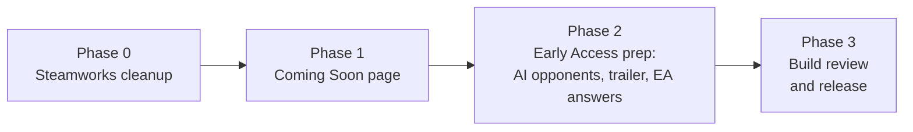

# Steam store page: plan

The plan for WAR-2D's Steam store page (app **1975300**), from "Coming Soon" through Early Access release. It was written on 2026-10-19 after a read-only look at the Steamworks dashboard. **Nothing in Steamworks has been changed yet.** Every Steamworks edit below is a step the owner approves first.

Owner decisions (2026-10-19):

| Topic | Decision |
| --- | --- |
| Store name | **War: Weaponry and Resources** (keep the existing name and fix the "Weaponary" typo; "WAR" is the acronym, and WAR-2D stays the build and repo name) |
| Release model | **Early Access** |
| Price | **Free to play, for good**: free in Early Access and at full release, and the Early Access answer says so (2026-10-22, after Valve asked for a pricing direction) |
| Single-player | **AI opponents are built** (roadmap update **v0.14**, 2026-10-24): **ready to list** Single-player and Co-op: Online once a build with v0.14 is the one Valve reviews (see §6) |
| Release date | **None set yet.** The dashboard keeps "To Be Announced" |
| Early Access length | **Roughly 18 to 24 months** (changed 2026-10-22 from "indefinite" after Valve asked for an estimate) |
| Trailer | **Claude makes it** (§4.2) |
| System requirements | **Best guesses for now** (§3.6) |
| Suicide bomber on the store page | Called the **Bomber** in all store text and art |
| Developer and publisher | **CoolCoder64** for both |

The owner's follow-up decisions (the last six rows) came the same day.

---

## 1. What Steamworks has now (2026-10-19)

The app was set up in June 2022 for an earlier 3D concept of the game. Most of the "Store Presence" checklist is ticked, but the content behind the ticks describes that old game, so ticked doesn't mean done.

**Store Presence checklist** (needed for Coming Soon and for release):

| Item | State | Note |
| --- | --- | --- |
| Basic Info | ✔ | Name misspelt ("Weaponary"). The platform boxes read as unticked on the edit form even though the checklist is ticked, so check them by hand |
| Descriptions | ✔ | **Old concept**: the Sahara, oil stations, mechanic huts, buggies, "3D", "3rd Person". Must be rewritten |
| Content Survey | ✔ | Answered for the old game, and the dashboard flags **new questions**. Redo it |
| Planned Release Date | ✔ | Jan 1, 2030, shown as "To Be Announced" (fine for Coming Soon) |
| System Requirements | ✔ | Re-check against the current build |
| Controller Support Description | ✘ | |
| 5 or more screenshots | ✘ | None |
| Capsule Images | ✔ | 2022 art for the old concept. Replace all of it |
| Library Assets | ✘ | 2022 files exist (`library_600x900`, `library_hero`, `logo`) but the item isn't complete |
| Support Info | ✔ | Email `weaponryandresourcesgame@gmail.com` |
| Developer and Publisher Names | ✔ | Confirm the names |
| Store Page Descriptive Tags | ✔ | 15 tags, chosen for the old game. Redo them |
| App Icon, Shortcut Icon | ✔ | Old art. Replace |
| Recommended: Cloud Saves, Achievements, Accessibility | ✘ | Accessibility is worth filling in (§3.7); the other two are out of scope |

**Game Build checklist:** done apart from **Trailer Uploaded** and **Store And Devcomp Packages Match**. Depots, launch options and the Windows depot are configured (v0.9).

**Packages:** a single store package, **"Tank Time" (713149)**, Hidden, **$10.99 USD**. That conflicts with the free-to-play decision (§5).

**Other:** "Search keywords" are deprecated, so leave them. Short description and long description are both old. Steam Next Fest **February 2027** (registration closes **10 Jan 2027**, the event starts 22 Feb 2027) and **June 2027** (registration closes 25 Apr, the event starts 14 Jun) are open.

**Release rules from the dashboard:** the store page needs a review (2 to 3 business days each time), the build needs its own review (3 to 5 business days, and must contain every feature the page describes), and the page must be visible as Coming Soon for **at least two weeks** before release.

---

## 2. Phases

| Phase | Work | Who | Done when |
| --- | --- | --- | --- |
| 0 | Fix the name, set Windows and Linux as the platforms, sort out the package for free to play (§5), delete or replace the old art and descriptions | Owner in Steamworks; Claude drafts | The dashboard describes WAR-2D, not the 2022 concept |
| 1 | Short and long description (§3.1 to §3.2), tags, players, languages, system requirements, controller description, accessibility, content survey with the AI disclosure, capsules, at least 5 screenshots, and ideally the trailer. Submit the store page for review | Claude drafts text, captures screenshots and makes the trailer; art through Figma; owner submits | Valve approves, the page is live as **Coming Soon**, wishlists open |
| 2 | AI opponents (v0.14, §6), the Early Access questionnaire (§3.3), the trailer if Phase 1 skipped it, library assets, final screenshots of the shipping build | Roadmap update + owner | Everything the page claims is in the build |
| 3 | Upload the release build to `default`, submit the build for review, choose the release date (at least 2 weeks after Coming Soon went live), release | Owner | The game is out in Early Access |

No release date is set yet: the dashboard keeps showing "To Be Announced" until the owner picks one in Phase 3. Phase 1 doesn't wait for AI opponents: a Coming Soon page can go up first so wishlists start piling up early. The Players field then leaves out Single-player until the AI ships (Steam asks for supported features only once they're released).

---

## 3. Store text (drafts)

### 3.1 to 3.3 Short description, long description and Early Access answers

The final wording lives in [docs/store/store-text.md](../../store/store-text.md), ready to paste; the drafts that used to be here are replaced by it. Two rules from the owner (2026-10-19) apply to all store text, the trailer and the art:

- **No counts.** No number of unit types, buildings, factories or players anywhere, since those will change. Units are described ("heavy armour", "artillery and snipers") rather than listed.
- **Price only in the Early Access answer.** That answer says the game is free and stays free at full release (owner, 2026-10-22); the descriptions, art and trailer still say nothing about price, and "Free to Play" is left out of the tags (Steam shows it from the price while the game is free).

### 3.4 Basic Info fields

- **App type:** Game. **Genres:** Strategy (primary), Indie, Free to Play, Early Access (Steam adds the last two from the release settings).
- **Platforms:** Windows, Linux + SteamOS. Not macOS.
- **Players:** Multi-player; PvP: Online; **Single-player** and **Co-op: Online**: **ready to list** (v0.14 built, 2026-10-24: a Private lobby against AIs is single-player and works without Steam; humans and AI allies can team up against AIs). Tick them when the uploaded build Valve reviews contains v0.14. Don't tick **LAN** or **Cross-Platform Multiplayer** until they're tested and visible to players (Direct/LAN needs the `-direct` flag today; Windows and Linux players meet over the Steam relay, which should be tested before ticking cross-platform).
- **Languages:** English (Interface). No audio language.
- **Supported features:** none of Achievements, Cloud or Workshop. Leave them unticked.
- **Steam Deck:** don't claim compatibility; the game needs a mouse and keyboard.
- **3rd party DRM / accounts:** none.
- **External links:** a privacy policy URL (§3.8). A website or Discord is optional.

### 3.5 Tags (the Tag Wizard picks up to 20; the first 5 to 7 weigh most)

RTS, Strategy, Multiplayer, PvP, Base Building, Top-Down, 2D, Pixel Graphics, Procedural Generation, Military, Tanks, Team-Based, Online Co-Op, Early Access, Real-Time, War, Destruction, Resource Management, Indie.

### 3.6 System requirements (best guesses)

| | Minimum | Recommended |
| --- | --- | --- |
| OS | Windows 10 64-bit; Ubuntu 22.04 or SteamOS 3 (64-bit) | Windows 11; a current Linux |
| Processor | 4 cores, 3 GHz | Ryzen 5 5600 class (6 cores) |
| Memory | 8 GB | 16 GB |
| Graphics | Vulkan or DX11, 2 GB VRAM | Radeon RX 6600 / GeForce RTX 3060 class |
| Network | Broadband internet connection | |
| Storage | 1 GB available space (the Linux build is about 230 MB) | |
| Notes | Hosting a large match uses more CPU than joining one; mouse and keyboard required | |

The recommended row matches the perf gate's reference machine. The minimum row is a guess that nobody has tested on a weaker machine; the owner chose to publish the guesses for now and revise them if players report problems.

### 3.7 Controller support and accessibility

- **Controller support description:** "Mouse and keyboard only. No controller support."
- **Accessibility:** Standard, Colourblind (Okabe–Ito) and High-contrast colour palettes that recolour units, buildings, the minimap and the UI; rebindable keys; adjustable master, music and effect volume; edge scrolling can be turned off. No subtitles are needed (there's no speech).

### 3.8 Legal lines, privacy and support

- **Developer and publisher:** CoolCoder64 (both fields). A Creator Homepage for CoolCoder64 is optional.
- **Legal lines:** © 2026 CoolCoder64. Third-party licences (Mirror, Steamworks.NET, FizzySteamworks, DOTween and the rest) go in an in-game credits screen or a `LICENSES` file in the depot, not here.
- **Privacy policy:** the game keeps the Steam ID on the server for the match only, saves settings and replays locally, and sends no analytics. A one-page policy saying so (hosted on a GitHub page, say) covers it.
- **Support:** the existing email. A Steam discussions forum is enough besides.

---

## 4. Graphics

### 4.1 Required images

Sizes as Steamworks listed them in 2025; **check the Graphical Assets tab before making them**, since Valve changes them now and then. No image may contain review quotes, awards, prices or discount text, and every capsule must show the logo or name.

| Asset | Size | Use |
| --- | --- | --- |
| Header capsule | 920 × 430 | Top of the store page, lists |
| Small capsule | 462 × 174 | Search results, lists |
| Main capsule | 1232 × 706 | Front-page carousel |
| Vertical capsule | 748 × 896 | Seasonal sales |
| Page background (optional) | 1438 × 810 | Behind the store page |
| Library capsule | 600 × 900 | Library grid |
| Library hero | 3840 × 1240 | Library page banner (no text) |
| Library logo | up to 1280 × 720, transparent PNG | Over the hero |
| Library header | 920 × 430 | Library, if separate |
| Community icon | 184 × 184 JPG | Community, chat |
| Client / shortcut icon | ICO (16 to 256 px) and a 256 × 256 PNG | Desktop shortcut, taskbar |
| Screenshots | at least 5, 1920 × 1080 or larger, 16:9 | Store page |
| Trailer | 1080p MP4 or similar | Store page; required by the build checklist |

### 4.2 How to make them

- **Key art and logo:** no in-game screenshots in capsules or library art: Valve rejects health bars, selection boxes and any other HUD in them (2026-10-22). The game's art is all generated (`RenderGen`, `EffectGen`, `Art/PixelIcons.cs`) and pixel art. The capsules should be built from the same generated sprites, scaled up by whole numbers so the pixels stay crisp, with a "WAR" wordmark as the logo. Store art goes through **Figma and the owner's approval** like any UI, then is exported at each size. The "nothing hand-made in Resources" rule doesn't cover store art (it isn't shipped in `Resources`), but staying with generated sprites keeps the look honest to the game.
- **Screenshots:** captured with the control API (`tools/war2d` screenshot) from a scripted dev-build match at 1920 × 1080 or 2560 × 1440, with the debug overlays and console off. Shot list:
  1. A large battle at a chokepoint (hundreds of units, splash and explosions).
  2. A base: HQ, Barracks, Heavy Factory, Miners on a gem vein, walls.
  3. Diggers tunnelling through rock to flank a wall.
  4. Fog of war, a Radar ping and a hidden bomb going off.
  5. The lobby with 8 players and teams.
  6. HQ placement with the private start options ringed.
  7. A zoomed-out generated map, lanes and expansions visible.
  8. The end screen statistics, or the replay viewer.
- **Trailer (60 to 90 s), made by Claude:**
  1. Script one or more matches in a dev build through the control API (`tools/war2d`: host, add bots, spawn armies, set resources, order attacks), with the recorder on.
  2. Play the recordings back in the replay viewer (no fog, free camera) and capture the window at 1920 × 1080, 60 fps, with `ffmpeg` (x11grab, or the PipeWire portal on Wayland). Capture short takes per shot: the screenshot list above, plus camera moves across a generated map.
  3. Cut the takes with `ffmpeg` to the game's generated music (`Assets/Art/Audio/music/`) and its sound effects. Gameplay in the first 5 seconds; title cards only for short feature lines ("Thousands of units", "Dig through anything", "Free to play") and the name and "Wishlist now" at the end.
  4. Export H.264 MP4 at 1080p (and a 5 Mbps preview), and a few 780-px GIFs for the long description. The owner reviews it before it's uploaded.
- **AI content:** `docs/art/ai-content.md` shows no AI-made art shipped. If any store art or music is AI-made, log it there and declare it in the content survey.

---

## 5. Free to play: what changes in Steamworks

- The paid package "Tank Time" ($10.99, 713149) can't be the store package of a free game. It needs a free package in its place, renamed to the game's name. Free packages on Steam are set up with Valve's help (the "free to play" release type and a free-on-demand package); **check Valve's current docs or ask Steam support** before changing anything, because a free app's packages behave differently from paid ones.
- That free package must include both depots, which also clears **Store And Devcomp Packages Match**.
- The content survey and the store page don't change for free to play. The Early Access answers make no promise about future pricing (§3.1 to 3.3).
- The game has no in-app purchases, so the In-App Purchases feature stays unticked. If cosmetics are ever sold, that's a separate decision with its own Steamworks setup.
- The Steam Direct app fee has already been paid (the app exists). Valve's rule is that it's refunded once a game earns US$1,000; a free game won't reach that, so the fee is a sunk cost.

---

## 6. AI opponents before launch (v0.14)

**Built (v0.14, 2026-10-24):** the host adds AI players in the lobby (Easy, Normal, Hard; Rusher, Turtle, Expander, Balanced or Random), a Private lobby is single-player without Steam, AIs play as allies or enemies, and a one-human match pauses from the menu ([design](2026-10-23-v0.14-ai-opponents-design.md), [gameplay](../../gameplay.md)). **Single-player and Co-op: Online are ready to list**; tick them once the uploaded build Valve reviews contains v0.14 (the build must contain every feature the page describes). How hard each level feels to a person is still tuned in the owner's playtests ([AI bench](../../perf/v0.14/ai-bench.md)).

---

## 7. Open decisions

1. **Steam Next Fest.** The Coming Soon page needs to be approved before **10 Jan 2027** to register for **Next Fest February 2027** (or 25 Apr 2027 for June). Next Fest requires a playable demo; check whether a free game can take part without a separate demo app.
2. **Whether to tick LAN PvP** once Direct is exposed to players without `-direct`.
3. **Where the privacy policy is hosted.**
4. **Whether the Suicide bomber is renamed in the game too.** The store says Bomber; renaming it in game (unit name, command card, docs) is a separate change.

Resolved on 2026-10-19: release date (none yet), Early Access length (indefinite; changed on 2026-10-22 to roughly 18 to 24 months), trailer (Claude), system requirements (guesses), the store name of the Suicide bomber (Bomber), developer and publisher (CoolCoder64), AI opponents (v0.14).

---

## 8. First store review (2026-10-22)

Valve failed the first store-page review. What it asked for and the fix:

| Failure | Fix |
| --- | --- |
| Header, small and vertical capsules, library capsule and library header use an in-game screenshot with UI (health bars and selection boxes) | New key art composed straight from the generated sprite atlases, with no health bars, selection or other HUD, through Figma for approval (§4.2) |
| Main capsule missing | Upload `main_capsule_1232x706.png` with **English** chosen in the language drop-down (Steam falls back to English, so a missing English image shows broken almost everywhere). Replace it with the new key art too, since it has the same health bars |
| Early Access pricing answer doesn't say which way pricing leans | "Free during Early Access and free at full release" |
| Early Access length and full-version answers too vague | "Roughly 18 to 24 months"; the full-version answer lists the planned features |
| "Fully playable online" (and "The core game is done") read as finished development | Current-state and Why-Early-Access answers rewritten to describe an early build that players help shape |

The new text is in [store-text.md](../../store/store-text.md). The new capsules are in `docs/store/art/v2/`, drawn by `tools/store/compose.py` (Pillow and numpy) straight from the atlases in `Assets/Resources/Art` with the existing wordmark; the library hero is redrawn the same way too (the old one had health bars, found by the mock store review); the logo and icons stay as they are. Also check that the app name in Steamworks is fixed: the review still calls it "Weaponary".

Before uploading, a mockup of the page ([docs/store/mockup/index.html](../../store/mockup/index.html), built by `tools/store/mockup.py`) went through two review agents: a Steam-reviewer persona and a player persona. Both passed it after two rounds. Their changes: a short description saying it's online multiplayer only for now, "Play with friends" moved up, Co-op left out of Players until the AI ships, screenshot 03 dropped, and the library hero redrawn (the old one had health bars).

**Saved in Steamworks on 2026-10-22, not yet submitted:** the Early Access answers, short and long description, all six capsules plus the library header and hero (English), and six screenshots (01, 02, 05, 04, 06, 07, all Gameplay and suitable for all ages). Players (Multi-player, Online PvP), system requirements, accessibility, languages and tags were already right. The owner checks the store beta page and marks the store page ready for re-review.

## 9. Checklist (for the owner, in Steamworks, once approved)

- [ ] Rename the app to "War: Weaponry and Resources"
- [ ] Developer and publisher: CoolCoder64
- [ ] Platforms: Windows and Linux + SteamOS, in both Steamworks settings and the store admin
- [ ] Package: replace "Tank Time" $10.99 with a free package containing both depots (§5)
- [ ] Short and long description (§3.1, §3.2)
- [ ] Tags (§3.5), players and languages (§3.4)
- [ ] System requirements (§3.6), controller description and accessibility (§3.7)
- [ ] Content survey, new questions included, with the AI disclosure
- [ ] Capsules, library assets and icons (§4.1)
- [ ] At least 5 screenshots; trailer
- [ ] Support info, legal lines, privacy policy URL (§3.8)
- [ ] Preview in store beta mode, then submit the store page for review
- [ ] Phase 2: Early Access answers (§3.3), AI opponents shipped, final screenshots
- [ ] Phase 3: release build on `default`, build review, pick the release date (≥ 2 weeks after Coming Soon)
